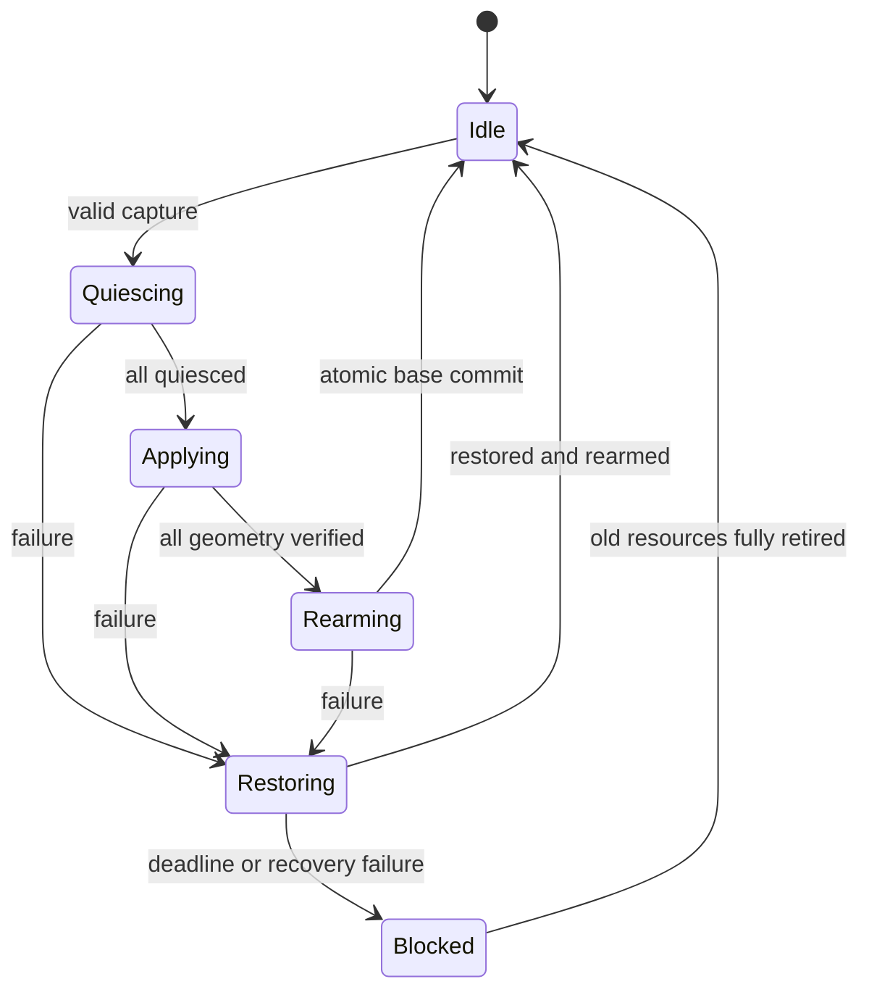

# 03 — 一括操作owner・失敗・Undo・保存境界

[入口](README.md) / [型とwire](01-contracts.md)。実装はsingle core worker上。SDK callbackを待ってMutexを保持しない。SSH ownerへlayoutの完了待ちを持ち込まない。

## 1. captureとadmission

`capture::capture_three(World, Ticket)`は、以下の順に検査し、一件でも失敗なら副作用を出さない。

1. Runtime Ready、activity visible、XR Focused、render未pause、同scene。
2. source commandのexpected_revisionとcurrent report一致。他operationなし。
3. mapped通常窓が3枚、全roleが一意、全window/session/targetが一致。diagnostic除外。slot leaseは現在Bound。
4. 各Create applied/no error、SDK binding非診断、native render target、frames>0、content_frame>=capture時のwindow.frame。
5. workspace placementのbound target、desiredとapplied pose/pose_command、physical desiredとapplied、logical/target/canvas尺寸が一致。
6. groupなし、drag/grab/resize/menuなし、IME無効、native pressed/pointer pressed=0。SDK側の操作状態は後述quiesceでも照合する。
7. 全Envelopeとsolver proposalがvalid、保存可能性・Undo capacityを事前計算。

初版でtarget setの一部だけを適用しない。window/app_id変更、slot変化、theme revision変化、logical/canvas/physical変化はcapture失効。frame増加だけは許可。

## 2. 既存SetPoseを連打しない理由

基準runtimeはSetPose成功で `workspace.remember` を呼び、rememberはdesired poseを保存する。従って3回のSetPoseでは途中成功を永続化し得る。

CWの適用中は `workspace_layout` report内のdesired poseだけをSDKが参照する。`workspace.windows[].placement.pose`、Preferences、slotを変更しない。rollbackの原本はcaptureしたbase poseで、適用途中SDK poseから再計算しない。

`core/workspace.rs`に次のinternal APIを追加する:

```text
prepare_layout_commit(capture, applied_proofs, operation_request)
  -> PreparedLayoutCommit
commit_layout(PreparedLayoutCommit) -> Result<SaveIntent, Reason>
```

prepareは全target・現revisionを再検証し、window placementとPreferencesのclone上に完成値を構築。各Placementへrequest(operation_request, desired)、acknowledge(current_target,Some(operation_request),observed_actual)を適用する。実geometry proofからのみacknowledgeする。途中のclone失敗では現状態を変えない。

commitは同core turnで全cloneをswapする。サイズ・slotは変更しない。保存対象は一意app_idの既存SavedPlacementだけ。runtime/app_id複数の配置はmemory-only。初版ではschema1を維持する。

## 3. 状態とeffect

pure modelは`Observation{scope_valid, geometry_unchanged, visible, native_neutral, current_input_epoch, current_targets, retire_evidence, acks}`とnowを受ける。実clock/I/Oは読まない。

| 状態 | 入口effect | 遷移条件 |
|---|---|---|
| Idle | なし | 完全なcapture成功→Quiescing |
| Quiescing | 全app入力gateを閉じる、focus解除、input_resetsを1回進める、SDK listener/control閉鎖を要求 | 全target quiesced、native neutral→Applying |
| Applying | overlay desired poseを公開。SDKが実geometryを検査 | 同roundの全Applied ACK→Rearming |
| Rearming | 新epoch/revisionのlistener準備要求。native gateは閉じたまま | 全InputReady、neutral、scope不変→Commit |
| Commit | 全base poseを一括反映、SaveIntent、UndoRecordを作る | 同turnでgate解除・completion、Idleへ |
| Restoring | first_failure保持、revisionとinput_epoch更新、旧listener退役、元baseへのoverlayを公開 | 生存targetのquiesce→geometry→input readyと喪失targetのretirement証拠→restored completion |
| Blocked | gate維持、捕捉対象とfirst/cleanup failureを保持 | 明示Stop/通常retirement後にだけ資源解放。新layout不可 |

Applying/Rearmingの途中poseは保存しない。ACK受理と表示成功と保存成功を一つのboolにしない。

Restoringの内部順序はsnapshotの各memberのquiesced/geometry_applied/input_readyで表現する。全生存member quiesced前はrestore poseを書かず、全geometry_applied前はlistenerをarmしない。RESTORE_MSは内部段階を含む合計deadlineで延長しない。

初版は全app入力を一時停止する。最大9一般化後も最初は全session入力停止で統一し、一部だけ動かしながら他窓でtypingする機能は別変更とする。

## 4. 同一tickの優先順位

```text
shutdown/session終了
  > scene/target/geometry/visibility喪失
  > SDK failure
  > 明示cancel
  > now >= deadline
  > 全ACKによるsuccess候補
```

ACKを先に処理してからtimeoutやcloseを確認してはいけない。同tickに最後のACKとwindow closeが来れば成功ではない。完全に同じduplicate ACKは既に受理済みであることを確認して状態を変えない。異なる値のduplicate、旧round、未要求stage ACKはStale。stale ACK単体で正当な新operationを取消さない。

apply/restore各roundのACK setは全TargetKeyをkeyにする。window単体、generation単体、slot単体で照合しない。request受付のACCEPTEDは非同期開始の意味。

## 5. deadlineとbounded recovery

Quiescing 2秒、Applying 5秒、Rearming 2秒。段階移行以外でdeadlineを延長しない。失敗したらRestoringの合計5秒を一度だけ開始。最大14秒は初期設計の上限で、実機性能保証ではない。

SDKが一枚だけ遅れても他の2枚を入力可能にしない。復旧に必要なgeometryが得られなければBlocked。sleep/scene喪失で時計を止めて待たず、scope失効として処理する。

非同期SDK callをcancelできなくても、その結果はoperation/round/full targetで失効する。成功結果が後着した場合、現targetへ転用せず、作成した実資源だけを元ownerに従ってdisposeする。

## 6. window/Surface/Sceneが変わった場合

### 6.1 一枚が消失

そのtargetへrollback commandを送らない。残る同targetの窓だけを元poseへ戻す。喪失targetはnative target不在、SDK bindingの正しいrelease、pending callback/Entity退役が揃うまで操作recordに残す。単なるwindow snapshot不在を回収証拠にしない。

新たに同slotへ来た窓をこのoperationのmemberへ追加しない。same WindowIdの新generationも旧captureとは別であり、旧ACKを採用しない。新targetは通常base配置で作成し、CWの旧roundが正常化または退役するまで入力gateを解除しない。

### 6.2 全Sceneが失効

旧SceneへTransformを適用し続けない。baseは変更されていないので新Sceneは従来のbaseから作成できる。旧operationは全旧targetの実退役を追跡し、current input epochをinvalidate。新Sceneのgeometry/normal input leaseを確認するまで解除しない。5秒以内に証拠が揃わなければBlockedのまま、通常Stopを利用する。

### 6.3 Stopを妨げない

Disconnect、shutdown、SurfaceLost、SDK release、renderer detach、既存cleanup ACKはlayout gateを迂回して処理する。BlockedでもStop可能。operationが持つTargetKeyはメタデータであってSDK/GL資源の独立所有参照ではない。CWの失敗をremote journalの成功へ変換しない。

全旧資源が回収された後はoperation記録をcompletionへ移し、新runtime/sessionへblockedを持ち越さない。旧runtimeのcallbackは新handleで受理しない。

## 7. geometry更新の排他表

| 操作 | CW実行中 | CW idle・管理済みtarget |
|---|---|---|
| SetPose/SetPoseControl/physical・logical resize | Busy | Undo失効、revision更新、geometry gate後に実行 |
| theme変更/import適用 | Busy | 全affected targetのrevision更新、通常generation変更も追跡 |
| group開始/展開/前面切替 | Busy | groupとCW overlayは同時所有不可。group側のgateと入力leaseを連携 |
| OpenTerminal/新app表示 | Busy（初版） | 通常起動。membership変更でUndo失効 |
| close/Disconnect/SurfaceLost | 実行しCWを中断 | 通常回収、Undo失効 |
| SetBackground/workload観測 | 許可 | geometryが変わらないことを検査 |
| save/settings切替 | 保存済みbaseの無関係設定だけ許可 | 保存laneで順序を保つ |
| pointer/key/focus/IME | NotReady | current epoch/revision/tokenで許可 |

SDK直接grabのようにnative command前に動き始めるUIも、04で無効化する。API側のBusyだけでは十分ではない。

## 8. 保存lane

既存 `take_pending_save` とmutex外Storeを使うが、CW SaveIntentに `save_revision` と `operation` を付ける。backlogは最後の完全なPreferences snapshotへcoalesceできる。ただし消したintentをsavedと報告しない。後のsnapshotに該当変更が含まれる場合だけ、同じ保存receiptから前のintentも完了可能。

最初の実装ではcoalesceを追加せず、既存単一ownerの逐次saveを使う方を採用する。Store.saveの前後にsnapshot revisionを結合したreceiptを返す。単なるreport.savedの増分を別operationの保存成功へ転用しない。

保存状態:

- `memory_only`: preferences rootがない。
- `skipped_ambiguous`: 全選択windowが同app_idの曖昧性で保存対象外。
- `pending`: 一意なSavedPlacementを含む完全snapshotの保存待ち。
- `saved`: 対応snapshotのwrite・file fsync・rename・directory fsyncとreadbackが一致。
- `failed`: I/O不明/失敗。runtime配置は維持してCW_SAVE_FAILEDを表示。

rename後directory fsyncが失敗した場合、「旧fileが必ず残る」と言わない。diskはold/newのどちらもあり得るので、保存成功とはせずreadback/retry対象にする。再試行はユーザーが明示した現在base revisionだけ。バックグラウンドで古いoperationのsnapshotを新配置へ上書きしない。

## 9. Undo

成功commit後に `UndoRecord{runtime, session, scene, operation, revision, targets, old_base, new_base, geometry_capture}` を一つ保持。

同target、同new_base、同controls/canvas/logical/physical、同membership、同revisionの場合だけ有効。frame更新は失効条件にしない。手動move/resize、new window、group、theme変更、scene/generation、次layout成功で失効する。

Undoも通常operationとしてquiesce→apply old_base→rearm→commitを実行。Undo開始で元UndoRecordは再実行不可にし、再送から二重反転しない。Undo失敗時は開始直前base（元layout適用後の配置）へ戻す。UndoのUndoによるredoは初版に含めない。

同app_id複数窓でも接続内Undoは利用可能。永続復元の制約とは別。

## 10. runtime統合の順序

1. native commandをvalidate。
2. 起動/終端/scene・compositor・renderer観測を更新。
3. 現在CW captureの失効を評価して必要ならgateを先に閉じる。
4. ACKを検証しstate machineへ一回渡す。
5. effectを実行。全geometry証拠がある場合だけprepare/commit。
6. global/target input gateをsnapshotへ反映。
7. immutable snapshotをKotlinへ公開。
8. state lockを解放して保存I/O。結果はoperation/save revision付きでownerへ戻す。

参考となる既存APIはREADMEに列挙。group ownerのClockは可視時間の論理時計を持つが、CWは同じ時計をコピーしない。CWのdeadlineは本書のmonotonic経過時間。


