# 08 — 小さい実装単位と引継ぎ

[入口](README.md)。全票は設計時点で **not_started**。実装者は一票を完了して止まり、次票を自動で実装しない。許可fileに加えて、必要なmodule登録とその票に直結するtestだけ変更可。範囲外の修正が必要なら理由と差分を引継ぎに残し、既存成功gateを緩めない。

## 1. 依存DAGとPRの境界

```mermaid
flowchart LR
  T00[CW00 baseline] --> T01[CW01 contracts]
  T01 --> T02[CW02 geometry]
  T01 --> T03[CW03 state machine]
  T02 --> T04[CW04 capture]
  T03 --> T04
  T04 --> T05[CW05 batch commit]
  T01 --> T06[CW06 Kotlin codec]
  T06 --> T07[CW07 input lease]
  T07 --> T08[CW08 SDK controller]
  T05 --> T09[CW09 integration]
  T08 --> T09
  T09 --> T10[CW10 normal geometry]
  T10 --> T11[CW11 UI and Undo]
  T11 --> T12[CW12 Flat acceptance]
  T12 --> T13[CW13 presets]
  T13 --> T14[CW14 storage]
  T14 --> T15[CW15 migration]
  T15 --> T16[CW16 reference]
  T16 --> T17[CW17 temporary Hybrid]
  T17 --> T18[CW18 preset acceptance]
  T06 --> T19[CW19 Cylinder API probe]
  T19 --> T20[CW20 Cylinder lifecycle]
  T20 --> T21[CW21 Cylinder input]
  T12 --> T22[CW22 plain foot]
  T21 --> T22
  T22 --> T23[CW23 decorated geometry]
  T18 --> T24[CW24 Hybrid integration]
  T23 --> T24
  T24 --> T25[CW25 long session]
```



CW01〜08は純粋model/codecまたは独立adapterのdraft実装で、通常入口を作らない。**最初の利用可能なPRの完成範囲はCW01〜12**。全て一度の大きな生成で書くという意味ではなく、同じfeature branchの小さな検証済みcommitへ分ける。

別PRに分ける場合、CW01〜08の単体PRは「内部基盤・未接続」とし、成功stubや通常UIを含めない。CW09のcompile/wire接続は一人が統合する。CW19〜21はdebug-only別branchとして並行可能。製品有効化はCINPUT/CLIFE等の依存成立後。

手動Phase 0の比較が未実施でも、独立した型・数学・negative testsを止めない。人間受入れのstatusはnot_runで保持し、完成を偽装しない。

## 2. 作業票

### CW00 — baseline・禁止境界を記録

- 読む: README、上位計画1/2節、最新AGENTS.md、関連PR/CI。
- 作る: 作業用checkpointに基準SHA、変更された関連source、CI failure、実機可否を記録。
- 許可: 本作業の実装票を始める前の調査記録のみ。
- 禁止: 上位planの過去CI成功を新実装の成功とすること。
- 合格: 実装用branchが最新mainまたは明示したdependency headから作られている。
- 既存fmt失敗は別修正単位へ分離。今回の文書作成で直したことにしない。

### CW01 — 型・validation

- 依存: CW00。読む: 01。
- 許可: model/workspace_layout/mod.rs、wire.rs、model/lib.rs、対応unit test。
- 入出力: RoleTarget/CapturedPanel/LayoutParams/GeometryRevision/Reasonとpayload DTO。
- 手順: IDs→bounds→strict DTO→fixture decoderの順に作る。runtime Commandへはまだ接続しない。
- 合格: wire-v1の正常/異常caseを通し、nested duplicate・位置array・enum objectを拒否。
- 禁止: 他backendのJSON canonicalizerへfloat対応を足す、COMMAND_BYTESを上げる。

### CW02 — 3枚solver

- 依存: CW01。読む: 02、geometry fixture。
- 許可: geometry.rs、同module tests。
- 手順: reference抽出→非対称Envelope角→全pose→f32再検証。
- 合格: 07のgeometry必須test、1m幅3枚のNO_FIT、yaw90°とq/-q。
- 禁止: sizesの自動縮小、gap clamp、SDK呼出、保存I/O。

### CW03 — 純粋operation state machine

- 依存: CW01。読む: 03、lifecycle fixture。
- 許可: operation.rs、同module tests。
- 手順: Observation/Effect→clock/deadline→ACK sets→failure precedence→restore→completion。
- 合格: 同tick timeout優先、old target/round拒否、counter overflow、first_failure latch。
- 禁止: std::time::Instantをmodelが直接読む、Fake cleanup successを実ownerへ接続。

### CW04 — current世界のcapture

- 依存: CW02/CW03。読む: 01/03、core/workspace、panels、window_slots、group owner。
- 許可: core/workspace_layout/capture.rs、mod.rs、fixture tests。
- 入出力: World + Ticket → Capture/Reason。正当なwindow集合からのみ作る。
- 合格: R01/R03/R04/R05、diagnostic・旧SDK binding・frame総数流用拒否。
- 禁止: app_id/title/slotだけで同windowと判断、FootOriginの別実装。

### CW05 — 一括commitと保存receipt

- 依存: CW04。読む: 03の2/8節、既存workspace/preferences。
- 許可: core/workspace.rs、preferences.rs、CW owner/save tests。
- 手順: PreparedLayoutCommitをclone上で検査→一括swap→save revision付きI/O receipt。
- 合格: R02/R06/R11/R12/R13、旧Preferences schema/bytes互換。
- 禁止: SetPose連打、ACK前remember、3つのfileへ個別保存、save失敗で配置rollback。

### CW06 — Kotlin DTO

- 依存: CW01。読む: 01/04。
- 許可: WorkspaceLayoutProtocol.kt、WorkspaceLayoutPresentation.kt、JVM tests。
- 合格: strict raw vector、schema/ID/unknown state拒否、UnownedとPendingの区別。
- 禁止: Kotlin solver、mutable JSONObjectのbinding正本、parse失敗のlegacy降格。

### CW07 — immutable input lease

- 依存: CW06。読む: 04の2/4/5節、InputAdapter、Host InputTarget。
- 許可: PanelInputLease.kt、InputAdapter.kt、Hostのticket/sendPointer境界、JVM tests。
- 手順: callback時にlease capture→queue前後check→geometry_revisionを送る。
- 合格: 旧listener/receiver/epoch/revision拒否、drag別面UV、held source再arm。
- 禁止: callbackで最新ticketを取り直す、旧TargetKeyをupdateTargetで新窓へ転用。

### CW08 — SDK transaction controller

- 依存: CW07。読む: 04、SpatialPanelAdapterのapplyGroup/acknowledgeGroupを参考。
- 許可: WorkspaceLayoutSdkController.kt、SpatialPanelAdapterへの薄いdelegate、JVM Fake tests。
- 合格: 全quiesce前のTransform書込み0、実probe→ACK、failure/late futureの回収。
- 禁止: component値だけのApplied ACK、固定sleepによる完了、成功stub。

### CW09 — Rust/Kotlin wire統合

- 依存: CW05/CW08。読む: 01/03/04。
- 許可: commands.rs、core CW owner、runtime.rs、diagnostics.rs、Host、SDK adapter。
- この票だけは接続点が多いため、同branchでA=parse/dispatch、B=report/ACK、C=gate/receiptの3commitへ分ける。未接続tagはNotReadyで明示拒否し、ACCEPTED stubにしない。
- 合格: 全command matchが網羅、R01〜R08/R14〜R16、UI未公開、runtime Stopが常に進む。
- 禁止: shutdown/disposal commandをlayout Busyで拒否、lease/journal変更。

### CW10 — 通常geometry経路の回帰

- 依存: CW09。読む: 01の5節、03の7節、04の6節。
- 許可: runtime geometry gate、InputAdapter/Host、SDK通常move/resize/groupのlease再arm、tests。
- 合格: 管理済みtargetで普通のmove/resize/group後も入力可能、旧epoch/revisionは不可。
- 禁止: CW終了でgeometry_revisionを消してlegacy Pointerを再許可する。

### CW11 — UIと一段Undo

- 依存: CW10。読む: 03の9節、04の7節。
- 許可: WorkspaceLayoutUi.kt、ControlPanel.kt、Host submit/receipt、Undo tests。
- 合格: 3窓selector、Apply/Cancel/Undo、保存結果の分離、Undo失効、focus空。
- 禁止: focusだけで自動中央移動、window titleによるbind、ACCEPTED=完了表示。

### CW12 — Flat統合と最初のPR受入れ

- 依存: CW11。読む: 07。
- 許可: debug WorkspaceLayoutSdkCase、既存quest-check登録、host/JVM回帰tests、結果文書。
- 合格: 必須test件数>0、host/Android同head、Q01〜Q05と全回収の実証拠。
- 未実機ならUI公開/製品合格をしない。ただし作成済みcodeとhost/JVM結果は引渡せる。
- PRにはsource SHA、fixture数、skip、未確認HMD/物理入力を明記。

### CW13 — 1〜9枚とpreset solver

- 依存: CW12。読む: 02の5/6節、05の6節。
- 許可: geometry.rs、role binding model、property tests。
- 合格: Flat/Fan/Arc/Customの違い、上下段のelevation極値、manual固定、穴保持。
- 禁止: 9枚なら必ずfitというassert、4cornerだけの一般姿勢判定。

### CW14 — 保存schema2とfile store

- 依存: CW13。読む: 05の1/2/3節。
- 許可: 新model/workspace_layout/storage.rs、core preferences I/O共通化、tests。
- 合格: exact schema、二重poseキー禁止、64KiB/16件、原子的old/new、readback。
- 禁止: 2file transaction、壊れたv2→v1 fallback、無断migration。

### CW15 — migration/明示restore UI

- 依存: CW14。読む: 05の3/4節。
- 許可: workspace store選択、migration controller、UI、tests。
- 合格: legacy不変、exclusive初回publish、失敗再開、同app複数抑止、auto launch0。
- 禁止: 旧absolute world poseを新Sceneの同じ部屋位置とみなす。

### CW16 — viewer once/recenter

- 依存: CW15。読む: 05の5節。
- 許可: report schema2、reference capture command、Kotlin viewer adapter、tests。
- 合格: request/scene/deadline照合、一回capture、全窓共通剛体変換。
- 禁止: head常時追従、Android/Rust時刻起点の直接比較、stale poseの再署名。

### CW17 — Bring Here / Return

- 依存: CW16。読む: 05の7/8節。
- 許可: temporary overlay owner、command/UI、tests。
- 合格: 2窓pose交換、サイズ差NO_FIT、base保存不変、nested操作拒否、scene失効。
- 禁止: window複製、slot交換、temporary中のremember。

### CW18 — preset/Hybrid Flat受入れ

- 依存: CW17。読む: 07の5/6/7節。
- 許可: 固定SDK cases、migration crash tests、結果文書。
- 合格: 1/3/6/9、手動調整、増減、restore、Return、回収。9枚の視認は別評価。

### CW19 — Cylinder API compileと固定pattern

- 依存: CW06のみ。読む: 06の1〜4節。
- 許可: debug CurvedPanelSdkCase/CylinderProbeController/CylinderProbeEvidence、検証文書。
- 合格: CAPI/CIMAGE、SDK pin保持、Flat/Cylinder patternの実証拠。
- 禁止: 通常Workspace・SSH・profile・Preferences変更。

### CW20 — Cylinder Surface lifecycle

- 依存: CW19。読む: 06の4/10節。
- 許可: debug probeのshape/resize/retire cases、validator。
- 合格: CLIFE。Surface同一性、callback、新旧producer、Activity境界を別観測。
- 禁止: reshapeは必ずSurface維持という仮定、old generationの再利用。

### CW21 — Cylinder UVと遅延入力

- 依存: CW20。読む: 02の7節、04の4節、06の2/4節。
- 許可: debug grid oracle・callback試験、math tests。
- 合格: CUV/CSTALE、world/local/pivot/UV原点が実測で確定。
- 不成立: 非interactiveのまま。代替re-hit/scene object交換は別レビュー・別commit。

### CW22 — plain foot Cylinder

- 依存: CW12/CW21。読む: 06の5/6節。
- 許可: PanelGeometry model、panel creation DTO、SDK shape生成、固定foot受入れ。
- 合格: CINPUT/Q08、logical/physical/radius独立、old target拒否、全回収。
- 禁止: renderer刷新、任意remote app追加、動的shape animation。

### CW23 — 装飾canvas・曲面collision

- 依存: CW22。読む: 06の7/8節。
- 許可: CurvedBodyHitMesh、canvas transform、controls tangent、math/SDK tests。
- 合格: 非対称offset golden、本文とvisualの9/25点一致、二重collision0、CTHEME。
- 禁止: 非一様Scale、canvas pixel UVをbody UVとして送る。

### CW24 — Hybrid Cylinderと保存統合

- 依存: CW18/CW23。読む: 05のshape契約、06。
- 許可: shape保存、geometry owner、normal adapter、fallback UI、tests。
- 合格: Flat設定互換、unsupported shapeの明示拒否、SurfaceGeneration交換、Return。
- 禁止: 保存Cylinderを黙ってFlatへ書換え、回収失敗時の再生成。

### CW25 — 長時間・最終採否

- 依存: CW24。読む: 07の6〜9節、上位計画の可読性/性能。
- 許可: 固定性能case、private evidence validator、結果文書。
- 合格: CPERF/Q10〜Q12、負荷・温度・資源・作業UXを別測定し採用判断を記録。
- 禁止: 一回の快適という感想だけで全物理・性能gateをpassにすること。

## 3. そのまま使える開始prompt

```text
tin-machine/eidolon-waylandでCurved Workspaceの作業票 <CW番号> だけを実装してください。
主な入口は docs/curved-workspace/README.md と docs/curved-workspace/08-work-items.md です。
最初に最新main、関連PR/CI、AGENTS.mdを確認し、依存票の実装commitと受入れ証拠を確認してください。
この票の「読む」文書と許可sourceを先に読み、型・wire・reason・状態遷移・fixture期待値を変更しないでください。
新規APIは設計であり、既存sourceに存在すると推測して呼ばないでください。
一つの票を小さなcommitへ分け、最初に純粋test/否定testを作ってから製品配線へ進めてください。
依存が未完ならACCEPTED/ready/cleanup successのstubを作らず、独立部分だけ実装し未接続を記録してください。
input epoch、full TargetKey、geometry revision、SDK/native回収、slot/lease、SSH/process owner/journalを弱めないでください。
幾何fixtureの期待値をSUTで再生成しないでください。test filter 0件やskipを成功扱いしないでください。
最大3回の失敗した修正試行の後は範囲を広げず、初回原因・試した差分・残件を引継ぎ記録へ残してください。
完成しなかった変更を成功として製品入口へ有効化しないでください。
実行できた検査と未実施の実機/物理確認を分け、同headのCIを確認して独立PRを作成してください。
マージと次票への着手は行わないでください。
```

`<CW番号>`を具体的な一票へ置換する。全文書をpromptへ貼るより、その票の指定節と実sourceをcontextへ入れる。contextが足りなくなる前に下のcheckpointを更新する。

## 4. 引継ぎtemplate

```text
Task: CWxx
Status: not_started | in_progress | host_verified | sdk_verified | blocked | complete
Baseline / branch / head:
Dependency task -> verified commit:
Contract sections read:
Allowed files / actual changed files:
Implemented functions:
Tests: command / actual count / pass / fail / skip
CI: same-head run/job and result
Quest: case / SDK / OS / evidence path / not_run reason
First failure:
Attempt 1/2/3 and measured outcome:
Cleanup result (separate from original failure):
Remaining gate:
Next exact function/test:
Production entry enabled: no/yes + evidence
```

completeはその票の範囲だけ。host_verifiedをsdk_verifiedへ自動昇格しない。recordへcredential/endpoint/title/本文/室内画像を入れない。通常artifactの保存場所は実装時の作業規則に従う。

## 5. 最終レビュー時の機械的な確認項目

1. docs-onlyの本変更を実装済みと書いていない。
2. new Commandをparse/request_id/dispatchから漏らしていない。
3. overlay適用中にworkspace.rememberへ到達しない。
4. listenerがcallback時に新ticketを取り直していない。
5. Key/IME/controlsにinput gateの抜け道がない。
6. rollbackに別revisionがあり、全復旧ACK前に入力を開けない。
7. Stop/retirementをblockedが妨げない。
8. save receiptが別operationへ流用されない。
9. 型・Fixture・契約が複製されず単一正本を参照している。
10. 成功のUI表示がactual completion / storage outcomeを区別する。

completion outcomeの選択は、通常成功=applied、明示cancel後の正常復旧=cancelled、その他failure後の正常復旧=restored、復旧不成立=blocked。first_failureにはcancelを含む元の理由を残す。
