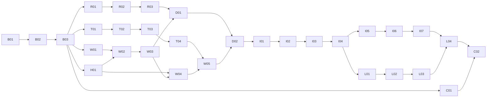

# 残フェーズの詳細設計と実装の入口

設計日: 2026-11-04。基準revision: `76baac2ca860aeb89bd51d61a23084e2fe88b285`。
引継ぎ先はユーザー指定の **Codex Sol**。設計はモデルの世代に依存しない。

2026-11-06の追加依頼: [テーマ・独立アニメーション・作業負荷](theme-animation.md)をPhase 6完了より先に実装する。
元の31タスクの受入条件は維持し、追加分TH00〜TH05の進捗を同文書で管理する。

これは製品実装前の契約であり、Phase 1〜6全体の実機成功記録ではない。Phase 0の[実測記録](../phase-0-troubleshooting-20261104.md)に加え、独立debug APKによる[Native事前検証](../native-preflight-20261104.md)がある。そこに記載された部分的な成立確認を再利用し、31タスクの残る受入条件を省略しない。

## 読む順序

次の拡張は[Termuxの必要時起動・Linux GUI・ウィンドウ装飾と操作の計画](../next-phase-termux-startup-linux-gui-plan-20261107.md)にまとめた。
2026-11-07時点では相談段階で、実装開始待ち。既存taskの受入れ条件と状態は変更しない。
同日の追加要望で、[次期拡張の実装順](../next-phase-termux-startup-linux-gui-plan-20261107.md#implementation-order)を概算コスト順へ改訂した。
入力停止理由の表示と[foot内のかな漢字変換](../japanese-input-plan-20261107.md)を加え、本文の節番号と着手順を分ける。
[Quest全体のメトリクス・IP取得の調査](../quest-device-metrics-plan-20261107.md)も同計画の補足として参照する。
[左下のアプリランチャー・file指定・設定fileの計画](../application-launcher-plan-20261107.md)も相談段階の拡張として参照する。
[Ubuntu等のremote Linux GUI拡張案](../remote-linux-gui-plan-20261107.md)では、接続先profile・Linux helper・LAN性能の検証方針を扱う。

1. 本書で到達点とタスク順を確認する。
2. [共通契約](contracts.md)で識別子・thread・JNI・エラー・上限を読む。
3. [tasks.json](tasks.json)から依存が満たされた一つのタスクを選ぶ。
4. その`spec`の節だけを中心に実装する。[根拠一覧](sources.md)は該当APIを確認するときに読む。
5. [検証と記録](phase-6.md)に従って結果を残し、次のタスクへ進む。

古いphase文書は調査経緯と広い要件、本directoryは今回選んだ実装契約の正本。矛盾を見つけたら両方を更新する。実機で否定された契約は、失敗証拠と変更理由を残して改訂する。

| 文書 | 決めること |
| --- | --- |
| [Phase 0残作業・1](phase-0-1.md) | Cargo/Gradle、JNI、診断、SDK Surface、EGL、helper配置 |
| [Phase 2](phase-2.md) | APK専用鍵、host key、russh、exec、StreamLocal、remote launcher |
| [Phase 3](phase-3.md) | Smithay移植、protocol、SHM、安全なcopy、Waypipeの両端 |
| [Phase 4・5](phase-4-5.md) | 所有済み画像の描画、座標、入力、resize、二枚表示、保存 |
| [Phase 6](phase-6.md) | 寿命・停止・復旧、テスト行列、CI、実機合格の証拠 |

## 到達点を三つに分ける

- **描画PoC:** Termuxのfoot一枚が、APK内Wayland→Rust renderer→SDK Surfaceを通って現実背景の前に表示される。キーボード入力はまだ別判定。
- **操作MVP:** 一枚のfootへ物理キーボード・コントローラー入力、論理resize、明示的な切断/新セッション開始が通る。ネットワークを切ってもQuest内通信で動く。
- **拡張完了:** 二枚の独立したwindow、focus、配置・背景保存、popup/clipboardの規定範囲、耐久試験が通る。

IME、DMA-BUF、AHardwareBuffer、GPU zero-copy、湾曲パネル、手追跡、Waypipe既存セッションへの再接続、Quest内Codexはこの順路の必須条件にしない。省いた要件は消さず、各phaseの後続欄へ残す。

## 今回固定した判断

| 判断 | 理由・変更した境界 |
| --- | --- |
| 実証済みJDK 25 / compileSdk 36 / min・target 34 / SDK 0.15.0を維持 | 未検証のOS/API更新をnative導入と混ぜない |
| Meta Gradle pluginを再導入しない | 組込みcomponentで開始できる。独自componentが必要になった時だけ互換問題を扱う |
| Rustはmodel・protocol・transport、KotlinはSDK/Android adapter | 状態の正本を一つにする |
| protocol/model ownerとGL ownerを最初から分ける | `eglSwapBuffers`待ちがdispatch・入力・停止を止める設計を避ける。CPU copyとメモリー上限を明示する |
| Smithay GlesRendererには所有済み画像を`ImportMem`で渡す | `WlBuffer`・共有pointer・GL objectをthread間で移動しない。以前の単一owner案をこの設計では置き換える |
| SDKパネルのSurfaceの所有者はSDK | `Surface.release()`をadapterから無条件に呼ばない。Rustが追加取得したNativeWindow参照だけを解放する |
| APK UIDのhelper起動を早期gateにする | Termux/ADB shellで実行できても製品の実行制約は検証できない |
| 新しいアプリ専用SSH鍵を使う | PC開発用秘密鍵をAPKへコピーしない。初期pairingは承認済みADBで公開情報だけを交換 |
| SSH切断後は新しいWaylandセッション | 未検証の作業内容保持を約束しない。古い子プロセスは所有範囲内で終了する |
| 画面・文字入力を通常診断へ入れない | 状態、世代、回数、遅延だけで再現条件を追えるようにする |

これらは採用する設計判断であり、性能や移植成功の実証ではない。特にSHMのSIGBUS保護、Android EGL adapter、helper exec、SDKの入力/Surface通知は先行gateで実機判定する。

## 実装順



タスクは一覧順に進めればよい。図の分岐は依存がないことを示し、自動で別agentを起動する指示ではない。runtimeを扱わないC01は早めに実施できる。実機gateが未実施でも独立したhost作業は進め、依存する統合だけを待つ。

## Solに渡す最初の指示

```text
適用されるAGENTS.md（存在する場合）とdocs/design/README.md、contracts.mdを読んでください。
docs/design/tasks.jsonのB01から、一つのタスクずつ実装してください。
現在のコードとGit状態を確認し、各タスクのfiles・spec・checks・done_whenに従ってください。
仕様名はEidolon独自の契約であり、SDK/crateの実在API名とは区別してください。
未作成のscriptはtasks.jsonの作成タスクを先に実施し、存在するふりで実行しないでください。
実機が必要な判定はnot_runで残し、host build成功で置き換えないでください。
失敗したコマンド・仮説・変更・再試験結果を残し、同じ失敗を条件変更なしに反復しないでください。
既存のmain反映方針と作業root設定を引き継いでください。
```

同じ会話ならモデル選択で利用可能なSolへ切り替える。CLIでは`/model`が入口である。[公式Models](https://learn.chatgpt.com/docs/models)はUI/CLIの選択方法を説明している。世代・利用可否はaccount/clientによって異なるので、設計書に特定のSol IDや料金を固定しない。今回確認したローカルCLIは0.155.1で、モデル設定自体は変更していない。

別会話でもこのrepositoryだけで再開できる。実装者は[進捗記録](../progress.md)にtask ID、commit、検証結果、残件を更新する。会話の記憶を完了証拠にしない。`tasks.json`は設計時すべて`planned`で開始し、実装検証に合わせてstatusを更新する。

2026-11-04の実装開始後、ユーザーはHMD視認・物理入力の確認を最終段階にまとめると指定した。自動部分の成立を確認したtaskから後続実装・ADB試験を進めてよい。手動部分が残るcheck全体は`not_run`、taskは`in_progress`として残し、最終受入れまで`done`へ変更しない。

## 実装中の判断と引継ぎ

通常の命名、内部関数分割、既存APIに合わせる局所的な修正は実装者が進める。契約の型・所有者・セキュリティ・合格条件を変える場合は、変更理由と影響taskをこのdirectoryへ反映する。

SDK APIが存在しない、APK UIDでhelper実行不可、SIGBUS保護がruntimeと衝突する、鍵検証を維持できない、停止不能なGL待ちが再現する場合は、該当gateを`needs_design`として証拠を残す。無関係な作業まで中止せず、依存のないtaskを進める。別方式への全体変更やOS設定の一括緩和を成功扱いのために行わない。

設計の構造確認は`python3 scripts/check-design`。このscriptはtask依存・参照・必須欄を検査し、Android/Quest動作は判定しない。
