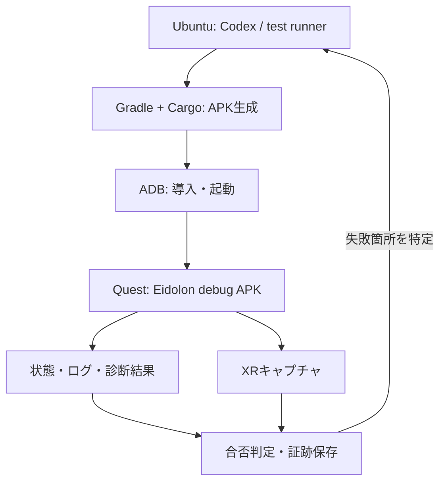

# Eidolon Wayland — 開発自動化・デバッグの調査と実装方針

**状態:** 一次資料・実装ソースの調査／Eidolonへの組込みとQuest実機検証は未実施  
**調査整理日:** 2026-11-03  
**対象:** Ubuntu 26.04上のCodex CLI・Gradle・Cargoから、開発用Quest 3を操作する環境  
**関連:** [Phase 0の環境構築](phase-0-development-environment.md) / [実装計画](implementation-plan.md) / [Phase 6の検証](phase-6-rust-lifecycle-testing.md)

## 位置付けと読み方

**ビルド → APK導入 → 起動 → 状態・ログ・画像の取得 → 判定 → 修正・再試行**を、開発PC側から自動化するための参照文書とする。デバッグ方法や実機テストを設計・変更する際は、まず本書の対応範囲と未検証条件を確認する。個々のフェーズの機能要件・完了条件は各フェーズ文書を正本とし、共通の操作方法・証跡・ツール制約を本書へ集約する。

自動化ツールの初回調査ではGitHubの`main`を`6cef07274d07f110d2aa5f11495cbe72313ca43f`で確認した。今回の接続計画の追記では`9f840ee21718393049f332d9de967fcecf395162`を確認し、USBでの初期検証から、給電＋Wi-Fiでの更新検証へ進む方針を具体化した。リポジトリは設計文書のみであり、APK、Rust実装、自動テストスクリプト、実機成功記録はまだない。以下のコマンドは公式資料に基づく**導入後の手順例**で、実行済みの記録ではない。

記述の確度を次のように区別する。

| 区分 | 意味 |
| --- | --- |
| 資料で確認 | 公式ドキュメント・上流ソースに機能やコマンドがある。Eidolonでの成功を意味しない |
| Eidolonへの提案 | 診断イベント、debug操作、smoke testの構成など、このプロジェクト向けの設計案 |
| 実機で確認する事項 | Quest OS／SDK版、APK構成、ユーザー設定等に依存し、まだ検証していない組合せ |

**通常利用時のQuest単体動作は維持する。** Codex、ADB、Meta VR CLI、MCP、開発用SSH、実機CIは開発・検証用であり、製品実行時の依存にはしない。Kotlin adapter＋Rust coreという責務分担も変えない。

### 目的別の入口

- 導入・起動・ログ取得：[ADBの基本操作](#adbの基本操作)
- 画像で起動状況を確認：[キャプチャと起動確認](#キャプチャと起動確認)
- 2D UIの操作：[Android入力とUIテスト](#android入力とuiテスト)
- Codexと公式Metaツール：[Codexとの連携](#codexとの連携) / [Meta VR CLI](#meta-vr-cli)
- コントローラー・head pose等：[XR入力の自動化](#xr入力の自動化)
- 安定した判定と最初の実装：[debug buildの観測と操作](#debug-buildの観測と操作) / [実機smokeの実装案](#実機smokeの実装案)
- 接続方法と実行環境：[USB以外の接続と実機CI](#usb以外の接続と実機ci) / [無人運用とライフサイクル試験](#無人運用とライフサイクル試験) / [Simulatorの使い分け](#simulatorの使い分け)
- いつ実装するか：[フェーズへの組込み](#フェーズへの組込み)

## 自動化できる範囲

下表の「可能」はツールの機能または設計上の実現方法を示す。**このプロジェクトのQuest実機での合格判定ではない。** 根拠と条件は後続の各節に記載する。

| 作業 | 方法・自動化の範囲 | 境界・残る検証 |
| --- | --- | --- |
| APK／Rustのビルド | Gradle wrapper、Cargo、cargo-ndk、host CI | SDK／NDK／ABI／native同梱の整合を確認 |
| APK導入・更新・起動・停止 | ADB、Meta VR CLI | 初回のDeveloper Mode／USB信頼設定は人が行う |
| 起動診断 | Activity起動結果、PID、logcat、dumpsys | 起動成功とXR描画成功は別 |
| ファイル転送 | `adb push`／`pull`、TermuxへのSSH | Android UID・private storageの制約は残る |
| Androidのtap／swipe／key入力 | `adb shell input` | 2D座標の入力。XR ray／6DoFの代用とは限らない |
| 設定UIの要素選択・待機 | UI Automator、instrumentation、`metavr ui` | accessibilityに依存。GLES内のLinux GUIは自動で要素化されない |
| スクリーンショット・動画 | ADB、`metacam`、内蔵capture、MQDH | XR合成・passthrough・layerが写る範囲を実機照合 |
| Codexによる画像・ログの確認 | ローカルコマンド、画像入力、Meta MCP | 画像理解だけを唯一の合否判定にしない |
| モデル・接続・描画の回帰 | Rust host test、debug診断、実機smoke | 独自診断は未実装。各境界の成功を分けて報告 |
| XRのpose／controller／hand入力 | XR Operator、Tapedeck等を評価 | Ubuntu＋Spatial SDK＋非root Questへの統合は未検証 |
| 性能・長時間試験 | app counters、dumpsys、Metaの性能ツール | capture負荷・装着状態・温度・OS版を記録 |
| 装着時の最終品質 | HMD内での人による確認 | 文字の可読性、奥行き、快適性、実コントローラー／手追跡は残る |

## 推奨する開発ループ

基本経路はUbuntu上の**Gradle＋Cargo＋ADB**とし、Quest固有の観測に**Meta VR CLI**を追加する。まずUSB接続で一回のsmoke testを再現可能にし、その入口をCodexが呼べるようにする。その後、QuestのUSB-Cを充電器につないだまま、Wi-Fi経由でAPK更新・起動・観測を反復できるか検証する。[USBから給電＋Wi-Fiへ移る受入条件](#usbから給電wi-fiへ移る受入条件)に沿って通常更新の採用を判断し、sleep／rebootからの無人復旧は別に判定する。無線の未了項目は課題として残し、USBで他の独立した実装・検証を継続できる。全ツールの導入やXR入力自動化を、Phase 0のビルド開始条件にしない。



これは未実装の開発ループ案である。Codexが使うCLI／MCPと、Eidolon製品内のrussh／Waypipe通信は別の経路。クラウドの会話環境だけで手元のUSB端末へ到達できるとは仮定せず、コマンドを実行するhostがQuestへ接続できる必要がある。

## ADBの基本操作

### 前提と対象の固定

[Phase 0](phase-0-development-environment.md#4-quest-3のdeveloper-modeとusbデバッグ)に従い、Developer Mode、データ通信可能なUSB-C、初回のHMD内USB debugging承認を済ませる。`adb devices -l`の状態が`device`であることを確認し、対象を明示する。以降の`quest_serial`は現在使うADB transportの識別子で、初期はUSB serial、Wi-Fi切替後はその接続の識別子へ変更する。物理端末の排他用IDとは分ける。対象選択の根拠は[Android公式ADBガイド](https://developer.android.com/tools/adb#directingcommands)と[AOSP man pageの`-s`指定](https://android.googlesource.com/platform/packages/modules/adb/+/refs/heads/main/docs/user/adb.1.md)である。

以降のBash例では、リポジトリのrootを作業ディレクトリとし、次の変数を設定済みとする。**applicationId、Activity、APKパスは仮置きで、現状のリポジトリには存在しない。** 実装時のmerged manifest／成果物に合わせて置き換える。artifactの保存先は実行ごとに分ける。

```bash
quest_serial='YOUR_QUEST_SERIAL'
eidolon_app='com.example.eidolon'
eidolon_component='com.example.eidolon/.MainActivity'
eidolon_apk='android/app/build/outputs/apk/debug/app-debug.apk'
eidolon_artifacts="artifacts/$(date -u +%Y%m%dT%H%M%SZ)"
mkdir -p "$eidolon_artifacts"

adb devices -l
adb -s "$quest_serial" get-state
adb -s "$quest_serial" shell getprop ro.product.model
adb -s "$quest_serial" shell getprop ro.product.cpu.abi
adb -s "$quest_serial" shell getprop ro.build.version.sdk
adb -s "$quest_serial" shell getprop ro.build.fingerprint
```

### ビルド・導入・起動・停止

```bash
# android/とGradle wrapper、Cargo連携を実装した後の例
./android/gradlew -p android :app:assembleDebug
adb -s "$quest_serial" install -r "$eidolon_apk"
adb -s "$quest_serial" shell am start -S -W -n "$eidolon_component"

# 以下は起動後の状態確認
adb -s "$quest_serial" shell pidof "$eidolon_app"
adb -s "$quest_serial" shell dumpsys activity activities
```

[`install -r`](https://developer.android.com/tools/adb#pm)は既存データを維持した更新。本計画では、同じapplicationId・同じ署名鍵のdebug APKを更新の基準にする。[Androidの署名資料](https://developer.android.com/studio/publish/app-signing#considerations)が説明する更新時の署名照合を踏まえ、CIごとに別のdebug keystoreを生成して更新不能になる構成を避ける。署名不一致をuninstall／データ削除で黙って回避しない。`am start -S`は対象を先にforce-stopし、`-W`はActivity起動完了を待つ。cold start試験と、停止せず復帰する試験を分ける。**`am start -W`の成功、PIDの存在、例外ログがないことだけでは、Rustロード・Surface描画・XR合成の成功を証明しない。** 起動後の観測はアプリを停止する前に行う。

### ログ・状態・性能情報

```bash
# 起動後、停止前に取得する。調査用logcatを先に消去しない
adb -s "$quest_serial" logcat -d \
  -b main -b system -b crash -v threadtime \
  > "$eidolon_artifacts/logcat.txt"
adb -s "$quest_serial" shell dumpsys meminfo "$eidolon_app" \
  > "$eidolon_artifacts/meminfo.txt"
adb -s "$quest_serial" shell dumpsys activity activities \
  > "$eidolon_artifacts/activity.txt"
adb -s "$quest_serial" shell dumpsys battery \
  > "$eidolon_artifacts/battery.txt"
```

Java/Kotlinの例外だけでなくnative crashやsystem側の情報も残し、取得後に対象プロセス・run ID・時刻で絞る。短時間で落ちるアプリや長時間試験では、起動前からのstreaming logcatとローテーションを検討する。上の`-d`だけではリングバッファから消えた古いログは回収できない。メモリの内訳や利用可能なserviceは[dumpsys公式資料][dumpsys]、buffer／filterは[logcat公式資料][logcat]を参照する。

`dumpsys`はAndroid側の状態を観測する手段で、Eidolon固有のXR session、Wayland session、window focusを代わりに報告するものではない。native backtraceを調べるときは、実行APKに対応する未stripのsymbol／build IDも残す。`ndk-stack`による解析方法は[NDK公式資料][ndk-stack]に従う。通常のADB shellから全tombstoneや別UIDのprivate storageを読めるとは仮定しない。

停止には`adb -s "$quest_serial" shell am force-stop "$eidolon_app"`を使う。画像・状態・ログの採取を終えてから実行する。

### ファイル転送とUID境界

`adb push`／`adb pull`で許可された共有領域へテストデータを送り、ログ・画像等を回収できる。**APKはファイルをコピーしただけではインストールされず、`adb install`等が必要**である。

Termuxのprivate homeは別UIDなので、通常のADB shellから自由に操作できない。`run-as`も任意のreleaseアプリへ通るものではない。Termux内部は[Phase 0のADB forward＋SSH](phase-0-development-environment.md#61-推奨pc側の公式codex--usb-adb-forward--termux-ssh)で調べる。APK UIDからWaypipe helperを起動する試験も、ADB shellから起動できたことでは代替しない。[Phase 3のP3-B](phase-3-rust-compositor-waypipe.md#apk側helperの実行確認をphase-01へ前倒しする)を参照。

## Android入力とUIテスト

### 2D座標とKeyEventの注入

```bash
adb -s "$quest_serial" shell input tap 400 300
adb -s "$quest_serial" shell input swipe 400 700 400 200 300
adb -s "$quest_serial" shell input text EidolonSmoke
adb -s "$quest_serial" shell input keyevent KEYCODE_ENTER
```

これらの機能は[AOSPのInputShellCommand実装][input-source]で確認できる。`tap`／`swipe`はAndroid display座標へのMotionEvent、`keyevent`はKeyEventの注入である。`text`はKeyCharacterMapを使って文字をキーイベントへ変換するため、任意Unicodeの入力や日本語IMEのcomposition試験と同一視しない。対象display・focus・入力routingは実機で確認する。

**XRのray-hit、controllerの位置・向き、hand tracking、6DoFの動作を、この2D入力だけで再現できるとは扱わない。** Android KeyEventがEidolonへ届いても、Bluetoothキーボードのscan code／配列／modifierと同じ経路をすべて検証したことにはならない。

### UI Automatorとinstrumentation

[UI Automator][uiautomator]では、Android UIの要素検索・操作・待機・スクリーンショット等をテストへ組み込める。標準Viewやaccessibility情報のある設定画面に適する。一方、GLES／Waylandの画像を貼ったSurface内のfootやエディターに、Androidのwidget階層が自動生成されるわけではない。独自UIの要素識別には[accessibility情報の提供][uiautomator-accessibility]が必要である。

test APKとrunnerを用意した後の例。Gradle経由の実機testは、対象端末を一台に限定するか、採用する実行方式でserialを固定する。

```bash
./android/gradlew -p android :app:connectedDebugAndroidTest

# main APK・test APKを導入済みの場合。runner名は実装に合わせる
eidolon_test_package='com.example.eidolon.test'
adb -s "$quest_serial" shell am instrument -w \
  "$eidolon_test_package/androidx.test.runner.AndroidJUnitRunner"
```

実行方法は[AndroidのCLIテスト資料][android-tests]を参照する。`-w`は終了待機であり、test results／Gradleレポートを解析して合否を判定する。UI Automatorの`waitForStable`もUI階層の安定を扱うので、EGL presentやXR合成完了の待機として流用しない。`metavr ui`の操作もscreen-space座標／UI階層に基づき、XR入力とは分ける。

## キャプチャと起動確認

### Android標準の画像・動画

```bash
adb -s "$quest_serial" exec-out screencap -p \
  > "$eidolon_artifacts/android-screen.png"

# Android表示の短い録画例。XRの全layerが入る保証はない
adb -s "$quest_serial" shell screenrecord \
  --time-limit 15 /sdcard/eidolon-smoke.mp4
adb -s "$quest_serial" pull /sdcard/eidolon-smoke.mp4 \
  "$eidolon_artifacts/android-screen.mp4"
```

`exec-out`でPNGをhostへ直接取得する方法は[ADB公式][adb]に掲載されている。ただし**QuestのAndroid表示と、HMDで見えるXR compositorの最終合成は同一とは限らない**。`screencap`の画像が黒い／一部しか写らないだけで、アプリのHMD内表示も失敗したと断定しない。

### QuestのXR合成はmetacamを第一候補にする

Meta公式の[キャプチャ資料][meta-capture]は、`metacam`をVR／MR view、`screencap`をfull VR viewを反映しない場合がある2D Android surfaceとして区別する。

```bash
metavr -d "$quest_serial" capture screenshot \
  --method metacam --output "$eidolon_artifacts/xr-screen.png"

# 同じツールでAndroid経路と比較する場合
metavr -d "$quest_serial" capture screenshot \
  --method screencap --output "$eidolon_artifacts/android-screen-metavr.png"
```

公式資料上、`metacam`はpassthrough、VR overlay、表示中のsystem UIを含むキャプチャ経路である。**Eidolonのdirect-to-surface panel、背景、視点・眼の構成、解像度、OS UIが実際にどう写るかは、採用OS／SDKでHMD内表示と照合する。** `--width`／`--height`を含むoptionは採用CLIのhelpで確認する。

[通常passthrough背景](phase-1-passthrough-background.md)、外部開発ツールによる合成画像の取得、Camera2／Passthrough Camera APIによるapp内のraw camera取得はそれぞれ別である。**デバッグのためにEidolonへCamera2を組み込むことは前提にしない。** capture画像には現実の部屋やLinuxアプリの内容も入り得るので、明示的な試験artifactとして扱い、恒常ログやGitへ自動混入させない。

### 他の取得・比較経路

| 経路 | 用途と条件 |
| --- | --- |
| Quest内蔵capture | 公式資料の保存先は`/sdcard/Oculus/Screenshots/`と`/sdcard/Oculus/VideoShots/`。ADBで許可された画像・動画を回収する |
| MQDH Capture／Cast | [MQDH][mqdh]はWindows／macOS向け。比較用には有用だがUbuntu標準手順の必須にしない |
| scrcpy | Linuxでも使える補助ミラー候補。上流[v4.0][scrcpy-fix]にはQuest向けちらつき修正がある。過去の不具合から現在も利用不能とは判断せず、採用版・OS・layer構成を検証する |
| MediaProjection | [Metaの説明][meta-projection]ではXrRuntime compositorがSurfaceを直接供給するapp向け経路。ユーザー同意を伴い、通常Android実装との差もある。外部CLIによるデバッグのためにEidolonへ追加する必要はない |

MQDHの[Debugging Tools資料][mqdh-media]では、CastのOriginalと、FOV・負荷を変えapp再起動も伴うCinematicを区別している。またCast中はproximity sensorが自動無効化され、停止時に戻る。したがってcastingしながらの装着解除試験は、通常のsleep／復帰試験と同一条件にはならない。録画開始の未確認コマンドや古いprivate APIを推測でrunbookへ追加せず、利用版の公開CLI／公式手順で確かめる。

### 画像と状態を組み合わせて判定する

Eidolon向けの提案として、画像に対応するrun ID、build revision、時刻、`SurfaceGeneration`、描画frame番号、XR session状態、背景モードを一緒に保存する。固定時間sleepだけで撮影せず、準備完了を期限付きで待つ。

黒い画像を得た場合は、capture経路、未装着／sleep、sessionの可視性、背景entity、Surface／EGLの失敗を切り分ける。MR背景は動くので、画像全体のpixel完全一致を通常の合格条件にしない。既知のtest pattern、panel領域、model／adapterの状態と組み合わせる。描画frame番号が進んでもHMDで見えた証明にはならず、画像だけでも入力focusや接続状態までは確認できない。

## Meta VR CLI

Metaは[Meta VR CLI 1.8.0][meta-cli-release]をLinux向けにも提供している。今回参照した[`meta-quest/agentic-tools`][meta-tools]のcommitは**`3a8553d10a5a1bd1bf9beaaa950243fbbed3b9ea`**。以下はこの時点の公式[CLI reference][meta-cli]に基づく。採用時は配布版と`--help`を再確認・記録する。

| 機能群 | 用途 |
| --- | --- |
| `device`／`doctor` | 接続・環境診断、wake、health check、Wi-Fi、proximity等 |
| `app`／`adb`／`log`／`files` | install／launch／stop、ADB操作、ログ・ファイル取得 |
| `capture` | `metacam`／`screencap`の画像取得 |
| `ui` | UI階層、要素選択、tap、type、wait。XR入力とは別 |
| `perf` | 性能・メモリ・traceの調査。対応項目と権限は実機確認 |
| `mcp`／`init` | Codex等へ公式MCP・skillを設定 |
| `xroperator`／`tapedeck`／`ssim`／`xrsim` | XR操作・記録再生・Simulatorへの入口。下位機能の対応条件は別々に確認 |

```bash
metavr --version
metavr --help
metavr device info "$quest_serial"
metavr -d "$quest_serial" app launch "$eidolon_app" \
  --cold-start --wait-for-idle --verify
```

`app launch --wait-for-idle`はfocused windowの確認、`--verify`は一定期間後のlogcatからFATAL／ANR／native crashの兆候を検査する機能として文書化されている。**EGL初回frame、Wayland buffer受信、実際のXR表示までの合格を保証するoptionではない。** `--json`は出力を機械処理する場合の候補とする。

CLI本体がLinux対応でも、XR Operator proxy、各Simulator、補助toolのLinux対応やUbuntu 26.04での動作は別問題である。[developer tools reference][meta-dev-tools]では`jdk`／`android-sdk`／`vrc-local`にaccount側enablementが必要とされている。全依存が無条件に自動取得できるとは仮定せず、既存のGradle／Cargo／ADB経路を保ち、利用できた補助機能から導入する。

### Scene編集と他OSの補助手段

Meta Spatial EditorにはAI agent向けの`mse-agent`があり、[公式のAI scene manipulation][mse-agent]はLinuxのheadless CLI経路も説明している。sceneの作成・配置・変更をプログラムから行う候補である。[Phase 0のLinux Editor CLI](phase-0-development-environment.md#32-linux版meta-spatial-editor-cli)と接続できるが、Ubuntuでのscene export／APK buildは引き続き検証対象。Editor内のscene編集は、実行中のEidolonやHMD入力をテストする機能とは別に扱う。

MQDHの[Custom Commands][mqdh-custom]は複数のADB操作等を登録・再実行する補助手段になる。また[MQDH 6.5.2のrelease notes][mqdh-release]には、headlessのPerformance Analyzer CLIによる`mqdh-perf capture`がある。MQDHを使えるhostでの選択肢として記録し、Ubuntuの基本経路には要求しない。GPU profiling等は計測負荷と有効設定を記録してから利用する。

## Codexとの連携

### コマンド実行と画像確認

開発PC上のCodex CLIが、ビルド・ADB・Meta CLIを実行し、保存されたログとスクリーンショットを読む構成にする。[Codex CLI公式資料][codex-cli]は画像を`--image`で渡す方法を示している。例として、取得済み画像を新しい調査へ渡せる。

```bash
codex --image "$eidolon_artifacts/xr-screen.png" \
  'Eidolonの診断ログと画像を照合し、見えた事実と未確認事項を分けてください'
```

自動反復ではCodexの画像判断に加え、test runnerの終了code、構造化状態、JUnit等の結果を使う。画像から「正常そう」と判断しただけで全gateをpassへ書き換えない。HMDを装着した品質評価は別に残す。

### 公式Meta MCPの設定

公式CLIにCodex向け設定が存在する。次はPC上のCodex設定へMCP接続を追加する導入例であり、この文書更新で設定を変更したものではない。

```bash
metavr mcp install codex
```

初回セットアップ全体には`metavr init --codex`もある。標準MCP serverは`metavr mcp server`で起動するstdio経路。[CLI reference][meta-cli]と[公式README][meta-tools]に従い、必要な構成を選ぶ。MCPを導入しても、初回USB承認やAndroidのUID境界、XR Operatorのapp側統合が自動で解消されるわけではない。

### 非対話実行とCI

[Codex非対話実行][codex-exec]では、`codex exec`、JSONLイベント出力の`--json`、最終応答のJSON Schemaを指定する`--output-schema`、結果をファイルへ出す`-o`を利用できる。これらを実機runnerの調査・報告へ接続する案とする。**Codexのイベントstream、Codexが生成した要約、test runnerが測った結果は別のデータ**として保存する。

調査時の公式資料では`--full-auto`は廃止されている。古い例をコピーせず、必要な編集権限には現行の`--sandbox workspace-write`等を使う。USB／ADB server／SSHへの到達性と実行許可はhost環境で設定する。認証の方式は[Phase 0](phase-0-development-environment.md)を参照し、既存の制約を全面無効化することを自動化の前提にしない。

## XR入力の自動化

### MQDH CastとSpatial SDKの入力転送

[MQDHの一般的なinput forwarding][mqdh-media]には、mouseによる視点操作、WASD等の移動、gaze click、text転送がある。一般modeのgaze clickにはhand trackingの無効化とcontroller切断が必要で、text転送中は移動用key bindingが無効になる。これは通常の`adb shell input`とは別の開発機能である。

Spatial SDKにはさらに[SDK用のCastInputForwardFeature][spatial-cast-input]がある。公式手順は`meta-spatial-sdk-castinputforward`依存と`registerFeatures()`への登録を示し、**debug build限定**を要求している。SDK専用のcursor／panel操作を扱う経路で、一般modeと条件・操作を混ぜない。EidolonのKotlin adapterからRust／Waylandまで通るかは未検証である。

SDKガイドはOriginal（1:1）解像度を指定する一方、後の[MQDH 6.5.2 release notes][mqdh-release]は全casting解像度でのinput forwarding対応を記載している。採用版の組合せで確認し、最初の比較はOriginalから始める。MQDHはWindows／macOS向けの補助手段として扱い、Ubuntu開発の必須にしない。

### XR Operator

Meta XR Operatorは、AI agentが実行中のVR／MR appを観測・操作するための公式機能である。[公式概要][xr-operator-blog]と[OpenXR経路の説明][xr-operator-openxr]には、head／controller等のpose、controller入力、hand関連操作、画像等をMCP経由で扱う構成がある。OpenXR API layerとapp内のserverが関与する。Unity固有のscene hierarchy機能と、native／OpenXRで使える機能を混同しない。

```bash
metavr xroperator status
metavr xroperator detect --device "$quest_serial"
```

公式CLIの`detect`は、`adb forward tcp:8720`を設定して**app内MCP server**へ接続し、公開tool一覧と`openxr_set_controller_input`等の有無を調べる。`detect`を実行しただけで任意のAPKに入力機能が追加されるわけではない。複数端末・並行runではport競合にも注意する。操作の引数は検出されたtool schemaと採用版のhelpを使い、旧名`agentic-xr`が残る参考例をそのままコピーしない。

**Eidolonでは独立spikeとして評価する。** 確認するのは次の点である。

- Ubuntuで必要なproxy／packageが動作するか。CLI本体のLinux対応だけから判断しない。
- Spatial SDKが使うOpenXR loader／APK構成へ、公開された方法でlayerを統合できるか。
- root化していない開発用Quest 3で、controller入力・pose・画像取得のどこまで使えるか。
- SDK入力 → Kotlin adapter → Rust model → Wayland seatまで、意図した経路を通るか。
- 初期化・終了・focus喪失時に入力が残らず、通常buildと分離できるか。

[standalone配布][xr-operator-download]もあるが、配布側のOS条件、実験的APIの変更、engine固有機能がある。資料にnative対応があることを、Ubuntu＋Spatial SDK＋Eidolonでの動作保証としない。Unityへの移行や独自OpenXR sessionの追加を、この自動化のために必須化しない。未成立でもADB／app診断／host model testは進める。

### Tapedeckによる記録・再生

公式CLI referenceの[Tapedeck節][meta-cli]は、OpenXR API layer `libXrApiLayer_META_tapedeck.so`を使い、HMD／controller／hand／eye等の入力・pose、reference space等をVRSへ記録し、再起動したappへ再生する機能を説明している。入力依存の回帰・性能比較の将来候補になる。

ただし、**同じreferenceに適用条件の不整合がある**。冒頭はinstall／record／replay／pullにuserdebug・root可能なadbdが必要とする一方、後半には`bundle-apk`、`verify-apk`、`record --mode apk-bundled`、`replay --mode apk-bundled`がある。apk-bundled modeの`stop`にはroot不要と明記され、`stop --pull`による記録回収や、同modeを選ぶ`pull`コマンドも掲載されている。

従って「全面的にroot必須」とも「市販Questでそのまま利用可能」とも断定しない。APK同梱modeが候補だが、APKの書換え・再署名、debuggable条件、OpenXR loaderの差替え／layer探索に関係する。実際のCLI版のhelpとlayer配布・採用SDKを確認し、専用debug成果物で検証する。Eidolonのroot不要という製品条件は維持する。

入力を再生できても、model・描画・protocolが正しいかを判定するassertionは別に必要である。記録再生は本書のsmoke・観測設計を置き換えず、後から追加する。

### 旧AutoDriverは適用しない

[MetaのAutoDriver資料][autodriver]はVrApi向けで、**OpenXR非対応**を明記している。古いQuest自動化の記事に出てきても、Eidolonの入力自動化の根拠として採用しない。XR Operator／Tapedeckとは別の機能である。

## debug buildの観測と操作

この節は**Eidolonへの未実装の設計提案**であり、既存SDKのAPI一覧ではない。特にXR入力自動化の互換性が未確定でも、app固有の状態を観測し、同じ内部command経路を使って回帰試験を行えるようにする。

### 観測する情報

| 境界 | 記録案 | 判定時の注意 |
| --- | --- | --- |
| Build／JNI | APK revision、Rust revision、ABI、JNI初期化結果 | 古い`.so`の混入を検出 |
| Activity／XR | Activity lifecycle、XR sessionの可視・focus状態 | Android foregroundとXR focusを分ける |
| Surface／EGL | WindowId、SurfaceGeneration、pixel size、EGL初期化、最後のpresent結果、frame番号 | producerが提出したこととHMDで見えたことは別 |
| Model／SDK adapter | 希望pose／size／focus／背景モード、SDKへの適用結果 | Rustの希望状態だけでSDK成功と判定しない |
| SSH／Waypipe | 接続・認証・forward・helperの各状態、終了理由、byte counters | SSHログインだけでWayland転送成功としない |
| Wayland | client／toplevel数、configure／ack／commit／releaseの進行 | protocol進行とXR表示を分ける |
| Resources | queue depth、FD数、native memory、layerの観測値 | 利用可能な観測APIがない値を推測で埋めない |

Phase 0ではbuild情報とJNI readinessだけでもよい。Surface、transport、Waylandは実装された順に追加し、未実装は`not_applicable`や未検証として報告する。型名・schema・command名は実装時に決める。

### 操作と観測の入口

debug buildに、テストパターン選択、windowの移動・拡大・focus要求、背景切替、接続の開始・停止、診断snapshot等の入口を段階的に設ける案とする。instrumentation、アプリ専用のローカルsocket／ADB forward、debug専用の明示的なAndroid component等を比較し、必要になった範囲だけ選ぶ。無制限の外部command実行や汎用remote shellを製品へ追加する提案ではない。

Rustを状態の正本として、テスト用入口も通常のcommand／event処理へ流す。Kotlin adapterがSDKへ適用した結果をRustへ返し、owner thread／bounded queue／世代管理を守る。テストだけ別のwindow stateを直接書き換えて、本来の処理を飛ばす構成にしない。release buildには制御入口を含めない方針とする。

ただし、内部commandによるfocus変更が成功しても、実コントローラーの追跡、SDKのray-hit、座標変換まで試験したことにはならない。**host model test、debug commandによる統合試験、XR入力経路の試験、実機の物理操作**を別々の結果として記録する。

run ID／revision／世代／時刻を付け、snapshotの古さや途中状態を判別できるようにする。接続鍵、token、普段の入力文字やwindow pixelsは通常ログへ含めず、画像・詳細protocol logは明示的な診断時だけ採取する。

## USB以外の接続と実機CI

**初期はUSBで基準を作り、最終的に給電しながらネットワーク経由で更新・検証できる開発環境を目指す。** QuestのUSB-Cを充電器へ接続する運用では、開発PCとのデータ接続をWi-Fiへ移す。[MetaのQuest向けADB手順](https://developers.meta.com/vr/documentation/native/android/ts-adb/)は、USB接続からTCP/IPを有効化し、接続確認後にUSBを外してADBを利用する方法を説明している（今回本文を確認した[公式ドイツ語版](https://developers.meta.com/vr/documentation/native/android/ts-adb/?locale=de_DE)も参照）。これは資料上の対応確認であり、EidolonのAPK更新・描画・給電中の安定動作が実機で合格したという意味ではない。

### 無線ADB

[Android公式ADBガイド](https://developer.android.com/tools/adb#wireless)と[AOSPのADB Wi-Fi設計資料](https://android.googlesource.com/platform/packages/modules/adb/+/refs/heads/main/docs/dev/adb_wifi.md)にある、次の二方式を区別する。

| 方式 | 初回設定と接続 | 本プロジェクトでの扱い |
| --- | --- | --- |
| USBからのlegacy TCP | USB debuggingでホスト鍵を承認し、`adb tcpip PORT` → `adb connect IP:PORT` | MetaのQuest手順に沿った最初の検証候補。ADB transport自体はTLSではなく、通信は暗号化されない |
| Wireless debuggingのTLS pairing | 端末が示すpairing用IP／port／codeで`adb pair`し、接続用portへ接続する | Questで必要なpairing UI・サービスが利用できるか未確認。Android一般の対応だけで採用を決めない |

初回のDeveloper Mode・HMD内承認は[Phase 0](phase-0-development-environment.md#4-quest-3のdeveloper-modeとusbデバッグ)で済ませる。接続するADB serverのホスト鍵に対する承認であり、別のhost／新しい鍵では再承認が必要になり得る。[Android公式の端末接続説明](https://developer.android.com/tools/adb#Enabling)に従い、初回設定や復旧用にデータ通信可能なUSB接続を残す。legacy TCPを使う検証では、信頼できる開発LANから対象へ到達させ、ADBの端末portをインターネットへ公開しない。

USB smokeが通った後の、legacy TCPへの切替例。`quest_serial`等は[前提と対象の固定](#前提と対象の固定)で設定済みとする。IPは実際のLANアドレスに置き換える。

```bash
quest_usb_serial="$quest_serial"
adb -s "$quest_usb_serial" shell ip route
quest_ip='QUEST_LAN_IP'

adb -s "$quest_usb_serial" tcpip 5555
adb connect "${quest_ip}:5555"
adb devices -l

# devicesで確認したネットワーク側transportを以降の対象にする
quest_serial="${quest_ip}:5555"
adb -s "$quest_serial" get-state
```

ネットワーク側が`device`になったことを確認してからPCとのUSBを外し、充電器へ接続する。同じQuestがUSBとWi-Fiの二つのtransportで表示される場合があるので、以後も対象を明示する。この挙動と`-s`による選択は[MetaのADB手順](https://developers.meta.com/vr/documentation/native/android/ts-adb/)に記載されている。切替前のUSB serialをそのままネットワーク接続の指定に使わない。

給電＋Wi-Fiで、USB時と同じ更新・起動・ログ取得を実施する。以下は接続先を切り替えた操作例であり、採用Meta CLIの`capture screenshot --help`を確認して使う。実際のsmokeでは[実行順と判定](#実行順と判定)に従い、起動前のログ採取と撮影前のreadinessの期限付き待機を組み込む。これらは未実行の手順である。

```bash
adb -s "$quest_serial" install -r "$eidolon_apk"
adb -s "$quest_serial" shell am start -S -W -n "$eidolon_component"
adb -s "$quest_serial" logcat -d -b main -b system -b crash -v threadtime \
  > "$eidolon_artifacts/wifi-logcat.txt"
metavr -d "$quest_serial" capture screenshot \
  --method metacam --output "$eidolon_artifacts/wifi-xr-screen.png"
```

`metacam`と`screencap`の取得範囲は[Meta公式capture資料](https://github.com/meta-quest/agentic-tools/blob/3a8553d10a5a1bd1bf9beaaa950243fbbed3b9ea/skills/hz-vr-debug/references/screenshots-video.md)に従い、[キャプチャと起動確認](#キャプチャと起動確認)の条件を維持する。Wi-Fi transportを選んだことで、Eidolonのlayerやpassthroughが撮影できると保証されるわけではない。Termux向けSSHは[ADB forward／reverseとTermux](#adb-forwardreverseとtermux)の転送も同じ接続上で確認する。**Termuxやsshdが未準備なら転送試験を`not_run`として残し、最小APKのWi-Fi更新・起動・観測は先行する。**

[MQDHの公式画像取得資料](https://developers.meta.com/vr/documentation/native/android/ts-mqdh-media/)にも、ADB over Wi-Fiを有効にしたwireless castingと、cast中のスクリーンショット・録画が説明されている。これは[Windows／macOS向けMQDH](https://developers.meta.com/vr/documentation/unreal/ts-mqdh-getting-started/)の機能の裏付けとして扱い、UbuntuのCLIで取得できる画像・layer範囲は上記の実機試験で確認する。

Meta CLIを使う場合、固定commitの[公式`device wifi` reference](https://github.com/meta-quest/agentic-tools/blob/3a8553d10a5a1bd1bf9beaaa950243fbbed3b9ea/docs/metavr-cli.md#wifi)は、`enable`を「tcpip＋端末のWi-Fi IPへの自動接続」、`disable`を「disconnect＋USBへの切戻し」、`status`を状態確認として説明している。`metavr -d "$quest_usb_serial" device wifi enable`等をADB手順の代替候補にするが、**配布版の`metavr device wifi --help`と各subcommandのhelpを確認・記録してから使う。Eidolonの実機では未検証であり、CLIのWi-Fi機能をTLS pairingと同一視しない。** `disable`は常時Wi-Fi運用の各job末尾に無条件で入れず、USBへ戻すと決めた時の操作とする。

TLS pairingの評価は別の試験にする。必要なUIが使える場合に限り、端末が示した実際のportを使う。pairing用portと接続用portは別であり、接続用portも固定5555とは限らないことが[AOSP設計資料](https://android.googlesource.com/platform/packages/modules/adb/+/refs/heads/main/docs/dev/adb_wifi.md)に示されている。

```bash
adb pair DEVICE_IP:PAIR_PORT
adb connect DEVICE_IP:DEBUG_PORT
```

再起動後の自動復旧は、接続方式の資料確認と分ける。AOSPの[`restart_service.cpp`](https://android.googlesource.com/platform/packages/modules/adb/+/refs/heads/main/daemon/restart_service.cpp)では、`adb tcpip`が設定するのは`service.adb.tcp.port`であり、永続propertyではない。[Android 14のadbd起動処理](https://android.googlesource.com/platform/packages/modules/adb/+/refs/heads/android14-release/daemon/main.cpp)には`persist.adb.tcp.port`を参照する経路もあるが、Horizon OSが同じ設定・動作をするとは未確認である。**一度`adb tcpip`を実行すればreboot後も必ず維持される、とは扱わない。** listenが解除された場合は`adb connect`の再試行だけでは復旧せず、USB等で再有効化する必要があり得る。

切断時は、対象IP／portと承認状態を確認し、試行回数・総待機期限を決めて再接続する。接続復旧後はアプリreadinessを取り直し、必要なforwardを再作成する。期限超過・未承認・待受なしはインフラ条件として記録し、無限待機やappの失敗判定に置き換えない。実機の再起動・復旧手順は、[Metaのdevice management資料](https://github.com/meta-quest/agentic-tools/blob/3a8553d10a5a1bd1bf9beaaa950243fbbed3b9ea/skills/metavr-cli/references/metavr-device-management.md)と採用OSで照合する。

終了時の操作も区別する。[AOSP man page](https://android.googlesource.com/platform/packages/modules/adb/+/refs/heads/main/docs/user/adb.1.md)にある`adb disconnect IP:PORT`はホスト側のTCP接続解除であり、端末の待受停止ではない。legacy TCPからUSBへ戻す操作は`adb -s "$quest_serial" usb`で、上記`restart_service.cpp`がTCP portを`0`へ戻す。通常jobでは自分の転送・試験設定を回収し、端末側のWi-Fi待受を維持するか解除するかは運用方針として決める。

#### USBから給電＋Wi-Fiへ移る受入条件

以下は**Eidolon向けの試験計画で、全項目が実機未実施**。USBでの基準確認を飛ばさず、同じAPK／同じ実装済みsmokeをWi-Fiで比較する。30〜60分は初期の接続・給電確認の目安であり、[Phase 6の長時間・寿命試験](phase-6-rust-lifecycle-testing.md)の代替にはしない。

| 段階 | 試験と記録 | 次へ進む条件・残す制約 |
| --- | --- | --- |
| USB baseline | 初回承認、最小APKのbuild／install／launch、実装済みreadiness、ログ、capture経路を確認 | USBでの結果を保存する。未実装・画像取得不能等を無線接続の問題と混ぜない |
| 給電＋Wi-Fiへの切替 | PCとのUSBを外し充電器へ接続。Wi-Fi側の対象指定でshell／install／launch／log／captureを実行 | USB接続へ誤って依存せず同じsmokeが通る。capture不足は表示確認の不足として残す |
| APK更新とデータ保持 | 同じapplicationId・署名鍵でrevisionの異なるAPKを`install -r`し、更新後のbuild情報とテスト用保存データを読む | 新revisionが動き、保持対象データが残る。署名不一致や更新失敗をuninstallで隠さない |
| Termuxと接続復旧 | Wi-Fi上でforward＋SSHを確認し、意図したADB接続断・再接続後にforwardを作り直す | 期限内に対象選択・SSHの認証／host key照合まで復旧する。Termux未準備なら`not_run`とし、APK更新試験は進める |
| 30〜60分の反復 | 給電しながら更新・起動・観測を繰り返し、切断、電池残量、充電状態、温度、利用したawake設定を記録 | 反復結果と電源・温度の推移を説明できる。給電表示だけで負荷中の電池維持を推定しない |
| 通常設定でのsleep／復帰 | Castやproximity／auto-sleep変更を元に戻し、実際の非装着・sleepから接続とapp状態を再確認 | 自動復帰・物理操作が必要・未確認を分ける。通常の反復試験とは別の結果にする |
| Questのreboot後 | 起動後のIP、ADB待受・承認、必要なTermuxサービス、forwardを確認する | USB再有効化の要否と復旧手順が確定する。手動復旧が必要なら無人reboot対応を合格にしない |

採用結果は通常更新・観測、Termux調査、連続運転、sleep復帰、reboot復旧ごとに記録する。例えば起動済み端末の更新が成功しreboot後にUSB再設定が必要なら、その条件を明記して通常開発に利用できる。未実施・失敗を合格に変えず、課題は[Phase 0](phase-0-development-environment.md)と[Phase 6](phase-6-rust-lifecycle-testing.md)へ引き継ぐ。

### ADB forward／reverseとTermux

```bash
# ADB serverのあるhostのloopback:18022 → Questのloopback:8022
# quest_serialは現在選択しているUSBまたはWi-Fi transport
adb -s "$quest_serial" forward --no-rebind tcp:18022 tcp:8022
adb forward --list

# 別用途: QuestからADB serverのあるhost上の開発serverへ接続
adb -s "$quest_serial" reverse tcp:18080 tcp:18080

# 該当試験の終了時に、自分が作成した転送を解除する
adb -s "$quest_serial" forward --remove tcp:18022
adb -s "$quest_serial" reverse --remove tcp:18080
```

`forward`はhost→device、`reverse`はdevice→hostの接続用で、[AOSP man page](https://android.googlesource.com/platform/packages/modules/adb/+/refs/heads/main/docs/user/adb.1.md)に両方向の操作がある。[`adb_listeners.cpp`](https://android.googlesource.com/platform/packages/modules/adb/+/f4965b77c694689c08855076eaf983c8e88646f9/adb_listeners.cpp)ではlistenerが選択transportにひも付き、[`socket_spec.cpp`](https://android.googlesource.com/platform/packages/modules/adb/+/f4965b77c694689c08855076eaf983c8e88646f9/socket_spec.cpp)ではremoteの`tcp:8022`がdevice loopbackへ接続される。このため、**USBをWi-Fi transportへ変えても同じforwardを利用する設計が成立し、Termux sshdをLANへ公開する必要はない。** EidolonのQuestでの確認は上の受入試験で行う。

通常設定のlocal `tcp:18022`は**ADB serverが動くhostのloopback**にlistenする。ADB clientを起動した場所と同じとは限らない。Pod内のADB serverならそのPodのnetwork namespace、常設UbuntuのADB serverならUbuntu側にできる。`adb -H`で別hostのserverを使っても、Podの`127.0.0.1:18022`へ転送が自動で生えるわけではない。server側でSSHを実行するか、別途SSH tunnel等でそのlocal endpointへ接続する。[AOSP man pageのserver指定](https://android.googlesource.com/platform/packages/modules/adb/+/refs/heads/main/docs/user/adb.1.md)と[listen実装](https://android.googlesource.com/platform/packages/modules/adb/+/f4965b77c694689c08855076eaf983c8e88646f9/socket_spec.cpp)を参照し、全interfaceへlistenする`-a`を安易に有効化しない。

上記[`adb_listeners.cpp`](https://android.googlesource.com/platform/packages/modules/adb/+/f4965b77c694689c08855076eaf983c8e88646f9/adb_listeners.cpp)は、transport切断時に対応listenerを除去する。Wi-Fi再接続後は必要なforwardを作り直し、既存listenerが残っていると仮定しない。固定18022を使う例では`--no-rebind`で意図しない上書きを検出し、runの所有情報と`forward --list`を照合する。動的port等への変更はrunner設計時に選んでよい。

Termux側のloopback限定sshdと公開鍵・host key照合は[Phase 0](phase-0-development-environment.md#6-quest内termuxを調査する方法)に従う。ADBホスト鍵の承認と、TermuxのSSH認証・SSH host keyの検証は別である。これによりCodexからTermuxのプロセス・Waypipe版・ログ等を調べられるが、製品APKのrussh／StreamLocal中継の成功証明とは別である。USB／ADB接続があるだけでQuestのインターネット到達性が得られるわけでもない。

### Questに接続したhostをtest runnerにする

USBを接続したUbuntuで最初のsmokeを確立し、Wi-Fi検証後は次のどちらかへ接続方法を広げる。通常のクラウドCIに手元のQuestやLANが自動で見えるとは扱わない。以下は実装案であり、k3sのrunnerや遠隔操作経路はまだ構築していない。

| Wi-Fi実機操作の構成 | ADB／forwardの所在 | 判断と確認事項 |
| --- | --- | --- |
| 常設UbuntuでADBと検証harnessを実行し、k3s runnerからSSHで呼ぶ | 接続・ADB鍵・local forwardをUbuntuに集約 | 初期の推奨。USBの基準環境と復旧手段を維持しやすい。APKと証跡の転送・対象排他を設計する |
| QuestのLANへ到達できるtrusted Podから直接接続する | ADB serverとlocal forwardをPod内に置く | TCP到達性があれば候補になる。Pod再作成時のADB鍵・アドレス管理・再承認・接続復旧を確認する |

Wi-Fi接続そのものにk3sへのUSB passthroughは不要である。これは[AOSPのTCP/IP接続モデル](https://android.googlesource.com/platform/packages/modules/adb/+/refs/heads/main/docs/dev/adb_wifi.md)に基づく構成上の判断で、CNI・routing・firewall・AP isolationの実環境確認は残る。hostは有線LANでもQuestへ到達できる配置を検討できる。明示的なIP／portを用いる接続と、mDNSによる自動発見の条件を分ける。

ADB serverと端末のadbdも区別する。[AOSP man page](https://android.googlesource.com/platform/packages/modules/adb/+/refs/heads/main/docs/user/adb.1.md)の`-H`／`-P`はhost側server（標準port 5037）の指定であり、`adb connect`のQuest側portとは別である。初期案ではserverのlocalhost listenを維持し、SSH経由でhost上のharnessを実行する。ADB／MCPをインターネットへ直接公開しない。

ホスト認証には`adbkey`等の鍵が関与し、[AOSP man page](https://android.googlesource.com/platform/packages/modules/adb/+/refs/heads/main/docs/user/adb.1.md)は`ADB_VENDOR_KEYS`による鍵指定も提供している。ephemeral Podで毎回別鍵を生成するのではなく、承認済みの鍵を常設hostで管理するか、trustedな実機実行jobだけへ供給する案とする。untrustedなPR buildへQuestの到達権限やADB／SSHの鍵を渡さない。APK更新用の署名鍵、ADBホスト鍵、Termux SSHの鍵は用途を分けて扱う。

| 実行環境 | 担当する検証 |
| --- | --- |
| 実機なしのhost CI | Gradle／Cargoビルド、ABI・同梱、Rust状態モデル、静的検査 |
| Quest接続runner | 導入・起動、Android instrumentation、app診断、XR capture、実機の性能・寿命 |
| HMDを装着した人 | 表示・奥行き・読みやすさ、物理入力、MR背景、操作感の最終確認 |

一台のQuestを複数jobで同時操作しない。**物理端末に対応する固定の管理IDで排他し、現在のUSB／Wi-Fi transportをそのIDへ対応付ける。** transportのserialやIPだけで別端末と判定すると、同じQuestを二重操作する恐れがある。port forward、テスト用設定、起動したhelperをrun単位で管理・回収する。接続なし・未承認・他job使用中はインフラ条件として報告し、app失敗やpassへ変換しない。

充電器につないでいることは、sleep中のWi-Fi到達性や完全無人wakeを保証しない。[Metaのdebug skillの注意事項](https://github.com/meta-quest/agentic-tools/blob/3a8553d10a5a1bd1bf9beaaa950243fbbed3b9ea/skills/hz-vr-debug/SKILL.md#gotchas)もsleepによる接続の不安定さに触れている。通常の更新・観測を繰り返す条件と、通常設定でのsleep／復帰試験を分け、[無人運用とライフサイクル試験](#無人運用とライフサイクル試験)の設定記録・復元を守る。接続のない端末をCLIのwakeだけで必ず復帰させられるとは扱わない。

## 無人運用とライフサイクル試験

未装着のQuestはsleepやproximity、modal UIの影響を受ける。Metaの[Scriptable Testing Services][sts]は、auto-sleep、boundary、一部のblocking system dialog等の設定をADBから扱う公式経路である。資料はprovisioned device、test user／Store PINを前提として説明し、single test userを推奨する。通常の個人accountやmulti-user構成で全機能が使えるとは保証しない。

公式資料には、装着・非装着の模擬として次のbroadcastが掲載されている。これはhead／controller／hand poseの注入とは別の操作である。

```bash
adb -s "$quest_serial" shell am broadcast \
  -a com.oculus.vrpowermanager.prox_close

# 試験に対応した状態へ戻すときの非装着通知例
adb -s "$quest_serial" shell am broadcast \
  -a com.oculus.vrpowermanager.prox_far
```

`GET_PROPERTY`で現状を記録し、必要な設定だけ変更して終了時に戻す。**STSで変えた設定はrebootだけでは元に戻らない**。Meta VR CLIにもproximity、testing設定、property操作があるが、各操作の復旧方法を採用版で確認する。`configure-testing restore`の既定値復元と、利用者の試験前設定への復元が一致するとは仮定しない。

この文書は通常開発のために端末初期化を要求しない。STS資料中のdevice wipe／test account再provisioningは別用途で、最小smokeへ組み込まない。root化や特殊OS buildを本プロジェクトの前提にすることもない。

**未装着のまま描画を継続させる試験と、実際の取り外し・sleep・復帰を確認する試験を分ける。** Castやproximity／autosleep変更が有効なままでは、通常のlifecycleを再現しない場合がある。[Phase 6](phase-6-rust-lifecycle-testing.md)では通常設定に戻した試験も実施し、Activity、XR focus、Surface、SSH、Waylandの寿命をそれぞれ追う。

## Simulatorの使い分け

名称が似ていても、二つのSimulatorは異なる対象を扱う。

| ツール | 公式資料で確認できた範囲 | Eidolonでの扱い |
| --- | --- | --- |
| Meta Spatial Simulator | 2D Android panel向け。immersive appは起動しない。[公式制約][spatial-sim] | 独立した2D設定UIの検証余地はあるが、immersiveなEidolon全体の実行先にはしない |
| Meta XR Simulator | desktop OpenXR runtime。Android OS image／Android layerを提供せず、参照した機能表はOpenGL／OpenGL ES非対応。[公式概要][xr-sim] | APK／JNI／Android Surface／EGL／Termuxをそのまま動かす環境ではない。使うならhost向けbackend等が別途必要 |
| Rust host test | AndroidやGLに依存しないmodelのテスト | focus、世代、resize、save／restore等を早期から実行する |

Spatial Simulatorの調査時配布は[Windows x86][spatial-sim-win]と[Apple Silicon macOS][spatial-sim-mac]向け。[Platform SDK資料][spatial-sim-platform]も2D panel用でOpenXR runtimeを持たないと説明している。XR Simulatorには[Linux alpha配布の記載][meta-linux-sim-releases]もあるが、**Linux版の存在はAndroid APKの実行対応を意味しない**。Meta VR CLIに`ssim`／`xrsim`コマンドがあっても、この適用範囲は変わらない。採用時は[Meta公式download一覧][meta-downloads]で各OS／版を確認する。

初期のEidolonでは、host model testとQuest実機の経路を優先する。Simulator用の別renderer・OpenXR frontendを作ることを、MVPやUbuntu開発の必須条件にはしない。

## 実機smokeの実装案

最初に作る自動化は、**一つのcommandで最小APKのbuild・install・launch・観測・結果保存を行う小さなrunner**とする。`scripts/quest-smoke`等の名前・言語・配置は案で、現在そのファイルはない。実装者は既存buildとhost環境に合わせて決めてよい。

### 実行順と判定

1. 物理端末の管理IDと現在のtransport、tool版、Quest OS／ABI、接続・承認、他jobの利用を確認する。最初はUSBで通し、Wi-Fiでは接続復旧とforward再作成も期限付きで扱う。
2. GradleからCargoを含むbuildを実行し、APK／native revisionと成果物hashを記録する。
3. APKを更新し、起動前から必要なログを採取する。cold startか復帰かを明示する。
4. appを起動し、そのフェーズで実装済みのreadinessを**期限付き**で待つ。PID存在だけや固定sleepだけに依存しない。
5. 状態snapshot、logcat、端末情報、利用可能ならXR画像を取得し、同じrun IDへまとめる。失敗・timeout時も証跡を回収する。
6. 確認した項目と未実施項目を構造化して、終了codeと結果JSONを出す。画像取得不能なら描画確認の欠落を明記する。
7. 自分が作った転送・試験設定・helperを回収する。cleanup失敗も結果へ残し、次回へ黙って持ち越さない。

readinessは段階化する。Phase 0のJNI初期化、Phase 1のSurface／EGL、Phase 2のSSH echo、Phase 3のprotocol、Phase 4のfoot表示を、一つの曖昧な`ready=true`に潰さない。表現は自由だが、少なくとも`pass`／`fail`／`not_run`／`not_applicable`とインフラの阻害理由を区別する。**アプリ未実装や端末未接続をpassにしない。**

必要な画像取得経路が未成立でもビルド・JNI・SSH等の独立spikeは続け、その項目だけの結果を記録する。XR表示が必要なフェーズは画像照合やHMD確認の不足を残し、機能完了と取り違えない。最初からXR Operator／Tapedeckや全診断APIの完成をrunnerの前提にしない。

### 最小の証跡

| 証跡 | 内容 |
| --- | --- |
| 実行情報 | run ID、時刻、source SHA、command、tool版、物理端末の管理ID・対象transport・OS／SDK構成、USB／Wi-Fi・給電・awake設定 |
| Build | build log、APK hash、APK／Rust revision、ABI・native同梱結果 |
| 起動 | Activity起動結果、PID、readinessの進行／timeout、crash情報 |
| 状態 | 実装済み範囲のmodel／adapter／Surface／transport状態 |
| 画像 | capture方式・寸法・時刻、XR画像、必要ならAndroid画像。取得失敗も保存 |
| 検証 | test結果、終了code、未実施・未対応の理由、人による確認の有無 |
| 復旧 | 変更設定、port forward、helper等のcleanup結果 |

snapshotやschemaの具体名は未確定。一般ログのsecret除外を維持し、撮影・protocol dump・入力記録を常時ONにしない。artifactはGitのsourceと分離し、保存期間・共有範囲は実機runnerを作るときに決める。

## フェーズへの組込み

| フェーズ | 追加する自動化・観測 | 合格と混同しないこと |
| --- | --- | --- |
| [Phase 0](phase-0-development-environment.md) | USBでの最小smoke、明示的Activity起動、build／JNI情報、logcat、capture方式の比較準備。その後に給電＋Wi-Fiで更新・観測を比較 | APK生成／起動だけではXR表示成功にならない。無線の資料確認と実機合格も分ける |
| [Phase 1](phase-1-rust-rendering.md) | pattern／frame番号、Surface世代、EGL結果、`metacam`とHMD内表示の照合 | presentの成功と最終合成を分ける |
| [Passthrough補足](phase-1-passthrough-background.md) | 現実背景＋不透明panelのcapture確認 | 通常背景、開発capture、raw camera APIを区別 |
| [Phase 2](phase-2-rust-ssh.md) | host key／認証／exec／echoを別結果にし、EOF・timeoutを機械判定 | PCからのSSH成功はAPK russhの成功ではない |
| [Phase 3](phase-3-rust-compositor-waypipe.md) | APK UID helper、SHM既知パターン、protocol進行の観測 | shell UIDの起動や一枚の静止画だけでpassにしない |
| [Phase 4](phase-4-rust-window-rendering.md) | footの描画、resize、複数layerを状態と画像で照合 | capture範囲と、HMD内の可読性・最終表示を分ける |
| [Phase 5](phase-5-rust-window-manager.md) | Rust model回帰、debug command、物理入力。XR Operatorは独立spike | 内部command成功だけでray-hit／物理入力が検証済みとはしない |
| [Phase 6](phase-6-rust-lifecycle-testing.md) | 再接続・長時間・sleep／復帰、設定復旧、実機CI、性能比較。Wi-Fiとforwardの復旧、reboot後のUSB再設定要否も記録 | capture負荷・未装着設定による試験条件の変化を記録。ネットワーク不通をapp失敗にしない |

性能計測はcapture／castingの有無を条件として記録し、撮影なしのbaselineも取得する。passthrough ON／OFF、panel数・解像度、実際のlayer数、温度・電源状態も比較条件に含める。[Phase 6の測定順序](phase-6-rust-lifecycle-testing.md#性能の測定順序)を維持し、自動化toolを入れたことだけで計測の妥当性が保証されるとは扱わない。

### 実装時に更新する記録

- [ ] 基本ADB操作と最小APK／JNI smokeをUbuntu＋Questで確認し、実際の版とcommandを記録する。
- [ ] `metacam`／`screencap`とHMD内表示を照合し、panel／背景／system UIの取得範囲を記録する。
- [ ] 2D入力、debug command、XR入力、物理入力を別々のテストとして記録する。
- [ ] USBで基準を作った後、給電＋Wi-FiでAPK更新・データ保持・起動・ログ・captureを確認し、Termux準備後にforward＋SSHも確認する。
- [ ] Wi-Fiの30〜60分反復、接続断からのforward再作成、通常設定のsleep／復帰、reboot後の再設定要否を記録する。
- [ ] 実機runnerの物理端末IDとtransportの対応、排他、ADB鍵、期限付き復旧、cleanupを確認する。
- [ ] 未装着試験の設定を記録・復元し、通常設定でのsleep／復帰も別に確認する。
- [ ] XR Operator／Tapedeckを試す場合は、host OS、loader、APK、非root条件の可否を更新する。
- [ ] 実機の成功・失敗を本書と該当フェーズへ反映し、上位plan／READMEの完了状況を整合させる。

## 一次資料

参照日は2026-11-03。GitHubのMetaツール資料は上記の固定commitを使い、動くURLの公式ドキュメントは実装時にも再確認する。資料の存在、ツールの一般機能、Eidolon実機成功は別の証拠である。

- Android：[ADB][adb] / [AOSP adb man page][adb-man] / [logcat][logcat] / [dumpsys][dumpsys] / [ndk-stack][ndk-stack]
- Android入力・test：[InputShellCommand][input-source] / [UI Automator][uiautomator] / [accessibility][uiautomator-accessibility] / [CLI test][android-tests]
- Meta開発CLI：[1.8.0配布][meta-cli-release] / [agentic-tools][meta-tools] / [CLI reference][meta-cli] / [capture資料][meta-capture]
- Scene編集・補助：[mse-agent][mse-agent] / [tool導入条件][meta-dev-tools] / [MQDH Custom Commands][mqdh-custom] / [MQDH 6.5.2][mqdh-release]
- Meta画像・端末：[MQDH][mqdh] / [Debugging Tools][mqdh-media] / [MediaProjection][meta-projection] / [Scriptable Testing Services][sts]
- XR自動化：[XR Operator概要][xr-operator-blog] / [OpenXR経路][xr-operator-openxr] / [standalone配布][xr-operator-download] / [旧AutoDriver][autodriver]
- Spatial SDK入力：[CastInputForwardFeature][spatial-cast-input]
- Simulator：[Spatial Simulator制約][spatial-sim] / [XR Simulator概要][xr-sim] / [配布一覧][meta-downloads]
- Codex：[CLI][codex-cli] / [非対話実行][codex-exec]
- ミラー：[scrcpy上流][scrcpy] / [Quest向けv4.0修正][scrcpy-fix]

[adb]: https://developer.android.com/tools/adb
[adb-man]: https://android.googlesource.com/platform/packages/modules/adb/+/refs/heads/main/docs/user/adb.1.md
[logcat]: https://developer.android.com/tools/logcat
[dumpsys]: https://developer.android.com/tools/dumpsys
[ndk-stack]: https://developer.android.com/ndk/guides/ndk-stack
[input-source]: https://android.googlesource.com/platform/frameworks/base/+/master/services/core/java/com/android/server/input/InputShellCommand.java
[uiautomator]: https://developer.android.com/training/testing/other-components/ui-automator
[uiautomator-accessibility]: https://developer.android.com/training/testing/other-components/ui-automator-legacy#ensure-your-activity-is-accessible
[android-tests]: https://developer.android.com/studio/test/command-line
[meta-cli-release]: https://developers.meta.com/vr/downloads/package/meta-vr-cli/1.8.0/
[meta-tools]: https://github.com/meta-quest/agentic-tools/tree/3a8553d10a5a1bd1bf9beaaa950243fbbed3b9ea
[meta-cli]: https://github.com/meta-quest/agentic-tools/blob/3a8553d10a5a1bd1bf9beaaa950243fbbed3b9ea/docs/metavr-cli.md
[meta-capture]: https://github.com/meta-quest/agentic-tools/blob/3a8553d10a5a1bd1bf9beaaa950243fbbed3b9ea/skills/hz-vr-debug/references/screenshots-video.md
[meta-dev-tools]: https://github.com/meta-quest/agentic-tools/blob/3a8553d10a5a1bd1bf9beaaa950243fbbed3b9ea/skills/metavr-cli/references/metavr-dev-tools.md
[mse-agent]: https://developers.meta.com/vr/documentation/spatial-sdk/spatial-editor-ai-scene-manipulation/
[mqdh]: https://developers.meta.com/vr/documentation/native/android/ts-mqdh/
[mqdh-media]: https://developers.meta.com/vr/documentation/native/android/ts-mqdh-media/
[mqdh-custom]: https://developers.meta.com/vr/documentation/unreal/ts-mqdh-custom-commands/
[mqdh-release]: https://developers.meta.com/vr/downloads/package/oculus-developer-hub-win/6.5.2/
[meta-projection]: https://developers.meta.com/vr/documentation/native/native-media-projection/
[sts]: https://developers.meta.com/vr/documentation/native/android/ts-scriptable-testing/
[xr-operator-blog]: https://developers.meta.com/vr/blog/meta-xr-operator-close-the-build-test-verify-loop-for-vr/
[xr-operator-openxr]: https://developers.meta.com/vr/documentation/unity/meta-xr-operator/xr-simulator/
[xr-operator-download]: https://developers.meta.com/vr/downloads/package/meta-xr-operator-standalone/
[spatial-cast-input]: https://developers.meta.com/vr/documentation/spatial-sdk/spatial-sdk-tooling-castinputforward/
[autodriver]: https://developers.meta.com/vr/documentation/unreal/ts-autodriver/
[spatial-sim]: https://developers.meta.com/vr/documentation/android-apps/spatial-sim-multi-window/
[spatial-sim-platform]: https://developers.meta.com/vr/documentation/android-apps/ps-platform-sdk-overview/
[spatial-sim-win]: https://developers.meta.com/vr/downloads/package/meta-spatial-simulator-x86/
[spatial-sim-mac]: https://developers.meta.com/vr/downloads/package/meta-spatial-simulator-arm64/
[meta-linux-sim-releases]: https://developers.meta.com/vr/release-notes/?search_key=unity
[xr-sim]: https://developers.meta.com/horizon/documentation/unreal/xrsim-intro/
[meta-downloads]: https://developers.meta.com/vr/downloads/
[codex-cli]: https://learn.chatgpt.com/docs/codex/cli
[codex-exec]: https://learn.chatgpt.com/docs/non-interactive-mode
[scrcpy]: https://github.com/Genymobile/scrcpy
[scrcpy-fix]: https://github.com/Genymobile/scrcpy/releases/tag/v4.0
