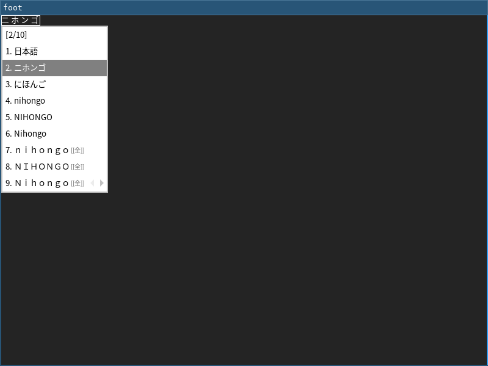
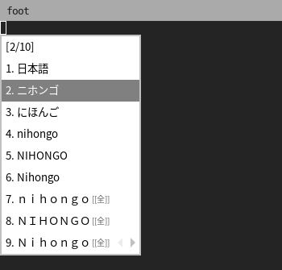

# Quest の Termux ネイティブ Fcitx5＋Mozc 構築記録

[共通 IME 計画](japanese-input-shared-apps-plan-20261123.md)の試行記録。固定語は `nihongo` →「日本語」。各行はその段階で観測できた結果を示す。

| 日付・環境 | 試したこと | 観測と次の判断 |
| --- | --- | --- |
| 2026-11-23 Quest 3、Android API 34、Termux aarch64 | ビルド前の依存を調査 | clang 21、Python、Wayland scanner、D-Bus があり、空きは約 96 GiB。Fcitx5 と CMake は未導入。 |
| 同日 Quest、依存解決 | `wayland-protocols` を指定して apt の模擬インストール | パッケージ名が見つからず失敗。Termux のパッケージ一覧で `libwayland-protocols` を確認。 |
| 同日 Quest、依存導入 | Termux 配布の Fcitx5、CMake、Ninja、ECM を導入 | Fcitx5 5.1.23-1 と CMake 4.5.1 のセットアップ完了。PRoot・Debian は導入していない。 |
| 同日 Ubuntu、ソース選定 | Fcitx5 Mozc の CMake 版の CI とサブモジュールを確認 | アドオンと生成済み辞書を用意して Quest でビルドする経路がある。CMake 版 `d55a0517e127c24def4d498d2428c39f956525ae`、Mozc `1527a4cd1217cec4611cd4bc8d46f8c66ea79e6a`。 |
| 同日 Quest、依存導入の再試行 | `gettext` と `libwayland-protocols` を指定 | gettext 1.0 とプロトコル 1.49 を導入。 |
| 同日 Quest、Mozc 構成 | 上流 CI の protobuf パッチと配布辞書を使い CMake を実行 | Clang 21.1.8 と同梱 protobuf 34.1.0 で生成まで成功。辞書ヘッダー（48,692,305 バイト）の SHA-256 は `f918272cdd0ba0d0ce850bfe18588994ea4eecf889e9ef387a48f2014c960f61`。 |
| 同日 Quest、Wayland 構成 | Fcitx5 5.1.23 に Termux のパッチを適用し、Wayland を有効にして CMake を実行 | システムの Yoga と同梱 Plasma XML を使用して生成成功。上流の `waylandimserverv2.cpp` で、input-method-v2 と virtual-keyboard-v1 の両方が初期化条件になっていることも確認。 |
| 同日 Quest、検証用 compositor | 専用ディレクトリの深いパスを `XDG_RUNTIME_DIR` にして Sway を headless 起動 | IPC ソケット名が Unix ソケットの長さ制限を超え、Sway が終了。Termux の `$TMPDIR` 直下に短い専用ディレクトリを作ると起動した。 |
| 同日 Quest、検証用キー配送 | wtype で専用の foot に英字を送る | wtype のキーマップ生成が固定パス `/tmp` で失敗。Termux の一時ディレクトリを使う検査用ビルドで再試行し、foot の端末から `eidolon` と改行を読み戻せた。Eidolon・Mozc を介さない比較用の結果。 |
| 同日 ソース確認、Termux 対応 | Mozc の Android 用のプロファイル決定箇所と CMake の入力を確認 | Java からディレクトリを渡す Android 版の経路は、このプロセスでは空のパスを返す。上流にある XDG の処理を使い、Android の OS 情報取得に必要なソースをビルド対象へ加え、生成するバージョンの対象を Android に設定した。 |
| 同日 Ubuntu、クロスビルド | Quest の充電が約 11% のため、Ubuntu の Clang 21 から Android API 24・ARM64 向けのビルドも試行 | 最初の CMake のリンクテストは `-lgcc` が見つからず失敗。Termux と同じ compiler-rt を選び、CMake のキャッシュを更新すると構成成功。Quest のヘッダー・Fcitx5 ライブラリと、同じ protobuf 34.1 のホスト用 protoc を使用。 |
| 同日 Ubuntu、アドオンのリンク | ARM64 向けのオブジェクトを共有ライブラリにリンク | `_Unwind_Resume` の未解決で失敗。NDK の aarch64 用 libunwind をリンクすると、辞書内蔵の `libmozc.so`（約 26 MiB）が完成。 |
| 同日 Quest、ロード検査の初回 | 上のアドオンを専用パスに置いて固定語の検査を開始 | `addon("mozc")` はオンデマンドのモジュールを探すだけで読み込まないため失敗。検査で明示的にロードし、検査プロセスには組み込まれていない静的 keyboard アドオンへの依存を外した。 |
| 同日 Quest、変換 | クロスビルド版と新しい専用プロファイルで再試行 | **読み「にほんご」、変換「日本語」、候補 9 件を取得し、「日本語」を選択して確定した。** プロファイル初回の履歴ファイル未作成をログで確認した。 |

## 実際の入力欄に届いた結果

2026-11-23、Quest の Termux に専用の headless Sway 1.12 を起動し、物理キーに相当する固定キー列をテスト用の仮想キーボードで送った。Ubuntu アプリの表示と入力は SSH の専用転送と Waypipe を通した。

| 対象と条件 | 観測・再試行 |
| --- | --- |
| Quest で Mozc 自体をビルド | 最初のリンクは Android の OS 情報を取得する `AndroidUtil::GetSystemProperty` が未解決。CMake の対象に上流の `android_util.cc` を追加して再構成するとリンク成功。同じ検査で読み「にほんご」、候補 9 件、確定「日本語」。 |
| Quest の foot、Fcitx は Sway に直接接続 | `input-method-v2` の確定と、foot が端末で読み取った「日本語」が一致。 |
| Fcitx の接続も Waypipe 経由に変更 | C 版 0.11.3 の無修正版では IME のキーマップ FD を変換できず、foot に英字が届いた。キーボードを接続したままにした同条件で、IME の grab と仮想キーボードの二つのキーマップを既存の転送処理へ渡すと「日本語」が届いた。リポジトリのビルド手順で作った Android ARM64 版 Waypipe と、Quest でビルドした Mozc の組み合わせでも再確認した。 |
| キーボードが存在しない瞬間の Waypipe | 検査用キーボードを破棄すると Sway が `NO_KEYMAP` とサイズ 0 の FD を通知した。この条件では上の変更後も転送に失敗する。継続したキーボード接続と区別して扱う。 |
| Ubuntu Mousepad 0.7.0、GTK 3.24.52 | 入力欄が「日本語」を本文として通知した。専用環境で Ctrl＋S による保存は確認できず、同じ窓の GTK 保存アクションを呼んで、テストファイルが「日本語」の UTF-8 9 バイトであることを確認した。 |
| Ubuntu Dolphin 25.12.3、Qt 6.10.2 | 最初は拡張子削除の確認画面まで進み、ファイル名の検査がタイムアウトした。拡張子のない専用ファイルに変更して F2 → 変換 → Enter を送り、Ubuntu のファイルシステムで名前「日本語」を確認した。 |

Quest 上の作業ディレクトリで、ソースは Mozc 系 278 MiB と Fcitx5 系 17 MiB、ビルド出力はそれぞれ 169 MiB と 29 MiB だった。作成したランタイムの配置先は約 34 MiB。Termux の共有パッケージ、プロファイル、別の比較用ビルドはこの 34 MiB に含まれない。

### 候補が変わるのに候補窓が出ない場合

| 条件 | 結果と変更点 |
| --- | --- |
| Termux 配布の `fcitx5` を使い classicui と Mozc をロード | Space と上下キーで「日本語」「ニホンゴ」が切り替わり、本文には確定できたが、IME は候補窓を生成しなかった。`--ui=classicui` だけでも同じ。Fcitx5 5.1.23 は Android を検出すると初期モードを `OnScreenKeyboard` にし、classicui は物理キーボード向け UI として登録される。 |
| 専用の Fcitx5 実行ファイルの構築 | 初回は構築済みソースのパッチ適用で `git` が見つからず、Termux に導入。その後 ELF を確認すると、Wayland モジュールはビルドディレクトリの版付きライブラリを参照していた。Termux 配布版と同じ版番号なしの SONAME とインストール用のライブラリ検索パスに変更した。次に起動時の `__udivti3` 未解決を観測。コンパイラの補助関数を共有ライブラリからエクスポートしないようにして再リンクすると、配布版の共通ライブラリだけで起動できた。 |
| 専用の実行ファイルが `PhysicalKeyboard` を選び、同じ足場・キー列で再試行 | IME が `get_input_popup_surface` を送り、キーマップ対応 Waypipe 越しの foot の本文直下に候補一覧が現れた。出力を 800×600 で取得し「1. 日本語」「2. ニホンゴ」「3. にほんご」と選択行を確認。上キーで「日本語」に戻し、端末でも確定文字列を読み戻した。 |



最後に、Quest でビルドした専用の実行ファイルを認証済みの Termux SSH から起動し、IME 用の Waypipe の通信も SSH を通して同じ検証用 compositor に戻した。Ubuntu アプリ用の Waypipe は別接続にした。この条件で Mousepad と Dolphin の両方に候補窓生成と「日本語」の確定が記録され、本文の保存とファイルの改名をもう一度確認した。最終の `stage/` は Waypipe と専用の実行ファイルを含めて 34 MiB、Fcitx5 のビルド出力は 35 MiB。

### 二窓の切替と IME 通信の切断

| 固定入力による試行 | 端末に届いた結果 |
| --- | --- |
| 二つの foot を開き、A で「ニホンゴ」の候補を選択中に B へ移る。B に `x` と Enter を送り、A に戻って Enter | B は `x\n` の 2 バイト、A は改行の 1 バイト。切替時に Escape を押さなくても、未確定の候補はどちらにも混入しなかった。 |
| 同じテスト用キーボードを接続したまま A の変換中に IME 用 Waypipe を終了する。直接入力の後、新しい専用 Waypipe と Fcitx5 を起動する | 切断後は `x\n` が届いた。同じ foot で再び「日本語」を確定し、A の内容は `x\n日本語\n`、B は空だった。 |
| キー列ごとに検査用キーボードを作り直し、キーマップのない時点で IME が再接続 | 直接入力には戻った。再接続時に Sway がサイズ 0 の `NO_KEYMAP` を送り、Waypipe が FD を復元できず変換再開に失敗した。上の試行は一つのキーボードから全キー列を送って条件を分けている。抜き差し後の自動復帰は別途確認する。 |

## 再開位置

実機で Eidolon と Termux の間に IME 専用の接続を作る方法も調べた。

| 条件 | 結果と次の判断 |
| --- | --- |
| Quest の Eidolon プロセスでテスト用の abstract Unix ソケットを開き、Termux の RUN_COMMAND サービスから検査用プログラムを起動 | Termux 側の `connect` は `EACCES`、Eidolon 側の待受はタイムアウト。ファイル記述子の受渡しに進む前に終了した。この構成でのアプリ間直接接続の再試行は不要。検査用 APK は削除した。 |
| 次に使う経路 | 既存の認証済み Termux SSH 接続と、foot で通ったキーマップ対応 Waypipe を使う。通常のアプリ接続と区別できる IME 専用の待受を Eidolon に用意し、その接続だけに IME 用の Wayland インターフェースを公開する。 |

Termux ネイティブの変換と各ツールキットへの配送を確認した。Eidolon 側の次の確認は専用接続の識別、選択窓の有効化、未処理キーの返送、候補の空間配置、切断時の取消。通常 APK の物理キーボード操作と装着時の視認性は未検証。

## ビルドを再現する

Quest の Termux（x11-repo 有効）でリポジトリのルートから実行する。Fcitx5 の版と辞書のハッシュはスクリプトで照合する。生成済み辞書を更新する場合は、Mozc のリビジョンと候補の検査結果を一緒に記録する。

```sh
pkg install x11-repo
pkg install fcitx5 clang cmake ninja git curl python gettext pkg-config extra-cmake-modules nlohmann-json libwayland libwayland-protocols util-linux python-pip liblz4 zstd patch
scripts/termux/ime/build-mozc
scripts/termux/ime/verify-mozc
scripts/termux/ime/build-wayland
scripts/termux/ime/build-relay
```

作業先は `~/.local/share/eidolon-ime-native/d55a051`。引数で別の作業先、`JOBS=1` で並列数を指定できる。配布用の共有ライブラリと登録ファイルはその中の `stage/` に集める。変換検査は毎回専用の一時プロファイルを使う。実機で日常利用している辞書や Android の既定 IME への書き込みはない。

`build-wayland` は作業先の `stage/bin/eidolon-ime` に起動スクリプトを配置する。呼び出し元から受け取った Wayland 接続で、同じ場所にある物理キーボード向けの `eidolon-fcitx5` をフォアグラウンド起動する。専用プロファイルを使用し、同じ辞書を使う二重起動はロックで検出する。既定と異なる作業先は第 1 引数で渡す。

### Ubuntu へコンパイルを移す場合

実測した組み合わせは Ubuntu の Clang 21.1.8、Android NDK r27d の ARM64/API 24 用リンク環境、Quest の Termux に入っている libc++・Fcitx5 のヘッダーと共有ライブラリ。生成工程に使った [Linux x86-64 用 protoc 34.1](https://github.com/protocolbuffers/protobuf/releases/tag/v34.1) の ZIP の SHA-256 は `af27ea66cd26938fe48587804ca7d4817457a08350021a1c6e23a27ccc8c6904`。

1. Termux の `clang++ -v -E -x c++ - </dev/null` でターゲットと include の順番を記録し、同じ版のヘッダー、clang resource directory、Fcitx5 の CMake 定義とライブラリを作業用の sysroot に取り出す。CMake 定義内の Termux の絶対パスは、この作業用コピーで置換する。
2. Ubuntu の Clang に `--target=aarch64-unknown-linux-android24`、Termux の libc++ ヘッダー、`-femulated-tls` を指定する。リンクには Android 用 LLD、compiler-rt、libc++_shared、liblog、NDK の aarch64 版 libunwind を使う。ホストの実行ファイルは `-DPROTOC_EXECUTABLE=...` で渡し、`-Dprotobuf_BUILD_PROTOC_BINARIES=OFF` とする。
3. 同じソース、パッチ、辞書で `mozc` ターゲットをビルドする。`readelf -h -d libmozc.so` の Machine が AArch64 であり、Ubuntu のビルドディレクトリへの RUNPATH がないことを確認する。Quest に渡すのはアドオンと登録ファイル。ロードと固定語の確定は Quest で検証する。

## Eidolon のコンポジタを使った三つのアプリでの検証

2026-11-23、Ubuntu で製品の Rust コンポジタを起動し、専用の接続済みソケットを渡した Waypipe と認証済みの Termux SSH を通じて、Quest 上の Fcitx5＋Mozc を接続した。キー列は検証用ドライバから製品の入力処理へ渡した。

| 入力先 | 失敗・条件変更 | 確定結果 |
| --- | --- | --- |
| Quest の foot | 素の foot は既定の共有メモリプールがコンポジタの予算を超え、窓を出せなかった。製品ランチャーと同じ `--override=tweak.max-shm-pool-size-mb=0` で再試行した。 | 端末の標準入力から「日本語」を読めた。 |
| Ubuntu の Mousepad | 独立したセッションバスで `--disable-server` を付けると保存アクションの宛先がなかった。専用バス上で通常起動し、保存を呼び出した。 | ファイルの全文が UTF-8 の「日本語」（9 バイト）になった。 |
| Ubuntu の Dolphin | 専用ディレクトリ内のファイルを選択して起動し、F2 で名前変更欄を開いた。 | 確定後、実ファイルの名前が「日本語」になった。 |

ここで使ったコンポジタは Ubuntu 上で動作する。Quest の通常 APK からの自動接続、装着時の候補位置、物理キー操作は別途確認する。

候補一覧を出した瞬間の foot の窓から、製品コンポジタの RGBA レイヤーを読み戻した。本文・装飾の後に 175×274 ピクセルの候補レイヤーがあり、窓の座標 (0, 43) から本文の直下へ合成された。下図は同じフレームの左上を原寸で切り出したもの。2 行目が選択中で、上矢印と Enter で 1 行目の「日本語」が端末に届いた。入力ドライバは各キーイベントを約 12 ms 間隔で確認した。



SSH で起動する専用リレーに転送を切り替え、同じ三つのアプリの入力検査を再実行した。3 件とも成功。リレーは SSH の標準入出力で Waypipe のデータを中継し、Termux 内の専用一時ディレクトリで接続を受ける。通常動作時は入力内容を記録しない。

## 通常 APK の接続と検査

ビルド 138 で、Termux に認証済みの SSH セッションから専用のリレーを起動し、選択窓を所有するランタイムで Waypipe を開始する経路を追加した。選択窓・フォーカストークン・入力世代を接続開始前に照合する。接続に失敗した場合の直接入力と Shift＋Space の Android IME は引き続き使える構成とした。

| 環境 | 試行 | 結果 |
| --- | --- | --- |
| Ubuntu | Rust コンポジタのテスト、専用接続と一般アプリから見える Wayland グローバルを比較 | 36 件成功。一般アプリから IME と仮想キーボードの管理インターフェースは見えず、専用接続の同時 2 件目は拒否された。 |
| Quest の Termux | Waypipe を固定ソースとパッチからクリーンビルド | 環境のパッケージ一覧に meson がなく最初の導入に失敗。Python 用 Meson 1.7.2、API 34、Ninja の正しいターゲット `waypipe-c/waypipe-c` で 0.11.3 を構築できた。レシピを独立したディレクトリでも実行した。 |
| Quest の通常 APK | Wi-Fi ADB で 138 に更新し、ランチャーから Termux のターミナルを起動 | インストール済み APK のハッシュ一致、foot プロセスと空間に出た窓 1 枚を確認。ここでは未だキー入力の合否を判定していない。 |

ビルド 139 の検証では、窓の選択だけを試験用レシーバーから通常のポインター処理に送り、それ以降のキーは Android の USB HID テストデバイスから入力した。起動直後から残る回収記録とは別に、実際の foot を所有する SSH セッションは Ready だった。選択窓自身の認証済み接続を優先すると、Wayland の IME 登録、フォーカスの有効化、キーボードの grab まで Quest 内で成功した。

| 条件 | 観測 | 次の検査 |
| --- | --- | --- |
| Quest の通常入力経路で Ctrl＋Space と固定語 | 端末に英字の `nihongo` が届いた。別の試行でキーの種別だけを採取すると、Fcitx5 に Ctrl が届いても Space の押下は見えなかった。 | Android の入力欄が物理キーを先に扱っていないかを検査する。 |
| Fcitx5 に Ctrl＋セミコロンを追加して同じ USB HID で再試行 | IME は Ready のまま。端末への入力は 0 バイトで、英字を送った際の Android 側の直近判定は `not_physical_keyboard`。 | 選択窓の物理キーを Linux に渡す間だけ Android IME への接続を外し、同じ条件で比較する。 |
| 画面キャプチャ | Wi-Fi 経由の 4128×2208 のスクリーンショット 1 枚を取得。別回は 8 秒の制限で中断した。 | 入力結果をキャプチャの所要時間に依存させず、装着時の視認性は別に確認する。 |

ビルド 140 では、Linux 窓を選択し、専用 IME の準備が整った間だけ、物理キーを中継する Android ウィンドウの `FLAG_ALT_FOCUSABLE_IM` を有効にした。Android テキスト欄や Shift＋Space の入力パネルへ戻す際は外す。Stealth Keyboard の端末設定は維持した。[Android のウィンドウフラグ](https://developer.android.com/reference/android/view/WindowManager.LayoutParams#FLAG_ALT_FOCUSABLE_IM)

同じ Quest、同じランチャーの foot、同じ USB HID テストデバイスで、Ctrl＋セミコロンと Ctrl＋Space のそれぞれを試した。**両方とも、直接入力の `a`、読み `nihongo`、Space 2 回、上矢印、Enter の結果、端末で受け取った全 10 バイトが `a日本語` と一致した。** Fcitx5 の専用 grab で実キーを受け、候補ポップアップと確定要求を出した。確認用 APK で対象窓への右トリガーだけを試験レシーバーから送っている。装着者による読みやすさの評価は未実施。

ビルド 141 では「日本語」の確定後に `ka` と Esc を 1 回送り、Ctrl＋Space で直接入力に戻して `b` を打った。foot の全受信内容が `a日本語b`（11 バイト）と一致した。Esc を 2 回送った最初の試行は 12 バイトで不一致。取消後の追加の Esc を含めていたため、通常の取消操作で再試験した。

Ubuntu 側には専用テストファイルを開く Mousepad と Dolphin のデスクトップエントリを一時的に作った。Quest ランチャーに出た GTK エントリを押すと、以前の Linux セッションは Quest 再起動後に回収する旨のダイアログが出た。対象プロセスは起動していない。この試行では Ubuntu の通常 XR ウィンドウへの入力は未確認。既存の回収記録は保持した。

### 再起動後の Quest から Ubuntu の Mousepad に確定

1. Quest 再起動後に USB で同じ端末を照合し、Wi-Fi ADB を復旧した。給電中の画面維持は有効だったが、近接センサーは通常の装着検知に戻っていた。[開発開始前チェック](../../development/quest-development-preflight.md)に従って時限設定を適用し、再読取で近接設定、給電と起動状態を確認した。
2. Quest のランチャーから実際の Ubuntu の Mousepad を試験用の空ファイルで開いた。最初の試行では Ubuntu の窓はあったが、Termux の接続は失敗状態で、入力先の IME は起動しなかった。ランチャーを開き直して Termux 接続が Ready になり、Mousepad の本文を選ぶと別ランタイムの IME と入力先の両方が有効になった。Termux の SSH ポートに接続できるだけでは、アプリの認証済み接続が成立した証拠にはならない。
3. ビルド 141 相当の Quest 検証用 APK、試験用の窓選択、Android USB HID を使用した。Ctrl＋Space、読み、候補選択、Enter で確定し、Mousepad の保存操作後に Ubuntu からファイルを再読取した。内容は改行なしの「日本語」だけで、UTF-8 の 9 バイトと一致した。
4. Mousepad を通常の終了アクションで閉じ、そのプロセスと Quest の表示窓が消えたことを確認した。直後にランチャーで Dolphin を選んだが、「元の処理と全世代ウィンドウの回収を確認しています」と表示され、Dolphin の試験プロセスは生成されなかった。Ubuntu の回収照会では同じブートでプロセス終了・パイプ EOF の証明が得られず、回収完了の受領記録もなかった。この試行で Dolphin の IME にキーは届いていない。

Qt の切り分けでは、同じ Quest の Fcitx5 を Ubuntu 上の製品コンポジタへ再接続した。最初はウィンドウが描画された直後に F2 を送り、Dolphin の改名欄がフォーカスを取らず失敗した。フォルダーの表示後に Home で唯一の試験ファイルを選び、F2 で改名を開始して再試行した。未確定の読みを Esc で取り消して改名を閉じると元のファイルが 1 件だけ残った。もう一度改名して「日本語」を確定し、Ubuntu のファイル名も一致した。この検査ではコンポジタとキー注入は Ubuntu 上で動作した。

再現した接続失敗に合わせ、Ubuntu の入力欄を選んだときに Termux への認証済み接続がなければ、既存のランチャーと同じペアリング済み接続を一度要求するようにした。接続処理や回収の途中は待ち、同じ入力先の更新が続いても要求を繰り返さない。利用者が Termux を切断した後は、ランチャーで再び接続を要求するまでその選択を保つ。接続待ち、フォーカス変更、切断後に再接続を許可する条件は Android 単体テストで確認した。実機の回収待ちのため、Ubuntu の窓で最初の認証失敗から自動で復帰するところは未確認。
