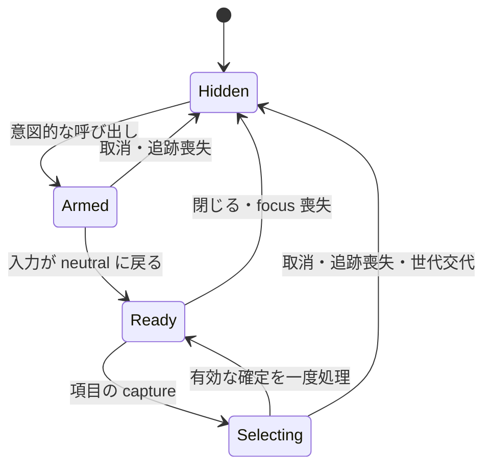
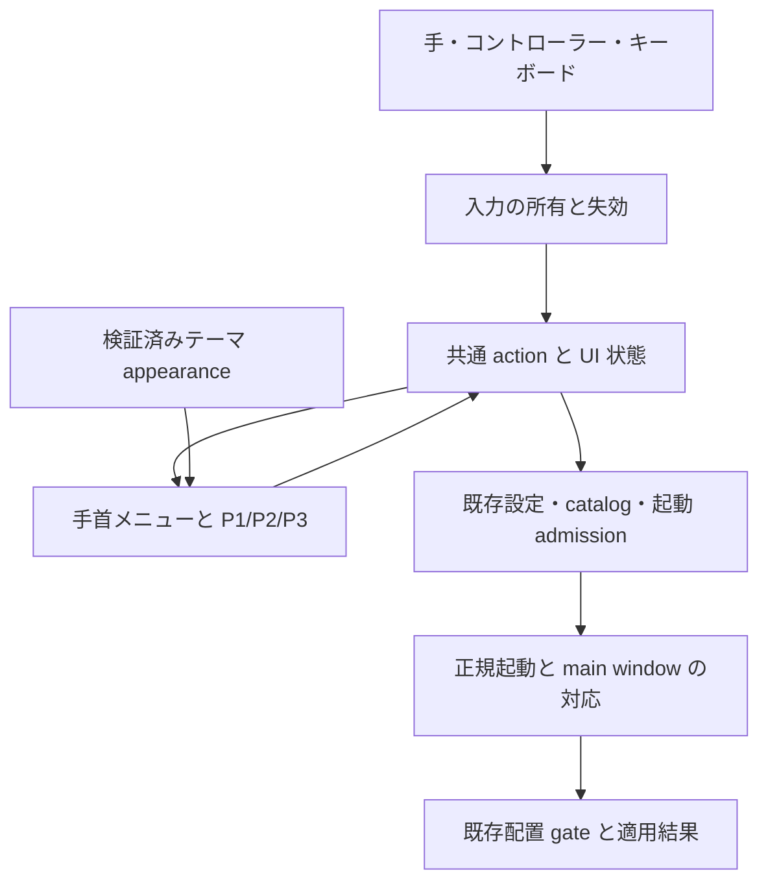

# Spatial Launcher UI — 手首ラジアル・空間パレット・Drag-out 比較計画

作成日: 2026-11-21（日本時間）。
状態: **proposed / 未実装 / Quest 未評価**。
調査基準 main: **64374c65f21dd24a5de3d06af4365d9a5abbf063**。

本書は、ユーザーが選んだ方向を、Codex が複数案を実装し、Quest 3 で比較して使いやすい案だけを
残せる作業計画へ具体化する。今回の文書追加は UI 実装、SDK 能力の実機確認、製品受入の完了を意味しない。
LX00–LX07 は本書内の作業 ID であり、managed manifest / resolver には登録しない。
本文の新しい型名・設定名は**実装予定の概念名**であり、既存 API として使用してはいけない。

関連: [入口](README.md) / [比較手順・記録](spatial-launcher-evaluation-20261121.md) /
[既存ランチャー計画](application-launcher-plan-20261107.md) /
[Linux Desktop v3 統合計画](../linux-desktop-v3/linux-real-app-v3-integration-plan-20261111.md)。

## 1. 目的と合意した方向

目的は、Quest 3 の広い作業空間で Linux アプリを起動・配置する際に、作業を中断する操作と
ランチャーを探す負担を減らすこと。次の方向を実装対象とする。

| ID | 必須の方向 | 実装時の意味 |
| --- | --- | --- |
| R1 | 手首の円形ランチャーで設定 ON/OFF やランチャー呼び出し | 少数の quick actions を手首近くの radial menu へ置く。表示位置と呼び出し gesture は別に設計する |
| R2 | 詳細一覧は手から離して空間に固定 | アプリ一覧・詳細設定を、手を上げ続けず読める panel にする |
| R3 | アイコンをつかんで置きたい場所へ取り出す | 選択と初期配置を結ぶ drag-out 起動。通常のクリック起動も使用できる |
| R4 | 円／六角形などの見た目はテーマで変更 | 共通の操作・起動モデルへ異なる skin を適用する。形ごとに起動処理を複製しない |
| R5 | 複数の UI 案を実装して比較 | 同一 APK 内でプリセットを切替。Codex の印象で一案だけ実装して完了にしない |
| R6 | 使いやすいもののみ残す | 実機結果と利用者の選択を記録し、不採用コード・設定分岐を削除。保存設定を移行する |

「ハンドジェスチャー」は手首を返す、pinch する等の入力動作を指す。
ここでの UI は **手首近くで利用者へ向く円盤状のラジアルメニュー** と定義する。
腕を一周するブレスレット状 UI は、裏側の遮蔽や回転操作が別の比較軸になるため初期三案へ含めない。
円盤の枠や各ボタンの外形はテーマで変更できるが、項目の順序・意味は skin 変更で変えない。

## 2. 現行との差分と読むべき source

以下は調査基準 commit の観測。実装着手時に最新 main と差分を取り、未マージ PR を実装済み扱いしない。

| 領域 | 現行の観測 | 今回必要な追加 |
| --- | --- | --- |
| ランチャー | Compose の LauncherStrip と LauncherSettings。色・文字記号・横並びを直接指定 | 共通 action/catalog model と複数 presentation |
| 空間配置 | MainActivity が LOCAL_FLOOR 上の固定 pose でランチャー panel を生成。showLauncher は詳細表示フラグを変更 | 手首 pose、召喚、切り離し、再配置と lifecycle |
| SDK | Meta Spatial SDK 0.15.0、VRFeature(this)、ComposeFeature | 実 artifact・merged manifest・Quest で hands 能力と入力競合を確認 |
| Linux 入力 | trigger / B・Y / thumbstick 等を click / scroll へ変換 | shell 操作と Linux 入力の排他、古い release の失効 |
| 物理キーボード | Ctrl+Space の IME 切替、panelTextInput による Linux 配送停止、accepted key-up tail の消費 | 召喚・検索の焦点移譲と戻り先の生存確認 |
| theme | format_version 1/2、未知 field を拒否。window 装飾と v2 controls が対象 | launcher/shell appearance の新 schema と Android への適用経路 |
| v3 起動 | runtime / capture / session / catalog revision / entry ID を照合。通常 GUI lease は一つ | drag-out の起動要求と正規 main window を対応付ける receipt / coordinator |
| 窓配置 | 対象 identity、generation、geometry の既存 gate がある | 新規 main の初期配置 intent を既存経路へ接続 |

主な source:

- [ApplicationLauncher.kt](../../../android/app/src/main/java/io/github/tinmachine/eidolon/ApplicationLauncher.kt)
  / [ControlPanel.kt](../../../android/app/src/main/java/io/github/tinmachine/eidolon/ControlPanel.kt)
  / [MainActivity.kt](../../../android/app/src/main/java/io/github/tinmachine/eidolon/MainActivity.kt)
  / [build.gradle.kts](../../../android/app/build.gradle.kts)。
- [InputAdapter.kt](../../../android/app/src/main/java/io/github/tinmachine/eidolon/InputAdapter.kt)
  / [PhysicalKeyboard.kt](../../../android/app/src/main/java/io/github/tinmachine/eidolon/PhysicalKeyboard.kt)
  / [NativeSessionHost.kt](../../../android/app/src/main/java/io/github/tinmachine/eidolon/NativeSessionHost.kt)
  / [SpatialPanelAdapter.kt](../../../android/app/src/main/java/io/github/tinmachine/eidolon/SpatialPanelAdapter.kt)。
- [theme manifest](../../../native/theme/src/manifest.rs)
  / [theme loader](../../../native/theme/src/loader.rs)
  / [theme controller](../../../native/core/src/theme.rs)
  / [ThemeImporter.kt](../../../android/app/src/main/java/io/github/tinmachine/eidolon/ThemeImporter.kt)
  / [ThemeArchive.kt](../../../android/app/src/main/java/io/github/tinmachine/eidolon/ThemeArchive.kt)。
- [WindowControls.kt](../../../android/app/src/main/java/io/github/tinmachine/eidolon/WindowControls.kt)
  / [ThemeHitMesh.kt](../../../android/app/src/main/java/io/github/tinmachine/eidolon/ThemeHitMesh.kt)
  / [workspace model](../../../native/model/src/workspace.rs)
  / [workspace controller](../../../native/core/src/workspace.rs)。

現行 theme v2 の controls は固定ウィンドウ操作部の配置設定であり、launcher skin ではない。
ソース AndroidManifest に handtracking 宣言が見えないことだけで最終 APK の対応を断定せず、
LX00 で merged manifest と実際の入力を確認する。

## 3. 既存契約との境界

- **Linux Desktop v3 の一 GUI 契約を維持**する。比較のために同時起動、catalog の再使用、
  session/capture の省略、lease/Stop/Recover の意味変更を行わない。
- Termux と remote Linux の起動定義・権限・利用可能状態は既存 backend が所有する。
  メニューやテーマへ自由な command / argv / host を移さない。
- アプリ起動、既存窓への復帰、設定変更を別 action とする。アイコン選択で暗黙に既存アプリを停止しない。
- [I5 詳細設計](../linux-desktop-v3/linux-real-app-v3-i5-detailed-design.md)、
  [B1 契約](../linux-desktop-v3/linux-real-app-b1-contract-20261110.md)の所有・受理・回収条件を維持する。
- ここでの空間固定はセッション中の world pose 保持。[Spatial Anchor SA0](../spatial-anchor/README.md)
  の成功、部屋再認識、再起動をまたぐ永続 anchor を前提にしない。
- [Curved Workspace](../curved-workspace/README.md) の cylinder panel 実装と、
  小さなアイコンを浅い弧へ並べる appearance は別。CW の完了を初期案の依存にしない。
- [共通 status HUD 計画](../quest-status-hud/quest-status-hud-plan-20261120.md)は未実装の計画。
  HUD ON/OFF は backend が成立した時だけ追加し、今回の計画で HUD を実装済みにしない。

## 4. 比較する三つのプリセット

全案で、手首 quick menu、共通アプリ一覧、クリック／drag-out 起動、設定状態、起動 admission を共有する。
比較する主な差は **詳細一覧の呼び出しと配置**。同時に複数案を反応させず、一案だけを有効にする。

| ID | 表示名 | 手首からの操作 | 詳細一覧の位置 | 再び呼び出す時 |
| --- | --- | --- | --- | --- |
| P1 / summon | 前方へ呼び出す棚 | 「アプリ」を明示選択 | 呼び出し時の viewer pose から見やすい場所へ生成し、その後は空間固定 | 同じ panel を前方へ呼び戻す。操作中なら自動移動せず保留表示 |
| P2 / pull | 手首から引き出す棚 | 小さな launcher handle を grab し、引き出して release | 引き出し中は軽い輪郭だけ。release 後にその場所で詳細を開く | 同じ panel を再配置。クリック／キーボード入口では P1 相当で開ける |
| P3 / pinned | 作業空間に置いておく棚 | 「アプリ」で表示／非表示 | 利用者が置いた同一セッション内の位置を保持 | 同じ位置で再表示。別 action の「手元へ戻す」で明示再配置 |
| P0 / legacy | 現行ドック | 既存の入口 | 現行の配置 | 比較基準、試作からの復帰経路 |

P2 で**一覧を手に付けたまま読ませない**。手首側は小さな取っ手・プレビューまでとし、
詳細 panel の操作は空間に置いた後に行う。panel 移動の grab と、アプリアイコンの grab は区別する。
P0 は比較期間に残すが、最終 UI に独立した実験プリセットとして永久保存する要件ではない。
新 gesture が失敗しても操作できる既存 ControlPanel の復帰入口は維持する。

### 比較軸を増やしすぎない

1. 同じ入力方式・同じ circle skin で P0/P1/P2/P3 を比較する。
2. 残った一～二案で circle / hexagon を比較する。
3. 必要な場合だけ hands / controller の差を再確認する。

P0 が同じ input mode に対応することを確認できない場合は、その mode の baseline を未成立とする。
controller の P0 を参考として残しても、hands の三案と同条件の速度比較や hands 成功の証拠にはしない。

形状・gesture・配置・項目数を同時に全組合せ比較しない。
キーボード検索は各案共通の補助入口として用意し、第四の独立した UI 実装を増やさない。
採用後に circle と hexagon の両 skin が残ってもよい。操作方式の不採用と見た目の好みは別判断にする。

## 5. 共通の手首ラジアル

### 5.1 形と内容

初期は非利き手の手首近く、利用者を向く小さな円盤に四～六項目を置く。左右を設定で交換できる。
試作寸法・姿勢しきい値は LX00 の実測で決め、テーマ値と分離した bounded な製品設定として記録する。
項目順序は固定し、hover、使用頻度、通信応答に応じて指の下で並べ替えない。

| 操作種別 | 初期候補 | 状態の扱い |
| --- | --- | --- |
| Open | アプリ一覧、設定 | 同じ種類の panel を多重生成しない |
| Toggle | 動きを減らす、ランチャー常時表示など、実 backend へ接続できる表示設定 | 実際の適用値、変更待ち、失敗を区別 |
| Recall | ランチャーを手元へ戻す | scene 内の同じ panel を明示再配置 |
| Close / Back | 閉じる、戻る | remote アプリを Stop しない |
| 後続追加 | HUD 表示、既存窓一覧等 | 能力が成立した時だけ追加。未実装なら理由付き無効または初期項目外 |

初期六項目は、上から時計回りに「アプリ」「動きを減らす ON/OFF」「装飾 ON/OFF」
「閉じる」「手元へ戻す」「設定」を候補の既定配置とする。
能力不足・処理中の項目は理由付き無効にし、隣の action を繰り上げて位置を変えない。
配置を変えて比較する必要が生じた場合は、skin の変更と分けて設定・試行記録へ残す。

「装飾 ON/OFF」を用意する場合は、最後に有効だった theme 選択を記憶して復帰する。
読み込み中は変更を重ねず、既存 theme controller の実状態を表示する。
停止・切断・アプリ終了など、未保存作業に影響する操作を初期 quick toggle に含めない。

### 5.2 呼び出しと確定

- 手首／手のひらの姿勢は表示意図の候補。**手を返すだけで ON/OFF や Launch を実行しない**。
- menu を支える anchor hand と、選択する ray/hand/controller の source identity は別に捕捉する。
  非利き手に表示し、利き手で選ぶ操作を単一 source と見なさず、各入力の失効を照合する。
- Meta 推奨の非利き手 palm-up index pinch 等を候補に、対象 SDK の提供イベント、OS の予約 gesture、
  既定 locomotion との競合を LX00 で確認して最初の binding を決める。
- 初期 hands 選択は安定した hand ray＋明示 pinch、controller は ray＋trigger を第一候補にする。
  直接 touch と thumbstick 方向選択は、対応が確認できた場合の入力 adapter とし、三案の比較軸へ混ぜない。
- 召喚に使った pinch／button を、そのまま最初の項目選択に再利用しない。neutral へ戻ってから再 arm する。
- 中央の無操作領域と、選択候補／押下／現在 ON の異なる表示を持つ。色だけに依存しない。
- 手首への追従は reveal 中に限定し、選択 capture 中は位置を latch するなどの安定化を行う。
  不連続な pose 更新は cancel とし、止まって見える menu へ古い座標で確定しない。
- toggle は「反転を再実行」ではなく、捕捉した revision に対する desired value と operation ID で dispatch。
  一操作で最大一回。結果が未確認なら ON/OFF を確定表示しない。

### 5.3 状態と失効

tracking-loss で pinch=false になった値を、人が指を離した証拠にしない。
入力 mode 交代、Activity pause、XR focus 喪失、scene 再生成、theme/preset 変更、
接続設定交代、capture 元と異なる手の release、timeout は進行中操作の cancel とする。
tracking 復帰で自動選択せず、再び意図的な操作から開始する。

## 6. 詳細一覧を空間へ切り離す

詳細 panel は、アプリ一覧／検索と詳細設定の共通の受け皿とする。
初版は同一 scene に一つの詳細 surface を持ち、用途を切り替える。繰り返し呼び出しで増殖させない。
開くだけで Linux の入力先を暗黙に奪わず、panel を操作する入力と検索 text focus を明示的に所有する。

- 初期 pose は有効な viewer/hand pose の snapshot から決め、その後は頭・手へ毎 frame 追従しない。
- grab handle、閉じる、呼び戻すを別操作として見せる。P2 の移動中に app 選択を開始しない。
- 手を下ろしても一覧は残る。手首 quick menu の消失と、詳細 panel の閉鎖を連動させない。
- 呼び出し直した時は、進行中の text 編集／drag を勝手に移動しない。安定した状態で再配置する。
- 検索は表示中 catalog の label／利用者向け接続先 alias を対象にする。
  実際に開いている窓の検索は、正規の window model が接続できた場合だけ提供する。
- フィルタがゼロ件でも検索解除と閉じるが使える。未接続／起動不可／busy の理由を表示する。
- panel を閉じる時は text focus・pointer capture を解放し、元の Linux target が生存している場合にだけ戻す。
- 新規 menu/panel/preview の entity・listener・Compose focus は scene owner が回収する。
  既存アプリ窓の枠数とは分けても、描画面数・texture・メモリ・入力対象の資源として計上する。

P3 の位置は初版ではセッション内で保持する。再起動時は見つけられる既定位置から始める。
永続配置を後から足す際も、部屋の識別を持たない floor pose を永続 anchor と見なさない。

## 7. Drag-out でアプリ選択と配置を結ぶ

### 7.1 利用者の操作

アイコンをクリックすると既存の通常起動、つかんで棚の外へ引き出すと配置プレビューを開始する。
click と drag の境界は製品側のしきい値で判定し、同じ release で両方を発火しない。
プレビュー中は window の輪郭・向き・アプリ名を示し、まだ remote を起動しない。
有効な位置で明示 release した時だけ起動を一度要求する。

初版の置き方は、利用者を向く upright な panel を既定とし、既存の物理サイズを維持する。
不正な pose、非有限値、近すぎる／遠すぎる位置、UI の cancel 領域は確定不可と表示する。
数値の範囲は LX00/LX05 で既存 workspace 制限と整合させ、試作記録へ固定する。
自動で別の棚・別アプリへ吸着して実行する挙動は入れない。

### 7.2 起動要求と新規 window の対応

現行の公開 launchRegistered(runtime, capture, session, revision, id) は、
呼び出し元へ request / target receipt を返さない。**外観の drag 実装だけでは完了しない**。
LX01/LX05 で既存起動経路へ対応付けを追加する。下記は提案する論理契約であり、実在する型名ではない。

| 段階 | 捕捉／照合する情報 | 副作用 |
| --- | --- | --- |
| Grab | operation ID、入力 source、scene/activity epoch、immutable catalog selection、runtime/capture/session/revision/entry ID | ローカル preview のみ |
| Drop | 同じ selection の有効性、現在の admission、検証済み pose、入力の正規 release | 共通 Launch 経路へ最大一回 submit |
| Admission | 正規 controller が受理した request と launch/session の identity | UI 独自の迂回 Launch を作らない |
| Target ready | その request に対応する正規 NativeOrigin と固定 main root の identity / generation | 対象が証明できた一窓だけへ配置 intent |
| Placement | runtime/scene/target と既存 geometry/control gate、適用 receipt | 一度だけ初期 pose 適用。アプリ表示・入力準備とは別に観測 |

同じ app_id／title の窓、最初に出現した窓、現在 focus の窓を推測で動かさない。
dialog/popup を main に見立てず、main の drop pose で子 surface の位置を上書きしない。
scene 再生成や対象 generation 変更後へ古い placement intent を持ち越さない。
初版の pending drag-out Launch は既存一 GUI 契約に合わせて最大一件とする。

enqueue 成功が不確実な場合も既存 catalog claim の意味を保つ。
タイムアウトや配置失敗を理由に catalog を巻き戻したり、自動で再 Launch したりしない。
新たな remote protocol の拡張が必要かは LX00/LX01 で調査し、まず既存 native の正規 identity を使う。
既存 wire 契約の変更が必要になった場合は別途差分を明示し、この UI 計画を無条件の変更許可にしない。

### 7.3 取消の境界

| 時点／結果 | 挙動 |
| --- | --- |
| submit 前の cancel・追跡喪失 | preview と capture を回収。remote に起動副作用なし |
| submit 後に一覧を閉じる・theme を変える | 起動を未実行へ戻さない。再送／暗黙 Stop をしない。適用不能な placement だけを失効 |
| app 起動失敗 | 実際の失敗状態と既存 Recover/再確認への入口を示す |
| app は起動、配置だけ失敗 | 既定の安全な表示・既存窓操作へ戻し、配置失敗を明示。他窓へ適用しない |
| pending 中に次の起動を要求 | 既存 admission で拒否し理由を示す。見えない起動キューを増やさない |

## 8. 入力の所有と復帰経路

共通 coordinator が入力 source と capture の owner を追跡する。見た目の view から
Linux 入力や Launch を直接呼ぶ複数経路を作らない。

1. OS/System の予約入力を専有しない。既存 reset と OS への返却を維持する。
2. 進行中の release/cancel は元の owner へ終端を届け、別 view へ横流ししない。
3. wrist 選択、panel 操作、drag-out が消費した click/pinch/scroll は Linux 本文へ二重配送しない。
4. menu 外で既に押していた入力を、menu を開いた瞬間に選択として採用しない。
5. 検索中は panel が keyboard/IME を所有する。終了後の accepted key-up tail は消費し、
   新しい入力先へ押しっぱなし／不正 release を作らない。
6. 一度に active な preset は一つ。切替は現在の gesture/drag を cancel し、neutral 復帰後に有効化する。

既存 Ctrl+Space は IME 用なので流用しない。召喚 shortcut は既存 binding を調べて割当て、
設定で変更可能にする。コントローラーと物理 keyboard の fallback を、素手の能力検証と独立に用意する。
**既存 ControlPanel から「標準の起動 UI に戻す」「ランチャーを呼び戻す」を使用できること**を各実装 PR の条件とする。
復帰するために新しい手首 gesture の成功を要求しない。

## 9. テーマと操作の責務

### 9.1 何をテーマで指定するか

| テーマが指定する appearance | 製品／ユーザー設定が指定する意味 |
| --- | --- |
| ボタン・アイコン背景の circle / hexagon / rounded rectangle | action ID、項目順、ON/OFF の対象 |
| 手首 menu の台座、棚、枠、handle、placement ghost の形と素材 | P1/P2/P3、呼び出し・確定・取消、利き手 |
| 色、陰影、輪郭、アイコン、文字 style | catalog、host、program/argv、実際の availability |
| 制限内の寸法・余白・label 位置、許可済みの直線／浅い弧の表現 | 最小 hit target、非重複、入力 owner、generation |
| hover / pressed / on / pending / disabled / failure の表示 | 実状態、エラー理由、再試行条件 |
| reduced-motion 時の静止表現 | gesture しきい値、保存配置、採用 preset、起動権限 |

円／六角形を変えても、同じ action と同じ catalog entry を選ぶ。
テーマが操作の意味を変更する script、外部 code、command を含む仕組みは追加しない。
一般的な任意 3D mesh の取り込みは初版の前提とせず、検証できる shape enum と既存の許可済み素材から始める。

### 9.2 schema と適用経路

1. 共通の typed LauncherAppearance（仮称）を定義し、組み込み circle / hexagon skin を同じ model で描画する。
2. **theme format_version 3 の追加を提案**する。launcher/shell appearance を明示的に versioning し、
   現行 v2 の例に未対応 field を混ぜない。詳細 field、上限、fallback は LX04 で schema として固定する。
3. v1/v2 の window theme は従来どおり受理し、launcher appearance 未指定なら組み込み skin を使う。
   旧アプリが v3 を読めないことも文書化する。
4. 既存 ThemeArchive/Importer → native validation/compile の境界に載せる。
   Android が ZIP を独自に再解釈する二重 parser を作らない。
5. 検証済みの immutable appearance と theme revision を Android 側へ渡す。
   renderer での採用 receipt を確認してから保存する既存の意味を維持し、
   shell appearance が適用できていない状態を「全体の適用成功」と報告しない。
   現行 theme controller の acknowledge は renderer receipt だけで selection 更新・保存まで進むため、
   **LX04 はこの採用・保存条件も変更対象**にする。同じ revision の shell 採用結果まで照合し、
   Android 側で後から error を表示するだけの実装では完了にしない。
6. shell への受渡し失敗時は最後の正常な組を保持し、初回なら組み込み skin へ戻す。
   複数の表示部分が一時的に異なる場合は pending/error を明示し、成功保存を行わない。
   renderer だけが新 theme を採用した後に shell が失敗した場合は旧 theme へ戻す。
   戻す処理も失敗した場合は部分失敗を明示して新しい組を成功保存せず、組み込み shell と
   既存 ControlPanel を使える状態にする。回復の receipt を確認するまで適用成功を報告しない。
7. 未知 shape/field、非有限・過大寸法、資源上限超過は拒否する。
   不正 import で最後の正常 skin を消さない。

ThemeSelection::Off は現行の window 装飾 OFF の意味を維持する。
OFF の時は中立な組み込み launcher skin を使う。
import 失敗時は最後に正常適用した skin を保持し、初回など正常 skin がない時だけ組み込み skin を使う。
いずれの場合もランチャーを表示・操作でき、装飾 OFF をランチャー消失の意味へ変更しない。
将来の theme 版と同名のキーを試作専用設定へ先取りして、移行不能な保存形式を作らない。

### 9.3 形状と hit target

見た目の alpha が透明なら入力も通過する、という仮定をしない。
視覚 shape と collider の関係を明示し、余裕を持つ hit 領域でも隣の項目と重ねない。
テーマが狭すぎる target を要求する場合は、検証時に拒否するか、明示した製品側の下限へ補正する。
隙間、六角形の角、背景、label が誤って隣の action を選ばないことを実機でも確認する。

theme reload／geometry 再生成前に進行中 press・menu drag を cancel し、古い release を失効させる。
受理済み Launch を skin 変更で再送・取消ししない。装飾 animation で action 位置を動かさない。

## 10. 共通構造と削除しやすさ

責務の概念図。箱の名称は将来の module/API 名を強制しない。

P1/P2/P3 は配置・呼び出し policy と薄い view に留め、catalog、toggle、Launch、回収を共通化する。
全案を subclass で複製して修正を三回行う構造にはしない。
試作 selector は設定の実験項目に置き、通常の利用フローへ task ID や内部 generation を表示しない。
debug の比較ログは operation/epoch/preset/skin の匿名 ID と時刻を使い、
認証情報、profile 本文、実 host 名、command/argv、入力した検索文字列を保存しない。

## 11. Codex の実装順と PR 単位

以下は予定。全て未実装であり、HMD 合格を表す checkmark は付けない。
独立にできる実装・自動検証は先へ進める。HMD が使えない部分は未確認として残し、
偽の手 pose や UI fixture を実機成功の代用にしない。

| 作業 | 内容 | 完了条件／次へ渡すもの |
| --- | --- | --- |
| LX00 | SDK 能力・入力競合・既存起動 identity の調査と最小 probe | 固定 SDK の実 API、merged manifest、手首 pose/tracking/選択/release、locomotion/OS 競合、Launch receipt 接続点を記録。未確認を列挙 |
| LX01 | 共通 action/state、input owner、preset 設定、fallback、配置 intent、typed appearance 受渡し境界 | 一操作一 dispatch、失効・復帰、型付き selection。P0 が使え、fake backend の境界試験が可能。theme schema 詳細は LX04 |
| LX02 | 手首 radial と P1 の縦の接続 | 実設定の ON/OFF、一覧を空間へ出す、手を下げても残る。最初の短い実機確認を実施可能 |
| LX03 | P2/P3 と共通一覧・検索 | 同じ APK で三案を切替。panel 多重生成なし、既存入口から復帰。共通操作の比較ログあり |
| LX04 | theme v3 / appearance 経路と circle・hexagon | v1/v2/OFF/不正 import の互換、同じ意味の二形状、適用 receipt と保存、hit 領域の検証 |
| LX05 | drag-out と正規起動・main 配置の接続 | preview →一度の Launch →対応した main だけへ配置。取消、stale、配置失敗、one-GUI 拒否を検証 |
| LX06 | Quest 比較と必要な修正 | 記録シートへ実測。採用／限定採用／不採用／未評価／能力未成立を区別。根拠と利用者の選択を記録 |
| LX07 | 不採用案の削除と設定移行 | 不要 view/policy/assets/flag を削除。古い preset から採用案へ移行。再起動・復帰・通常起動を確認 |

推奨 PR のまとめ方:

1. **共通基盤 PR: LX00/LX01**。SDK と receipt の不明点を先に潰し、実装境界を固定する。
2. **最初の操作 PR: LX02**。手首から P1 を開き、設定と通常起動を使うところまでつなぐ。
3. **比較可能な実装 PR: LX03/LX04/LX05**。同一 APK で三案・二 skin・drag-out を使える状態にする。
   変更が大きい場合だけ theme と drag-out を独立 PR に分ける。見た目の案ごとの別 branch/APK 運用を必須にしない。
4. **評価・修正 PR: LX06**。観測ログ、短い評価、必要な修正、採用判断をまとめる。
5. **整理 PR: LX07**。判断に沿って不採用実装を削除し、採用 UI と設定移行を製品へ残す。

LX03/LX04 は LX01 の共通契約確定後に並行可能。LX05 は正規 identity の接続点を先に固定する。
後から theme と Launch を共通化するために UI 三案を作り直す順番を避ける。
利用者に実機操作を依頼する前に、Codex が build・必要な自動試験・切替手順・観測箇所を用意する。

### LX00 で確認する SDK の具体的な論点

固定版 0.15.0 の公式 VRFeature reference は inputSystemType=INTERACTION_SDK と
handMicrogestureLocomotion=true を既定値として記載する。
現在の VRFeature(this) に独自 thumb gesture を足す前に、既定の移動・回転との競合を調べる。
一般的な機能一覧だけで API の有無を判断せず、固定版 artifact/KDoc、最小 compile、実イベントで照合する。
一瞬の microgesture event を pinch の連続保持／正常 release の代替にしない。

素手の joint/pose・追跡 confidence・入力 event の提供元は probe で確定し、本書で架空の SDK API 名を指定しない。
pose の reference space、LOCAL_FLOOR / view-origin への変換、valid/fresh の判定も記録する。
API が取得できることだけで、切り離し後の world pose や drop 位置が正しいとは認定しない。
merged manifest の宣言と実際に手で操作できることを別々に記録する。
controller 代替が動いても、hands の受入欄を合格にしない。

## 12. 自動検証と Quest 受入

テストは表示実装の写しを増やさず、誤操作・所有・遅延イベント・非同期起動の境界へ絞る。

| 検証 | 期待結果 | 段階 |
| --- | --- | --- |
| wrist pose だけ、長押し、同じ callback の重複 | 副作用なし、または明示した一操作に最大一回 | model/JVM + Quest |
| tracking-loss を release として受け取る入力列 | commit せず cancel | model/JVM + Quest |
| theme/preset/scene/catalog/runtime 交代後の古い release | 新 action / 新アプリを実行しない | model/native/JVM |
| menu 操作と Linux click/scroll/key の重複 | shell 所有の入力が Linux に漏れない | integration + Quest |
| 検索終了後の key-up、元 target 消失 | 入力 stuck なし、別 target に不正配送なし | JVM/integration |
| 詳細 panel を開いて手を下げる・頭を動かす | 同じ world pose に残り、多重生成しない | Quest |
| drop と catalog/接続先の交代、二重 drop | 古い選択の拒否、Launch 最大一回 | native/JVM/integration |
| 受理不明、別 root/generation、dialog 先着 | 自動再 Launch なし、誤った配置なし | native/integration |
| app 成功・配置失敗 | 起動と配置の結果を区別し既存操作で復帰 | integration + Quest |
| v1/v2/OFF/不正 v3、適用中の import 交代 | 最後の正常 skin と復帰入口を維持、成功保存の偽装なし | theme/JVM/integration |
| circle/hex の隙間・角・ラベル・背景 | 隣接 action の誤選択なし、狙いやすさを記録 | geometry + Quest |
| pause/resume・入力 mode 交代・再生成を反復 | capture/listener/preview/pending intent の残留なし | lifecycle + Quest |
| 廃止 preset を保存した状態から起動 | 採用案へ移行し、アプリ定義・theme 等を保持 | migration + Quest smoke |

Host/JVM 試験合格、Android build 合格、Quest 入力合格、利用者による使いやすさの判断は別項目。
スクリーンショットだけで手入力・tracking-loss・入力漏れの合格を認定しない。
見た目確認用の模擬 catalog を使うなら「UI fixture」と明示し、実アプリ起動の成功件数に混ぜない。
実起動の比較は現在利用できる Mousepad 等で行い、次の試行は正常終了・回収・再確認後に開始する。

## 13. 比較と採用・削除

具体的なタスク、記録欄、判断欄は[評価手順](spatial-launcher-evaluation-20261121.md)に置く。

最初は同じ skin / host / app で三案を短く触り、残った一～二案だけを再評価する。
UI の選択時間と SSH／アプリ起動時間を分け、ネットワークの揺れを操作方式の優劣へ混ぜない。
速度、誤選択、腕の負担、キーボードから手を離す回数、メニュー探索、起動後の置き直しを記録する。
個人内の少数試行なので、統計的な優越や一般ユーザーへの効果を断定しない。

**採用前の必須条件**は、意図しない起動／設定変更なし、Linux 入力漏れなし、確実な cancel/復帰、
一 GUI 契約維持、正しい main への配置、theme 互換と lifecycle 回収。
これを満たさない案は、好みや短い操作時間を理由に採用しない。修正後に問題の場面だけ再確認する。
HMD 未確認・SDK 能力未成立は「使いにくいので不採用」と区別する。

採用は一つの標準 preset を基本とし、異なる入力環境で明確な価値がある場合のみ補助案を残す。
利用者の選択と理由を記録した後、Codex が LX07 を行う。
不採用の view、policy、専用 assets、feature flag、設定項目、専用テストを削除し、
共通 action / Launch / cancel の回帰テストと採用判断の記録を残す。
実験用コードをすべて experimental のまま無期限に残さない。

保存された廃止 preset ID は versioned migration で採用 preset に移行する。
お気に入り、catalog 定義、接続先、theme、利き手、非関連設定を保持する。
移行に失敗しても組み込みの安全な起動 UI と既存 ControlPanel へ戻り、ランチャーのない状態を作らない。

## 14. Codex への最初の実装依頼

次のセッションでは LX00/LX01 から開始する。依頼文の例:

> 最新 main と AGENTS.md、docs/features/launcher/README.md を確認し、
> spatial-launcher-experiment-plan-20261121.md の LX00/LX01 を実装してください。
> 手首ラジアル、P1/P2/P3、テーマ、drag-out が共有する入力所有・action・selection・placement intent の境界を作り、
> 固定 Meta Spatial SDK の実 artifact と merged manifest で利用可能な手入力を確認してください。
> 既存 v3 の一 GUI 契約と起動 identity、theme 互換を保ち、P0/ControlPanel の復帰入口を維持してください。
> 新 UI の外観を三つ独立に複製せず、後で三案を同一 APK で比較できる構造にしてください。
> 必要な境界試験、commit、push、PR 作成まで進め、コード／Host・JVM／Android／Quest の検証状態を分けて報告してください。
> Quest が未接続でも独立にできる実装と自動検証を進め、未確認の SDK 動作や実機結果は成功と記載しないでください。

## 15. 参考事例と一次資料

確認日: 2026-11-21。以下の機能記述は各製品の資料に基づく。
それらを組み合わせた P1/P2/P3、初期項目数、採用手順は Eidolon 向けの設計提案。
他製品で成立していることは、Eidolon の固定 SDK・Quest 入力経路での成功を意味しない。

| 資料 | 確認したこと／この計画で使う点 |
| --- | --- |
| [VRChat Action Menu](https://docs.vrchat.com/docs/action-menu) | radial の方向選択と明示確定。特定の既定 button binding を Eidolon へコピーしない |
| [Gravity Sketch Quick Access](https://help.gravitysketch.com/hc/en-us/articles/22600460586141-quick-access-menu) | 非描画側の手首の向きで短い操作を呼ぶ |
| [Open Brush Admin Panel](https://docs.openbrush.app/user-guide/using-the-open-brush-tools-quick-tools-and-menu-panels/the-admin-panel) | 非利き手 controller に管理 UI を付ける |
| [Microsoft Hand Menu](https://learn.microsoft.com/en-us/windows/mixed-reality/design/hand-menu) | 手に付く UI は短時間向け。複雑な UI をつかんで world-lock する方式。HoloLens の数値を Quest の規格にはしない |
| [Stardust XR Telescope](https://stardustxr.org/docs/telescope/use) | 六角形 launcher と pinch/grip によるアプリの drag-out |
| [ShapesXR Assets Library](https://learn.shapesxr.com/objects-creation/assets-library) | 一覧の model をつかんで空間へ引き出し配置する |
| [WayVR](https://github.com/wayvr-org/wayvr) | 手首 Watch、taskbar、working set の再表示。Linux 側 overlay の比較例 |
| [SimulaVR](https://github.com/SimulaVR/Simula) | 物理 keyboard からの launcher と window 操作 |
| [Meta Navigator](https://www.meta.com/help/quest/133727602066940/) | 一覧・検索・整理。OS の配信差をアプリ設計へ固定しない |
| [Apple Ornaments](https://developer.apple.com/design/human-interface-guidelines/ornaments/) | window に付属する局所操作。global launcher と窓固有操作の役割分担 |
| [Meta Hands UI](https://developers.meta.com/vr/design/hands-ui-best-practices/) | 生産性用途の間接入力、意図的な menu gesture、手入力 target の角寸法。約2.5–3°は初期検討値であり実機評価を代替しない |
| [Meta HUD Placement](https://developers.meta.com/vr/documentation/iwsdk/concepts/spatial-ui/hud/) | 通常 UI は world/object 固定、完全な head-lock は避ける。IWSDK の API を Spatial SDK API と誤認しない |
| [Meta Spatial SDK 0.15.0 VRFeature](https://developers.meta.com/vr/reference/spatial-sdk/v0.15.0/com_meta_spatial_vr_vrfeature/) | Interaction SDK と hand microgesture locomotion の既定値。gesture 競合の調査根拠 |
| [Meta Input](https://developers.meta.com/vr/essentials/horizon-os-input/) | Quest 3 は eye tracking 非搭載。頭方向と眼球視線を同一視しない |
| [Meta App Compatibility](https://developers.meta.com/vr/essentials/app-compatibility/) | merged manifest の入力宣言と実際の hands 操作を区別する。VR Glasses 向け記述も含むため対象 Quest/SDK で照合する |

## 16. この計画 PR の検証範囲

通常 Markdown と既存文書への導線だけを追加する。
[CI change-scope policy](../../development/ci/ci-change-scope-20261113.md)に従い、Documentation integrity と
scope checks を確認する。Host/Android build を省略するための workflow 変更や skip marker は追加しない。
新規文書は未登録なので、managed registry の validate 成功だけを本書のリンク・設計内容の検証としない。
追加した相対リンクと図、source との整合を別に確認する。
