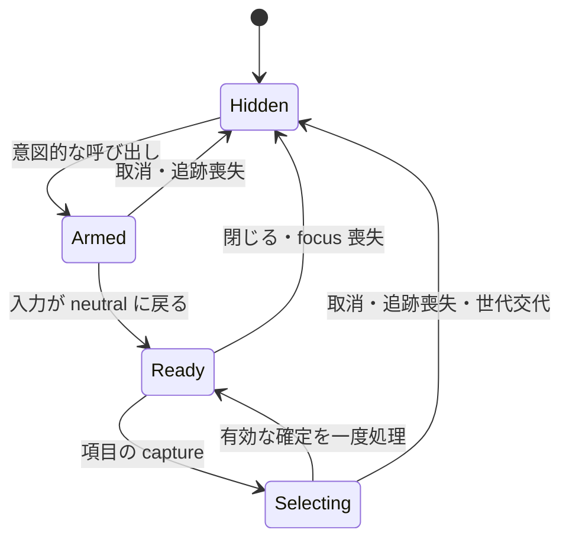
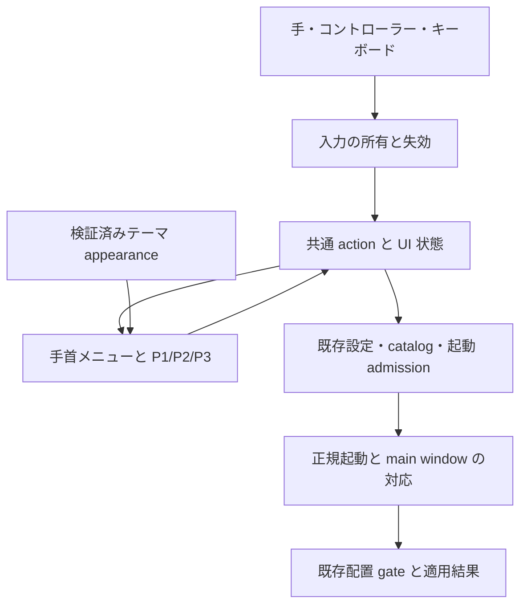

# Spatial Launcher UI — 手首ラジアル・空間パレット・Drag-out 比較計画

作成日: 2026-11-21（日本時間）。
状態: **proposed**。三案と手首入力の受入は未評価。0.1.94 作業版で使える部分は実装詳細 §1 に記す。
調査基準 main: **64374c65f21dd24a5de3d06af4365d9a5abbf063**。

本書は、ユーザーが選んだ方向を、Codex が複数案を実装し、Quest 3 で比較して使いやすい案だけを
残せる作業計画へ具体化する。今回の文書追加は UI 実装、SDK 能力の実機確認、製品受入の完了を意味しない。
LX00–LX07 は本書内の作業 ID であり、managed manifest / resolver には登録しない。
本文の新しい型名・設定名は**実装予定の概念名**であり、既存 API として使用してはいけない。

関連: [実装詳細・設定値・状態遷移](spatial-launcher-implementation-20261121.md) / [入口](README.md) / [比較手順・記録](spatial-launcher-evaluation-20261121.md) /
[UI サンプル画像](spatial-launcher-ui-samples-20261121.md) /
[既存ランチャー計画](application-launcher-plan-20261107.md) /
[Linux Desktop v3 統合計画](../linux-desktop-v3/linux-real-app-v3-integration-plan-20261111.md)。

## 1. 目的と合意した方向

目的は、Quest 3 の広い作業空間で Linux アプリを起動・配置する際に、作業を中断する操作と
ランチャーを探す負担を減らすこと。次の方向を実装対象とする。

| ID | 必須の方向 | 実装時の意味 |
| --- | --- | --- |
| R1 | 手首の円形ランチャーで設定 ON/OFF やランチャー呼び出し | 素手の手のひらと、利用者が登録したコントローラーの向きの両方で表示する。左右・入力方式を設定でき、反対側で選択する |
| R2 | 詳細一覧は手から離して空間に固定 | アプリ一覧・詳細設定を、手を上げ続けず読める panel にする |
| R3 | アイコンをつかんで置きたい場所へ取り出す | 選択と初期配置を結ぶ drag-out 起動。通常のクリック起動も使用できる |
| R4 | 円／六角形などの見た目はテーマで変更 | 共通の操作・起動モデルへ異なる skin を適用する。形ごとに起動処理を複製しない |
| R5 | 複数の UI 案を実装して比較 | 同一 APK 内でプリセットを切替。Codex の印象で一案だけ実装して完了にしない |
| R6 | 利用者が残す UI を選ぶ | 同一 APK で試した後、用途に応じて複数案を残せる。廃止する案があれば保存設定を移行する |
| R7 | どのホストのアプリか分かる | 全アプリ・お気に入り・空間の起動ボタン・drag 中・起動中・起動後の窓で、同じ接続先の文字ラベルを保つ |
| R8 | 好きな場所のボタンと全アプリの両方から選べる | お気に入りの有無に依存しない「すべてのアプリ」を必須にする。最初は Ubuntu Desktop 1 台の実メニューの全項目を検索・選択できる。複数ホストの統合はその後に加える |
| R9 | 同じ Ubuntu で複数のアプリを開く | まず異なる 2 アプリを同時に表示し、個別に入力・終了・回収できる。ウィンドウの追加とアプリの追加を区別する |

「ハンドジェスチャー」は手首を返す、pinch する等の入力動作を指す。
ここでの UI は **手首近くで利用者へ向く円盤状のラジアルメニュー** と定義する。
腕を一周するブレスレット状 UI は、裏側の遮蔽や回転操作が別の比較軸になるため初期三案へ含めない。
円盤の枠や各ボタンの外形はテーマで変更できるが、項目の順序・意味は skin 変更で変えない。

## 2. 現行との差分と読むべき source

以下は調査基準 commit の観測。実装着手時に最新 main と差分を取り、未マージ PR を実装済み扱いしない。

| 領域 | 現行の観測 | 今回必要な追加 |
| --- | --- | --- |
| ランチャー | Compose の LauncherStrip と LauncherSettings。色・文字記号・横並びを直接指定 | 共通 action/catalog model と複数 presentation |
| 空間配置 | MainActivity が LOCAL_FLOOR 上の固定 pose でランチャー panel を生成。showLauncher は詳細表示フラグを変更 | 手首 pose、召喚、切り離し、再配置と lifecycle |
| SDK | Meta Spatial SDK 0.15.0、VRFeature(this)、ComposeFeature | 実 artifact・merged manifest・Quest で hands 能力と入力競合を確認 |
| Linux 入力 | trigger / B・Y / thumbstick 等を click / scroll へ変換 | shell 操作と Linux 入力の排他、古い release の失効 |
| 物理キーボード | Ctrl+Space の IME 切替、panelTextInput による Linux 配送停止、accepted key-up tail の消費 | 召喚・検索の焦点移譲と戻り先の生存確認 |
| theme | format_version 1/2、未知 field を拒否。window 装飾と v2 controls が対象 | launcher/shell appearance の新 schema と Android への適用経路 |
| catalog と接続先 | Termux は登録 catalog のページ表示。remote v3 は固定 GTK デモと Mousepad の二項目。LauncherUi は一つの snapshot、remote profile 保存先は一つ | まず 1 台の可変 catalog を全件選択可能にする。複数 host の registry と横断検索は後続 |
| v3 起動 | runtime / capture / session / catalog revision / entry ID を照合。通常 GUI lease は一つ | 同一 host の各起動に lease・回収記録・窓を対応付け、入力と Stop の対象を識別する。drag-out では同じ対応を再利用する |
| 窓配置 | 対象 identity、generation、geometry の既存 gate がある | 新規 main の初期配置 intent を既存経路へ接続 |

開発中の実機用作業版には、Ubuntu の Desktop Entry を SSH で取得し、一覧を開いたときと手動更新時に読み直す実装がある。GTK と Qt/KDE の項目を取得した記録もある。LX00 でこの差分を main と突き合わせ、利用できる列挙・表示・テストを先に取り込む。作業版の件数は固定の期待値にしない。

主な source:

- [ApplicationLauncher.kt](../../../android/app/src/main/java/io/github/tinmachine/eidolon/ApplicationLauncher.kt)
  / [ControlPanel.kt](../../../android/app/src/main/java/io/github/tinmachine/eidolon/ControlPanel.kt)
  / [MainActivity.kt](../../../android/app/src/main/java/io/github/tinmachine/eidolon/MainActivity.kt)
  / [build.gradle.kts](../../../android/app/build.gradle.kts)。
- [LauncherState.kt](../../../android/app/src/main/java/io/github/tinmachine/eidolon/LauncherState.kt)
  / [LinuxDesktopV3Catalog.kt](../../../android/app/src/main/java/io/github/tinmachine/eidolon/LinuxDesktopV3Catalog.kt)
  / [LinuxStorageRepository.kt](../../../android/app/src/main/java/io/github/tinmachine/eidolon/LinuxStorageRepository.kt)。
- [InputAdapter.kt](../../../android/app/src/main/java/io/github/tinmachine/eidolon/InputAdapter.kt)
  / [PhysicalKeyboard.kt](../../../android/app/src/main/java/io/github/tinmachine/eidolon/PhysicalKeyboard.kt)
  / [NativeSessionHost.kt](../../../android/app/src/main/java/io/github/tinmachine/eidolon/NativeSessionHost.kt)
  / [SpatialPanelAdapter.kt](../../../android/app/src/main/java/io/github/tinmachine/eidolon/SpatialPanelAdapter.kt)。
- [theme manifest](../../../native/theme/src/manifest.rs)
  / [theme loader](../../../native/theme/src/loader.rs)
  / [theme controller](../../../native/core/src/theme.rs)
  / [ThemeImporter.kt](../../../android/app/src/main/java/io/github/tinmachine/eidolon/ThemeImporter.kt)
  / [ThemeArchive.kt](../../../android/app/src/main/java/io/github/tinmachine/eidolon/ThemeArchive.kt)。
- [WindowControls.kt](../../../android/app/src/main/java/io/github/tinmachine/eidolon/WindowControls.kt)
  / [ThemeHitMesh.kt](../../../android/app/src/main/java/io/github/tinmachine/eidolon/ThemeHitMesh.kt)
  / [workspace model](../../../native/model/src/workspace.rs)
  / [workspace controller](../../../native/core/src/workspace.rs)。

現行 theme v2 の controls は固定ウィンドウ操作部の配置設定であり、launcher skin ではない。
ソース AndroidManifest に handtracking 宣言が見えないことだけで最終 APK の対応を断定せず、
素手入力を追加する段階で merged manifest と実際の入力を確認する。

## 3. 既存契約との境界

- 固定 v3 の単一起動は旧クライアント／ヘルパーの互換条件とする。新しい組み合わせでは、同一ホストで複数アプリの起動を受け付ける能力を明示する。各起動の所有、入力先、個別 Stop/Recover の条件は §6.5 に従う。
- Termux と remote Linux の起動定義・権限・利用可能状態は既存 backend が所有する。
  メニューやテーマへ自由な command / argv / host を移さない。
- 一覧の host filter と実際の接続先を別状態にする。表示対象を変える操作で接続・切断・Stop を実行しない。
  別ホストの起動ボタンを押しても live な v3 を暗黙に切断せず、必要な通常終了・回収・接続確認を案内する。
  未完了の旧要求を、接続先変更後に自動で再実行しない。
- アプリ起動、既存窓への復帰、設定変更を別 action とする。アイコン選択で暗黙に既存アプリを停止しない。
- [I5 詳細設計](../linux-desktop-v3/linux-real-app-v3-i5-detailed-design.md)、
  [B1 契約](../linux-desktop-v3/linux-real-app-b1-contract-20261110.md)の所有・受理・回収条件を維持する。
- ここでの空間固定はセッション中の world pose 保持。[Spatial Anchor SA0](../spatial-anchor/README.md)
  の成功、部屋再認識、再起動をまたぐ永続 anchor を前提にしない。
- [Curved Workspace](../curved-workspace/README.md) の cylinder panel 実装と、
  小さなアイコンを浅い弧へ並べる appearance は別。CW の完了を初期案の依存にしない。
- [共通 status HUD 計画](../quest-status-hud/quest-status-hud-plan-20261120.md)は未実装の計画。
  HUD ON/OFF は backend が成立した時だけ追加し、今回の計画で HUD を実装済みにしない。

## 4. 比較する三つのプリセット

全案で同じ全アプリ一覧・選択・通常起動を使う。手首 quick menu、配置ボタン、drag-out は実装した段階で三案に共通で提供する。初回は controller の ray/trigger と組み込みの円形表示で比較できる。
比較する主な差は **詳細一覧の呼び出しと配置**。同時に複数案を反応させず、一案だけを有効にする。

| ID | 表示名 | 手首からの操作 | 詳細一覧の位置 | 再び呼び出す時 |
| --- | --- | --- | --- | --- |
| P1 / summon | 前方へ呼び出す棚 | 「アプリ」を明示選択 | 呼び出し時の viewer pose から見やすい場所へ生成し、その後は空間固定 | 同じ panel を前方へ呼び戻す。操作中なら自動移動せず保留表示 |
| P2 / pull | 手首から引き出す棚 | 小さな launcher handle を grab し、引き出して release | 引き出し中は軽い輪郭だけ。release 後にその場所で詳細を開く | 同じ panel を再配置。クリック／キーボード入口では P1 相当で開ける |
| P3 / pinned | 作業空間に置いておく棚 | 「アプリ」で表示／非表示 | 利用者が置いた同一セッション内の位置を保持 | 同じ位置で再表示。別 action の「手元へ戻す」で明示再配置 |
| P0 / legacy | 現行ドック | 既存の入口 | 現行の配置 | 比較基準、試作からの復帰経路 |

P2 で**一覧を手に付けたまま読ませない**。手首側は小さな取っ手・プレビューまでとし、
詳細 panel の操作は空間に置いた後に行う。panel 移動の grab と、アプリアイコンの grab は区別する。
P0 は比較期間に残すが、最終 UI に独立した実験プリセットとして永久保存する要件ではない。
新 gesture が失敗しても操作できる既存 ControlPanel の復帰入口は維持する。

P3 の「棚を固定する」と「個別の起動ボタンを好きな場所へ置く」は別機能。
後者は P1/P2/P3 共通で使え、ボタンからも「すべてのアプリ」を開ける。
[各案のサンプル画像](spatial-launcher-ui-samples-20261121.md)は設計イメージであり、
複数ホストの実装・接続・アプリ起動を示す実機 screenshot ではない。

### 比較軸を増やしすぎない

1. 同じ入力方式・同じ circle skin で P0/P1/P2/P3 を比較する。
2. 利用者が残したい案で circle / hexagon を比較する。
3. 手首呼び出しの受入は素手とコントローラーで各一度行う。全プリセットを両方で反復する必要はない。

P0 が同じ input mode に対応することを確認できない場合は、その mode の baseline を未成立とする。
controller の P0 を参考として残しても、hands の三案と同条件の速度比較や hands 成功の証拠にはしない。

形状・gesture・配置・項目数を同時に全組合せ比較しない。
キーボード検索は各案共通の補助入口として用意し、第四の独立した UI 実装を増やさない。
採用後に circle と hexagon の両 skin が残ってもよい。操作方式の不採用と見た目の好みは別判断にする。

## 5. 共通の手首ラジアル

### 5.1 形と内容

初期は非利き手の手首近く、利用者を向く小さな円盤に四～六項目を置く。左右を設定で交換できる。
姿勢の初期値、左右別の向きの登録、追跡失効は[実装詳細 §3–5](spatial-launcher-implementation-20261121.md)を使い、寸法とともに装着試験で調整する。
項目順序は固定し、hover、使用頻度、通信応答に応じて指の下で並べ替えない。

| 操作種別 | 初期候補 | 状態の扱い |
| --- | --- | --- |
| Open | アプリ一覧、設定 | 同じ種類の panel を多重生成しない。アプリ入口では「すべてのアプリ」を常に選べる |
| Toggle | 動きを減らす、ランチャー常時表示など、実 backend へ接続できる表示設定 | 実際の適用値、変更待ち、失敗を区別 |
| Recall | ランチャーを手元へ戻す | scene 内の同じ panel を明示再配置 |
| Close / Back | 閉じる、戻る | remote アプリを Stop しない |
| 後続追加 | HUD 表示、既存窓一覧等 | 能力が成立した時だけ追加。未実装なら理由付き無効または初期項目外 |

時計回りの標準配置は、上から「アプリ」「動きを減らす ON/OFF」「装飾 ON/OFF」
「閉じる」「手元へ戻す」「設定」を候補の既定配置とする。
能力不足・処理中の項目は理由付き無効にし、隣の action を繰り上げて位置を変えない。
配置を変えて比較する必要が生じた場合は、skin の変更と分けて設定・試行記録へ残す。

「装飾 ON/OFF」を用意する場合は、最後に有効だった theme 選択を記憶して復帰する。
読み込み中は変更を重ねず、既存 theme controller の実状態を表示する。
停止・切断・アプリ終了など、未保存作業に影響する操作を初期 quick toggle に含めない。

### 5.2 呼び出しと確定

- 手首／手のひらの姿勢は表示意図の候補。**手を返すだけで ON/OFF や Launch を実行しない**。
- menu を支える anchor hand と、選択する ray/hand/controller の source identity は別に捕捉する。
  非利き手に表示し、利き手で選ぶ操作を単一 source と見なさず、各入力の失効を照合する。
- 指定側の手のひらを上へ返すか、指定側のコントローラーを登録した傾きへ向けて円盤を表示する。登録時は反対側で確定する。OS の予約 gesture と既定 locomotion は維持する。
- 選択は反対側の hand ray＋明示 pinch または controller ray＋trigger。
  直接 touch と thumbstick 方向選択は、対応が確認できた場合の入力 adapter とし、三案の比較軸へ混ぜない。
- 召喚に使った pinch／button を、そのまま最初の項目選択に再利用しない。neutral へ戻ってから再 arm する。
- 中央の無操作領域と、選択候補／押下／現在 ON の異なる表示を持つ。色だけに依存しない。
- 手首への追従は reveal 中に限定し、選択 capture 中は位置を latch するなどの安定化を行う。
  不連続な pose 更新は cancel とし、止まって見える menu へ古い座標で確定しない。
- toggle は「反転を再実行」ではなく、捕捉した revision に対する desired value と operation ID で dispatch。
  一操作で最大一回。結果が未確認なら ON/OFF を確定表示しない。

### 5.3 状態と失効

tracking-loss で pinch=false になった値を、人が指を離した証拠にしない。
入力 mode 交代、Activity pause、XR focus 喪失、scene 再生成、theme/preset 変更、
接続設定交代、capture 元と異なる手の release、timeout は進行中操作の cancel とする。
tracking 復帰で自動選択せず、再び意図的な操作から開始する。

## 6. 詳細一覧を空間へ切り離す

### 6.1 panel の位置と所有

詳細 panel は、アプリ一覧／検索と詳細設定の共通の受け皿とする。
初版は同一 scene に一つの詳細 surface を持ち、用途を切り替える。繰り返し呼び出しで増殖させない。
開くだけで Linux の入力先を暗黙に奪わず、panel を操作する入力と検索 text focus を明示的に所有する。

- 初期 pose は有効な viewer/hand pose の snapshot から決め、その後は頭・手へ毎 frame 追従しない。
- grab handle、閉じる、呼び戻すを別操作として見せる。P2 の移動中に app 選択を開始しない。
- 手を下ろしても一覧は残る。手首 quick menu の消失と、詳細 panel の閉鎖を連動させない。
- 呼び出し直した時は、進行中の text 編集／drag を勝手に移動しない。安定した状態で再配置する。
- 検索は表示中 catalog の label／利用者向け接続先 alias を対象にする。
  ページをまたぐ検索範囲と未取得部分は §6.2 に従う。
  実際に開いている窓の検索は、正規の window model が接続できた場合だけ提供する。
- フィルタがゼロ件でも検索解除と閉じるが使える。未接続／起動不可／busy の理由を表示する。
- panel を閉じる時は text focus・pointer capture を解放し、元の Linux target が生存している場合にだけ戻す。
- 新規 menu/panel/preview の entity・listener・Compose focus は scene owner が回収する。
  既存アプリ窓の枠数とは分けても、描画面数・texture・メモリ・入力対象の資源として計上する。

P3 の位置は初版ではセッション内で保持する。再起動時は見つけられる既定位置から始める。
永続配置を後から足す際も、部屋の識別を持たない floor pose を永続 anchor と見なさない。

### 6.2 全アプリへの入口と一覧の範囲

「お気に入り」と「すべてのアプリ」を、共通 panel の常に見える切替として用意する。
**全アプリは、お気に入り登録や配置済みボタンの存在を前提にしない基本経路**とする。
最初は既存 ControlPanel から controller で到達できる。手首・キーボードの入口も実装時に同じ一覧を開く。
初回・お気に入りゼロ件・ボタン削除後も入口を維持し、検索を開始するためのアプリ登録も不要とする。

| 場所 | 必須の表示と操作 |
| --- | --- |
| 全アプリ | 上部に「すべてのホスト」または選択 host 名、検索、件数／取得状況、更新。お気に入り外も全件たどれる |
| お気に入り | app 名＋host badge、利用可能状態、登録解除。「すべてのアプリ」への切替を残す |
| 空間へ置いた起動ボタン | app 名＋host badge、起動状態。編集操作で移動・削除と「すべてのアプリを開く」を選べる |
| 空／失敗状態 | 「該当なし」「まだ取得していない」「取得できなかった」を区別。検索解除、scope 変更、一覧更新へ進める |

「すべて」は、**設定済みホストの backend が公開する全 catalog entry**を指す。
お気に入り、先頭の数件、現在画面の一ページ、起動確認済みの項目だけを「全アプリ」と呼ばない。
全項目で選択して詳細を開ける。未検証でも対応する起動方法なら「起動を試す」を使える。Terminal 必須など既知の非対応では詳細に理由を示し、起動操作だけを無効にする。ネットワーク上の未知ホスト、未登録の実行ファイル、
権限外の directory を勝手に探索する範囲ではない。remote の Desktop Entry discovery は §6.4 に従う。

最初の 1 台では host 名、取得結果、更新操作を表示する。以下のホスト横断フィルターとホスト別 cache は、接続先を複数登録できる段階で追加する。

- host scope は「すべてのホスト」と「一つの host」を明示的に切り替え、active な接続先とは別に表示する。
  検索語は scope 内の app 名・host alias を対象とする。同名 app を統合せず、host ごとの別 entry とする。
- スクロール／ページ送り／検索で catalog の末尾まで到達できる。総件数が確定している場合は取得済み数と総数を、
  未確定なら「取得途中」と次の取得操作を示す。表示上限や backend 上限で黙って切り捨てない。
- 検索は同じ catalog revision の全ページを対象とする。まだページを取得していなければ取得を進めるか、
  「取得済み範囲の結果」と未取得件数／host を表示し、「見つからない」と確定しない。
- ホストごとに、未取得／取得中／最新取得済み／cache が古い／offline／取得失敗／取得範囲の一部欠落を保持する。
  全ホスト表示でも「2/3 ホストを取得」のように coverage を示し、未読 directory や取得失敗をゼロ件へ変換しない。
  表示する数値は実際の取得結果から算出し、サンプルの値を製品へ固定しない。
- stale/offline の cache は閲覧・検索できても、現在の起動許可ではない。最後の取得時点と理由を示し、
  項目を選んで詳細を読める。起動の確定時に新しい catalog／admission を確認する。通信復帰だけで予約起動しない。
- 現行 catalog の固定範囲や、新しい discovery に未対応の host はその能力を表示する。
  「固定二項目の一覧」と「host のアプリメニューを自動取得済み」を同じ完了状態にしない。

### 6.3 ホスト識別と配置ボタンの意味

利用者向けには `Mousepad · DEV-BOX` のように app 名と短い host alias を並べる。
`DEV-BOX` / `LAB-PI` / `TERMUX` は画像・試験用の架空 alias。実ホスト名、IP、ユーザー名、鍵を常時表示する要件ではない。
色、輪郭、host ごとの棚の分割は補助表現とし、**文字の host badge を省略しない**。
同名 alias がある場合は、利用者が識別できる短い補助名を付ける。長い alias も区別部分を失う省略をしない。

| 操作段階 | ホスト情報を保つ場所 |
| --- | --- |
| 選ぶ | 全アプリの各 entry、お気に入り、配置済み起動ボタン。filter が一 host でも残す |
| つかむ／置く | 選択したアイコンと drag ghost の app 名＋host badge |
| 起動を待つ／失敗する | pending・成功／失敗表示に、要求した app と host を残す |
| 作業する | 正規 main の window chrome と窓選択表示。窓タイトルが変わっても host を追跡可能にする |

host badge は製品が供給する metadata とし、theme は appearance のみを変える。
円／六角形や装飾 OFF でも読み取れる位置に残し、hover や tooltip だけに隠さない。
アプリ本文へ文字を焼き込まず、window 側でも最小の shell badge を使う。

配置ボタンは **同じ app への shortcut**。一覧で「起動ボタンを置く」を選んで置く操作は app を起動しない。
通常の app drag-out は「今起動し、窓をここへ置く」であり、ボタン配置の mode・preview と見分けられること。
ボタンの削除／お気に入り解除は app の登録・インストール・全アプリ一覧を変更しない。
初版ではボタンの pose もセッション内だけ保持し、部屋をまたぐ永続配置は SA0 の別依存にする。

永続 shortcut の identity は、提案する登録 host ID、backend 種別、安定した app catalog ID と、
検証対象の profile binding を結び付ける。表示名や「いま選択している host」だけでは保存しない。
一方、runtime/session/capture/catalog revision は起動時に取得する一時的な selection であり、
その古い値を shortcut の再利用権限として永続化しない。

click/Grab では表示した snapshot の host/backend/profile binding と app ID、revision、runtime 等を immutable に捕捉し、
submit 時に正規 backend へ再照合する。filter 変更・接続先変更・再取得・遅い callback で別 host へ振り替えない。
profile の変更・host 削除・app 削除・更新で binding が合わなければ、理由を表示して更新／再選択を求める。
alias の変更は安定した登録先との対応を保ち、別の実ホストへの置換を単なる改名として扱わない。
別 host のボタンから接続手順へ移った場合も、旧 click を復活させず、確認済みの一覧で改めて起動する。

host の削除・実 target の置換は、お気に入り／起動ボタンの削除と別操作にする。
通常の回収完了と既存の保存 transaction の gate に従い、稼働中・cleanup pending なら
回収に必要な capture/profile/storage と Recover の入口を保持する。registry から消して回収を迂回しない。

### 6.4 現行 backend からの段階的な接続

現行の `selectConnection` は Termux と一つの remote Linux profile の選択を扱い、catalog を切り替える。
複数の remote profile registry や全ホストの catalog 集約はまだ存在しない。
remote v3 の二項目は固定契約で、任意のアプリを一覧化する実装としては使えない。
Termux の既存ページ表示も全アプリ導線へ接続し、現在ページだけで検索を終えない。

1. **Ubuntu Desktop 1 台の全アプリを選ぶ（R8）。** 認証済み SSH で Ubuntu のアプリメニューに表示される Desktop Entry を取得する。GTK・Qt/KDE とも個別登録は不要。ランチャーを開くたびに再取得し、「更新」でも同じ取得処理を使う。取得中の旧一覧と最新結果を区別し、応答の前後で選択先が別のアプリに変わらないようにする。
2. **同じホストで起動を試す。** Desktop Entry ID と起動定義を Ubuntu 側で再照合する。対応する未検証項目も試せる。起動失敗・既知の非対応は項目ごとに理由を示す。全アプリの動作確認や起動成功率を、一覧の公開条件にしない。
3. **同じホストで複数アプリを使う（R9）。** §6.5 の個別起動と回収を実装する。複数の SSH 接続先の登録・移行、ホスト横断検索、offline cache は、別の増分として後から加える。host binding は最初の 1 台から保持する。

R8 の初回受入では、同じ利用者・デスクトップ環境でホストが公開する ID の集合と、一覧の全ページから選べる ID の集合を照合する。お気に入りゼロでも、末尾・未検証・起動非対応の項目を選んで詳細を開けること、ホスト側の追加・削除が次に開いた時に反映されることを確認する。読み取り失敗は取得失敗または部分取得として扱い、欠落した一覧を全件取得済みにしない。複数ホスト導入時は同名項目・取得範囲・接続先を追加確認する。

### 6.5 同じホストでの複数アプリ同時起動

最初の受入例は、Mousepad を開いたまま別の GUI アプリを起動し、二つの独立した main が操作できること。ダイアログ 2 枚や同じアプリの既存窓の再表示は、この確認に数えない。初回の検証数は 2 とし、製品の上限は利用できるウィンドウ・描画資源に応じて扱う。

- 新しい能力を両端で確認した接続で、起動ごとに所有記録・lease・main と子窓の対応を追跡する。既存の session/capture と回収手順を再利用し、二件目の起動が一件目の catalog claim や journal を上書きしないようにする。旧方式では従来の単一起動と旧記録の Recover を維持する。
- ウィンドウを指して入力先を切り替える。片方の終了・失敗・個別 Stop/Recover の対象はその起動が所有する資源に限る。共有接続を使う場合は他の起動が使用中の間は維持する。明示的なホスト全体の切断は対象の全起動を扱う。
- 接続切れやアプリ再起動の後も、残った所有記録を起動ごとに再照合する。受入では B の終了後も A に入力できること、A の終了後に両方の資源が回収されたことを確認する。自動試験で B の起動失敗・旧 callback・再接続時の回収も確認する。

## 7. Drag-out でアプリ選択と配置を結ぶ

### 7.1 利用者の操作

全アプリでは項目をクリックして詳細を開き、「起動」または「起動を試す」を選ぶ。配置済みの起動ボタンではクリックで直接起動できる。棚のアイコンに ray を向けるとアプリ名と操作説明を表示し、hover だけでは起動しない。対応する項目をつかんで棚の外へ引き出すと配置プレビューを開始する。
click と drag の境界は製品側のしきい値で判定し、同じ release で両方を発火しない。
プレビュー中は window の輪郭・向き・アプリ名・host badge を示し、まだ remote を起動しない。
有効な位置で明示 release した時だけ起動を一度要求する。

初版の置き方は、利用者を向く upright な panel を既定とし、既存の物理サイズを維持する。
不正な pose、非有限値、近すぎる／遠すぎる位置、UI の cancel 領域は確定不可と表示する。
数値の範囲は LX00/LX05 で既存 workspace 制限と整合させ、試作記録へ固定する。
自動で別の棚・別アプリへ吸着して実行する挙動は入れない。

### 7.2 起動要求と新規 window の対応

現行の公開 launchRegistered(runtime, capture, session, revision, id) は、
呼び出し元へ request / target receipt を返さない。**外観の drag 実装だけでは完了しない**。
LX01/LX05 で既存起動経路へ対応付けを追加する。下記は提案する論理契約であり、実在する型名ではない。

| 段階 | 捕捉／照合する情報 | 副作用 |
| --- | --- | --- |
| Grab | operation ID、入力 source、scene/activity epoch、host ID/backend/profile binding、immutable catalog selection、runtime/capture/session/revision/entry ID | ローカル preview のみ |
| Drop | 同じ host/backend/profile binding と selection の有効性、現在の admission、検証済み pose、入力の正規 release | 共通 Launch 経路へ最大一回 submit。現在の host filter で選択を組み替えない |
| Admission | 正規 controller が受理した request と launch/session の identity | UI 独自の迂回 Launch を作らない |
| Target ready | その request に対応する正規 NativeOrigin と固定 main root の identity / generation | 対象が証明できた一窓だけへ配置 intent |
| Placement | runtime/scene/target と既存 geometry/control gate、適用 receipt | 一度だけ初期 pose 適用。アプリ表示・入力準備とは別に観測 |

同じ app_id／title の窓、最初に出現した窓、現在 focus の窓を推測で動かさない。
dialog/popup を main に見立てず、main の drop pose で子 surface の位置を上書きしない。
scene 再生成や対象 generation 変更後へ古い placement intent を持ち越さない。
一つの controller が同時につかむアイコンは一つでよい。確定後の起動と配置は要求ごとに追跡し、既に開いている窓と次の起動を区別する。

enqueue 成功が不確実な場合も既存 catalog claim の意味を保つ。
タイムアウトや配置失敗を理由に catalog を巻き戻したり、自動で再 Launch したりしない。
新たな remote protocol の拡張が必要かは LX00/LX01 で調査し、まず既存 native の正規 identity を使う。
既存 wire 契約の変更が必要になった場合は別途差分を明示し、この UI 計画を無条件の変更許可にしない。

### 7.3 取消の境界

| 時点／結果 | 挙動 |
| --- | --- |
| submit 前の cancel・追跡喪失 | preview と capture を回収。remote に起動副作用なし |
| submit 後に一覧を閉じる・theme を変える | 起動を未実行へ戻さない。再送／暗黙 Stop をしない。適用不能な placement だけを失効 |
| app 起動失敗 | 実際の失敗状態と既存 Recover/再確認への入口を示す |
| app は起動、配置だけ失敗 | 既定の安全な表示・既存窓操作へ戻し、配置失敗を明示。他窓へ適用しない |
| pending 中に次の起動を要求 | 別の明示操作は対応能力・空き資源に応じて受理する。上限なら理由を示し、同じ操作の再送を防ぐ |

## 8. 入力の所有と復帰経路

共通 coordinator が入力 source と capture の owner を追跡する。見た目の view から
Linux 入力や Launch を直接呼ぶ複数経路を作らない。

1. OS/System の予約入力を専有しない。既存 reset と OS への返却を維持する。
2. 進行中の release/cancel は元の owner へ終端を届け、別 view へ横流ししない。
3. wrist 選択、panel 操作、drag-out が消費した click/pinch/scroll は Linux 本文へ二重配送しない。
4. menu 外で既に押していた入力を、menu を開いた瞬間に選択として採用しない。
5. 検索中は panel が keyboard/IME を所有する。終了後の accepted key-up tail は消費し、
   新しい入力先へ押しっぱなし／不正 release を作らない。
6. 一度に active な preset は一つ。切替は現在の gesture/drag を cancel し、neutral 復帰後に有効化する。

既存 Ctrl+Space は IME 用なので流用しない。召喚 shortcut は既存 binding を調べて割当て、
設定で変更可能にする。コントローラーと物理 keyboard の fallback を、素手の能力検証と独立に用意する。
新しい UI を利用者へ渡す時点で、既存 ControlPanel からランチャーを呼び戻し、標準 UI に戻れることを確認する。
復帰するために新しい手首 gesture の成功を要求しない。

## 9. テーマと操作の責務

### 9.1 何をテーマで指定するか

| テーマが指定する appearance | 製品／ユーザー設定が指定する意味 |
| --- | --- |
| ボタン・アイコン背景の circle / hexagon / rounded rectangle | action ID、項目順、ON/OFF の対象 |
| 手首 menu の台座、棚、枠、handle、placement ghost の形と素材 | P1/P2/P3、呼び出し・確定・取消、利き手 |
| 色、陰影、輪郭、アイコン、文字 style | catalog、host badge の内容と常時表示、program/argv、実際の availability |
| 制限内の寸法・余白・label 位置、許可済みの直線／浅い弧の表現 | 最小 hit target、非重複、入力 owner、generation |
| hover / pressed / on / pending / disabled / failure の表示 | 実状態、エラー理由、再試行条件 |
| reduced-motion 時の静止表現 | gesture しきい値、保存配置、採用 preset、起動権限 |

円／六角形を変えても、同じ action と同じ catalog entry を選ぶ。
テーマが操作の意味を変更する script、外部 code、command を含む仕組みは追加しない。
一般的な任意 3D mesh の取り込みは初版の前提とせず、検証できる shape enum と既存の許可済み素材から始める。

### 9.2 schema と適用経路

初回比較には組み込み skin を使う。以下の外部テーマ形式と保存処理は、ランチャー用のテーマをインポートする機能を実装する段階で扱う。

1. 共通の typed LauncherAppearance（仮称）を定義し、組み込み circle / hexagon skin を同じ model で描画する。
2. **theme format_version 3 の追加を提案**する。launcher/shell appearance を明示的に versioning し、
   現行 v2 の例に未対応 field を混ぜない。詳細 field、上限、fallback は LX04 で schema として固定する。
3. v1/v2 の window theme は従来どおり受理し、launcher appearance 未指定なら組み込み skin を使う。
   旧アプリが v3 を読めないことも文書化する。
4. 既存 ThemeArchive/Importer → native validation/compile の境界に載せる。
   Android が ZIP を独自に再解釈する二重 parser を作らない。
5. 検証済みの immutable appearance と theme revision を Android 側へ渡す。
   renderer での採用 receipt を確認してから保存する既存の意味を維持し、
   shell appearance が適用できていない状態を「全体の適用成功」と報告しない。
   現行 theme controller の acknowledge は renderer receipt だけで selection 更新・保存まで進むため、
   **LX04 はこの採用・保存条件も変更対象**にする。同じ revision の shell 採用結果まで照合し、
   Android 側で後から error を表示するだけの実装では完了にしない。
6. shell への受渡し失敗時は最後の正常な組を保持し、初回なら組み込み skin へ戻す。
   複数の表示部分が一時的に異なる場合は pending/error を明示し、成功保存を行わない。
   renderer だけが新 theme を採用した後に shell が失敗した場合は旧 theme へ戻す。
   戻す処理も失敗した場合は部分失敗を明示して新しい組を成功保存せず、組み込み shell と
   既存 ControlPanel を使える状態にする。回復の receipt を確認するまで適用成功を報告しない。
7. 未知 shape/field、非有限・過大寸法、資源上限超過は拒否する。
   不正 import で最後の正常 skin を消さない。

ThemeSelection::Off は現行の window 装飾 OFF の意味を維持する。
OFF の時は中立な組み込み launcher skin を使う。
import 失敗時は最後に正常適用した skin を保持し、初回など正常 skin がない時だけ組み込み skin を使う。
いずれの場合もランチャーを表示・操作でき、装飾 OFF をランチャー消失の意味へ変更しない。
将来の theme 版と同名のキーを試作専用設定へ先取りして、移行不能な保存形式を作らない。

### 9.3 形状と hit target

見た目の alpha が透明なら入力も通過する、という仮定をしない。
視覚 shape と collider の関係を明示し、余裕を持つ hit 領域でも隣の項目と重ねない。
テーマが狭すぎる target を要求する場合は、検証時に拒否するか、明示した製品側の下限へ補正する。
隙間、六角形の角、背景、label が誤って隣の action を選ばないことを実機でも確認する。

theme reload／geometry 再生成前に進行中 press・menu drag を cancel し、古い release を失効させる。
受理済み Launch を skin 変更で再送・取消ししない。装飾 animation で action 位置を動かさない。

## 10. 共通構造と削除しやすさ

責務の概念図。箱の名称は将来の module/API 名を強制しない。

P1/P2/P3 は配置・呼び出し policy と薄い view に留め、host registry／snapshot、catalog 全件の取得、
お気に入り／配置ボタン、toggle、Launch、回収を共通化する。
全案を subclass で複製して修正を三回行う構造にはしない。
「棚の表示方式」と「手首ランチャー」は通常のアプリ画面からも開く。task ID や内部 generation は実装・試験の記録に使う。
debug の比較ログは operation/epoch/preset/skin の匿名 ID と時刻を使い、
認証情報、profile 本文、実 host 名、command/argv、入力した検索文字列を保存しない。
画面上の host 識別と記録する匿名 host ID は分ける。

## 11. Codex の実装順と PR 単位

| 順序 | 作業 | その段階で確認する結果 |
| --- | --- | --- |
| 1（LX00/LX01） | 実機用作業版の列挙を照合・再利用し、既存 ControlPanel に現ホストの「すべてのアプリ」を接続 | §6.4 の全件選択と再取得。実装できた単位で渡せる |
| 2（LX01） | 同じホストで異なる 2 アプリを開く | §6.5 の個別入力・停止・回収。旧単一方式の互換試験 |
| 3（LX02/LX03） | [実装詳細](spatial-launcher-implementation-20261121.md)の順に、共通カード、手首設定、コントローラー姿勢、素手追跡を同じ棚に接続 | コントローラー版から渡せる。左右の向き登録と素手のピンチをそれぞれ確認し、同じ APK に P1/P2/P3 を保持 |
| 4（LX05/LX06） | 選んで置く drag-out と配置ボタンを追加し、使う操作をまとめて Quest で比較 | 指したアプリと開いた窓の対応、取消、二重配送の防止。利用者が残したい方式と理由を記録 |
| 後続（LX04/LX07） | 必要に応じて hexagon・外部テーマ、複数ホストの登録・移行と横断検索を追加。利用者が不要と決めた案を整理 | 各機能を提供する時点で固有の互換・実機試験を行う。廃止する保存済み設定があれば移行する |

実機用 0.1.94 にある棚・二窓の経路を先に照合し、未完部分から実装する。素手とコントローラーの両経路が R1 の完了条件。共通一覧が用意できれば、複数起動の実装中にも三案の UI を作れる。UI 比較には同一の実データ・入力方式を使い、共通部分の受入は一度でよい。SDK の hands 調査、複数ホスト環境、外部テーマ形式、詳細な時間計測を初回比較の前提にしない。

### 素手対応で最初に調べる SDK の論点

固定版 0.15.0 の公式 VRFeature reference は inputSystemType=INTERACTION_SDK と
handMicrogestureLocomotion=true を既定値として記載する。
現在の VRFeature(this) に独自 thumb gesture を足す前に、既定の移動・回転との競合を調べる。
一般的な機能一覧だけで API の有無を判断せず、固定版 artifact/KDoc、最小 compile、実イベントで照合する。
一瞬の microgesture event を pinch の連続保持／正常 release の代替にしない。

素手の joint/pose・追跡 confidence・入力 event の提供元は probe で確定し、本書で架空の SDK API 名を指定しない。
pose の reference space、LOCAL_FLOOR / view-origin への変換、valid/fresh の判定も記録する。
API が取得できることだけで、切り離し後の world pose や drop 位置が正しいとは認定しない。
merged manifest の宣言と実際に手で操作できることを別々に記録する。
controller 代替が動いても、hands の受入欄を合格にしない。

## 12. 自動検証と Quest 受入

テストは表示実装の写しを増やさず、誤操作・所有・遅延イベント・非同期起動の境界へ絞る。

| 検証 | 期待結果 | 段階 |
| --- | --- | --- |
| wrist pose だけ、長押し、同じ callback の重複 | 副作用なし、または明示した一操作に最大一回 | model/JVM + Quest |
| tracking-loss を release として受け取る入力列 | commit せず cancel | model/JVM + Quest |
| theme/preset/scene/catalog/runtime 交代後の古い release | 新 action / 新アプリを実行しない | model/native/JVM |
| menu 操作と Linux click/scroll/key の重複 | shell 所有の入力が Linux に漏れない | integration + Quest |
| 検索終了後の key-up、元 target 消失 | 入力 stuck なし、別 target に不正配送なし | JVM/integration |
| 詳細 panel を開いて手を下げる・頭を動かす | 同じ world pose に残り、多重生成しない | Quest |
| 同名 app が二 host、alias 改名、実 target 置換 | identity は表示名と独立。別 host への誤起動なし、binding 不一致は再選択 | model/native/integration |
| click/drop と catalog/接続先/filter の交代、二重 drop | 捕捉した host/selection を保持または失効。古い要求を新 host に再解釈しない、Launch 最大一回 | native/JVM/integration |
| 別 host のお気に入り選択時に live v3 がある | 暗黙 Stop/切断/再接続なし。通常回収後も自動 Launch せず明示再選択 | integration + Quest |
| live／cleanup pending の host 削除・実 target 置換 | 回収と保存の gate を維持。必要な target 情報と Recover を残し、通常のボタン削除と混同しない | model/native/integration |
| お気に入りゼロ、解除、二ページ以上の catalog、検索 | 全アプリ入口と末尾まで到達可。先頭ページ外・非お気に入りを検索できる | model/integration + Quest |
| offline/stale/未取得/partial、一部 directory 読取失敗 | coverage と理由を区別。未取得をゼロ件、cache を現行 launch 権限にしない | backend/integration |
| remote discovery の追加・削除・非表示条件・起動非対応項目 | 実 catalog の更新を反映。起動非対応の項目も選択でき、詳細に理由を表示、未知 protocol の偽 fallback なし | Host/integration |
| アイコンを shortcut として置く／削除する | app の Launch/削除なし。通常 drag-out と mode・preview を区別 | model + Quest |
| 受理不明、別 root/generation、dialog 先着 | 自動再 Launch なし、誤った配置なし | native/integration |
| app 成功・配置失敗 | 起動と配置の結果を区別し既存操作で復帰 | integration + Quest |
| v1/v2/OFF/不正 v3、適用中の import 交代 | 最後の正常 skin と復帰入口を維持、成功保存の偽装なし | theme/JVM/integration |
| circle/hex の隙間・角・ラベル・背景 | 隣接 action の誤選択なし、狙いやすさを記録 | geometry + Quest |
| pause/resume・入力 mode 交代・再生成を反復 | capture/listener/preview/pending intent の残留なし | lifecycle + Quest |
| 廃止 preset を保存した状態から起動 | 採用案へ移行し、アプリ定義・theme 等を保持 | migration + Quest smoke |

Host/JVM 試験合格、Android build 合格、Quest 入力合格、利用者による使いやすさの判断は別項目。
スクリーンショットだけで手入力・tracking-loss・入力漏れの合格を認定しない。
見た目確認用の模擬 catalog を使うなら「UI fixture」と明示し、実アプリ起動の成功件数に混ぜない。
実起動は利用できる代表アプリで確認する。新方式では一つ目の窓を残して二つ目を開き、旧固定 v3 の回帰だけは従来どおり回収後に次の起動へ進む。

## 13. 比較と採用・削除

具体的なタスク、記録欄、判断欄は[評価手順](spatial-launcher-evaluation-20261121.md)に置く。

最初は同じ skin / host / app で三案を短く触り、利用者が希望する案を再評価する。
UI の選択時間と SSH／アプリ起動時間を分け、ネットワークの揺れを操作方式の優劣へ混ぜない。
速度、誤選択、腕の負担、キーボードから手を離す回数、メニュー探索、起動後の置き直しを記録する。
個人内の少数試行なので、統計的な優越や一般ユーザーへの効果を断定しない。

初回の採用判断では、利用者自身が P1/P2/P3 を試し、意図しない起動・入力漏れがなく、取り消して既存 UI に戻れることを確認する。配置、複数ホスト、外部テーマなどの機能試験はその機能を提供する段階で行う。実機未確認の操作には「未評価」を残す。

利用者が好む方式を標準にする。用途に応じて複数案を設定に残せる。LX07 で削除するのは、利用者が試して不要と判断した案だけとする。共通 action / Launch / cancel の回帰テストと採用判断の記録を残す。

保存された廃止 preset ID は versioned migration で採用 preset に移行する。
お気に入りと配置ボタンの target identity、catalog 定義、接続先、theme、利き手、非関連設定を保持する。
全アプリ経路はプリセット削除の対象にせず、採用後も共通の基本入口として残す。
移行に失敗しても組み込みの安全な起動 UI と既存 ControlPanel へ戻り、ランチャーのない状態を作らない。

## 14. Codex への最初の実装依頼

[実装詳細 §1 と §6](spatial-launcher-implementation-20261121.md)を入口にする。開発対象に作業版の共通一覧・二窓の経路があるか確かめ、差分を再利用する。残る R8/R9 の試験は §6.4/§6.5、手首の向き・素手入力・三案の受入は実装詳細と評価手順を使う。

## 15. 参考事例と一次資料

確認日: 2026-11-21。以下の機能記述は各製品の資料に基づく。
それらを組み合わせた P1/P2/P3、初期項目数、採用手順は Eidolon 向けの設計提案。
他製品で成立していることは、Eidolon の固定 SDK・Quest 入力経路での成功を意味しない。

| 資料 | 確認したこと／この計画で使う点 |
| --- | --- |
| [VRChat Action Menu](https://docs.vrchat.com/docs/action-menu) | radial の方向選択と明示確定。特定の既定 button binding を Eidolon へコピーしない |
| [Gravity Sketch Quick Access](https://help.gravitysketch.com/hc/en-us/articles/22600460586141-quick-access-menu) | 非描画側の手首の向きで短い操作を呼ぶ |
| [Open Brush Admin Panel](https://docs.openbrush.app/user-guide/using-the-open-brush-tools-quick-tools-and-menu-panels/the-admin-panel) | 非利き手 controller に管理 UI を付ける |
| [Microsoft Hand Menu](https://learn.microsoft.com/en-us/windows/mixed-reality/design/hand-menu) | 手に付く UI は短時間向け。複雑な UI をつかんで world-lock する方式。HoloLens の数値を Quest の規格にはしない |
| [Stardust XR Telescope](https://stardustxr.org/docs/telescope/use) | 六角形 launcher と pinch/grip によるアプリの drag-out |
| [ShapesXR Assets Library](https://learn.shapesxr.com/objects-creation/assets-library) | 一覧の model をつかんで空間へ引き出し配置する |
| [WayVR](https://github.com/wayvr-org/wayvr) | 手首 Watch、taskbar、working set の再表示。Linux 側 overlay の比較例 |
| [SimulaVR](https://github.com/SimulaVR/Simula) | 物理 keyboard からの launcher と window 操作 |
| [Meta Navigator](https://www.meta.com/help/quest/133727602066940/) | 一覧・検索・整理。OS の配信差をアプリ設計へ固定しない |
| [Apple Ornaments](https://developer.apple.com/design/human-interface-guidelines/ornaments/) | window に付属する局所操作。global launcher と窓固有操作の役割分担 |
| [Meta Hands UI](https://developers.meta.com/vr/design/hands-ui-best-practices/) | 生産性用途の間接入力、意図的な menu gesture、手入力 target の角寸法。約2.5–3°は初期検討値であり実機評価を代替しない |
| [Meta HUD Placement](https://developers.meta.com/vr/documentation/iwsdk/concepts/spatial-ui/hud/) | 通常 UI は world/object 固定、完全な head-lock は避ける。IWSDK の API を Spatial SDK API と誤認しない |
| [Meta Spatial SDK 0.15.0 VRFeature](https://developers.meta.com/vr/reference/spatial-sdk/v0.15.0/com_meta_spatial_vr_vrfeature/) | Interaction SDK と hand microgesture locomotion の既定値。gesture 競合の調査根拠 |
| [Meta Input](https://developers.meta.com/vr/essentials/horizon-os-input/) | Quest 3 は eye tracking 非搭載。頭方向と眼球視線を同一視しない |
| [Meta App Compatibility](https://developers.meta.com/vr/essentials/app-compatibility/) | merged manifest の入力宣言と実際の hands 操作を区別する。VR Glasses 向け記述も含むため対象 Quest/SDK で照合する |

## 16. この計画 PR の検証範囲

Markdown、既存文書への導線、各 UI 案のサンプル画像を追加する。
画像は架空の catalog／host を用いる設計案であり、製品 screenshot、実接続、Quest 受入の証拠ではない。
[CI change-scope policy](../../development/ci/ci-change-scope-20261113.md)に従い、Documentation integrity と
scope checks を確認する。画像等の非 Markdown は現行 policy では通常の full CI 対象になる。
Host/Android 等を省略するための workflow・分類規則変更や skip marker は追加しない。
実装詳細は文書メタデータで検査する。LX タスクや画像ギャラリーは手動索引の対象なので、相対リンクと設計内容も確認する。
画像と source の対応を実装着手時にも確認する。
