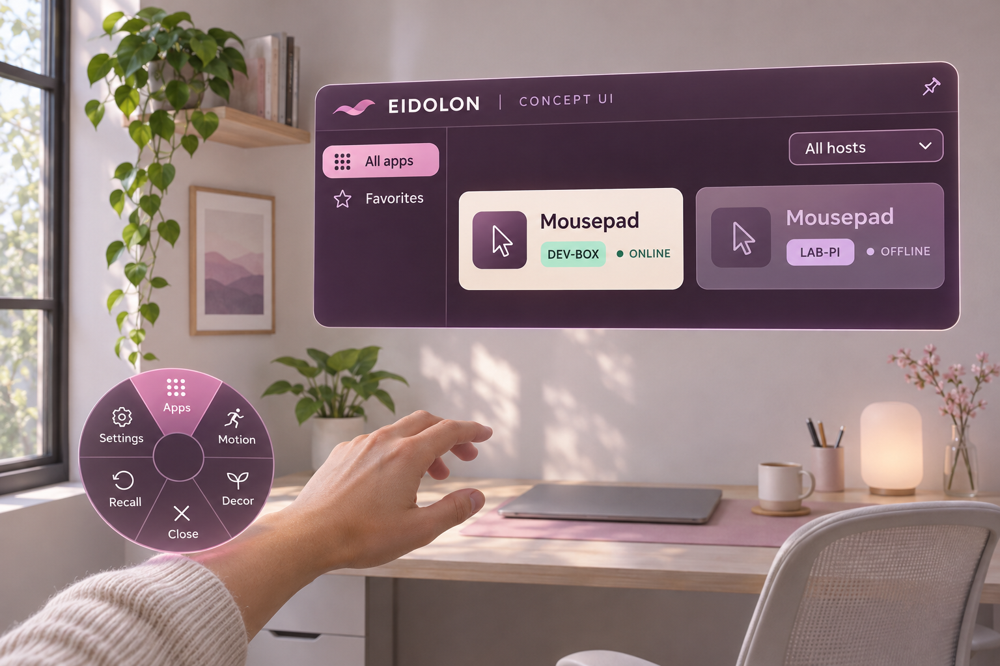
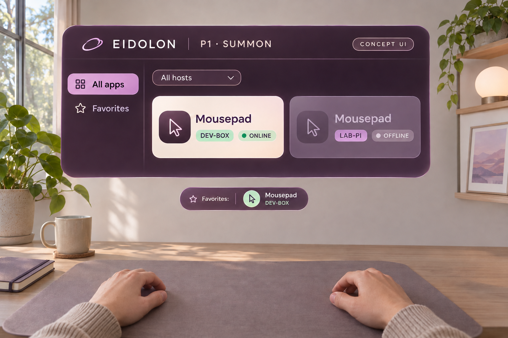
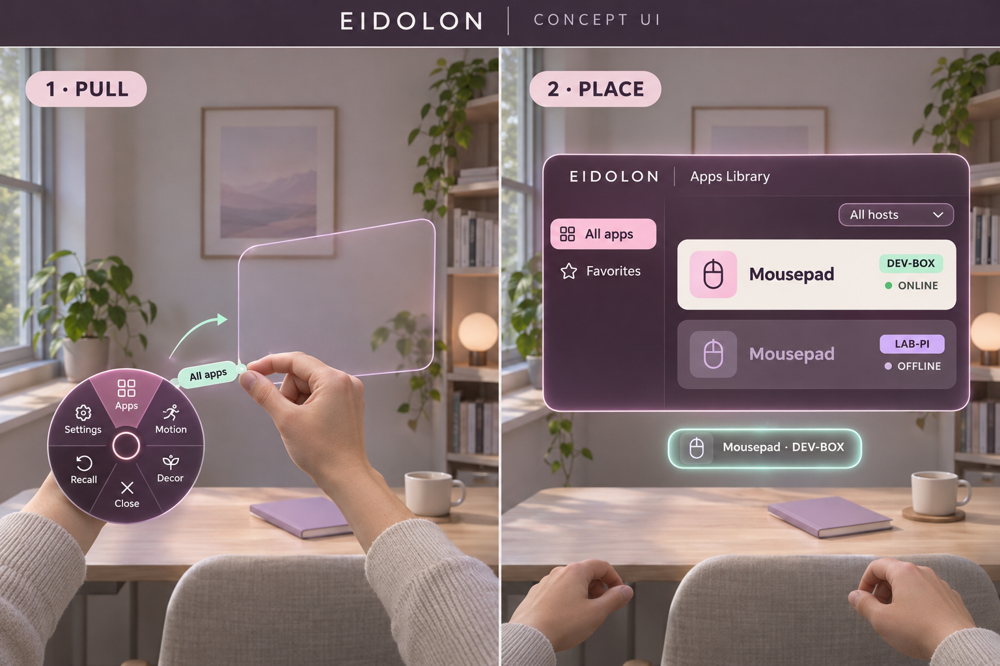
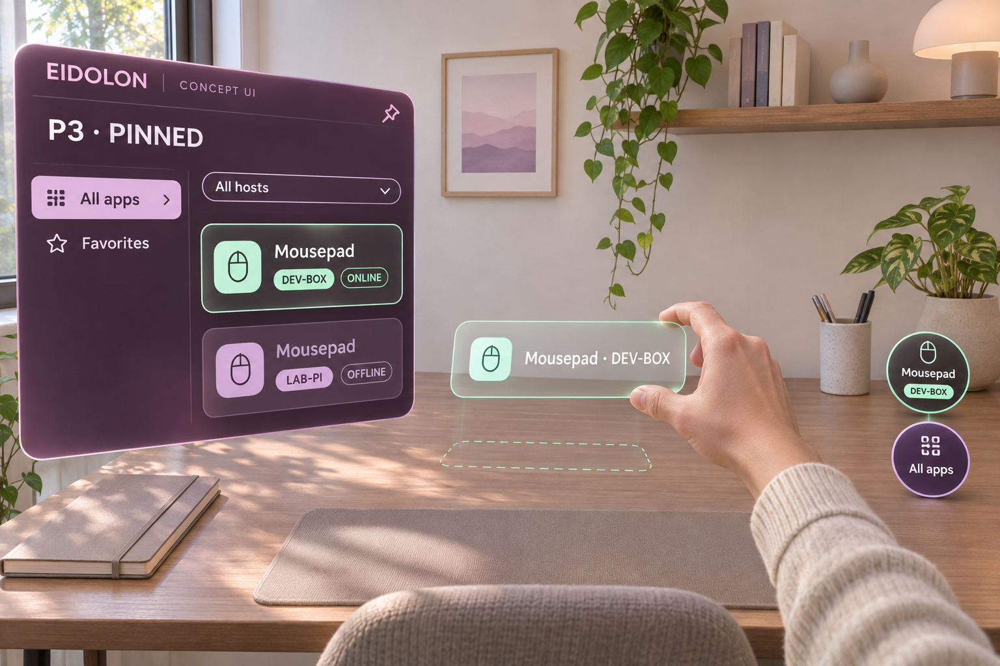
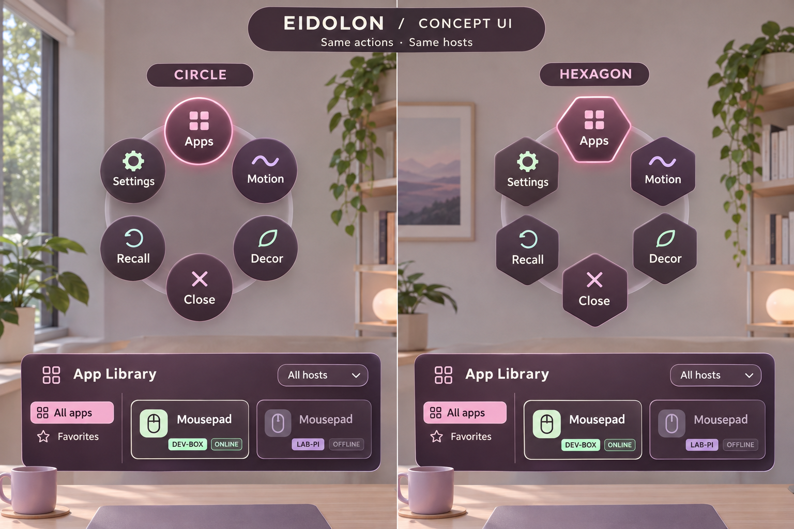

# Spatial Launcher UI — ホスト識別・全アプリ導線のサンプル画像

作成日: 2026-11-21（日本時間）。状態: **proposed / AI 生成のコンセプト / 未実装 / Quest 未評価**。

[比較実装計画](spatial-launcher-experiment-plan-20261121.md)の三つのプリセットと、共通の手首メニュー、
円／六角形テーマを視覚化する。画像は配置や雰囲気を比較するためのもので、現在の Eidolon のスクリーンショットではない。
寸法、文字の可読性、手の追跡、遮蔽、性能は実機で別途評価する。

関連: [入口](README.md) / [実装計画](spatial-launcher-experiment-plan-20261121.md) /
[Quest 比較手順](spatial-launcher-evaluation-20261121.md)。

## 全案に共通する読み方

**「どのホストのアプリか」と「お気に入り以外も探せること」を、どの配置でも維持する。**

| 要素 | 画像で示す内容 | 実装で維持する意味 |
| --- | --- | --- |
| ホストバッジ | `DEV-BOX`、`LAB-PI` など | 利用者が付けたホスト名を各アプリに文字で併記。色や上部のフィルターだけに依存しない |
| 同名アプリ | 二つのホストにある `Mousepad` | 別の起動対象として表示。選択後のフィルター変更で対象を変えない |
| `All apps` | 全アプリ一覧への常設入口 | お気に入り未登録、配置ボタン未作成、棚を非表示にした状態でも到達できる |
| `All hosts` | 全ホスト／個別ホストの絞り込み | 一覧の表示範囲。接続や実行先を暗黙に変更しない |
| `Favorites`・配置ボタン | よく使うアプリへの短い経路 | 全アプリの部分集合。削除しても元のカタログ項目は消えない |
| `ONLINE` / `OFFLINE` | 接続・取得状態の例 | オフライン項目や古い情報を理由付きで残し、起動可能とは扱わない。接続済みでも起動 admission は別途確認する |
| drag-out のプレビュー | アプリ名とホスト名を持つ ghost | 起動先を確認して置く。確定前にはアプリを起動しない |

`DEV-BOX`、`LAB-PI`、`TERMUX`、アプリ構成、状態はすべて説明用の架空例であり、実在する接続設定ではない。
複数ホストの表示は、今後の保存ホスト・カタログ集約の実装を含む目標像である。
現行の single-profile / Linux Desktop v3 の一 GUI 契約を変更した証拠でも、複数ホストの同時実行画面でもない。

**仕様の正本は実装計画の文章と契約表。** 生成画像の文字、アイコンの数や形、線や装飾は例示として扱い、
実装時に必要な空状態・取得途中・エラー表示・検索・ページ送りを省略する根拠にしない。

## 1. 共通の入口 — 手首ラジアルと全アプリ

手首近くの小さな円盤は、アプリ一覧、設定 ON/OFF、呼び戻しなど少数の quick actions を担当する。
詳細なアプリ一覧は手から離れ、空間に固定する。手首の動きだけで大きな一覧が追従する構成にはしない。
「Apps」はお気に入りだけの入口にせず、`All apps` へ到達できる一覧を開く。
円盤は腕に巻き付くブレスレットではなく、利用者へ向く小さな面を想定する。

## 2. P1 / summon — 前方へ呼び出す棚

手首メニューの「アプリ」を選ぶと、見やすい前方へ一覧を出し、その後は空間に固定する。
一覧は `All apps` と `Favorites` を切り替えられ、全ホスト／個別ホストと検索から対象を探せる。
手を下ろして読めること、呼び出すたびに一覧を探し直さなくてよいことを評価する。
通常選択で起動し、アイコンをつかんだ場合は対象ホスト付きのプレビューを置いて初期位置を指定する。

## 3. P2 / pull — 手首から引き出して置く棚

手首から引き出す対象は、小さな取っ手と配置用の輪郭に限定する。
離して配置を確定した後、その場所に詳細な全アプリ一覧を開く。手に付いた一覧を読ませる設計ではない。
棚を置く操作と、棚の中のアプリを取り出して起動する操作を、別の grab target と状態で区別する。
クリックやキーボードからも P1 相当で開ける経路を用意し、引き出す動作の失敗で全アプリへ到達不能にしない。

## 4. P3 / pinned — 置いておく棚と自由配置の起動ボタン

棚は利用者が選んだ位置を同じセッション内で保持し、手首メニューから表示／非表示を切り替える。
よく使うアプリは、棚とは独立した起動ボタンとして好きな場所に置ける。
ボタンは「Mousepad / DEV-BOX」のように対象を保持し、現在のホストフィルターに追従して別ホストへ変わらない。
画像中央の透明なカードはアプリを取り出す preview、右端の小さな丸形は独立した起動ボタンの例である。

自由配置ボタンが一つもなくても、手首や既存の復帰入口から `All apps` を開き、未登録のアプリを探せる。
ボタンの作成・移動とアプリの起動は明示的に区別し、ボタンを配置しただけではアプリを起動しない。
セッションをまたぐ現実空間の同じ場所への復元は Spatial Anchor の別課題として扱う。

## 5. 同じ操作に circle / hexagon のテーマを適用

比較するのは、同じアプリ順、同じホストバッジ、同じ全アプリ導線に適用した外形・素材・色である。
テーマを替えても起動先、action の意味、一覧の範囲、接続状態は変えない。
六角形だから専用の起動実装を作る必要はなく、共通の表示モデルと検証済み appearance によって切り替える。
文字の読みやすさ、選びやすい hit 領域、隣接項目への誤選択は HMD で別途比較する。

## 画像から実装へ進む際の確認

1. まず同じテーマで P1 / P2 / P3 を比較し、一覧を呼ぶ・置く・見つけ直す操作を評価する。
2. 同名アプリをホスト違いで選ぶ、未お気に入りのアプリを後続ページから探す、オフライン項目を識別する課題を全案で行う。
3. 採用候補の操作方式に circle / hexagon を適用して比較する。
4. 表示された全件数と検索範囲、起動先と実際に開いた窓の所属を照合する。画像の印象だけで完了にしない。

P0 は既存ドックの比較基準なので、このギャラリーで新しい外観を提案しない。
評価と削除の条件は [Quest 比較手順](spatial-launcher-evaluation-20261121.md)と実装計画に従う。

## 生成方法とレビュー条件

作成方法は組み込みの画像生成機能による新規生成。既存製品のスクリーンショットの加工ではない。
各画像は独立した生成リクエストとし、共通のデザイン指示と次の構図を指定した。
[使用したプロンプトと保存画像](images/README.md)も同梱する。

共通指示: 一人称の MR 作業空間、静かな室内、ピンク・ラベンダー・ミントを基調とする Eidolon の
コンセプト UI、読みやすい暗色または明色パネル、少数の英語ラベル、`All apps` / `Favorites` / `All hosts`、
各項目の文字ホストバッジ、二つのホストの `Mousepad`、オフライン状態、実在の IP・アカウント情報なし。

| 画像 | 個別の構図指示 |
| --- | --- |
| 共通の手首ラジアル | 利用者へ向く小さな円盤と、手から離れた全アプリパネル。アプリ・設定・呼び戻し等の quick actions |
| P1 | 前方に浮かび、手を下ろしてもその場に残る一覧。ホスト付きのアプリ選択と drag-out の関係 |
| P2 | 手首の小さな取っ手から軽い輪郭を引き出す段階と、空間へ置いた詳細一覧の段階 |
| P3 | 作業空間の脇に置いた棚、独立したホスト名付き起動ボタン、全アプリへ戻る入口 |
| テーマ比較 | 同じ内容と順序を左右に並べ、円形／六角形の外形だけを比較できる表示 |

生成結果を目視し、上記の配置の違いとホスト／全アプリの導線が説明できるものを採用する。
画像の存在は SDK 実装の可否、アクセシビリティ適合、Quest での可読性や操作成功を示さない。
