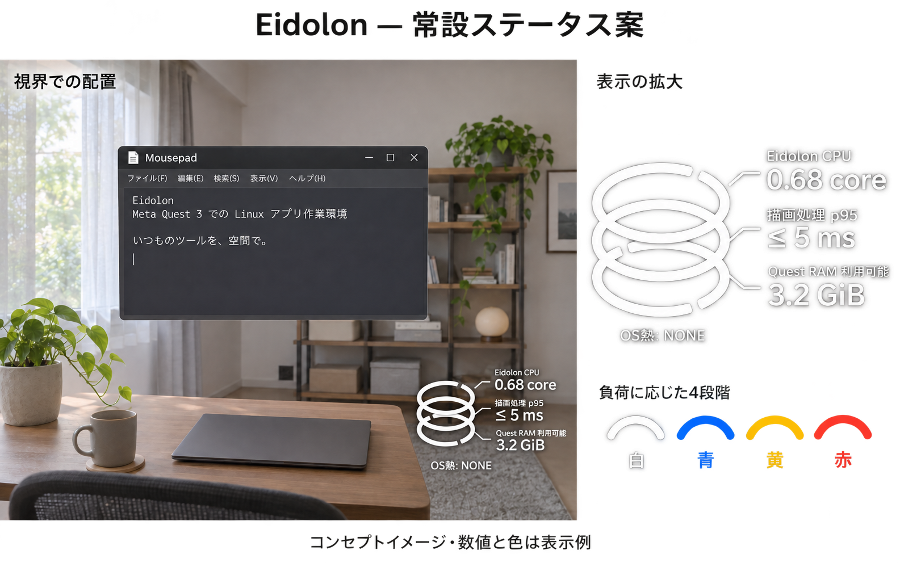

# Quest常設ステータスHUD — 重なるリング・負荷色の実装計画

**状態: proposed / unregistered / documentation only。**
2026-11-20 の表示方針をもとに、2026-11-21 に実装順を見直した。最初の実機試験は透明な静止パネルの入力透過とする。
本PRは製品コード、計測API、設定、SDK所有境界を変更しない。HUDの実装済み・Quest/HMD受入れ済みを意味しない。
確認したmainは `8eb34aa8d7a3943d991531bfc3fa02f6390e66e8`。
以下のHUD-01〜04は本書内の作業名であり、`scripts/docs.py context`の登録済みtask IDではない。

## 1. 目的と今回の範囲

EidolonのMR作業空間で、設定画面を開かなくても負荷の変化に気付けるよう、視界の右下付近に共通HUDを表示する。
Linuxアプリ、Termuxの窓、操作パネルのいずれにも所属させず、Activity/sceneが一つ所有する。
「Questの状況」を見る共通の表示場所に、**EidolonプロセスのCPU、Eidolonの描画処理、Quest全体のRAM**を、それぞれの対象が分かる名前で置く。

常設とは、**EidolonのActivityが表示・再開中で、有効なsceneがある間**を指す。
設定画面を閉じても表示を続けるが、Home・他アプリ・Activity pause中まで動くOS全体のoverlayや監視serviceは追加しない。
既存の通常APK権限と収集経路を使い、ADB・root・外部collectorを製品の必須条件にしない。

### 合意した表示

| 要素 | 方針 |
| --- | --- |
| 主な指標 | Eidolon CPU、描画処理p95、Quest RAM利用可能量の3つ |
| 補助表示 | OSが返した熱状態を小さな文字で表示 |
| リングの配置 | 3本を重ね、全体として短い円柱に見せる |
| 数値 | リングの右側に、項目名・値・単位を表示 |
| 背景 | 黒いカードや半透明の背景パネルを付けず、リングと文字だけを表示 |
| 線幅 | 最初の細いリング案の約4倍を目安にする |
| CPU・RAMの色 | 白 → 青 → 黄 → 赤の4段階。各指標と対応する文字を同じ色にする |
| 描画の色 | 有効値は当初白。処理時間による色の閾値は実機で調整する |

**今回は見送るもの:** RTT、入力応答・remote update・input-to-photonの新規計測、端末全体のCPU/GPU使用率、GPU時間、XR FPS/drop、batteryや通信量の主リング追加。
これらをHUDの実装条件にしない。[性能観測計画](../../development/performance/performance-observability-plan-20261120.md)の将来項目はそのまま残す。
v3の同時GUIアプリ数や、既存の窓別workloadリングの意味も変更しない。

## 2. 表示イメージと形状



この画像は本計画のために生成した**コンセプト画像**で、製品のスクリーンショット・実測・HMDでの視認結果ではない。
数値と色見本は表示例。画像に含まれる説明用の見出し・凡例・引き出し線を、そのまま製品UIに追加する必要はない。
画像の細部より本書の指標定義・閾値・透明背景の契約を優先する。

### リングと文字の構成

- 3本は同じ直径・同じ軸・同じ傾きで、平行な円として描く。斜め上から見た楕円の投影を使い、中心を少しずつずらして大きく重ねる。
- 全体を短い空洞の円柱のように見せる。円柱の側面、塗りつぶし、支柱、別々の縦並びアイコンは追加しない。
- 順番は上から**CPU → 描画 → RAM**に固定。右の3組の項目名・値・単位も対応する順番にする。対応が不明瞭な場合だけ短い細線を添える。
- 線を太くしても各輪の間に背景が見える余白を残す。リング同士を一つの白い塊にしない。太さ・楕円の縦横比・重なり量は共通パラメータにまとめ、実機で調整する。
- 円の一部に小さな切れ目を設け、その位相を動かして回転を表す。3本の回転中心や円柱全体の位置は動かさない。
- 回転を導入する段階では穏やかな一定速度とし、負荷は色で表す。高負荷だから回転・描画・計測頻度を増やす処理を入れない。秒単位の1回転周期を実機で調整し、値とは別の設定にする。
- 文字は回転させない。桁変化で位置が跳ねない数値書体・固定した値領域を使い、単位と名称を残す。
- 透明背景を維持する。必要なら文字・輪郭にごく細い縁取りを使うが、黒い矩形や広い影へ置き換えない。

### 視界の右下への配置

HUDは窓の移動・resize・Close・設定画面の開閉に追従させない。
右下付近に収まり、作業本文・キーボード・入力操作を邪魔しない視角と距離を実機で選ぶ。
初版は有効な scene の開始時に取得した視点の右下に一度置き、その後は空間に留める。recenter を確実に検出できる場合は新しい視点で置き直す。SDK の通知を確認できない場合は設定から「HUD を置き直す」操作を使う。追従の遅れや移動範囲は静止版の操作性を確認してから比較する。HUD の配置はマウスカーソルや Linux 窓の姿勢から独立させ、Spatial Anchor の解決も待たない。

SDK 0.15.0 の `Scene.getViewerPose()` を有効な scene 上で読み、既存の panel 配置に合わせて姿勢を変換する。固定位置にpanelを一枚置いただけで「常時視界右下」を満たしたとしない。
表示専用とし、keyboard focus・pointer入力を奪わない。透明領域も含めたhit判定は実機で確認する。

## 3. 指標の定義と現行ソース

| 指標・表示例 | 計測対象と表示 | 現行の材料 / 新たに必要な処理 |
| --- | --- | --- |
| `Eidolon CPU` / `0.68 core` | APK自身のCPU。1コアを使い切る量が`1.00 core = 100%` | `ProcessCpuTracker`の`process_cpu_percent`。既存約5秒平均を利用し、色とHUDへ変換 |
| `描画処理 p95` / `≤ 5 ms` | 成功したnative targetのdraw＋swapのCPU wall time。待ち時間を含む | `FrameTiming.histogram_ms`の累積値から直近区間の差分を作り、対象ごとのp95とHUD用集約を新規実装 |
| `Quest RAM 利用可能` / `3.2 GiB` | Quest全体の`availMem`。回収可能なメモリーを含む利用可能量 | 既存`availableRam`/`totalRam`を使用。色判定用使用率・鮮度を導出 |
| `OS熱: NONE` | OSが返したthermal status。CPU温度や安全判定ではない | 既存`ThermalReading`とその観測時刻・statusを再利用 |

CPUはQuest全体、Termuxの子プロセス、別LinuxホストのMousepad CPUを含む指標ではない。
`availableProcessors`や想定コア数で割って「端末CPU使用率」に正規化しない。
100%を超えても数値を丸め込まず、例えば250%は`2.50 core`と表示できる。
この色は**1コア基準の使用量**を示し、赤が端末の全CPU能力の90%消費や故障を意味するわけではない。

RAMは次で算出する。同じsnapshotの有効な2値を使い、`total > 0`かつ`0 ≤ available ≤ total`を確認する。

```text
ram_used_percent = 100 × (total_ram_bytes − available_ram_bytes) / total_ram_bytes
ram_available_gib = available_ram_bytes / 2^30
cpu_cores = process_cpu_percent / 100
```

RAMの表示値は利用可能GiBを維持し、**空きが減るほど使用率が上がる**方向で色を変える。
詳細表示・検証用モデルには総量と算出した使用率も保持する。
この使用率はavailable基準の目安であり、全アプリRSSの合計、完全な未使用RAM、OSのlow-memory判定そのものではない。

`OS熱: NONE`はコード0の観測で、正常・安全・熱制限なしの保証へ読み替えない。
現行`thermal_hardware_support=not_verified`を維持し、補助文字のために4本目のリングを増やさない。

### 確認した実装

| ソース | 確認した責務 |
| --- | --- |
| [ProcessCpuTracker.kt](../../../android/app/src/main/java/io/github/tinmachine/eidolon/ProcessCpuTracker.kt) | 1コア100%、5秒間隔、再開baseline、15秒超の計測区間・counter後退・取得失敗 |
| [DeviceMetrics.kt](../../../android/app/src/main/java/io/github/tinmachine/eidolon/DeviceMetrics.kt) | CPU/RAMの単一collector、`sampledMs`、start/stop、OS API呼出 |
| [DeviceDetails.kt](../../../android/app/src/main/java/io/github/tinmachine/eidolon/DeviceDetails.kt) | 熱状態、個別時刻、90秒の鮮度、lifetime付きworker |
| [ControlPanel.kt](../../../android/app/src/main/java/io/github/tinmachine/eidolon/ControlPanel.kt) | 既存の数値・詳細表示 |
| [NativeSessionHost.kt](../../../android/app/src/main/java/io/github/tinmachine/eidolon/NativeSessionHost.kt) | `deviceMetrics`/`publishDeviceMetrics()`、既存native snapshotのtick、診断公開 |
| [MainActivity.kt](../../../android/app/src/main/java/io/github/tinmachine/eidolon/MainActivity.kt) | resume/pause、panel登録、Activity owner/scene epoch、scene回収 |
| [SpatialPanelAdapter.kt](../../../android/app/src/main/java/io/github/tinmachine/eidolon/SpatialPanelAdapter.kt) | native panel/bindingの所有、透明decorationの既存設定、旧scene callbackの拒否 |
| [native/render/src/lib.rs](../../../native/render/src/lib.rs) | `FrameTiming`/`TargetReport`/`Snapshot`、成功draw+swapのみ、context rebuild、renderer error |
| [native/model/src/surface.rs](../../../native/model/src/surface.rs) | `TargetKey`のsession/window/scene/generationによる識別 |
| [theme_probe_checks.py](../../../scripts/theme_probe_checks.py) | 累積histogram差分から上限付きpercentileを求める既存例 |

この表は材料が存在するという確認であり、下記のrolling p95・HUD表示・追従配置が実装済みという意味ではない。

## 4. CPU・RAMの4段階閾値

ユーザー指定は「60%までは白、70%青、80%黄、90%赤」。
連続値に空白を作らないため、**70/80/90%を各色への切替開始値と解釈し、60%超〜70%未満も白**とする。
両指標に同じ区間を使い、各指標を独立して判定する。

| 丸める前の判定値 `x` | 色 | 境界の例 |
| --- | --- | --- |
| `0 ≤ x < 70` | 白 | 0%、60%、60.1%、69.9% |
| `70 ≤ x < 80` | 青 | 70%、79.9% |
| `80 ≤ x < 90` | 黄 | 80%、89.9% |
| `90 ≤ x` | 赤 | 90%、100%、CPUの250% |

- CPUの`x`は既存の`process_cpu_percent`、RAMの`x`は上記`ram_used_percent`。
- 対応する**リング・項目名・数値・単位**を同じ段階色にする。CPUが黄、RAMが白という組合せを許容する。
- 有効なCPUの100%超をクランプしない。RAMの不正値やCPUの非有限・負数は色判定に入れず、欠測表示にする。
- 表示桁への丸めは判定の後で行う。検証では丸め前値を残し、`69.99`を`70`へ丸めた結果で青へ昇格させない。
- 初期は有効な新サンプルごとに判定する。CPUの既存区間平均とは別の平均化や、閾値を変える暗黙のhysteresisは加えない。境界でのちらつきが実機で問題になった場合に、復帰条件を別途検討する。
- 色の名称・順番・区間は本表で固定する。具体的なRGB値・輝度は、青を含めてMR背景上で読み取れるよう調整できる。色だけに依存せず項目名と数値を残す。

### 描画処理時間の閾値

2026-11-20の元のUI相談では描画処理のms閾値をまだ固定しておらず、今回の「描画遅延はそのままで良い」は、この実機調整の方針を維持するものとする。
描画p95にはCPU/RAMの百分率を流用しない。**初期は色閾値を未設定とし、有効な値は白**で表示する。
`≤ 5 ms`は表示例で、正常値・SLO・白の上限ではない。
実機で入力・スクロール・メニュー・resize時の違和感と値を見比べ、必要になった段階で白/青/黄/赤のms閾値を決める。
値が定まるまでHUD実装を待つ必要はない。
draw＋swapを入力応答、GPU execution、XR frame周期、photon latencyと命名しない。

## 5. 描画p95の導出

### 初期案

- 約1秒ごとに既存native snapshotから材料を受け取り、**直近約10秒**のhistogram差分を保持する。窓幅は後の実機調整用にまとめる。
- キーはruntime lifetimeと`TargetKey`の全field。通常workspaceの表示中window targetを選び、HUD・probe・退役済み・`presentation_paused`のtargetを含めない。
- 各targetの直近区間p95を計算し、複数ある場合は**その最大値**を共通HUDへ出す。全targetのサンプルを混ぜたp95やp95の平均とは別の統計である。
- 製品の短い表示は`描画処理 p95`、詳細説明は「直近約10秒・表示対象ごとのp95の最大値」とする。対象数・サンプル数・実際に覆った観測区間もモデルに残す。
- 独立GUIアプリの上限を変更せず、現在許される親窓・popupなどで集約を確認する。

### Histogramと有効性

`FrameTiming.histogram_ms`は32 bins。最初が`0..=1000 μs`、以降が1ms刻みの上限、末尾は`>31 ms`である。
有効な差分のサンプル数を`N`とし、累積度数が`ceil(0.95 × N)`に届くbinを選ぶ。
選ばれた有限binの上限を`B ms`とし、`≤ B ms`と表示する。overflowは`>31 ms`と表示し、`32 ms`という実測値にしない。

実装時は次を守る。

1. 新targetの初回snapshotをbaselineにし、それ以前の累積値を直近10秒へ流入させない。bin数、非負の差分、`sum(delta_bins) == delta_samples`を検査する。
2. runtime再作成、Activity再開、scene/generation変更、counter後退・不整合では該当baselineと区間を捨てる。
3. **context lossでは累積値が維持され得る。** `context_rebuilds`やcontent evidence無効化を確認し、単にcounter減少だけで再baselineを判断しない。globalなrebuildしか分からなければ全対象を保守的に再baselineする。
4. サンプルが増えなくても単調時計で古い区間を失効させる。更新が来るまで古いp95を固定表示する処理にしない。
5. 1秒のsnapshot差分は区間単位の観測である。フレーム個別のtimestampを持つ厳密な10秒窓と称さず、採取gap・区間端・実際のcoverageを保持する。欠けた長区間を均等配分して復元しない。
6. 成功drawだけの分布であることを保ち、`renderer.error`や`RENDER_STALLED`、無効な世代を品質判定に反映する。失敗している表示対象を除いただけで「現在良好な描画」と見せない。
7. 更新のない静止状態、対象なし、採取失敗、停止を区別する。新サンプルがないことを`0 ms`、低負荷、描画成功へ変換しない。対象の一部だけが観測できた場合はcoverageを残す。
8. 少数サンプルでも内部モデルに`N`を保持する。体感閾値の校正では十分なサンプルと操作区間を併記し、1〜数件のp95を安定した性能特性と解釈しない。

CPU wall timeの区間開始は現行`target.gpu.frame(...)`の前であり、それ以前のtheme drawing作成などを含む「全Renderer処理時間」ではない。
この範囲を変える場合は別の計測変更としてレビューする。

## 6. 更新・欠測・ライフサイクル

| 項目 | 初期の更新方針 | 失効・再開 |
| --- | --- | --- |
| CPU | 既存約5秒の測定値を再利用 | 初回/再開は`warming_up`。測定時刻から15秒超、時計逆行、collector停止をHUDでも判定 |
| RAM | 既存約5秒tickと実際の取得通知を再利用 | `sampledMs`とActivity lifetimeを使用。HUDでは15秒超をstaleとする初期案 |
| 描画p95 | 既存snapshotから約1秒の公開、約10秒窓 | snapshot自体の鮮度と各対象の区間を別管理。gap/世代/scene/context変化で再baseline |
| OS熱 | 既存listenerと約30秒poll | 個別timestamp/statusと既存90秒の鮮度判定を維持 |
| リング回転 | 初版は静止。回転モード追加後は有効値が表示可能な間だけ一定速度 | pause・非表示・失効・欠測で停止。計測周期とは独立 |

現行`DeviceMetrics.stop()`はCPU/detailsを停止へ移すが、RAMと`sampledMs`は保持する。
したがって、HUDは保持されたRAMをresume直後の新しい実測と扱わず、新lifetimeの実測まで待つ。
thermal callbackによるpublishはRAMの新しい測定ではない。publishされた時刻を全指標共通の観測時刻へ置き換えない。
CPUの既存15秒判定も次のsample時に行われるため、HUD側で観測時刻からの経過を確認し、古い`available`の保持を検出する。

| 状態 | 表示と回転 |
| --- | --- |
| 有効な値 | 指標の段階色・数値・単位を表示。回転は回転モード時のみ |
| 初回・再開待ち | `—`と短い「計測中」。白い輪を停止 |
| 直近に描画サンプルなし | `—`と短い「サンプルなし」。正常/異常を断定せず停止 |
| 取得失敗・未対応・stale | `—`と状態を示す短い文字。古い段階色を現在値として保持せず停止 |
| pause・scene終了・HUD非表示 | HUDを非表示にし、アニメーション購読と所有resourceを適切に停止/回収 |

有効な0%・0GiBと欠測を区別する。一項目の取得不可で他項目の有効な表示を止めない。
復帰は新しいActivity owner/scene epochに属するcallbackだけを採用し、CPU・描画差分のbaselineを持ち越さない。

## 7. 実装境界と自己観測

### 既存収集の再利用

`NativeSessionHost.deviceMetrics`/`publishDeviceMetrics()`をCPU/RAM/熱の購読元にする。
HUDのためにOS APIのcollector、thermal listener、5秒timerをもう一組作らない。
描画については既存`NativeSessionHost.tick()`内のnative snapshotから低頻度の**型付きHUDモデル**を公開する案を第一候補にする。
HUDの描画フレームごとのJNI snapshot取得、`latest.json`再読、JSON全量再生成を追加しない。

HUDモデルには値・単位・scope、観測時刻、status/reason、Activity/scene/runtime lifetime、
描画の窓幅・coverage・sample count、色段階を持たせる。collectorの事実、集計・鮮度判定、表示を分離する。
具体的な型名や診断schemaへの追加は実装PRで固定し、既存readerの互換性を維持する。

### 一つのscene owner

既存`MainActivity.registerPanels()`、`onSceneReady()`、`ownsScene()`、`onSpatialShutdown()`の所有規約に沿って、
独立した表示専用panel/entityを一つ管理する案を採る。
リング3本のために3つの独立windowやXR layerを増やす必要はない。2D Canvas等で円柱に見える投影を描く候補を先に評価する。
本当に3Dのmeshや追加layerが必要かは、その後に判断する。

既存`SpatialPanelAdapter.decorationRegistration`には透明blendの設定例があるが、
同じ設定をCompose panelへそのまま使えるとは断定しない。alpha、深度・重なり、入力透過、頭部姿勢取得はSDK確認の対象とする。
window/sessionの終了とは別にHUDの所有を保ち、Activity/sceneの終了時にはcallback・panel・アニメーションを回収する。

### HUDの負荷を自分自身の数値へ混ぜる問題

- native windowの描画p95に、HUDの回転用targetを含めない。独立Compose/SDK panelでnative histogramの外に置くか、native経路なら明示的な対象識別で除外する。
- それでもAPKのCPUにはHUD自身の処理が含まれる。CPUから推定値を差し引かず、**HUD off / 表示・回転停止 / 表示・回転あり**の3条件で差を観測する。
- 検証を始める版では HUD は設定から有効にする。通常作業での既定 on は、入力透過・視認性・負荷の実機確認後に判断する。設定画面を閉じることとHUDをoffにすることを同一にしない。
- 回転の位相更新をOS計測・JNI読取・診断書込へ連動させない。既存のGL executorと退役契約を変更せず、HUDのためにGL workerを増やさない。
- 固定容量の統計状態を使い、表示targetの退役時に破棄する。履歴やsnapshotを無期限に蓄積しない。

## 8. 実装の作業単位と順序

| 作業 | 成果物 | 完了を確認する条件 |
| --- | --- | --- |
| HUD-03 の先行試験 | 透明な静止パネル一枚を表示。既存 decoration と同様に `Panel(registrationId, MeshCollision.NoCollision)` を候補とし、フォーカスを取らない表示にする | 透明部分・描いた部分の両方で背後のボタンを操作でき、選択中の窓へ文字入力できる |
| HUD-01 指標モデル・CPU/RAM色 | sourceを再利用する表示モデル、閾値分類、RAM導出、時刻/lifetimeによる欠測処理 | 4段階の境界、CPU100%超、RAM不正値、停止/復帰、旧callbackを検証 |
| HUD-02 描画区間の集計 | boundedな約10秒窓、対象ごとのp95と最大値、低頻度公開、品質/coverage | bin上限、overflow、gap、少数/ゼロsample、context rebuild、退役・counter後退を検証 |
| HUD-03 透明HUD・scene統合 | SDK公開APIの成立確認、重なった太い3リング、値と色、右下配置、表示設定、所有・回収 | 設定欄やwindowから独立、入力非占有、HUD自己描画除外、pause/scene破棄で停止・回収 |
| HUD-04 Questでの調整・記録 | 配置/追従、線幅、回転、色の視認、off/on比較、描画ms閾値の候補 | 操作条件・版・測定値・体感を同じrunで記録。未決の閾値は未決のまま明記 |

先行試験の後は、静止した3リングに HUD-01/02 の値を表示する。HUD-02 は既存 worker が取得した snapshot を約1秒に一度読む。静止した Mousepad で数件しか観測できない場合も `N` を残す。追加の JNI 読み出しや UI・描画スレッド上での診断 JSON 生成は不要。HUD-04 で初めて回転と緩やかな追従を試す。HUD-01/02 のホスト検証は先に進められる。

[Spatial Anchor の SA0](../spatial-anchor/spatial-anchor-linux-design-20261111.md) は独立した probe で行う。製品の HUD は視点を基準とし、机・壁に固定する Mousepad 一枚の配置復元とは別に試験できる。

### 現在の製品HUD

「設定と詳細」から「HUD を表示」で有効にする。「HUD を置き直す」は、その時点の視点の右下に配置する。静止版からリングの直径を2倍にした。CPU、描画、RAM の各リングは有効値がある間、切れ目が12秒で一周する。「リングの回転を停止」で数値を表示したまま比較できる。装飾の「動きを抑える」も回転を止める。文字は常に静止する。

| 表示 | 値の由来と読み方 |
| --- | --- |
| Eidolon FPS / 表示 Hz | 左は Meta ランタイムが Eidolon 自身のプロセスから出す `VrApi` の FPS。右は Spatial SDK の `Scene.getConfirmedFrameRate()` が返すディスプレイの Hz。片方だけ読める場合は読めた値を表示する。 |
| 前フレーム再利用 | 同じ `VrApi` 報告の `Stale`。直近の報告区間で新しいフレームが間に合わず、前のフレームを再利用した回数。 |
| Eidolon GPU | 左は同じ `VrApi` 報告のアプリ GPU 時間 `App`（ms）。右は表示リフレッシュレートから求めた1フレームの時間（90 Hz なら約11.1 ms）。 |
| 選択窓の更新（回/秒） | キーボード入力先になった窓で、新しい本文画像の描画・swap に成功した回数の差分を実際の観測間隔で割る。装飾の再描画と、描画前に次の画像に置き換わった更新は含まない。静止は 0、選択直後・未選択・世代交代は「—」。他のホストの窓も、その窓を所有する runtime の値を使う。 |
| 起動枠・回収待ち | ランチャーと共通の使用枠と同時起動上限、その横に終了または回収が進行中の runtime 数を表示する。ひとつの runtime が複数の窓を所有する場合は回収待ち1件として数える。単なるホスト接続や通常稼働中のリソース保有は回収待ちに含めない。 |
| 電池 | 既存の Quest の電池残量・充電状態を OS 熱の隣に表示する。 |

XR 指標の購読は HUD が可視の間に限り、通常権限で自プロセスの `main` バッファ内の `VrApi` だけを読む。生ログを保存しない。欠けた項目や最終報告が2.5秒より古い場合は「—」とする。約1秒の数値更新はリングの位相更新から独立している。描画処理 p95 の定義は §3 を参照。

## 9. 受入れ・実機確認

### 実装時に必要な自動検証

- [ ] CPU/RAMの`0, 60, 60.1, 69.99, 70, 79.99, 80, 89.99, 90, 100`とCPUの`250`で、表どおりの色になる。
- [ ] CPUのpercent/core換算、RAMの使用率/利用可能GiBを同じsourceから算出し、表示丸めで色が変わらない。
- [ ] RAMの欠落、total=0、負値、available>total、CPUの非有限値を0%へ置き換えない。
- [ ] 早い通知、thermal-only更新、pause/resume、時計/counter後退、15秒超の古い値、旧owner callbackを扱う。
- [ ] Histogram上限・overflow、差分不整合、初回baseline、target入替、同じwindow IDの別generation、context lossを区別する。
- [ ] 最大のtarget p95を選び、target p95の平均やHUD自体の時間へ置き換わらない。renderer error/stallを成功値で隠さない。
- [ ] 新sampleがなくても窓が失効し、no sample・対象なし・停止・失敗を分ける。
- [ ] SDK所有・callback・panel回収が既存のscene epoch/retirement契約を維持する。

今回の計画PRではこれらの製品テストを新設・実行せず、実装PRの検証要件として残す。

### Quest/HMDでの確認表

| シナリオ | 確認すること |
| --- | --- |
| 透明な静止パネルを Mousepad の操作位置に重ねる | リング上と透明な余白の各々で、右トリガーと物理マウスのクリックが背後に届くか確認する。続けてキーを打ち、選択中の窓で受け取れるか確認する。Quest の画面に見える重なりと実際の入力結果を一組で記録する |
| 設定画面を閉じる、アプリ窓を移動/resize/Closeする | HUDがwindowに付属せず、表示設定に従って残る |
| Home→復帰、sleep/wake、Activity/scene再作成 | 回転・収集状態の停止、旧値を最新として見せないこと、重複HUD・resource残留がないこと |
| 明るい/暗いMR背景、白/青/黄/赤の表示見本 | 背景パネルなしでリングと文字が読める。青・白も識別できる |
| 頭部の向き変更、recenter、キーボード作業 | 右下付近に配置され、移動や追従が邪魔にならず、入力を奪わない |
| 静止Mousepad、編集、スクロール、メニュー/ダイアログ、resize | 描画sampleのある区間と静止区間を分離。違和感のあった操作とp95を対照 |
| CPU/RAMの境界表示、欠測表示 | 合成した検証用値では4色と停止表示を確認し、実測値とは明確に区別する |
| HUD off / 回転停止 / 回転あり | 同一build・同じ作業でCPU、描画p95、資源数を比較。HUD自身の負荷を記録 |

色の確認のためだけに実機RAMを90%まで消費させる必要はない。合成値の視認確認と実測経路の確認を分ける。
実測記録にはAPK/commit、Quest OS/SDK、作業内容、MR環境、window/target数、窓幅、sample count、coverage、HUD状態を残す。
描画のms閾値を決める場合は、選んだ値と根拠・違和感のあった操作・未確認条件を本書または後続の評価記録へ反映する。
CPU/RAMの指定閾値を、描画の調整に合わせて自動的に変更しない。

Host/JVMテスト成功、Android build成功、SDK上の表示成功、HMDでの視認・操作受入れを別々に記録する。
通常のv3受入れやI6/I7/Hの既存条件を、このHUDの確認で代替しない。
実機の生ログや画面には作業内容を含み得るため、既存runbookの記録方針に従う。上の生成画像には実機の情報を使用していない。

## 10. 本PRの検証方針と関連資料

本PRでは文書リンク、既存documentation/design検証、変更ファイルのCI分類を確認する。
生成PNGを設計資料として含むため、現行[CI分類](../../development/ci/ci-change-scope-20261113.md)ではMarkdownだけの軽量経路にならず、通常のbuild群が選択される。
このPRのために分類規則・required checks・workflowを弱めない。実行した結果はPR本文に記録する。

- [端末メトリクスの調査・実装記録](../../development/performance/quest-device-metrics-plan-20261107.md)
- [Performance Observability計画](../../development/performance/performance-observability-plan-20261120.md)
- [Quest計測runbook](../../development/performance/performance-observability-quest-runbook-20261120.md)
- [既存theme animationとdraw/swap計測](../../design/theme-animation.md)
- [Android: Process.getElapsedCpuTime](https://developer.android.com/reference/android/os/Process#getElapsedCpuTime())
- [Android: ActivityManager.MemoryInfo](https://developer.android.com/reference/android/app/ActivityManager.MemoryInfo)

Android公式仕様はAPI値の意味の根拠であり、使用中Quest/SDKでのHUD成立や性能を保証するものではない。
