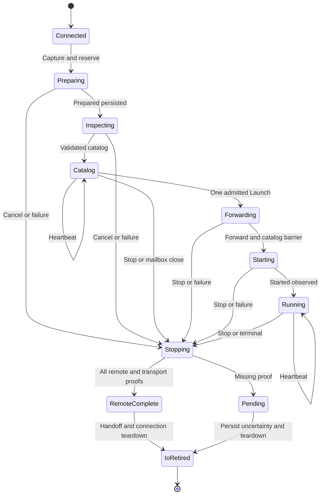

# Eidolon Wayland — I2: v3 SSH Controller詳細設計

- 設計日：2026-11-12 JST
- 推奨保存先：`docs/linux-real-app-v3-i2-detailed-design.md`
- 対象：Linux Desktop v3の通常SSH controller、Launch mailbox、remote recovery、journal finalizer
- 対象外：I3の実Wayland origin admission、I4のSDK表示判定、I5のAndroid保存・UI、I6/I7の製品受入れ
- 状態：コード調査に基づく設計。以下の「新規API」は未実装
- 文書化時の注記：§1に記載するGitHub headとCI結果は2026-11-12の**設計調査時点**の記録であり、後日にmainが更新された場合の最新状態を保証しない。実装開始時に最新mainとPRを再確認する。

## 1. 調査基準と現状

### 1.1 GitHubの確認結果

調査の開始時と回答前にGitHubを再確認した。設計調査の基準は次のとおり。

| 項目 | 確認結果 |
|---|---|
| main HEAD | `f894d796a06bcf0fafb1567718cd180ecf29009b` |
| mainの最新変更 | PR-00／PR #12のマージ |
| PR-01 | PR #13、open、未マージ |
| PR-01 head | `ba0a0b9fecc2e8660d3de9bd4bbf611a4bd243bd` |
| PR-01 base | main |
| GitHub上のmergeable | `true` |
| PR-01のhost / Android | 両方`cancelled` |
| PR-01のGIO / Mousepad foundation | 両方`cancelled` |
| report job | `skipped` |
| リポジトリ内の`AGENTS.md`等 | 基準treeの再帰一覧では該当ファイルなし |

`mergeable=true`はCI成功を意味しない。今回確認できたPR-01のCI結果は、成功ではなくキャンセルである。

参照：[mainの基準commit](https://github.com/tin-machine/eidolon-wayland/commit/f894d796a06bcf0fafb1567718cd180ecf29009b)、[PR #13](https://github.com/tin-machine/eidolon-wayland/pull/13)、[host / Androidのrun](https://github.com/tin-machine/eidolon-wayland/actions/runs/43040295629)、[L7a foundationのrun](https://github.com/tin-machine/eidolon-wayland/actions/runs/43040295610)。

設計調査時点のmainには、次の変更があった。

| Commit | 内容 |
|---|---|
| `f894d796` | PR-00のマージ |
| `65f9fa38` | Linux Desktop v3に関連するrustfmt baseline修正 |
| `1434f46e` | Curved Workspaceの実装契約・作業項目 |
| `36ebbfd4` | Curved Workspace / Immersive Terminal設計 |
| `470f0093` | Spatial Anchor設計 |
| `08673e21` | v3 source固定、検証済み接続設定のexportとcodec |

本書では、PR-01 headを**暫定契約**として参照する。実装開始時の正本は、PR-01がマージされた後の最新mainとする。

### 1.2 既に存在する基盤

コード上、次の基盤は実装済みである。

| 基盤 | 実装済みの責務 |
|---|---|
| B1 | `Pins`、`Manifest`、`Context`、`Selection`、storage identity、canonical/hash、固定catalog、`NativeOrigin`、`Startup` |
| B2 | v3 bootstrap、wire parser、`Owner`、journal、receipt parser、Recover、版別dispatch |
| C1 | remote永続profileの所有、排他、release条件 |
| C2 | 通常v3 helper、Inspect、Start、lease、子プロセス・pipe・receiptを含む回収 |
| E1 | Android storage identity、保存repository、回収barrierのインターフェース |
| I1 | compiled source集合の固定、bundle検証、設定export、`ConnectionConfig` |
| PR-01 | runtime設定・typed command・reportなどの共有契約 |

一方、**通常製品のv3 SSH controllerは存在しない**。

- `Controller::connect_spec()`はV3を明示的に`NotReady`へ返す。
- `session::connection()`のdesktop分岐はV3を実行しない。
- `native/transport/src/linux_desktop/v3/runtime.rs`は存在しない。
- v3 `Owner`には`next()`があるが、`next_launch()`はない。
- coreのv3 Inspect / Launch / Recover commandは、いずれも`NotReady`である。
- coreのruntime起動処理には、`RuntimeBinding`からv3接続設定を組み立てる配線がない。

参照：[PR-01引き継ぎ](https://github.com/tin-machine/eidolon-wayland/blob/ba0a0b9fecc2e8660d3de9bd4bbf611a4bd243bd/docs/linux-real-app-v3-pr01-contract-handoff-20261111.md)、[session.rs](https://github.com/tin-machine/eidolon-wayland/blob/ba0a0b9fecc2e8660d3de9bd4bbf611a4bd243bd/native/transport/src/session.rs)、[core runtime.rs](https://github.com/tin-machine/eidolon-wayland/blob/ba0a0b9fecc2e8660d3de9bd4bbf611a4bd243bd/native/core/src/runtime.rs)。

### 1.3 本書で採用する基本判断

I2は次の分離を守る。

1. **SSH接続世代**は`session.rs`が所有する。
2. **v3実行の調整**は新規`v3/runtime.rs`が担う。
3. **C2 wire通信**は既存`v3/owner.rs`を拡張する。
4. **remote回収の永続証拠**は既存journalを使う。
5. **local / SDK退役**はcoreの所有者から通知する。
6. **journal削除**は、SSHを必要としないfinalizerで行う。
7. **originの次回実行許可**と、**設定保存のためのruntime全体の回収**を別条件にする。
8. 一つのhelperは一回限り使用し、Startを再送しない。
9. 次回の起動は、新しいConnect / Inspect / nonce / catalogから開始する。
10. I2だけでSDK-visible `Ready`やQuest受入れを成立させたとは扱わない。

---

## 2. 実装済みAPIと追加するAPI

### 2.1 実装済みAPI

以下は計画上の名称ではなく、調査したコードに存在するAPIである。

| API | 現状・注意点 |
|---|---|
| `RuntimeBinding::parse(&[u8])` | PR-01で実装済み |
| `RuntimeBinding::matches_profile(&Profile)` | E1 storage captureとの一致を検査 |
| `ConnectSpec::linux_desktop_v3(profile, configuration, storage, files)` | PR-01で実装済み。実行配線は未実装 |
| `DesktopConfig::V3` | PR-01で実装済み |
| `v3::Binding::capture(...)` | profile/session/UID/nonce/pins/storageをcapture |
| `ExpectedEvidence::capture(...)` | Pins、Manifest、source mapを期待値として固定 |
| `sources::require_complete()` | compiled source closureの完成条件を検査 |
| `sources::validate_hashes(...)` | compiled source集合との完全一致を検査 |
| `Owner::open(...)` | 認証済みSSH handleを借用し、helper channelを所有 |
| `Owner::inspect()` | Inspect送信 |
| `Owner::selection(app_id)` | Catalogかつin-flight requestなしの場合にSelectionを取得 |
| `Owner::start(&Selection)` | Start送信 |
| `Owner::stop()` | Stopをラッチし、未応答requestの後ろに直列化 |
| `Owner::next()` | channel、deadline、heartbeat、cancelを処理 |
| `Owner::terminal_remote_clean()` | remote process / pipe / cleanup / receiptの完了判定 |
| `Owner::channel_complete()` | EOF、exit status、Close、decoder等の判定 |
| `Journal::reserve / prepared / advance / finish / clear` | 永続化と所有identity検査 |
| `Journal::matching(&Recovery)` | 保存済みcaptureと現在の認証済み接続条件を照合 |
| `v3::recovery::recover(...)` | 現状はremote回収後にjournalをclearする |
| `dispatch::captured_version()` | v2/v3 pendingの版を判定 |
| `dispatch::validate_recovery_selection()` | 別版によるRecoverを拒否 |
| `NativeOrigin::parse / matches` | B1のorigin値・照合 |
| `Startup::begin / advance / summary` | B1の表示成立判定 |

参照：[v3/mod.rs](https://github.com/tin-machine/eidolon-wayland/blob/ba0a0b9fecc2e8660d3de9bd4bbf611a4bd243bd/native/transport/src/linux_desktop/v3/mod.rs)、[configuration.rs](https://github.com/tin-machine/eidolon-wayland/blob/ba0a0b9fecc2e8660d3de9bd4bbf611a4bd243bd/native/model/src/linux_desktop_v3/configuration.rs)、[dispatch.rs](https://github.com/tin-machine/eidolon-wayland/blob/ba0a0b9fecc2e8660d3de9bd4bbf611a4bd243bd/native/transport/src/linux_desktop/dispatch.rs)。

### 2.2 I2で新規追加・変更するAPI

| API | 目的 |
|---|---|
| `v3::runtime::serve()` | 同じSSH actor上のInspect→Launch→Stopを調整 |
| `Owner::next_launch()` | 容量1のLaunch mailboxを安全な入力待ちへ統合 |
| `Owner::command_idle()` | in-flight requestがないことを確認 |
| `Owner::renew_catalog()` | heartbeat ACKとCatalog継続を確認するbarrier |
| `Owner::begin_stop()` | 絶対期限付きのStop開始 |
| `Controller::inspect_linux_desktop_v3()` | v3 Inspect受付 |
| `Controller::reserve_linux_desktop_v3_launch()` | local資源準備前の一回限りのLaunch予約 |
| `Controller::start_linux_desktop_v3()` | native所有socketを伴うLaunch受付 |
| `Controller::recover_linux_desktop_v3()` | v3 Recover受付 |
| `Controller::take_v3_reclamation()` | SSH非依存のfinalizerをcoreへmove |
| `recovery::recover_remote()` | remote証拠取得とComplete永続化まで |
| `reclamation::finalize_reclaimed()` | local / SDK退役確認後のjournal削除 |
| `IoGenerationFence` | 旧v3 I/O世代の終了証拠を確立 |
| `NativeOrigin::capture()` | trusted native入力からB1 originを作る補助API |

---

## 3. PR-01契約の修正

この節の修正はI2の前提とする。PR-01が現在の契約のままマージされた場合は、I2の最初のcommitで修正する。

### 3.1 `Ready`は実行中journalの存在を許容し、要求する

現在の`V3Report::validate()`は、`Ready`に対して次を要求している。

```rust
self.transport.phase == TransportPhase::Started
    && self.transport.launch_accepted
    && !self.transport.journal_pending
```

しかし、正常実行中もjournalは保持する必要がある。現状の条件を満たすためにjournalを先に削除すると、クラッシュ回収の根拠を失う。

**修正後の意味は次のとおり。**

| 状態 | `journal_pending` | `cleanup_pending` |
|---|---:|---:|
| Inspect / Catalog / Running | true | false |
| remote回収済み、local / SDK待ち | true | true |
| 回収不明 | true | true |
| finalizer成功後 | false | false |

`journal_pending`は「未clearのjournalが存在する／存在を否定できない」を意味する。回収異常そのものを意味しない。

修正例：

```rust
if presentation.state == PresentationState::Ready {
    require(
        self.transport.phase == TransportPhase::Started
            && self.transport.launch_accepted
            && self.transport.journal_pending
            && !self.cleanup_pending
            && presentation.startup_completed
            && presentation.main.is_some()
            && !presentation.cleanup_pending
            && self.sdk_target.as_ref().is_some_and(|target| {
                presentation.main == Some(target.target.window)
                    && target.acknowledged
                    && target.binding_present
                    && target.renderer_frame_seen
            }),
        "CONTRACT_INVALID",
    )?;
}
```

単にjournal条件を削除するのではなく、製品の`Ready`では`journal_pending=true`を要求する。これにより早すぎるjournal削除も検出する。

参照：[現在のReady検証](https://github.com/tin-machine/eidolon-wayland/blob/ba0a0b9fecc2e8660d3de9bd4bbf611a4bd243bd/native/model/src/linux_desktop_v3/report.rs#L173-L190)。

### 3.2 `relaunch_allowed`からruntime全体の破棄条件を外す

現在は`relaunch_allowed`に`runtime_reclamation.complete()`が必要である。その条件には`shutdown_complete`と`native_destroy_accepted`が含まれる。

これでは、生存中のnative runtimeで次のアプリを開始できない。

修正後：

```rust
if self.relaunch_allowed {
    require(
        !self.cleanup_pending
            && !self.transport.journal_pending
            && self.transport.phase == TransportPhase::Complete
            && self.remote_cleanup.complete()
            && self.local_retirement.complete(),
        "RECOVERY_REQUIRED",
    )?;
}
```

`relaunch_allowed`は、次の意味に限定する。

> このoriginの残存所有物は、次の実行を妨げない。

古いSelectionを再利用してよい、という意味ではない。次の起動には新しい接続世代とInspectが必要である。

一方、E1の設定保存では、引き続きruntime全体の停止と実際の`nativeDestroy`成功が必要になる。`RuntimeReclamation`はその別の証拠として維持する。native破棄後の結果はAndroid側が保持し、破棄前のnative snapshotに成功を先取りして書かない。

参照：[現在のrelaunch条件](https://github.com/tin-machine/eidolon-wayland/blob/ba0a0b9fecc2e8660d3de9bd4bbf611a4bd243bd/native/model/src/linux_desktop_v3/report.rs#L193-L200)、[E1 ReclamationBarrier](https://github.com/tin-machine/eidolon-wayland/blob/ba0a0b9fecc2e8660d3de9bd4bbf611a4bd243bd/android/app/src/main/java/io/github/tinmachine/eidolon/LinuxStorageRepository.kt#L32-L55)。

### 3.3 `RemoteCleanup`を既存B2の証拠に合わせる

PR-01の`RemoteCleanup`には、次の二項目が欠けている。

- `remote_cleaned`
- `boot_changed`

既存Recoverでは、remote再起動を確認した場合、`pipes_eof=false`のまま回収を成立させる。EOFを観測したわけではないため、この値をtrueへ書き換えてはいけない。

I2では、reportに二項目を追加する。

```rust
#[derive(Clone, Debug, PartialEq, Eq, Serialize, Deserialize)]
#[serde(deny_unknown_fields)]
pub struct RemoteCleanup {
    pub process_complete: bool,
    pub pipes_eof: bool,
    pub boot_changed: bool,
    pub remote_cleaned: bool,
    pub receipt_written: bool,
    pub ssh_channel_complete: bool,
    pub forward_retired: bool,
    pub router_drained: bool,
}

impl RemoteCleanup {
    pub fn complete(&self) -> bool {
        self.process_complete
            && (self.pipes_eof || self.boot_changed)
            && self.remote_cleaned
            && self.receipt_written
            && self.ssh_channel_complete
            && self.forward_retired
            && self.router_drained
    }
}
```

これは**新しい製品reportの修正**であり、B1 wire、C2 receipt、B2 journal schemaの変更ではない。

`boot_changed`は、検証済みreceiptまたはそのdurable Complete記録からのみ設定する。

参照：[既存journalの完了条件](https://github.com/tin-machine/eidolon-wayland/blob/ba0a0b9fecc2e8660d3de9bd4bbf611a4bd243bd/native/transport/src/linux_desktop/v3/journal.rs#L43-L64)、[receiptのboot変更検証](https://github.com/tin-machine/eidolon-wayland/blob/ba0a0b9fecc2e8660d3de9bd4bbf611a4bd243bd/native/transport/src/linux_desktop/v3/receipt.rs#L85-L94)。

### 3.4 InspectとRecoverに架空の`NativeOrigin`を作らない

`V3Report.origin`は必須であるが、Inspect時点ではLaunch requestも選択アプリも決まっていない。

また、既存journalには、旧`NativeOrigin`の次の情報が保存されていない。

- `RuntimeHandle`
- Launchの`CommandSeq`
- 選択アプリID

従って、Inspect要求や新しいRecover要求から旧originを合成してはいけない。

採用する分離：

| 場所 | 保持する情報 |
|---|---|
| `session::Snapshot.desktop_v3` | `Option<TransportSnapshot>`へ変更。transportの観測だけ |
| `session::Snapshot.desktop_v3_recovery` | Recoverの現在session・旧session・回収進捗 |
| `core::diagnostics::Snapshot.linux_desktop_v3` | `Option<V3Report>`。実originが存在する場合のみ |
| `CatalogUi.desktop_v3` | 検証済み二項目catalog |

完全な`V3Report`の生成者はcoreのreducer一つにする。

transportがStoppingになったときは、同じcore turnでB1 `Startup`へterminal/cancelを適用してからreportを公開する。古い`presentation=Ready`と新しい`transport=Stopping`を混ぜたsnapshotを公開しない。

参照：[NativeOrigin](https://github.com/tin-machine/eidolon-wayland/blob/ba0a0b9fecc2e8660d3de9bd4bbf611a4bd243bd/native/model/src/linux_desktop_v3/presentation.rs#L20-L54)、[journal Record](https://github.com/tin-machine/eidolon-wayland/blob/ba0a0b9fecc2e8660d3de9bd4bbf611a4bd243bd/native/transport/src/linux_desktop/v3/journal.rs#L68-L79)。

### 3.5 controller側の失敗をB1 `FailureReason`へ押し込まない

既存の`FailureReason`はC2用であり、journal fsync、forward取消、SDK退役timeoutなどを表現できない。

B1のenumとgoldenは維持し、製品内部の失敗型を追加する。

```rust
#[derive(Clone, Copy, Debug, PartialEq, Eq, Serialize, Deserialize)]
#[serde(rename_all = "snake_case")]
pub enum ControllerFault {
    SshIo,
    CommandTimeout,
    ChannelIncomplete,
    ForwardRequest,
    ForwardRetirement,
    RouterDrain,
    JournalReserve,
    JournalUpdate,
    JournalClear,
    PreviousIoPending,
    LocalAdmissionUnavailable,
    LocalRetirementTimeout,
    ScopeMismatch,
}

#[derive(Clone, Default, Serialize, Deserialize)]
#[serde(deny_unknown_fields)]
pub struct ControllerFaults {
    pub first: Option<ControllerFault>,
    pub cleanup: Option<ControllerFault>,
}
```

- 最初の実行失敗は`first.get_or_insert(...)`で保持する。
- 後続の回収失敗は`cleanup`へ保持する。
- C2の`public_reason`、`FailureReason`、`StopReason`は型を維持して受け渡す。
- 正常回収できても、先行した起動失敗を消さない。
- private path、stderr、credential、文書内容をエラー文字列へ含めない。

---

## 4. 責務とファイル単位の変更計画

### 4.1 責務分離

| 層 | 所有・判断 |
|---|---|
| `session.rs` | SSH接続世代、認証、UID、command dispatch、接続終了 |
| `v3/runtime.rs` | Inspectから終了までのcoordinator、Launch gate、forward、journal更新 |
| `v3/owner.rs` | C2 channel、wire sequence、in-flight request、decoder、heartbeat |
| `v3/journal.rs` | durable captureとremote/transport回収証拠 |
| `v3/recovery.rs` | 旧captureのremote証拠確認 |
| `v3/reclamation.rs` | SSH非依存のjournal finalization |
| `v3/io_fence.rs` | v3 I/O世代間の排他と旧世代終了証拠 |
| core | native origin、local Waypipe、listener、window、renderer、SDK退役の集約 |
| Android | runtime全体の回収、nativeDestroy、E1保存transaction |

### 4.2 変更ファイル

| ファイル | 変更内容 |
|---|---|
| `native/transport/src/linux_desktop/v3/runtime.rs` | 新規。実行coordinator |
| `native/transport/src/linux_desktop/v3/reclamation.rs` | 新規。deferred finalizer、local完了capability |
| `native/transport/src/linux_desktop/v3/io_fence.rs` | 新規。I/O世代fence |
| `native/transport/src/linux_desktop/v3/owner.rs` | mailbox、操作別deadline、lease時計、Stop budget |
| `native/transport/src/linux_desktop/v3/journal.rs` | Complete再開、clear再試行、finalizer専用削除境界 |
| `native/transport/src/linux_desktop/v3/recovery.rs` | `recover_remote()`へ分割 |
| `native/transport/src/linux_desktop/v3/mod.rs` | module公開 |
| `native/transport/src/linux_desktop/dispatch.rs` | V3 recovery outcomeにdeferred所有を含める |
| `native/transport/src/session.rs` | V3接続、Inspect、Launch gate、Recover、handoff |
| `native/transport/src/connect_profile.rs` | 既存V3 captureを使用。必要な補助accessorのみ |
| `native/model/src/linux_desktop_v3/report.rs` | §3の契約修正、controller fault |
| `native/model/src/linux_desktop_v3/presentation.rs` | `NativeOrigin::capture()`補助 |
| `native/core/src/linux_desktop_v3.rs` | 新規。core adapter、report reducer、finalizer所有 |
| `native/core/src/runtime.rs` | 設定parse、command dispatch、終了時handoff |
| `native/core/src/diagnostics.rs` | core所有のv3 report追加 |
| 各v3 test module | protocol、SSH、journal、Recover、finalizer検査 |
| `scripts/check-linux-desktop-v3-transport` | 新規。実C2/SSH/Waypipeの限定smoke |
| fixture用Rust driver | Controllerの公開APIを使うsmoke実行器 |
| `.github/workflows/linux-real-app.yml` | 既存fixture jobへ必須smoke stepを追加 |
| 設計書・PR-01引き継ぎ | 契約修正とI3/I4/I5への境界を記録 |

C1/C2のPython製品source、B1 hash式、既存v2 wire、既存v2 journalは変更しない。

---

## 5. 新規Rust型とAPI

以下は**追加するAPIの設計**である。型の内部fieldは、呼出側が勝手に成功状態を作れないようprivateにする。

### 5.1 captureとLaunch予約

```rust
use eidolon_model::{
    ids::{CommandSeq, RuntimeHandle, SessionId},
    linux_desktop_v3::{
        Context, Pins, Selection,
        presentation::NativeOrigin,
    },
};
use std::{path::PathBuf, sync::Arc};

/// 相関値。権限そのものではない。
/// Serialize / Deserializeは実装しない。
#[derive(Clone, PartialEq, Eq)]
pub struct ReclaimKey {
    context: Context,
    pins: Pins,
    source_hashes: super::sources::SourceHashes,
}

/// 一つのInspect/helperに固定された値。
pub(crate) struct RunCapture {
    binding: super::Binding,
    evidence: super::ExpectedEvidence,
    inspect_request: CommandSeq,
    generation: u64,
}

/// 一回限り。Clone / Deserializeは実装しない。
pub struct LaunchPermit {
    capture: Arc<RunCapture>,
    runtime: RuntimeHandle,
    request: CommandSeq,
    selection: Selection,
    reservation: u64,
    // 未消費でdropされた場合に当該runを停止するための内部状態。
}

/// UI JSONからは生成しない。
pub(crate) struct Launch {
    permit: LaunchPermit,
    origin: NativeOrigin,
    local_socket: PathBuf,
}
```

`LaunchPermit`の予約は、**local Waypipeやlistenerを作る前**に行う。

予約後にlocal準備が失敗した場合、そのhelperのLaunch gateを再びOpenへ戻さない。部分資源を回収し、helperをStopし、次回は新しいInspectへ進む。

### 5.2 transport snapshot

```rust
#[derive(Clone, Serialize)]
pub struct TransportSnapshot {
    pub protocol_revision: String,
    pub session: SessionId,
    pub inspect_request: CommandSeq,
    pub launch_request: Option<CommandSeq>,

    pub transport: eidolon_model::linux_desktop_v3::report::TransportState,
    pub journal_stage: Option<super::journal::Stage>,

    pub start_attempted: bool,
    pub started_observed: bool,
    pub terminal_observed: bool,

    /// actorのboundedな処理が終わった。
    /// remote完全回収やjournal削除とは別。
    pub actor_finished: bool,

    /// 旧接続世代のI/O所有物が実際に終了した。
    pub io_retired: bool,

    pub remote_cleanup:
        eidolon_model::linux_desktop_v3::report::RemoteCleanup,

    pub cleanup_pending: bool,
    pub faults:
        eidolon_model::linux_desktop_v3::report::ControllerFaults,
}
```

`TransportPhase::Complete`はtransport側の完了を表す。local待ちの間は、次の組合せが成立する。

```text
transport.phase = Complete
journal_stage = Complete
journal_pending = true
cleanup_pending = true
```

journal削除成功後に`journal_pending`と`cleanup_pending`がfalseになる。

### 5.3 runtime

```rust
pub(crate) struct Inspection<'a> {
    pub capture: Arc<RunCapture>,
    pub files: &'a std::path::Path,
}

pub struct RunOutcome {
    pub report: TransportSnapshot,
    pub deferred: Option<super::reclamation::DeferredReclamation>,
}

pub(crate) async fn serve<H: russh::client::Handler>(
    client: &russh::client::Handle<H>,
    router: &Arc<crate::forward::Router>,
    request: Inspection<'_>,
    launches: tokio::sync::mpsc::Receiver<Launch>,
    cancel: &tokio_util::sync::CancellationToken,
    publish: impl Fn(&TransportSnapshot),
    catalog: impl Fn(&VerifiedCatalog),
) -> RunOutcome;
```

`serve()`はSSH handleを借用する。内部で再接続しない。`Owner`、journal、forward lease、当該Launchを所有する。

`publish`と`catalog` callbackは、短い状態更新に限定する。SSH通信、filesystem I/O、core待機をcallback内で行わない。

### 5.4 Controller

```rust
impl Controller {
    pub fn inspect_linux_desktop_v3(
        &self,
        session: SessionId,
        request: CommandSeq,
    ) -> Status;

    pub fn reserve_linux_desktop_v3_launch(
        &self,
        runtime: RuntimeHandle,
        session: SessionId,
        request: CommandSeq,
        selection: &Selection,
    ) -> Result<LaunchPermit, Status>;

    pub fn start_linux_desktop_v3(
        &self,
        permit: LaunchPermit,
        origin: NativeOrigin,
        local_socket: &std::path::Path,
    ) -> Status;

    pub fn abort_linux_desktop_v3_launch(
        &self,
        permit: LaunchPermit,
        fault: ControllerFault,
    );

    pub fn recover_linux_desktop_v3(
        &self,
        session: SessionId,
        request: CommandSeq,
    ) -> Status;

    pub fn take_v3_reclamation(
        &self,
    ) -> Option<ReclamationHandoff>;

    pub fn publish_v3_finalized(
        &self,
        result: FinalizedReclamation,
    ) -> Status;
}
```

Stopの外部commandを新設しない。既存のsession disconnect / runtime stopから当該runのcancelへ接続する。

`publish_v3_finalized()`は、key・generation・現在のpending状態を照合する。file不在を見ただけでpendingを解除しない。

### 5.5 主要APIの入力・出力・失敗時の扱い

| API | 入力と所有者 | 出力 | 失敗時 |
|---|---|---|---|
| `RuntimeBinding::parse` | coreが持つ固定runtime設定 | typed configuration/storage | runtime起動拒否。v2へfallbackしない |
| `Binding::capture` | 同じ認証済み接続のUID、profile、session、nonce、pins、storage | immutable Binding | helper未実行 |
| `ExpectedEvidence::capture` | Pins、Manifest、compiled hashes | 期待evidence | source/manifest不一致として実行拒否 |
| `Journal::reserve` | files、Binding | Journal owner | execを送らない。公開済みrecordが残る可能性はpendingとして扱う |
| `Owner::open` | 認証済みhandle、Binding、ExpectedEvidence | C2 channel owner | exec enqueueが不明ならReservedを保持 |
| Inspect | 同じOwner | 検証済みCatalog | Stop/回収へ進む |
| Launch予約 | runtime/session/request/Selection | move-only permit | staleはStale、二重予約はBusy。未予約ならlocal資源を作らない |
| Launch送信 | permit、native origin、実local socket | Accepted等 | AcceptedをStartedと扱わない。失敗時は部分local資源も回収 |
| Stop | session所有者のcancel | eventual cleanup | ACK未着を成功にしない |
| `recover_remote` | 新しい認証済み接続、旧capture、旧I/O終了証拠 | remote report＋任意のdeferred | 証拠不足はjournal保持 |
| `finalize_reclaimed` | deferred＋同captureのlocal退役permit | Finalized | journal/gate保持、再試行可能な状態を返す |

---

## 6. SSH actorとmailbox

### 6.1 状態遷移



このactor状態とは別に、Launch gateを持つ。

```rust
enum LaunchGate {
    Open,
    Reserved,
    Queued,
    StartAttempted,
    Sealed,
}
```

同じrunでOpenへ戻る遷移は作らない。

### 6.2 容量1だけでは二重Launchを防げない

mailboxは`mpsc::channel(1)`とする。

ただし、最初のLaunchをreceiverが取り出すとmailboxには空きが戻る。従って、容量1だけでは二回目のLaunchを防げない。

Controllerは共有mutex下でLaunch gateを確認・更新する。

- `Open → Reserved`：local準備前の予約
- `Reserved → Queued`：`try_send()`成功
- `Queued → StartAttempted`：Start試行
- 取消・失敗・終了：`Sealed`

同じcatalogに対する二重clickは、mailboxが空でも拒否する。

### 6.3 `Owner::next()`を外側のselectでキャンセルしない

次の構成は禁止する。

```rust
// 採用しない。
tokio::select! {
    result = owner.next() => { /* ... */ }
    launch = launches.recv() => { /* ... */ }
}
```

既存`Owner::control()`は、Protocolのrequest sequenceとin-flight状態を進めてから、`data_bytes()`をawaitする。その途中で`next()`をdropし、同じOwnerを継続使用すると、送信状態とProtocol状態がずれる。

追加するAPI：

```rust
pub(crate) enum OwnerTurn {
    Events(Vec<Event>),
    Launch(Launch),
    MailboxClosed,
    Closed,
}

impl Owner {
    pub(crate) async fn next_launch(
        &mut self,
        launches: &mut tokio::sync::mpsc::Receiver<Launch>,
    ) -> Result<OwnerTurn, &'static str>;

    async fn next_input(
        &mut self,
        launches: Option<&mut tokio::sync::mpsc::Receiver<Launch>>,
    ) -> Result<OwnerTurn, &'static str>;

    pub(crate) fn command_idle(&self) -> bool;

    pub(crate) async fn renew_catalog(
        &mut self,
    ) -> Result<(), &'static str>;

    pub(crate) fn begin_stop(
        &mut self,
        observed_at: tokio::time::Instant,
    );
}
```

既存`next()`は`next_input(None)`を利用する。

mailboxは、**channel・timerを待つ内部境界だけ**に参加させる。送信開始後は、その送信が成功するか固有の2秒timeoutに達するまで、LaunchやStopによって送信futureを中断しない。

Tokioの`select!`は勝たなかったfutureをキャンセルする。`mpsc::Receiver::recv()`自体はcancel-safeであり、ここで必要なのは、その性質をOwner全体の性質と取り違えないことである。

### 6.4 内部pollの順序

各loop iterationで次を行う。

1. cancelを観測しStopをラッチする。
2. command / close / shutdownの絶対期限を検査する。
3. Stop可能なら、boundedなStop送信を完了させる。
4. heartbeat期限に達し、送信可能ならheartbeatを送る。
5. Launch受付可能なら`try_recv()`で一件確認する。
6. その後、channel / timer / mailbox / cancelを待つ。

概念例：

```rust
loop {
    self.observe_cancel();
    self.check_absolute_deadlines()?;

    if self.should_send_stop() {
        self.control(Action::Stop, None).await?;
        continue;
    }

    if self.heartbeat_due_and_eligible() {
        self.control(Action::Heartbeat, None).await?;
        continue;
    }

    if self.launch_input_enabled() {
        match launches.try_recv() {
            Ok(launch) => return Ok(OwnerTurn::Launch(launch)),
            Err(TryRecvError::Disconnected) => {
                self.latch_stop();
                return Ok(OwnerTurn::MailboxClosed);
            }
            Err(TryRecvError::Empty) => {}
        }
    }

    // ここで競合させるのは入力待ちだけ。
    let input = self.wait_for_input(...).await;
    self.handle_input(input).await?;
}
```

この例はアルゴリズムを示す。実装では`next()`から呼ぶmailboxなしの分岐も共通化する。

channelが常にreadableでも、heartbeatやStopが飢餓状態にならないよう、上記の事前検査を毎回通す。

`recv()`が`None`になったmailboxをselectし続けない。Catalog中の予期しないmailbox closeは制御owner喪失として停止する。

### 6.5 heartbeat送信中のLaunch

Launchを受け取った時点でheartbeat ACK待ちでも、Launchを失効扱いにはしない。

既存`Owner::selection()`はin-flight中に失敗するため、Catalog受理時に固定二項目のSelectionをcacheする。Launchの一致検査は、そのcacheに対して行う。

その後：

1. 受信したLaunchを一つだけ保持する。
2. 追加Launchを受信しない。
3. 元のACK deadlineを保ったまま`owner.next().await`でACKを処理する。
4. Stop、terminal、EOF、切断があればLaunchを取り消す。
5. command-idleになってからforward準備へ進む。

### 6.6 ACK待機中のStop

Stopはin-flight requestを追い越さない。

- Start ACK待機中なら、元のStart deadlineを維持する。
- ACKが来れば、その後にStopを送る。
- 非同期terminalが来れば、その証拠を採用する。
- ACK timeoutならOwnerを継続使用せず、bounded closeとRecoverへ進む。
- Startを再送しない。
- Stopを送った事実だけでは回収完了にしない。

### 6.7 操作別deadlineとlease時計

既存OwnerはInspect / Start / Heartbeatで一律5秒を使っている。一方、実C2のStartには、最大5秒のsettings probeと最大3秒のprivate bus待ちが含まれる。

そのためI2では、次の**操作全体の期限**を採用する。送信enqueueに要する時間も含め、送信開始直前から測定する。

| 操作 | 期限 |
|---|---:|
| Prepared待ち | 10秒 |
| command enqueue | 最大2秒 |
| Inspect | 10秒 |
| Start | 12秒 |
| Heartbeat | 5秒 |
| Stop | 8秒 |
| terminal後のchannel終了 | 3秒 |
| forward要求 | 5秒 |
| forward取消 | 3秒 |
| router drain | 3秒 |

通常GUIの総稼働時間には期限を設けない。

参照：[Ownerの現在のdeadline](https://github.com/tin-machine/eidolon-wayland/blob/ba0a0b9fecc2e8660d3de9bd4bbf611a4bd243bd/native/transport/src/linux_desktop/v3/owner.rs)、[C2 Start処理](https://github.com/tin-machine/eidolon-wayland/blob/ba0a0b9fecc2e8660d3de9bd4bbf611a4bd243bd/scripts/linux/eidolon_linux_desktop_session_v3.py#L259-L296)、[settings probe / bus待ち](https://github.com/tin-machine/eidolon-wayland/blob/ba0a0b9fecc2e8660d3de9bd4bbf611a4bd243bd/scripts/linux/eidolon_linux_desktop_v3.py#L438-L466)。

C2の15秒leaseはcommand受信時に更新されるため、heartbeat時計をACK受信時から5秒後へ設定し直さない。

```rust
struct LeaseClock {
    last_tx_started: Option<Instant>,
    heartbeat_due: Instant,
}

fn note_tx_started(&mut self, now: Instant) {
    self.lease.last_tx_started = Some(now);
    self.lease.heartbeat_due = now + Duration::from_secs(5);
}
```

遅いStart ACKを受けた時点でheartbeatが期限を過ぎていれば、直ちに次のheartbeatを送る。

保守的な送信条件：

```text
通常command送信前:
  now + 2秒のenqueue上限 + 1秒の余裕 <= 前回送信開始 + 15秒

forward開始前:
  now + 5秒のforward上限 + 2秒の次送信上限 + 1秒の余裕
      <= 前回送信開始 + 15秒
```

filesystem書込みが遅れる可能性があるため、journal更新後にも検査する。条件不成立は停止・pendingへ進める。

### 6.8 `renew_catalog()`の契約

Launch処理では、forward前後に明示的なheartbeat barrierを置く。

`renew_catalog()`は次を行う。

1. 既存in-flight requestがあれば元のdeadlineで処理する。
2. Catalog、非terminal、非EOF、非Stopを確認する。
3. Heartbeatを一回送る。
4. matching ACKまでpumpする。
5. 同じ受信chunk内の全eventを処理する。
6. 最終状態が引き続きCatalogの場合だけ成功する。

Heartbeat ACKとStoppedが同じchunkに入っていた場合、成功させない。

Launchの確定順序：

```text
Launch予約・受信
→ 未応答ACK処理
→ renew_catalog
→ local socket検査
→ router arm
→ ForwardRequested永続化
→ lease余裕再検査
→ streamlocal_forward
→ Stop/cancel再検査
→ renew_catalog
→ StartRequested永続化
→ lease余裕再検査
→ Startを一回だけ試行
```

追加される二回のheartbeatは意図した動作である。

### 6.9 Stop budget

OwnerがStopを最初に観測した時点から、graceful処理に24秒の絶対budgetを設ける。

これは、残りStart期限、Stop期限、channel終了を収めるためのbudgetである。

- graceful pump：最大24秒
- その後のbest-effort channel close：最大3秒
- forward取消：最大3秒
- router drain：最大3秒

従って、transportの不確定処理を打ち切る目安はStop観測後約33秒である。local / SDK回収時間は別に扱う。

外側の`timeout(async { owner.next()... })`で通常処理を中断する構成は使わない。絶対期限をOwner内部で検査する。

terminal、EOF、exit statusを受けるたびにclose deadlineを延ばさない。

```rust
self.close_deadline
    .get_or_insert(now + CLOSE_TIMEOUT);
```

---

## 7. Inspect→Launch→Stopの処理

### 7.1 接続とcapture

coreはruntime起動時に次を行う。

```rust
let binding = RuntimeBinding::parse(raw.as_bytes())?;
binding.matches_profile(&profile)?;

let spec = ConnectSpec::linux_desktop_v3(
    profile.clone(),
    binding.configuration().clone(),
    binding.storage().clone(),
    files.to_owned(),
)?;
```

SSH接続・host key確認・認証・既存UID probeの完了後、同じactorで次を行う。

```rust
sources::require_complete()?;
let hashes = sources::current_hashes();
sources::validate_hashes(&hashes)?;

let captured = v3::Binding::capture(
    profile,
    session,
    authenticated_uid,
    &nonce,
    configuration.pins().clone(),
    storage,
)?;

let expected = ExpectedEvidence::capture(
    configuration.pins(),
    configuration.manifest(),
    &hashes,
)?;
```

UIDが0の場合は拒否する。

`ExpectedEvidence`に含まれる検証済みを表す値は、期待する応答の形である。これを作っただけでremote検証成功にはしない。Catalog受理は、実C2から得たevidenceとの厳密一致後に行う。

### 7.2 シーケンス

```mermaid
sequenceDiagram
    participant Core as Core
    participant Actor as SSH actor
    participant C2 as C2 helper
    participant Journal as Journal
    participant Local as Local and SDK owners

    Core->>Actor: Inspect
    Actor->>Actor: UID and capture validation
    Actor->>Journal: reserve
    Actor->>C2: serve
    C2-->>Actor: Prepared
    Actor->>Journal: prepared boot identity
    Actor->>C2: Inspect
    C2-->>Actor: Catalog and evidence
    Actor-->>Core: Verified catalog

    Core->>Actor: Reserve one Launch
    Actor-->>Core: LaunchPermit
    Core->>Local: Register origin and prepare resources
    Local-->>Core: Owned local socket
    Core->>Actor: Launch with permit and origin

    Actor->>C2: Heartbeat barrier
    C2-->>Actor: ACK
    Actor->>Journal: ForwardRequested
    Actor->>Actor: Arm route and request forwarding
    Actor->>C2: Heartbeat barrier
    C2-->>Actor: ACK
    Actor->>Journal: StartRequested
    Actor->>C2: Start once
    C2-->>Actor: Started
    Actor->>Journal: Started
    Actor-->>Core: Transport started

    Core->>Actor: Stop
    Core->>Local: Close origin admission
    Actor->>C2: Stop after outstanding ACK
    C2-->>Actor: Terminal cleanup evidence
    Actor->>Actor: Channel close and route retirement
    Actor->>Journal: finish Complete
    Actor-->>Core: Deferred reclamation
    Actor->>Actor: Retire SSH generation

    Core->>Local: Retire all owned resources
    Local-->>Core: Matching retirement evidence
    Core->>Journal: finalize_reclaimed and clear
```

### 7.3 Startの一回性

`StartRequested`を永続化してからStartを試行する。

```rust
journal.advance(Stage::StartRequested)?;
report.start_attempted = true;
owner.start(&launch.selection).await?;
```

この後に以下が起きても、Startは再送しない。

- enqueue timeout
- SSH切断
- Started ACK喪失
- local UI再接続
- Activity再生成
- Recover成功

Recoverは旧実行の回収だけを行う。起動の再試行ではない。

### 7.4 immediate exit

Startedとterminalが同じSSH Dataに含まれる場合：

- `started_observed=true`は履歴として保持する。
- current phaseはStopping以降へ進める。
- 一瞬だけRunningやReadyを公開しない。
- local input / target admissionを閉じる。

---

## 8. JournalとRecoverの詳細設計

### 8.1 durable `Complete`の意味

既存journalのschema 2とfieldの意味を維持する。

> `Stage::Complete`はremoteおよびtransportの回収証拠が成立した状態であり、local / SDK回収完了を意味しない。

`pending()`はCompleteでも`Some`を返す現状を維持する。

### 8.2 remote処理とfinalizerを分割する

```rust
pub struct RemoteRecoveryOutcome {
    pub report: RecoveryReport,
    pub deferred: Option<DeferredReclamation>,
}

/// Move-only。SSH資源を含めない。
pub struct DeferredReclamation {
    journal: Journal,
    key: ReclaimKey,
    remote: VerifiedRemoteCleanup,
    clear: ClearState,
}

/// 表示用boolから直接構築しない。
pub struct LocalReclaimed {
    key: ReclaimKey,
    ticket_generation: u64,
    // 非公開のcapability照合情報。
}

pub struct FinalizedReclamation {
    key: ReclaimKey,
    ticket_generation: u64,
}

pub async fn recover_remote<H: russh::client::Handler>(
    client: &russh::client::Handle<H>,
    router: &Arc<crate::forward::Router>,
    request: Recovery<'_>,
    cancel: &CancellationToken,
) -> RemoteRecoveryOutcome;

pub fn finalize_reclaimed(
    deferred: &mut DeferredReclamation,
    local: &LocalReclaimed,
) -> Result<FinalizedReclamation, &'static str>;
```

`DeferredReclamation`には、次を含めない。

- SSH handle
- Owner
- Router
- forward Lease
- local Waypipe
- SDK Entity

これによりSSH actorを先に終了できる。

既存v3 `recover()`の無条件clear経路は通常callerから到達不能にする。`dispatch`のV3分岐もdeferredを返す型へ変更する。V2分岐は既存の動作を維持する。

### 8.3 local完了通知をcapabilityで束縛する

finalizerへ、JSONで受け取った`LocalRetirement`を直接渡してはいけない。

transportは、deferredと対になるmove-onlyの`ReclamationAuthority`をcoreへ渡す。coreは、当該captureの実所有trackerを確認してからauthorityを消費し、`LocalReclaimed`を生成する。

```rust
pub struct ReclamationHandoff {
    pub deferred: DeferredReclamation,
    pub authority: ReclamationAuthority,
}

pub struct ReclamationAuthority {
    // key / ticket generation / private seal
}

impl ReclamationAuthority {
    /// 信頼するcore retirement adapterからだけ呼ぶ。
    /// JNI/UI/remote commandには公開しない。
    pub fn confirm(
        self,
        observed: LocalRetirement,
    ) -> Result<LocalReclaimed, &'static str>;
}
```

このcapabilityだけで実観測が自動的に保証されるわけではない。実観測の責任はcore adapterにあり、capabilityは通知の発行元・対象capture・世代を束縛する。

確認対象は現在のmain windowだけではない。

- partial allocation
- dialog
- fallback target
- 旧scene / 旧generation
- pending Create
- pending detach / dispose
- rendererが保持する旧target
- SDK binding
- Entity

新しい資源を生成できるadmissionを閉じたうえで、これらの完了を確認する。

### 8.4 旧I/O終了証拠：`IoGenerationFence`

`previous_connection_closed=true`を呼出側の推測で設定しないため、v3専用のI/O fenceを導入する。

保存先：

```text
<files>/linux-desktop-v3-state/io.lock
```

これはjournal schemaの追加fieldではなく、安定した空のlock fileである。

成立条件：

1. 全製品v3世代が、Tokio runtime / SSH handle / Routerを作る前に取得する。
2. 旧世代の全I/O所有物とTokio runtimeが終了した後で解放する。
3. `io.lock`をunlinkしない。
4. `owner.lock`とは分離する。
5. lock FDを子processへ継承しない。
6. error / panicでも、runtimeを先に破棄するdrop順を保証する。

filesystem検査は既存journalの安全なI/O規則を再利用する。

- private directory
- regular file
- owner一致
- mode 0600
- nlink 1
- 長さ0
- `O_NOFOLLOW | O_CLOEXEC | O_NONBLOCK`
- nonblocking exclusive flock
- named fileと取得FDのdev/inode一致
- directory identityの一致

新規作成時は、fileと親directoryを永続化してからSSH処理へ進む。

```rust
pub struct IoGenerationFence {
    // private lock FD, directory identity, generation
}

pub struct PreviousIoClosed {
    // private files identity, fence generation,
    // new session, prior ReclaimKey
}
```

tokenは、fence取得時に存在した旧pending keyへ束縛する。現在の世代が後から作ったjournalに流用できない。

```text
旧origin_session != 今回のrecovery session
旧ReclaimKey == fence取得時にcaptureしたpending key
```

このfenceが証明するのは、参加済みの旧v3 I/O世代の終了である。remote processやlocal Waypipe子process、SDKの終了証拠にはしない。

既存pendingがあるのに`io.lock`が存在しない場合、初めて作ったlockから旧非参加ownerの終了を推測しない。旧開発fixture等によるpendingは、別途実終了を確認できる経路がなければ停止状態を維持する。

### 8.5 Recoverの処理順

1. v2/v3 pendingの版を確認する。
2. v3 I/O fenceを取得する。
3. 旧pending keyをcaptureする。
4. 新しいSSH接続でhost key・認証・UIDを確認する。
5. `Journal::matching()`でprofile、storage、UID、pins、sourceを照合する。
6. `PreviousIoClosed`を照合する。
7. journalがCompleteなら、その証拠を再検証・再syncする。
8. Complete以外なら、既存C2 Recoverを実行する。
9. receipt、EOF、exit status、Closeを検査する。
10. remote / transport証拠を`Journal::finish()`へ永続化する。
11. deferredをcoreへ渡す。
12. local / SDK退役後にclearする。

### 8.6 Completeからの再開

保存済みCompleteは、不可逆なremote回収証拠として再利用する。

新しい認証とcapture照合の後、次を行う。

```rust
match journal.stage() {
    Stage::Complete => {
        previous_io.validate_for(&key)?;
        let remote = journal.ensure_complete_durable()?;

        // remote helperを再実行しない。
        // recovered_boot()でUnknownへ戻さない。
        return deferred_from_persisted_complete(
            journal,
            key,
            remote,
        );
    }
    _ => {
        // 実Recover channelでreceiptを取得する。
    }
}
```

reportには証拠の由来を残す。

```rust
#[derive(Clone, Copy, Debug, Serialize)]
#[serde(rename_all = "snake_case")]
pub enum RemoteProofOrigin {
    LiveOwner,
    RecoveryReceipt,
    PersistedComplete,
}
```

Complete再利用時は`queried=false`とする。

その場合の`ssh_channel_complete`は、過去に検証して保存したchannel証拠であり、今回新しいRecover channelを開いたことを意味しない。

### 8.7 Recoverシーケンス

```mermaid
sequenceDiagram
    participant Core as Core
    participant Actor as New SSH actor
    participant Journal as Journal
    participant C2 as C2 recovery
    participant Local as Retirement tracker

    Core->>Actor: Recover
    Actor->>Actor: Acquire I/O fence and authenticate
    Actor->>Journal: Match captured identity
    Journal-->>Actor: Old binding and stage
    Actor->>Actor: Verify PreviousIoClosed

    alt Durable Complete
        Actor->>Journal: Validate identity and sync
        Journal-->>Actor: Persisted remote proof
    else Other stage
        Actor->>C2: Recover with old context and pins
        C2-->>Actor: Receipt
        Actor->>Actor: Validate receipt and channel completion
        Actor->>Journal: finish Complete
    end

    Actor-->>Core: Deferred reclamation
    Actor->>Actor: Retire new SSH generation
    Core->>Local: Resolve old capture ownership

    alt Actual local and SDK retirement proven
        Local-->>Core: LocalReclaimed
        Core->>Journal: finalize_reclaimed
        Journal-->>Core: Durable clear
    else Proof unavailable or timeout
        Local-->>Core: Pending
        Core->>Core: Keep journal barrier
    end
```

### 8.8 `finish()`失敗とCompleteの取り扱い

現在の`Journal::persist()`は、rename後のin-memory record更新をdirectory fsyncより先に行う。

そのため、次の判定は禁止する。

```rust
journal.finish(cleanup).ok();

if journal.stage() == Stage::Complete {
    // finishがfsyncで失敗していても通る可能性がある。
}
```

deferredを発行できるのは次のどちらかの場合だけ。

- `finish(cleanup)`が成功した。
- 保存済みCompleteを読み直し、identity検査とdirectory syncが成功した。

参照：[Journal::persist / finish / clear](https://github.com/tin-machine/eidolon-wayland/blob/ba0a0b9fecc2e8660d3de9bd4bbf611a4bd243bd/native/transport/src/linux_desktop/v3/journal.rs)。

### 8.9 journal clear失敗

clearは三状態で管理する。

```rust
enum ClearState {
    Linked,
    UnlinkedNeedsSync,
    Cleared,
}
```

| 状態 | 処理 |
|---|---|
| Linked | remote/local証拠、key、file bytes/dev/inodeを照合してunlink |
| UnlinkedNeedsSync | 同じdirectoryとpath不在を検査し、directory fsyncだけ再試行 |
| Cleared | 同じticketへの再通知はidempotentに成功 |

unlink成功直後、fsyncより前に`UnlinkedNeedsSync`へ進める。

重要な規則：

- 自分がunlinkする前からファイルが消えていた場合は成功にしない。
- unlink後のfsync失敗では、lockとpending gateを保持する。
- pathへ別fileが現れたら削除せず、owner changedとして拒否する。
- file不在だけでSharedのpendingを解除しない。
- 成功したfinalizerの通知だけがpendingを解除する。
- clear失敗を理由に、別identityのUnknown recordを作り直さない。

crash後にファイルが再出現した場合はCompleteから再開する。削除が永続化されていた場合は、unlink前に全回収証拠が揃っていたため空状態として扱える。

### 8.10 回収中のcrash

| crash地点 | 再開時の扱い |
|---|---|
| reserve前 | 新しいremote実行は未要求 |
| Reserved後、Prepared不明 | exec不確定。実Recoverで証拠確認 |
| Prepared後 | 保存済みbootを使う |
| ForwardRequested後 | forward要求済みの可能性を保持 |
| StartRequested後 | 起動済みの可能性を保持。Start再送禁止 |
| remote Complete後 | remote証拠を再利用し、local証拠を改めて確認 |
| local退役後、clear前 | journalを保持したままlocal providerで再確認 |
| unlink後、fsync前 | fileが残ればComplete、消えていればclear済み |

**PreparedやForwardRequestedというstageから、local資源が未作成だったと推測してはいけない。** coreはStart前にWaypipeやlistenerを作るためである。

また、現在のlocal Waypipe実装はprocess groupを作っているが、アプリprocessの死亡だけで子processの消滅を証明する仕組みやdurable local rosterはない。I2単独では、cold crash後のlocal回収完了を自動認定しない。

I3向けの境界を次で固定する。

```rust
pub enum PriorLocalRetirement {
    Pending,
    Reclaimed(LocalReclaimed),
}

pub trait CrashRetirementProvider {
    fn poll_prior_origin(
        &mut self,
        key: &ReclaimKey,
    ) -> PriorLocalRetirement;
}
```

provider未完成・証拠不明なら、remote Completeまで進んでもjournalは保持する。

参照：[local Waypipeのspawn](https://github.com/tin-machine/eidolon-wayland/blob/ba0a0b9fecc2e8660d3de9bd4bbf611a4bd243bd/native/core/src/waypipe.rs#L82-L108)、[RuntimeDirectoryの所有identity](https://github.com/tin-machine/eidolon-wayland/blob/ba0a0b9fecc2e8660d3de9bd4bbf611a4bd243bd/native/core/src/helper.rs#L39-L115)。

### 8.11 runtime shutdownの循環待ち防止

現在のcore shutdownは、transport終了を待ってからlocal Sessionを退役させる順序を含む。transportがlocal完了を待つ設計にすると循環する。

採用する順序：

1. coreがorigin admissionとinputを閉じる。
2. transportがboundedなremote / channel / forward / router処理を終える。
3. SSH資源を持たないdeferredをhandoffする。
4. transportの接続世代を終了する。
5. coreがlocal資源とSDK全世代の退役を進める。
6. core所有のfilesystem workerでfinalizerを実行する。
7. finalizer jobの終了を確認する。
8. runtime shutdownを完了する。
9. AndroidがnativeDestroyを行う。
10. 設定保存時はE1 barrierへ進む。

`Controller::is_finished()`はjournal削除成功を待たない。

remote process完了が不明でも、SSH世代とrouterが退役していればlocal資源を停止できる。**localを停止できる条件**と、**journalを削除できる条件**を分離する。

local / SDK待ちはcoreを同期blockしない。30秒を超えたら`LocalRetirementTimeout`を記録してpendingを保持し、実退役callbackの処理は継続する。timeoutを退役成功へ変換しない。

---

## 9. 資源の所有者と異常系

### 9.1 所有と解放条件

| 資源・証拠 | 所有者／取得元 | 解放・成立条件 |
|---|---|---|
| SSH接続 | session owner | handleと関連task、Tokio runtimeの終了 |
| I/O fence | session owner | 上記終了後にFD close |
| C2 channel | `Owner` | EOF、exit status、Close、decoder、protocol検査 |
| remote process | C2 `ProcessOwner` | 実子孫回収、または検証済みboot変更 |
| remote pipes | C2 drain | 実EOF。boot変更ではfalseを維持 |
| remote receipt | C2 | 検証済みdurable receipt |
| remote session cleanup | C2 | profile release、ephemeral cleanup等 |
| remote forward | v3 runtime | cancel ACK、または旧接続全体の実退役 |
| router task | `Router` / `Lease` | 新規受付停止後にjoin |
| journal | runtime→deferred | remoteとlocal/SDK証拠後にdurable clear |
| local Waypipe | core local owner | child/group回収、worker終了 |
| listener / display | core Session | accept停止、client等回収、所有directory処理 |
| window / SHM / pixel budget | core / compositor / renderer | 全世代の所有物・budget解放 |
| SDK binding / Entity | I4 adapter | full TargetKeyに対応するrelease / dispose完了 |
| runtime全体 | core / Android | 全worker終了、shutdown、nativeDestroy |

`router.active == 0`だけでは、新しいcallbackの受付を止めた証拠にならない。既存`Lease::close()`の受付停止とtask joinを使う。

参照：[Router / Lease](https://github.com/tin-machine/eidolon-wayland/blob/ba0a0b9fecc2e8660d3de9bd4bbf611a4bd243bd/native/transport/src/forward.rs)、[local Session退役条件](https://github.com/tin-machine/eidolon-wayland/blob/ba0a0b9fecc2e8660d3de9bd4bbf611a4bd243bd/native/core/src/session.rs#L663-L771)。

### 9.2 異常系ルール

| 事象 | 必須動作 |
|---|---|
| stale Selection | local準備前に拒否。現行Catalogを別captureへ読み替えない |
| 重複Launch | gateでBusy。receiverが空になっても再受付しない |
| local準備失敗 | 部分所有を保持して退役。helperを停止 |
| forward要求拒否・timeout | Startしない。要求済みpathへの取消を試みる |
| Start enqueue timeout | StartRequested保持。再送しない |
| Start ACK喪失 | Startedを推測しない。旧接続退役後Recover |
| partial JSON＋EOF | protocol不正。channel cleanにしない |
| Closeだけ到着 | remote completionやpipe EOFを補完しない |
| Stop中切断 | local転送を退役。remoteはreceipt / boot証拠でRecover |
| lease失効 | C2 terminalの理由を保持。自動再Launchしない |
| remote Complete、local未回収 | journal Completeを保持 |
| SDK旧generation残存 | finalizer不可 |
| journal clear失敗 | pendingと所有ticketを保持 |
| source hash不一致 | exec前拒否。保存済みhashを現在値へ置換しない |
| malformed / inaccessible journal | 空状態へ変換しない |
| callbackが旧generation | 状態更新を拒否 |
| journalが勝手に消えた | 成功扱いせずowner changed |

---

## 10. v2 / Termux互換性

次を不変条件とする。

1. v2の固定source集合を変更しない。
2. v2の11/12引数、v3の14/15引数を変更しない。
3. B1の9-field Pins、canonical/hash、既存goldenを変更しない。
4. v2 journalとv2 Recoverはそのまま使う。
5. remote応答からdecoder版を選ばない。
6. v3 parse失敗時にv2へfallbackしない。
7. v2 pendingがある場合、v3 reserve / Launch / Recoverを拒否する。
8. v2 pendingは、保存済みv2 captureに一致する旧Recoverで処理する。
9. v2/v3両方のpending、または破損journalはfail closedにする。
10. v3 fieldが`None`の場合、既存v2 / Termux snapshotへ余分なfieldを出さない。
11. active runtimeではbackendを一つだけ選ぶ。
12. storage上にv2/v3設定が共存することと、同時実行を区別する。

`session.rs`のpending管理はv2専用のままにせず、内部で版を保持する。

```rust
enum DesktopPending {
    None,
    V2(linux_desktop::Pending),
    V3(v3::journal::Pending),
    Blocked(&'static str),
}
```

判定には既存`dispatch::captured_version()`を利用する。別のschema推測器を実装しない。

---

## 11. テスト設計

### 11.1 検証層

| 層 | 確認すること | 証明できないこと |
|---|---|---|
| 純粋unit / golden | 状態遷移、厳密parse、key一致、契約条件 | 実process回収 |
| 決定的SSH peer | 暗号化SSH上の順序、ACK、EOF、切断、mailbox | 実C2のprofile・子孫回収 |
| OpenSSH＋実C2 | bootstrap、source、C1、lease、receipt | SDK表示 |
| 実Waypipe＋host compositor | 実データ転送とlocal process退役 | Quest SDKのEntity回収 |
| I3/I4/I5結合 | origin、全target世代、SDK、保存barrier | 実機特有の表示品質 |
| Quest | 実SDK・実表示・実操作 | I2単独の完了条件には含めない |

### 11.2 必須ケース

| ID | ケース | 必須assertion | 主な層 |
|---|---|---|---|
| T01 | Inspect→Launch→Stop | 同一actor、Start一回、全段階の証拠 | SSH |
| T02 | Catalog idle | heartbeat継続、アプリ未起動 | SSH |
| T03 | heartbeat送信中Launch | 送信futureを中断しない | Owner |
| T04 | heartbeat ACK待ちLaunch | 元deadline維持、StartはACK後 | SSH |
| T05 | ACK待ちStop | Stopがrequestを追い越さない | SSH |
| T06 | Start ACK喪失 | StartRequested保持、再送ゼロ | SSH |
| T07 | 遅いStart ACK | 8〜10秒後ACKでも、期限内なら受理、次heartbeat即時 | SSH |
| T08 | forward拒否 | Startゼロ、取消とrouter退役を試みる | SSH |
| T09 | forward ACK不明 | 未要求へ戻さない | SSH |
| T10 | partial EOF | channel complete=false、journal保持 | SSH |
| T11 | Stop中SSH切断 | remote不明を保持、local転送退役 | SSH |
| T12 | lease timeout | 実C2のlease失効と回収証拠 | 実C2 |
| T13 | 重複Launch | dequeue後も二回目を拒否 | Controller |
| T14 | stale Selection | session/scope/revision/appの各不一致を拒否 | Unit / Controller |
| T15 | mailbox close | 停止し、ready-None loopを起こさない | Owner |
| T16 | Started＋terminal同chunk | 履歴Started、currentはStopping | SSH |
| T17 | v2 pending | v3実行・書換えを拒否 | Journal / Controller |
| T18 | v2/v3両pending | 版選択拒否 | Dispatch |
| T19 | journal各stageでcrash | 正しいstageから再開、Start再送なし | 子process / FS |
| T20 | remote完了・local未回収 | Complete、pending true、file保持 | Finalizer |
| T21 | SDK binding残存 | clear不可 | Core adapter |
| T22 | SDK Entity残存 | clear不可 | Core adapter |
| T23 | 旧targetの遅延通知 | 新captureの証拠に使わない | Core adapter |
| T24 | boot変更Recover | `pipes_eof=false`で正しく完了 | Receipt / SSH |
| T25 | Complete再開 | `queried=false`、local証拠は新規確認 | Recovery |
| T26 | finish fsync失敗 | in-memory Completeだけでdeferred発行しない | FS fault |
| T27 | unlink失敗 | file保持、再試行可能 | FS fault |
| T28 | unlink後fsync失敗 | syncだけ再試行、gate保持 | FS fault |
| T29 | clear途中のfile差替え | 別fileを削除しない | FS fault |
| T30 | local回収timeout | pending維持、SSH workerは終了可能 | Core |
| T31 | shutdown順序 | transport終了前後の循環待ちなし | Core / Controller |
| T32 | UID=0 / capture不一致 | helper前拒否 | Controller |
| T33 | source不足・変更 | exec前拒否、journal不変 | Source / SSH |
| T34 | v2 / Termux | 既存suiteを通す | 回帰 |
| T35 | I3 adapter不在 | 製品Launchを資源準備前にNotReady | Core |
| T36 | crash local proof不明 | remote Completeでもjournal保持 | Recovery |

### 11.3 fenceテスト

追加で次を必須とする。

- 前世代がfenceを保持中は新接続を開始しない。
- channelだけ閉じても、Tokio runtime終了前はfenceが解放されない。
- process強制終了後は別processが取得できる。
- execした子にFDが残らない。
- directory / lock inode差替えを拒否する。
- 別root、別key、旧epochのtokenを拒否する。
- 現在sessionのjournalへ旧I/O証拠を流用できない。
- fence取得成功だけではlocal Waypipe退役を成立させない。

### 11.4 再利用するfixture

優先して再利用する。

- `scripts/tests/fixtures/linux-desktop-v3-contract.json`
- `scripts/tests/fixtures/linux-desktop-v3-wire.json`
- `scripts/tests/fixtures/linux-desktop-v3-configuration.json`
- `native/transport/src/linux_desktop/controller_tests.rs`
- `native/transport/src/linux_desktop/owner_tcp_tests.rs`
- `native/transport/src/forward/openssh.rs`
- `native/transport/src/linux_desktop/v3/journal/tests.rs`
- `native/transport/src/linux_desktop/v3/recovery/tests.rs`
- `scripts/tests/test_linux_desktop_v3_c2.py`
- `scripts/tests/fixtures/linux_desktop_v3_c2_cases.py`
- `scripts/ci/prepare-linux-real-app-fixture`
- `scripts/fixtures/linux-real-app-wayland`

注意点として、既存のOpenSSH actor fixtureにはForceCommandで合成応答へ置き換えるものがある。また、C2実所有テストにはHOMEやboot identityをfixture側で置換するものがある。これらを、immutable bootstrapからの通常v3結合成功と同一視しない。

参照：[既存SSH fixture](https://github.com/tin-machine/eidolon-wayland/blob/ba0a0b9fecc2e8660d3de9bd4bbf611a4bd243bd/native/transport/src/linux_desktop/tests.rs)、[実C2 case fixture](https://github.com/tin-machine/eidolon-wayland/blob/ba0a0b9fecc2e8660d3de9bd4bbf611a4bd243bd/scripts/tests/fixtures/linux_desktop_v3_c2_cases.py)。

### 11.5 I2で要求する実結合smoke

I6全体を実装せず、次の二ケースをI2に含める。

**ケースA：実Inspect→Catalog→Stop**

- 実OpenSSH
- 非rootの専用テスト環境
- 実passwd HOME
- I1で構築したimmutable v3 bundle
- 実compiled source hashes
- 実C1 / C2
- 合成ForceCommandなし

これにより、bootstrap、profile所有、settings probe、Catalog、receipt、channel終了を確認する。

**ケースB：実Launch→Started→Stop**

ケースAに加え、実local Waypipeと既存host compositor fixtureを使う。

remoteアプリはC2から起動し、A0 harnessによる直接spawnで代替しない。

確認項目：

- 実Startとprocess identity
- 実forward転送
- terminal / receipt / channel証拠
- local Waypipe停止・join
- local退役通知前のjournal保持
- 通知後のclear

SDKを作らないfixtureでは、その「未割当」はfixture自身の所有台帳による明示的証拠とする。製品SDK回収の成功とは記録しない。

必要な依存が欠けた場合、必須smokeは非zeroで終了する。未実行を成功に数えない。

---

## 12. I3 / I4 / I5へ渡すインターフェース

### 12.1 I3：local準備とorigin admission

I3へ渡すのは、nativeで予約済みのLaunchとB1 originである。

```rust
impl NativeOrigin {
    pub fn capture(
        runtime: RuntimeHandle,
        request: CommandSeq,
        context: &Context,
        selection: &Selection,
        pins: &Pins,
    ) -> eidolon_model::linux_desktop_v3::Result<Self>;
}
```

このconstructorは、runtime/requestをnative dispatchから、session/nonce/scope/appをcapture済み値から取得する。

I3側の予定API：

```rust
fn prepare_local(
    &mut self,
    origin: NativeOrigin,
    options: session::Options,
) -> Result<PreparedLocalV3, LocalPreparationFailure>;

fn begin_retirement(
    &mut self,
    key: &ReclaimKey,
);

fn poll_retirement(
    &mut self,
    key: &ReclaimKey,
) -> LocalRetirement;
```

`PreparedLocalV3`は実Sessionと資源を所有し、実起動後にforward socketを公開する。

部分失敗時も、作成済み資源を所有する値を保持する。`Err`だけを返して所有物を失わない。

I3が追加する`Session::start_v3()`は、listenerがclientを受け入れる前にoriginを取り付ける。既存v2 `Session::start(..., AppMode::LinuxDesktop, ...)`をそのままv3として呼ばない。

### 12.2 I4：表示成立とSDK退役

I4は既存B1 `Startup`を使う。

```rust
fn observe_presentation(
    &mut self,
    origin: &NativeOrigin,
    observation: &Observation,
) -> Result<(), &'static str>;
```

- Started ACKだけでReadyにしない。
- SDK Create ACK、binding、renderer frameをfull TargetKeyへ対応付ける。
- terminal/cancelを同じturnのReadyより優先する。
- 全generation・dialog・fallback・pending operationの退役をlocal trackerへ反映する。
- 旧callbackを新しいticketの完了に使わない。

### 12.3 I5：runtime全体の回収と保存

E1の実APIを維持する。

```kotlin
interface ReclamationBarrier {
    fun <T> withReclaimed(
        captureToken: String,
        action: (ReclamationEvidence) -> T,
    ): T
}
```

I5が確認するのは、origin退役より広い範囲である。

- 全接続
- coordinator / finalizerを含む全worker
- diagnostic panelを含む全panel
- 全native target
- 全SDK binding / Entity
- pending operation
- remote cleanup pendingなし
- shutdown complete
- nativeDestroy accepted

`relaunch_allowed`をこのbarrierの代用にしない。

### 12.4 I2だけで完成させる範囲

I2では、transportのLaunch / Stopとfinalizerを、実fixtureを使って完成させる。

通常製品のLaunchについては、I3の実local adapterが未接続なら、**Launch予約とlocal割当前に`NotReady`**を返す。固定診断は`LocalAdmissionUnavailable`とする。

Inspect / Catalog / Recoverの配線はI2で進める。実GUI originやSDK成功を仮の値で補わない。

この境界をI2 PR本文へ明記する。

---

## 13. 実装順序と内部commit

I2は一本の機能PRとし、内部commitを次の順で積む。

| Commit | 内容 | 次へ進める条件 |
|---|---|---|
| 1. 型・契約・adapter | §3修正、snapshot分離、capture/permit型、core設定parse | 契約テストが通り、v2 serialization不変 |
| 2. Owner mailbox | `next_launch`、内部poll、deadline、lease時計、Stop budget | heartbeat/Launch/Stop競合が決定的に検証できる |
| 3. v3 runtime | serve、Catalog、forward、Start一回、remote cleanup | runtime SSH fixtureの正常・異常系が通る |
| 4. SSH actor統合 | V3接続、UID、pending版管理、fence、Controller API | 公開Controller経由で動作し、stale/重複を拒否 |
| 5. Recover / finalizer | remote分離、Complete再開、handoff、clear再試行 | local/SDK未回収でjournal保持、shutdown循環なし |
| 6. 実結合・回帰・文書 | 実C2/Waypipe smoke、既存CIへの登録、引き継ぎ更新 | 同じheadで必要な検証が成立 |

各commitは可能な限りcompile可能にする。中間commitの一時的なNotReadyは、機能完成前の内部段階に限定する。

最終PRでは、残るNotReadyがI3の実local admission待ちであることを区別する。

---

## 14. 完了条件とCI方針

### 14.1 I2の完了条件

以下をすべて満たす。

- PR-01の契約矛盾を修正済み。
- V3設定から認証済みSSH actorへ接続できる。
- 同じactorでInspect→Catalog→Launch→Stopが成立する。
- mailbox容量と一回限りgateの両方が存在する。
- Start ACK喪失で再送しない。
- heartbeatとLaunch / Stopの競合を安全に処理する。
- remote・channel・forward・router証拠を独立して保持する。
- remote成功だけではjournalを消さない。
- local / SDK未回収でComplete journalを保持する。
- cold Completeを正しく再開できる。
- journal clearの部分失敗を扱える。
- shutdownに循環待ちがない。
- 旧v2 pendingを別版として保持・拒否できる。
- v2 / Termuxの既存テストが通る。
- 実C2と実Waypipeの限定smokeが通る。
- I3/I4/I5の未実装範囲を成功扱いしていない。

### 14.2 ローカル検証

開発中は変更範囲に対応する検証を使う。

```bash
cargo test --locked -p eidolon-model linux_desktop_v3
cargo test --locked -p eidolon-transport linux_desktop::v3
scripts/check-host --suite transport
```

core adapter変更時は、既存の依存準備を行うsuiteを使う。

```bash
scripts/check-host --suite lifecycle
```

push前の最終検証：

```bash
scripts/check-host --suite all
git diff --check
```

`check-host --suite all`には、design、fmt、clippy、登録済みRust/Python suite等が含まれるため、直後に同じ全検査を重複実行する必要はない。

実結合smokeは、専用環境で必須実行する。

```bash
scripts/check-linux-desktop-v3-transport \
  --reviewed-package "$EIDOLON_REVIEWED_PACKAGE" \
  --artifact-root "$EIDOLON_I2_ARTIFACT_ROOT"
```

このscriptは新規実装する。既存の`check-linux-real-app --stage acceptance`をI2完了に見せかけて成功化しない。

### 14.3 CI負荷を抑える進め方

- 中間commitはローカルに積む。
- 機能完成とローカル検証に近い段階で初回pushする。
- 一本のPRへまとめる。
- 実C2/Waypipe smokeは既存Mousepad fixture jobのbuild結果を再利用する。
- 重いfixtureを新jobで重複buildしない。
- CIのskip、条件緩和、必須検査削除は行わない。
- CIが失敗した場合、原因をまとめて修正してから追加pushする。
- PR本文には、head SHA、実行した検査、結果、未実施の実機検証を分けて記録する。
- マージは行わない。

参照：[既存host suite](https://github.com/tin-machine/eidolon-wayland/blob/ba0a0b9fecc2e8660d3de9bd4bbf611a4bd243bd/scripts/check-host)、[既存CI](https://github.com/tin-machine/eidolon-wayland/blob/ba0a0b9fecc2e8660d3de9bd4bbf611a4bd243bd/.github/workflows/check.yml)、[既存Mousepad fixture job](https://github.com/tin-machine/eidolon-wayland/blob/ba0a0b9fecc2e8660d3de9bd4bbf611a4bd243bd/.github/workflows/linux-real-app.yml)。

---

## 15. 未解決事項と推奨判断

### 15.1 PR-01のマージ状態

設計時点では未マージであり、確認したCIも成功していない。

**判断：** 設計はこのheadを暫定基準として完成させる。実装はPR-01マージ後のmainから開始し、本書の契約修正が既に取り込まれているかを照合する。

### 15.2 cold crash後のlocal資源回収

現状のlocal WaypipeとRuntimeDirectoryだけでは、旧アプリprocess死亡後の全local資源退役を十分に証明できない。

**判断：** I2はremote recoveryとjournal保持を完成させる。I3にdurable local ownershipとcrash retirement providerを渡し、provider未成立ならpendingを維持する。

この点を隠して「v3 crash recovery全体が完成」と記録しない。

### 15.3 操作別deadline

Inspect 10秒 / Start 12秒は、現C2処理の上限構成に基づく採用値である。filesystemやschedulerの任意の遅延まで成功させる保証ではない。

**判断：** この値で実装し、遅延注入テストと実C2 smokeで検証する。超過は不確定状態として安全に回収する。Start再送やlease条件の緩和で成功率を補わない。

### 15.4 I2とI3の並行開発

I2がv2用Sessionを流用して仮のoriginを作ると、I3の所有契約と衝突する。

**判断：** I2ではcore adapterを定義し、未接続時の製品Launchを明示的に拒否する。I3が実adapterを接続する。transport機能の完成は実fixtureで確認する。

### 15.5 reportの変更調整

`session::Snapshot.desktop_v3`の型変更と`RemoteCleanup`修正は、I3/I4/I5全担当へ影響する。

**判断：** I2の最初のcommitで契約を修正し、PR-01引き継ぎにも同時に記録する。B1 wireやjournal形式は維持する。並行担当には、この修正済み契約を渡す。

---

# 付録A：小さいLLMへ渡すI2実装用の初期プロンプト

以下は詳細設計と併せてそのまま実装セッションへ渡すための指示である。設計のみを行う本ドキュメントの追加作業では実装しない。

```markdown
# Eidolon Wayland — I2: v3 SSH Controller実装

Eidolon WaylandのI2を実装してください。

リポジトリ:
https://github.com/tin-machine/eidolon-wayland

最終目標は、Quest 3のMR空間で別LinuxホストのGUIアプリを複数の独立したウィンドウとして使用することです。

今回は、Linux Desktop v3の通常SSH controller、Launch mailbox、remote recovery、journal finalizerを実装します。

最新mainから専用branchを作成し、実装・テスト・push・PR作成まで進めてください。
PRは原則一本の大きな機能PRにまとめてください。
マージは禁止です。

## 1. 正本と依存関係

PR-01:
https://github.com/tin-machine/eidolon-wayland/pull/13

主な参照:
- docs/linux-real-app-v3-i2-detailed-design.md
- docs/linux-real-app-v3-pr01-contract-handoff-20261111.md
- docs/linux-real-app-v3-integration-plan-20261111.md

このプロンプトに続けて渡す「I2詳細設計全文」を実装仕様としてください。

詳細設計書がまだリポジトリに存在しなければ、提供された全文を
docs/linux-real-app-v3-i2-detailed-design.md
へ追加してください。設計書が存在すると仮定して読み飛ばさないでください。

設計時の基準:
- main: f894d796a06bcf0fafb1567718cd180ecf29009b
- PR-01 head: ba0a0b9fecc2e8660d3de9bd4bbf611a4bd243bd

これらのSHAへ戻す指示ではありません。
最初に最新main、PR #13の状態とCI、関連PR、AGENTS.md等を確認してください。

実装の正本はPR-01マージ後のmainです。
PR-01が未マージなら依存条件が未成立であることを報告し、
無断マージやPR-01の勝手な取り込みを行わないでください。
その場合でも、最新headとの差分調査と実装準備は進めてください。

## 2. 実装範囲

中心:
- native/transport/src/linux_desktop/v3/runtime.rs
- native/transport/src/linux_desktop/v3/owner.rs
- native/transport/src/linux_desktop/v3/journal.rs
- native/transport/src/linux_desktop/v3/recovery.rs

追加:
- native/transport/src/linux_desktop/v3/reclamation.rs
- native/transport/src/linux_desktop/v3/io_fence.rs
- native/core/src/linux_desktop_v3.rs

接続:
- native/transport/src/session.rs
- native/transport/src/connect_profile.rs
- native/transport/src/linux_desktop/dispatch.rs
- native/model/src/linux_desktop_v3/report.rs
- native/model/src/linux_desktop_v3/presentation.rs
- native/core/src/runtime.rs
- native/core/src/diagnostics.rs

既存B1/B2/C1/C2/E1/I1を再実装しないでください。

## 3. 最初に修正する共有契約

最新mainで修正済みなら、その実装を検証して再利用してください。

1. 正常実行中のReadyではjournal_pending=trueを要求する。
2. relaunch_allowedからruntime全体のshutdown/nativeDestroy条件を外す。
3. RemoteCleanupへremote_cleanedとboot_changedを追加し、既存B2条件へ揃える。
4. Inspect/Catalog/Recoverで架空のNativeOriginを作らない。
5. transport snapshotとcoreの完全なV3Reportを分離する。
6. controller側の失敗をB1 FailureReasonへ無理に追加せず、別のtyped faultを使う。

B1 wire、canonical/hash、golden、C2 receipt、既存journal schemaを変更しないでください。

## 4. 実装するAPI

- v3::runtime::serve()
- Owner::next_launch()
- Owner::command_idle()
- Owner::renew_catalog()
- Owner::begin_stop()
- Controller::inspect_linux_desktop_v3()
- Controller::reserve_linux_desktop_v3_launch()
- Controller::start_linux_desktop_v3()
- Controller::abort_linux_desktop_v3_launch()
- Controller::recover_linux_desktop_v3()
- Controller::take_v3_reclamation()
- Controller::publish_v3_finalized()
- recovery::recover_remote()
- reclamation::finalize_reclaimed()
- IoGenerationFence / PreviousIoClosed
- NativeOrigin::capture()

具体的なsignature、所有権、状態遷移、失敗時動作は詳細設計に従ってください。

## 5. SSH actorの必須条件

認証済みSSH handle、UID、profile、storage、pins、manifest、compiled sourcesを同じ接続世代へcaptureしてください。

Inspect、Catalog、Launch、Stopを同じSSH actorで処理してください。

Launch mailboxは容量1とし、それとは別に一回限りのLaunch gateを持ってください。
local資源準備前にLaunchPermitを予約してください。

Owner::next()を外側のtokio::select!でmailboxと競合させないでください。
mailboxはOwner内部の安全な入力待ち境界に参加させてください。

heartbeat送信中にLaunchが来ても送信futureを中断しないでください。
ACK待ち中のStopは元のdeadlineを維持してラッチしてください。

StartRequestedを永続化してからStartを最大一回だけ試行してください。
enqueue timeoutやACK喪失でも自動再送は禁止です。

## 6. deadlineとlease

詳細設計に従い、送信enqueue時間を含む操作全体の期限を使ってください。

- Prepared 10秒
- enqueue最大2秒
- Inspect 10秒
- Start 12秒
- Heartbeat 5秒
- Stop 8秒
- channel close 3秒
- forward 5秒
- forward取消3秒
- router drain 3秒

heartbeat時計はACK受信時刻ではなく送信開始時刻を基準にしてください。
遅いStart ACK後の期限超過heartbeatは直ちに送信してください。

forward前後のrenew_catalog barrierと、journal更新後のlease余裕再検査を実装してください。

通常GUIの総稼働時間制限を追加しないでください。
Stopの絶対budgetはOwner内部で管理してください。

## 7. Journalと回収

remote process completion、pipes EOF、receipt、remote cleanup、
SSH channel complete、forward retirement、router drain、
local Waypipe、listener、window、SDK binding、Entityを区別してください。

recover_remoteはremote証拠取得とJournal::finishまでを担当し、
local/SDK証拠なしにclearしないでください。

DeferredReclamationはJournalを所有しますが、
SSH handle、Owner、Router、Leaseを持たせないでください。

SSH actorはlocal/SDK回収を待たずに終了可能にしてください。
coreが退役を進め、FS専用の所有jobでfinalize_reclaimedを実行してください。

origin退役の条件にnativeDestroyを含めないでください。
E1保存用のruntime全体barrierは別条件です。

Completeの永続化が成功した場合だけdeferredを発行してください。
finishのfsync失敗後にin-memory stageだけを見て成功させないでください。

clearはLinked / UnlinkedNeedsSync / Clearedで管理してください。
unlink後fsync失敗は、同じticketとlockを保持し、syncだけ再試行してください。
別fileが現れたら削除しないでください。

保存済みCompleteは、新規認証・capture・旧I/O終了証拠を照合し、
再sync後にremote証拠として再利用してください。
その場合queried=falseとし、local/SDK証拠は新たに確認してください。

## 8. I/O fenceとcrash

全製品v3接続世代でstableなio.lockを取得し、
全SSH/forward所有物とTokio runtimeの終了後に解放してください。

lock fileをunlinkしないでください。
CLOEXEC、private mode、owner、type、nlink、inode、directory identityを検査してください。

PreviousIoClosedは、fence取得前に存在した旧pending keyへ束縛してください。
現在世代の新しいjournalへの流用は禁止です。

fenceをremote processやlocal Waypipe/SDKの退役証拠にしないでください。

cold crash後のlocal資源について、実証拠を供給するI3 providerがなければ
remote Completeでもjournalを保持してください。

## 9. I3/I4/I5との境界

I2のtransport Launch/Stopは実fixtureで完成させてください。

通常製品のLaunchは、I3の実local adapterが未接続なら
Launch予約・local割当前にNotReadyで拒否してください。
v2 Session経路やfake originへfallbackしないでください。

I4のSDK ACK/binding/frameやEntity disposalを合成しないでください。
V3Reportはcore reducer一つで組み立ててください。

I5の設定保存には実runtime全回収とnativeDestroyが必要です。
relaunch_allowedを保存barrierの代用にしないでください。

## 10. 実装順序

内部commitは次の順を基本としてください。

1. 型・PR-01契約修正・adapter
2. Owner mailbox・deadline・lease
3. v3 runtime
4. SSH actor・Controller・pending版管理・fence
5. Recover・deferred finalizer・clear再試行
6. 実結合smoke・回帰・引き継ぎ文書

## 11. 必須テスト

詳細設計のT01〜T36とfence検査を実装・実行してください。

特に:
- 正常Inspect→Launch→Stop
- heartbeat/Launch競合
- ACK待ちStop
- Start ACK喪失
- 遅いStart ACK
- forward拒否・不確定ACK
- partial EOF
- Stop中SSH切断
- 実C2 lease timeout
- 重複Launch
- stale Selection
- 旧v2 pending
- v2/v3両pending
- 各journal stageのcrash
- remote Complete/local未回収
- SDK未回収でjournal保持
- Complete再開
- finish/clearのfsync失敗
- cleanup timeout
- shutdown循環待ち防止
- v2/Termux回帰

既存golden、SSH fixture、C2実所有fixture、Waypipe/compositor fixtureを再利用してください。

合成SSH peerの成功を実C2成功と扱わないでください。
実C2 smokeでは通常bootstrapとimmutable bundleを使い、
ForceCommandによる合成helper置換をしないでください。

実Inspect→Catalog→Stopと、
実Waypipeを通したLaunch→Started→Stopを限定smokeとして追加してください。

I6の全製品acceptanceやQuest受入れを今回の成功へ含めないでください。

## 12. CI負荷削減とPR

中間作業はローカルcommitとローカル検証を優先してください。

初回pushとPR作成は、機能完成と必要なローカル検証に近い段階で行ってください。
原則一本の機能PRにまとめてください。

重い実C2/Waypipe smokeは、既存Mousepad fixture jobのbuild成果を再利用してください。
テストskip、CI条件緩和、必須検査削除は禁止です。

最終的に:
- 最新mainとの差分を確認
- ローカル検証
- commit
- push
- PR作成
- CI確認
まで行ってください。

PR本文には、問題、変更後の動作、共有契約修正、テスト結果、
実head SHA、I3/I4/I5に残る範囲を記載してください。

失敗・未実行・skipを成功へまとめないでください。
マージは禁止です。
```
