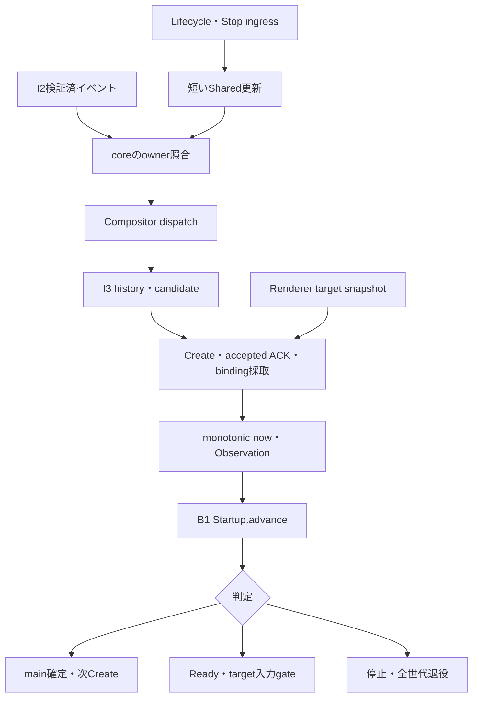
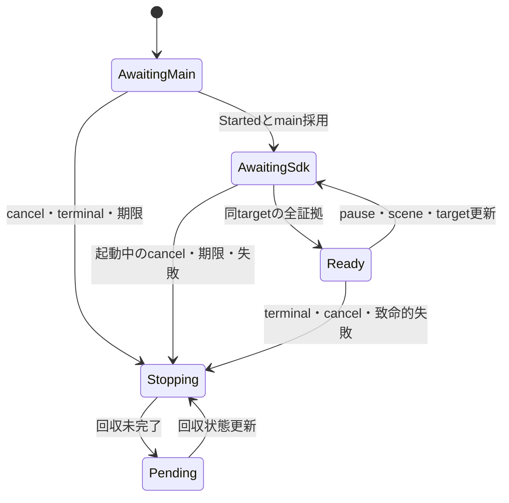
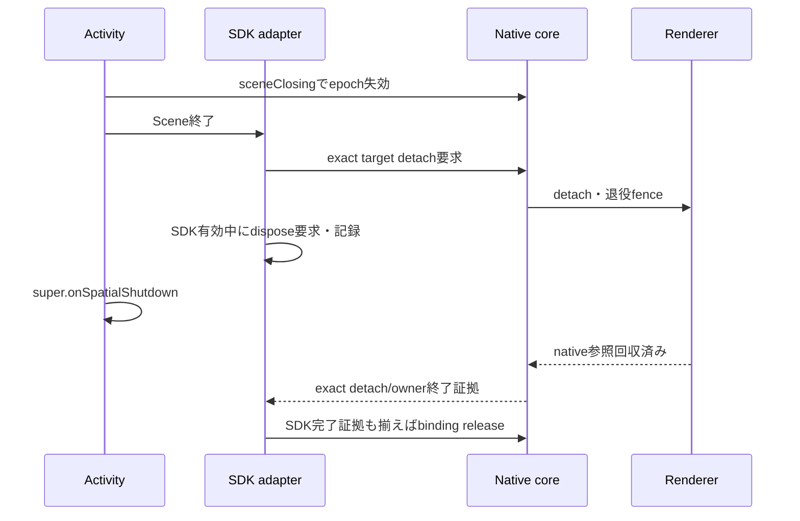

# Linux Desktop v3 I4 詳細設計 — Startup Observation / Spatial SDK Evidence

## 0. 調査基準と設計の位置づけ

本書は2026-11-12 00:51 JST（2026-11-11 15:51 UTC）時点で再確認した調査に基づく、I4の実装引き継ぎ用詳細設計である。今回の作業は設計とsource確認のみであり、実装、commit、push、PR作成、CI再実行、Quest実機検証は行っていない。

| 対象 | 調査時点の状態 |
|---|---|
| main | `f894d796a06bcf0fafb1567718cd180ecf29009b` |
| PR-01 #13 | head `ba0a0b9fecc2e8660d3de9bd4bbf611a4bd243bd`、未マージ |
| mainのCI | [L7a foundation](https://github.com/tin-machine/eidolon-wayland/actions/runs/43038968205)・[検証](https://github.com/tin-machine/eidolon-wayland/actions/runs/43038968162)ともcancelled |
| PR #13のCI | [L7a foundation](https://github.com/tin-machine/eidolon-wayland/actions/runs/43040295610)・[検証](https://github.com/tin-machine/eidolon-wayland/actions/runs/43040295629)ともcancelled。主要jobは依存準備中に中断し、後続testはskip。合格とは扱わない |
| リポジトリの作業指示 | 再帰treeでAGENTS.md等の追加作業指示は見つからず、依頼文の制約を適用 |
| 本設計中のテスト | 実行なし。既存fixtureの内容・実装・CI状態を確認した |

[PR #13](https://github.com/tin-machine/eidolon-wayland/pull/13)は共有型とpure validatorを追加するPRであり、I2–I5の製品配線を実装したものではない。[PR-01引き継ぎ](https://github.com/tin-machine/eidolon-wayland/blob/ba0a0b9fecc2e8660d3de9bd4bbf611a4bd243bd/docs/linux-real-app-v3-pr01-contract-handoff-20261111.md)と[主要統合計画](https://github.com/tin-machine/eidolon-wayland/blob/f894d796a06bcf0fafb1567718cd180ecf29009b/docs/linux-real-app-v3-integration-plan-20261111.md)を前提とする。実装開始時はPR-01のマージと最新headを再確認し、その後の変更を本書との差分として評価する。

以下で「提案API」と記した名前は新設予定であり、現存APIとして呼び出してはいけない。I3との境界は未統合のため、§4の依存APIをI3＋I4統合PRの契約として確定する。

## 1. 実装済み観測機構と不足する接続

| 領域 | 現存する正本 | I4で行う接続・修正 |
|---|---|---|
| B1 Startup | `Startup::begin/advance/summary`、20秒/10秒期限、固定main、完全一致する証拠、terminal優先、起動完了latch | 実観測からObservationを作る。別Startup FSM・別起動watchdogを作らない |
| PR-01 Report | `PresentationSummary::from_startup`、`SdkTarget`、`V3Report::validate` | 同tickのB1出力と証拠を投影。§7の契約修正を加える |
| core runtime | `eidolon-core` thread、`Shared` Mutex、command queue、panel controller、SDK binding管理表 | v3観測を一つのowner tickに集約する |
| Wayland Session | core threadがlistener・Display・ProtocolStateを所有し、`Session::tick`でaccept/dispatch | I3のNativeOrigin・WindowHistory・WindowAdmissionを利用する |
| Panel Create/ACK | panel commandがsequence/full TargetKey/action/applied/errorを保持 | nativeが実受理したACKを、消費型UIイベントに依存せず読む |
| SDK ownership | `sdk_bindings`と`diagnostic_sdk_bindings` | exact keyとoriginを検査。countだけでは成立判定しない |
| renderer | full TargetKey別`TargetReport`、frames、content_frame、role、pause、detach報告 | 現contentを描画したtargetだけを採用。context再生成時の古い証拠を失効させる |
| SpatialPanelAdapter | Entity/Surface/SceneObject/listener、current frameを確認後のCreate ACK、detach/dispose/release | callbackへimmutableなruntime/scene/target/command所有を捕捉する |
| Android lifecycle | Activity/Scene/XR通知、Hostの単調SceneEpoch、ActivityのownsScene | 最新lifecycleを短いingress処理で反映し、scene closingを明示する |
| shutdown | native worker終了、renderer解放、SDK bindingゼロ等の確認 | origin退役とruntime全体回収へ分け、全世代の証拠を提供する |

根拠は[B1 model](https://github.com/tin-machine/eidolon-wayland/blob/ba0a0b9fecc2e8660d3de9bd4bbf611a4bd243bd/native/model/src/linux_desktop_v3/presentation.rs)、[runtime](https://github.com/tin-machine/eidolon-wayland/blob/f894d796a06bcf0fafb1567718cd180ecf29009b/native/core/src/runtime.rs)、[panels](https://github.com/tin-machine/eidolon-wayland/blob/f894d796a06bcf0fafb1567718cd180ecf29009b/native/core/src/panels.rs)、[renderer](https://github.com/tin-machine/eidolon-wayland/blob/f894d796a06bcf0fafb1567718cd180ecf29009b/native/render/src/lib.rs)、[SpatialPanelAdapter](https://github.com/tin-machine/eidolon-wayland/blob/f894d796a06bcf0fafb1567718cd180ecf29009b/android/app/src/main/java/io/github/tinmachine/eidolon/SpatialPanelAdapter.kt)である。

現在のcore loopは、冒頭のrenderer/transport snapshot、`Session::tick`、render submission、panel reconcile、通常command一件、約5ms parkの順である。ACKやlifecycleをloop末尾で処理するため、冒頭snapshotをそのままB1へ渡す方法では観測時点が揃わない。v3の接続を§5のphaseへ整理する。

現runtimeの公開snapshotは、core snapshotにtransport/renderer snapshotをその都度合成する。診断表示には使えるが、異なる時点を含み得るため、I4のObservation正本としてAndroidから読み戻さない。SDKのmetricsも更新間隔と有限ringがあるため、Ready・退役完了を決める台帳にしない。

## 2. 同一性と証拠の信頼範囲

### 2.1 相関する識別子

`NativeOrigin`は次の全fieldで同一性を判定する。

- RuntimeHandle
- SessionId
- Launch要求のCommandSeq
- nonce
- scope
- 固定catalogのapp_id

originはnativeのLaunch予約と専用listenerの所有から得る。Wayland app_id/title、remoteのready申告、同UID、SDK Entity IDから生成しない。`NativeOrigin::matches`によるContext/Selection/Pins照合に加え、runtime/requestが現在予約と一致することをcoreで確認する。

表示の相関keyは次とする。

```text
CreateIdentity =
  RuntimeHandle
  + TargetKey(SessionId, WindowId, SceneEpoch, SurfaceGeneration)
  + Create CommandSeq
  + action=create
```

Launch CommandSeqとCreate CommandSeqは目的が異なる。前者はoriginの要求識別、後者はpanel commandの識別である。またACK送信自体のnative command受付sequenceと、ACK payloadが参照する元Create sequenceも区別する。CreateIdentityには後者だけを使う。[TargetKey](https://github.com/tin-machine/eidolon-wayland/blob/f894d796a06bcf0fafb1567718cd180ecf29009b/native/model/src/surface.rs)自体にはruntimeが含まれないため、runtimeを省いた比較は禁止する。識別子は既存の正のsigned 64-bit decimal string表現を維持する。

### 2.2 成立段階を混同しない

| 観測 | 証明すること | まだ証明しないこと |
|---|---|---|
| I2 Launch受付 | 同ownerへの実行要求が受理された | Started、window作成 |
| 同origin Started | I2がremoteの開始イベントを検証した | 正しいmainの採用、SDK表示 |
| main Mapped/admitted | 正しいorigin/role/parentのwindowを採用した | Entity、ACK、frame |
| SDK Entity作成 | SDK objectを確保した | Surface/listener接続、native ACK受理 |
| ACK送信のAccepted | commandをenqueueした | coreがCreate ACKとして受理した |
| native ACK受理 | exact Createのpanel.applied、errorなし | 現時点でもbinding/frame/lifecycleが有効であること |
| SDK binding存在 | native管理表にそのruntime/targetの所有がある | Entity作成完了、現frame |
| renderer frame | そのtargetへcontentを成功描画した | HMDのscan-out、人の視認、遮蔽・可読性 |
| B1 Ready | 現targetの証拠とActivity/Scene/XR条件が同じ観測で成立 | Quest受入れ全項目の成功 |

現在はnativeのSDK binding登録がEntity作成より先である。従ってbinding存在をEntity成功に読み替えない。Entity/listener成立後にだけACKを送る既存順序と、native受理を確認する仕組みを組み合わせる。

この証拠は、認証済みSSHと専用displayに対する配送・所有の相関である。改変されたremote hostの内部で本物のMousepadが動作したことを暗号学的に証明するものではない。実表示・入力・ファイル保存の受入れは別のQuest/remote oracleで確認する。

## 3. B1 Observationへの完全なfield mapping

### 3.1 最上位fields

| B1 field | 製品の取得元 | 生成規則 |
|---|---|---|
| `now_ms` | runtimeで統一したmonotonic clock | 証拠収集後に1回採取。t0と同じ基準、後退不可 |
| `origin` | I2/I3と共有するnative Launch予約 | 現runtime/session/request/nonce/scope/app_idとの完全一致 |
| `started` | v3 transport ownerの`Event::Started`を検証後に公開するI2 cut | 同originのみSome。B1自身のstarted latchを利用 |
| `terminal` | I2の同origin terminal | Stop要求をterminalへ合成しない。遅着・別ownerは入口で分離 |
| `cancelled` | 同ownerのStop/cancel intent、起動中のlifecycle喪失latch | loss→regainで消さない。正常post-Ready Stopのreasonは§7で修正 |
| `cleanup_pending` | 同originの回収要・回収失敗 | journal存在、実行中資源、通常の世代退役中だけではtrueにしない |
| `activity_visible` | lifecycle ingress後のShared現値 | Android metricsや古いpoll値を使わない |
| `scene` | 現SceneEpoch | scene closing後はNone。high-water markは別に保持 |
| `xr_focused` | native XR state | `Focused`だけtrue。`Visible`を代用しない |
| `global_window_count` | I3の製品全toplevel数 | 現上限9。popup/subsurfaceを独立窓に含めない |
| `windows` | I3 WindowHistoryから作るbounded view | 当該originのlive/unmapped＋必要な破棄観測。全履歴を直列化しない |
| `current_create` | native panel controllerの固定main用Create | 初回main採用tickはNone。dialog・旧targetは禁止 |
| `evidence` | 下記の実panel/ACK/binding/frame | 各証拠の元identityを保持して照合 |
| `fallback` | 失敗Createへのnative fallback policy | B1が見る失敗tickだけtrue。新targetへの事後申告は禁止 |

`Started`は[既存v3 owner](https://github.com/tin-machine/eidolon-wayland/blob/f894d796a06bcf0fafb1567718cd180ecf29009b/native/transport/src/linux_desktop/v3/owner.rs)がprotocol処理後に保持する事実を使う。現owner単独のboolにnative originは含まれないため、I2のLaunch予約とのtyped結合が依存条件である。ログ文字列の検索やAndroidのlaunch Acceptedから作らない。

B1の件数制約は`windows.len <= global_window_count <= 9`である。global countとwindowsは同cutのtoplevel集合から作る。slot解放後のDestroyed tombstoneをwindowsへ追加しない。破棄直後の観測を含める場合は、まだglobal countに含む同じcutに限る。破棄済みmain/roleや全dialogの履歴はI3に別保持し、9窓時にも履歴を丸ごと詰め込まない。現在snapshotから固定mainが消えた場合も、B1は別rootに差し替えず停止する。countのclampや不正windowの黙示的切捨ては禁止する。

### 3.2 window、Create、evidenceのサブfields

| record / field | mapping |
|---|---|
| `Window.origin` | listener/clientに固定されたNativeOrigin |
| `Window.window` | compositorが発行した非再利用WindowId |
| `Window.role` | I3履歴に固定したMain/Dialog |
| `Window.life` | 実Mapped/Unmapped/Destroyed |
| `Window.app_id` | 現Wayland app_id。originの推定には使わない |
| `Window.parent` | I3のNone/Resolved/Unresolved/Invalid。lookup失敗をNoneにしない |
| `Create.runtime/target/command_seq/action` | 実panel commandの各値。actionはCreate |
| `Panel.create` | 観測したpanel commandの完全なCreateIdentity |
| `Panel.applied/error` | panel controllerが保持する実受理結果。errorは実error存在から作る |
| `Ack.create/success` | coreが照合して受理したCreate ACKのidentityと結果 |
| `Sdk.runtime/target` | native SDK binding管理表の実key |
| `Sdk.bound` | exact keyが現在登録されているか |
| `Sdk.diagnostic` | 登録時のdiagnostic分類。window名やrenderer modeから推測しない |
| `Frame.runtime/target` | 現runtimeのrenderer TargetReportのkey |
| `Frame.frames` | 該当targetの成功描画累積値。総frame数を使わない |
| `Frame.paused` | renderer全体の現在paused |
| `Frame.presentation_paused` | 当該targetの現在presentation_paused |
| `Terminal.origin/reason` | I2が照合したoriginと既存typed StopReason |

B1には`content_frame`とrender roleのfieldがない。wireを増設せず、I4 adapterが`role=Windows`かつ`content_frame.is_some()`を満たす該当TargetReportだけをFrame候補へ変換する。pauseはB1へ渡し、B1自身にReadyを判定させる。

## 4. 新規adapterとI3依存API

### 4.1 部品を追加する範囲

| 提案部品 | 所有するもの | 所有しないもの |
|---|---|---|
| core `V3PresentationObserver` | originごとの既存Startup、Observation組立、同tick report投影 | SSH actor、別deadline、window role決定 |
| model `NativeObservationBuilder` | nativeのtyped factsから既存Observationを検証付きで構築する処理 | 権限推定、remote wire入口、状態遷移 |
| coreのpure target evidence predicate | current Createとaccepted ACK/binding/content frameの一致判定 | 別Ready FSM |
| Android `SdkEvidenceBridge` | immutable CreateIdentityとSDK binding reservation、callback lease | Startup、起動timer、storage CAS |
| Android `SdkRetirementHub` | runtime/originに束縛した退役要求・未完了予約・receipt | Entity/Surface/Activity本体、I5保存transaction |

coreの新規ファイルは`native/core/src/linux_desktop_v3/observation.rs`等へ分離する案とし、I3側module構成を統合担当が確定する。Androidは新規部品へSDK証拠と退役を分離し、I5も変更する`NativeSessionHost.kt`には薄いdelegateだけを置く。

### 4.2 modelのtyped構築API

現B1のCreate/Panel/Ack/Sdk/Frame等は型・fieldともprivateであり、通常のnativeコードから直接構築できない。共有契約へ、同module内でこれらを構築するpure builderを追加する。既存Serde/fixture形式は変更しない。

設計上の入口は次の形とする。名称は提案である。

```rust
// 新設するpure APIの形。製品実装ではない。
Observation::native_builder(origin, now_ms)
    .lifecycle(activity_visible, scene, xr_focused)
    .transport(started, terminal, cancelled, cleanup_pending)
    .windows(global_window_count, native_window_facts)
    .current_create(observed_create)
    .panel(observed_panel)
    .ack(native_accepted_ack)
    .sdk(observed_binding)
    .frame(observed_frame)
    .fallback(fallback_authorized)
    .finish()?;
```

各factは元のruntime/full target/command/actionを保持する。builderがACKへcurrent Createのidentityを補完して不一致を消す実装は禁止する。`finish()`は既存Observationのvalidateを呼び、`advance()`の相関検証も維持する。public input型はnative用であり、remoteからdeserializeする契約へ昇格させない。

### 4.3 I3に要求する依存API

以下は実装開始前にI3と合意する必須契約である。I4側で代替推定を実装しない。

| 提案API/出力 | 必須の意味 |
|---|---|
| `capture_launch_origin` | 予約済NativeOrigin、Launch受理monotonic t0、起動前WindowId集合、capture識別を一度取得 |
| `observe_origin_windows` | 同originの最新life/role/parentとglobal countを同core dispatchの結果として返す。未admitの不正rootもB1の検出対象へ含める |
| `candidate_main` | 同origin・正しいapp_id・明示親なし・新WindowIdの候補。まだSDK/input公開不可 |
| `commit_main_admission(origin, main)` | B1が返した固定mainを採用し、render/inputが共用するadmitted集合へ反映 |
| `admitted_windows(origin)` | main/dialogの共通集合。popup/subsurfaceの既存同client制約を維持 |
| `target_owner(full_identity)` | Create時に記録したtarget→originを返す。window破棄後も未回収世代の所有が解決可能 |
| `seal_origin(origin)` | 新client/window/target/register/attach/input admissionを閉じる |
| `origin_local_retirement` | listener/client/SHM/local Waypipe・worker・pending local operationの実回収状況 |

I3のcandidateはrender/inputへ公開する集合と別である。不正rootや未解決parentをadmitted集合から除いた結果、B1からも隠してしまう実装は禁止する。before集合・role履歴・target所有はorigin終了のproofまで保持する。

I2は検証済Started/terminalと回収状況をcloneできる短いsnapshot/cut APIを提供する。I5はcaptureとruntime置換の正本を所有し、nativeへ渡すruntime admissionのopen/sealedとepochの観測契約を提供する。I4はこれらのidentityを採取・比較し、別のstorage identity cacheを作らない。

## 5. runtime tickとthread/lock設計

### 5.1 現thread ownershipを維持する

- `eidolon-core`だけがSession/Wayland Display/ProtocolStateを操作する。
- rendererは独立したShared/queueを持ち、AndroidのGL実操作はprocess共通の既存`eidolon-gl` executorが行う。同時に一つのruntime jobだけがactiveである。
- SSH I/O actorは別ownerであり、coreへは短くcloneできる観測を提供する。
- SDK Entity/Scene/Surface/listenerの操作はAndroid MainLooperへ寄せる。
- `NativeSessionHost`のhost workerはruntime開始停止・I5保存手続きを進める。UI threadを待ち合わせで止めない。

[Session](https://github.com/tin-machine/eidolon-wayland/blob/f894d796a06bcf0fafb1567718cd180ecf29009b/native/core/src/session.rs)と[GL executor](https://github.com/tin-machine/eidolon-wayland/blob/f894d796a06bcf0fafb1567718cd180ecf29009b/native/render/src/executor.rs)の所有構造を変更しない。core Shared lockを持ったままSSH、SDK、GL実処理、join、future完了を待たない。

停止時はI2のfinishedを待ってからSessionをdrainする順序を採らない。I2 finalizerがlocal退役証拠を待つためである。正常終了・失敗・panic共通のdrainでremote回収とlocal/SDK/renderer回収を並進し、all-finished判定は最後に行う。未完了資源ledgerはcatch_unwindの外側でもshutdownから参照可能な所有位置に置く。

### 5.2 lifecycle ingressの最小変更

現在のrenderer visibility即時更新だけでは、XRのFocused→Visibleやscene closingをI4の正本へ即反映できない。既存`SceneReady/SetActivityState/SetXrState`と新規`scene_closing(expected_epoch)`を短いlock内で処理する。

- 最新のactivity/scene/xr snapshotを同入口で更新する。
- 通常queueで同じ通知を二重実行しない。既存CommandCompleteとcounterの契約は保つ。
- 起動完了前の前提喪失は同originのstop intentにlatchし、後続resumeで消さない。
- `scene_closing`はexpected epochがcurrentと一致するときだけsceneをNoneにする。
- sceneの最大受理epochを保持する。Noneへ戻した後も旧epochを再受理しない。
- 古いActivityのcloseは新Activityのsceneを無効化しない。
- render可視性とXR Focusを分離する。Visibleでは描画が続いてもReady/inputは認めない。

根拠となる現在の通知経路は[NativeSessionHost](https://github.com/tin-machine/eidolon-wayland/blob/f894d796a06bcf0fafb1567718cd180ecf29009b/android/app/src/main/java/io/github/tinmachine/eidolon/NativeSessionHost.kt)と[MainActivity](https://github.com/tin-machine/eidolon-wayland/blob/f894d796a06bcf0fafb1567718cd180ecf29009b/android/app/src/main/java/io/github/tinmachine/eidolon/MainActivity.kt)にある。

### 5.3 11段階の観測

| 順序 | core ownerで行うこと |
|---:|---|
| 1 | runtime/session/予約origin/captureが現在ownerと一致することを確認 |
| 2 | I2 terminal/cancel/cleanupとlifecycleを予備取得。停止要因があればadmission/inputを閉じる |
| 3 | compositorをdispatchし、実accept/map/unmap/destroyを反映 |
| 4 | I3 WindowHistoryとcandidate/admitted viewを更新。未採用candidateへCreateしない |
| 5 | Shared lock内で通常FIFOのhead一件を選ぶ。presentation completionなら前適用し、origin・Stop・lifecycleとI2 cutを再確認して、固定mainのcurrent Createを取得 |
| 6 | 当tickの前適用分まで含め、exact Createに対してnativeが受理済みのACK/applied/errorを取得 |
| 7 | exact runtime/full targetのSDK bindingとdiagnostic分類を取得 |
| 8 | renderer snapshotを新たにcloneし、該当targetのrole/content_frame/frames/両pauseを取得 |
| 9 | monotonic clockからnow_msを一度取得 |
| 10 | Observationを構築し`Startup::advance()`を一度呼ぶ。同じfactsからReportを作りvalidate_currentを実行 |
| 11 | 出力に応じgate、Create/retire、Stop意図を確定し、lock解放後に非同期処理を配送 |

通常FIFOは一件/tickの既存規則を維持する。選んだheadが`AdapterApplied`、`AdapterFailed`、`SurfaceLost`なら観測前へ既存処理を移す。それ以外のheadはstep 11で新しいgateの下で処理する。後続ACKの追越し、queue全走査、別ACK queueは追加しない。CommandComplete/counterは一度だけ更新する。失敗ACKはrecordへ記帳するが、theme fallbackとCreateのDestroy置換はadvance後まで延期する。SurfaceLostは観測前にcurrent Createを退役させる。GL内部SurfaceLostも同じ扱いにする。

render submissionはI3 admitted集合と現在lifecycleから行い、既存slot/panel reconcileのCreate・世代置換はB1の判定後に確定する。初回採用前のcandidateへpanelを作らず、fallback失敗recordも先に失わない。

短いlockの取得方向は`core Shared → I2 snapshot cut → renderer snapshot clone`とする。I2/rendererはcoreへの逆方向callbackをそのlock内で行わない。FIFO headより後ろのACKは未受理のままなので、そのtickはACKなしであり、次tick以降の実受理結果を待つ。enqueue成功から受理済へ補完しない。

ここで「同tick」はcoreが採取した一つの観測結果を意味する。複数threadの物理時刻が完全に原子的であるとは主張しない。cut後のterminal/frame等は次tickへ入る。識別子の一致、terminal/cancelの保持、lifecycleの即時gateによって、異なるowner/targetの証拠を混ぜない。



初回main採用tickでは`current_create=None`で進める。B1が返したmainをI3へcommitし、その後Createを発行する。Createの実証拠は次tick以降に読む。pre-Readyでも採用済mainの描画は許す。SDKがframeを見てACKする現経路で描画までReady待ちにすると循環待ちになる。

初回startup完了までは全アプリ入力を禁止する。以後はoriginがStopping/Pendingでないこと、Stop intentなし、I2がlive Started、最新lifecycle、I3 admitted、対象ごとのexact current evidenceと既存focus gateで判定する。固定mainがUnmappedでも有効なdialogが存在し得るため、mainの`AwaitingSdk`だけを全dialog入力の禁止条件にしない。共通のpure target証拠predicateを使い、dialog用Startup FSMは増やさない。

## 6. SDK callback相関とgeneration/frameの鮮度

### 6.1 既存ACK経路を再利用する

現Adapterは同targetのframeとlistenerを確認してからCreate ACKを送信する。nativeはさらにpanel commandのsequence/full target/actionとrenderer frameを検査し、成功したCreateを`applied=true`として保持する。

従って次の二段階を明示する。

1. `nativeCommand(ack)`のAccepted：queue投入。
2. coreが`panels.acknowledge`で受理：B1 ACK証拠。

UI pollで消えるCommandCompleteを唯一の証拠にしない。exact Createのpanel recordに保存されたapplied/errorを正本とし、その実受理地点でのみtyped ACK factを作る。PanelとACKは同じ受理事実に由来し得るが、CreateIdentityを一致させたままそれぞれのB1 fieldへ投影する。

### 6.2 callback lease

SDK callbackには、登録時のimmutable値を捕捉する。

- adapter instanceの識別
- SDK Scene object identityとSceneEpoch
- RuntimeHandle
- full TargetKey
- Create command sequence/action
- binding reservation / callback leaseの識別

callback到着時の`currentHandle`やmutable current sceneからidentityを補完しない。UIへpostする前と、UIでSDK操作する直前にleaseの有効性を再確認する。Entity ID単独のlookupで旧callbackを新Entityへ結び付けない。例外時ACKも捕捉済runtimeへ送る。

plain panelのcallbackもSceneを捕捉できるよう、公開`PanelRegistration.panelCreator`を使うscoped wrapperから既存VideoSurfacePanelRegistrationへ委譲する案を用いる。direct-to-surface方式は維持する。[SDK 0.15のVideoSurfacePanelRegistration](https://developers.meta.com/vr/reference/spatial-sdk/v0.15.0/com_meta_spatial_toolkit_videosurfacepanelregistration/)は`panelCreator(scene, spatialContext)`を公開している。pinned SDK 0.15でのコンパイルとQuest上のcallback順序を完了条件とし、未検証のSDK挙動を成立済みにしない。

SDK binding登録前からreservationを記帳し、Entity作成途中の失敗でもnative release責務を失わない。登録時はnativeのexact pending Create・I3 target owner・origin admission openを検証する。旧callbackが退役後にregister/attachを再開することを禁止する。

### 6.3 TargetKeyとrenderer再生成

Create sequenceは既存panel controllerで発行し、既存の`generation = Create command sequence`を正本とする。counterはchecked incrementし、overflow時は新規発行を停止して回収へ進む。独立したAndroid generation counterを追加しない。旧CreateのDestroy完了と所有解放を待つ既存順序を維持し、新targetには新Create sequence/generationを用いる。

Createの世代比較はB1の`TargetKey::newer_than`とCreate sequence増加の両方を満たす。ACK/binding/frameの照合には大小比較を使わず完全一致を使う。scene=None、main未採用、旧Createの退役中は`current_create=None`かつevidence全Noneとし、旧targetの情報はretirement側にだけ保持する。

Frame候補には次を要求する。

- 現runtimeのrenderer snapshot。
- exact current full TargetKey。
- `RenderMode::Windows`。
- `content_frame: Some(FrameSeq)`。
- 成功描画の`frames > 0`。
- current/admitted/mapped window。
- B1へ両pause値を正しく供給。

現在のrendererはimageなしのframeでもframesを増やし得るため、累積値だけではapp contentの証拠にならない。またEGL context再buildで同keyの累積frames/content_frameを残し得る。修正では、**contextを失効させる直前にcontent_frame=NoneをSharedへpublishしてから**再buildを開始する。再build完了だけでSomeへ戻さず、実際の次の成功描画でのみ復帰させる。frames累積値は維持する。これにより新しいrenderer世代counterを増やさず、現在contextの描画証拠を区別できる。

GL内部SurfaceLostのdetachも、UI通知だけで終わらず当該current Createの`panels.retire`へ接続する。再表示は新generationと全証拠を必要とする。`Session::render_tick`のWayland frame callbackもsession/windowだけでなく、確定したcurrent full targetと一致するrenderer報告に限定する。

## 7. startup期限・fallback・Report契約

### 7.1 期限の正本

```text
main deadline = native Launch受理t0 + 20,000 ms
SDK deadline  = B1の初回main採用時刻 + 10,000 ms
timeout       = now >= deadline
```

clockはnative runtime寿命に固定したmonotonic基準を用いる。例えばruntimeの`Instant`起点からのchecked elapsed millisecondsとし、Android wall clockやActivityごとの起点と混ぜない。t0はI2 Startをenqueueする前にLaunch予約を実行受付へcommitした時刻とし、後続Started、heartbeat、再pollで更新しない。main採用後はB1のfirst_adopted_msを使用する。remap、scene変更、renderer再生成、generation更新、fallbackでも元期限を維持する。

B1はorigin検証後にterminal/cancel/deadlineをReady候補より優先する。ちょうどdeadlineのframe/ACKも成功にしない。startup_completed後は再武装せず、同じStartup instanceで現在表示だけを再評価する。既存shutdown Watchの10秒は停止診断用であり、起動SDK待ちの10秒と共用しない。transport自身のACK/heartbeat/Stop期限もprotocol管理として維持し、B1の期限を再設定する根拠にはしない。

### 7.2 fallbackは失敗観測を先にB1へ渡す

現coreのAdapterFailed受理直後のtheme fallbackを、v3では次の順序へ変更する。

1. failed current Createと実失敗ACKを保持する。
2. 同Createに`fallback=true`を付けたObservationでB1を一度進める。
3. B1が起動前一回のfallbackを許可した場合だけ装飾を無効化し、旧targetを退役する。
4. 旧Destroy/解放後、新sequence/generationのCreateを発行する。
5. 新CreateでACK/binding/frameを取り直す。

B1が失敗Createを見る前にtheme変更やpanel reconcileでCreateを上書きしない。二回目、失敗なし、startup完了後のfallbackは停止とする。旧targetの回収義務と最初のSDK deadlineを保持する。

### 7.3 Reportの最小修正

[PR-01 report.rs](https://github.com/tin-machine/eidolon-wayland/blob/ba0a0b9fecc2e8660d3de9bd4bbf611a4bd243bd/native/model/src/linux_desktop_v3/report.rs)をそのまま製品へ接続すると、以下の不整合がある。I3＋I4統合PRで共有契約への限定修正として扱う。

| 現契約の問題 | 採用する修正 |
|---|---|
| Readyが`!transport.journal_pending`を要求 | このReady条件だけを除く。実行中journalを保持したままReadyを認める |
| relaunch_allowedがnativeDestroyを含むruntime全体回収まで要求 | origin単位remote/local回収＋journal clearから算出。I5保存用runtime barrierを分離 |
| validate()に現在scene/generation/Createの正本がない | wireを変えずpure `validate_current`を追加し、同tickのcurrent Createと実証拠へ照合 |
| 正常post-Ready cancelも起動取消failureになる | Rust/Python双方でterminalと同様、startup完了後は新failureなしでStopへ遷移 |
| advance Errでは旧stateが残る | 同B1内の限定pure `fail_observation`で停止させ、旧Readyの再公開を禁止 |

`journal_pending`は未finalizeのdurable journalがあることを表す。正常稼働中の`cleanup_pending`はfalseでよい。通常の旧generation退役中というだけでcleanup_pendingを立てない。SDK disposal失敗等で回収要となった場合はtrueとし、起動理由とcleanup_errorを分離する。

`relaunch_allowed`は同runtimeにおける次leaseの許可である。remote cleanup、I3/I4 origin退役、journal clear、pendingなしに加え、runtimeがlive、Stop intentなし、I5のruntime admission gateがopenであることを要求する。保存seal中やruntime停止後はfalseとする。これらの現在条件はreport生成時と`validate_current`で照合し、実Launch入口でも必ず再検査する。設定保存・runtime置換はこれに加えてI5の全runtime ReclamationBarrierを要求し、origin単位証拠で代用しない。

`validate_current`はI4内部の予約済NativeOrigin、固定main、current Scene/Create、native受理ACK、binding、renderer factとReportを比較する。`sdk_target`は現Createからだけ生成し、現CreateなしならNone、証拠不足なら対応boolをfalseにする。旧targetは退役証拠に残しても現SdkTargetへ転記しない。standalone `parse/validate`は形・内部整合の検証であり、現在性の証明ではない。Reportは同じObservationとStartup出力から生成し、Android UIが独自ready boolを組み立てない。

### 7.4 正常StopとObservation不正の扱い

正常Stopは既存Observation.cancelledで表し、既存advanceの条件・優先度を変えずreasonだけを次の意味にする。

```rust
// 既存cancel分岐内の限定変更案。
let reason =
    (!self.startup_completed).then_some(Reason::AppStartupCancelled);
return Ok(s.stop(reason));
```

Pythonの対照実装も同じ条件にする。既存91 presentation sequenceではpost-Ready cancelledは0件であり、既存goldenの期待値を変える必要はない。新しいpost-Ready Stop caseを追加し、実装時にRust/Python双方で回帰検査する。Stop intentは実terminalと別のままであり、回収完了を意味しない。

外部から到着した旧callbackは入口で拒否し、現在ownerへの取消に流用しない。一方、coreが誤って不整合Observationを作った場合、Errをready=falseとして握り潰さない。入力・新Createを閉じ、first_failureを保持し、B1内部の既存stop処理を使う限定pure `fail_observation`でStopping/Pendingへ進める。このAPIはinvariant failureの救済だけに使い、通常経路はtick当たりadvance一回とする。wireへ新しいfailure fieldを追加しない。内部origin不整合は既存`AppOriginUnknown`、window不変条件違反は`AppWindowUnsupported`、その他のclock/証拠構築不整合は`AppPresentationFailed`へ対応付け、元のtyped errorを診断に残す。`fail_observation`は新たなt0/adoption時刻を設定せず、first_failureとstartup_completedを保存する。native Stopの共通drainでもこの最終B1更新を行い、古いReadyを最終snapshotに残さない。

### 7.5 UIへ渡す意味

| transport / presentation | UI上の意味 |
|---|---|
| Launch受付のみ | 起動要求を受付済み |
| Started / AwaitingMain | remote開始済み、main待機 |
| Started / AwaitingSdk、startup_completed=false | 初回表示準備 |
| Started / Ready | 現targetの表示成立 |
| Started / AwaitingSdk、startup_completed=true | 起動履歴を保持した再表示準備 |
| Stopping / Stopping | 停止・回収処理 |
| Pendingまたはcleanup_pending | 回収要。再Launchと設定保存を許可しない |

起動完了履歴と現在表示状態を同じラベルへ畳まない。scene交換後にstartup_completed=trueのままcurrent SDK証拠が空／未完成である状態は正当である。


## 8. Scene / Activity / XR lifecycle

### 8.1 起動履歴と現在の表示状態

`Startup`はoriginの寿命中に一度だけ作る。Activity再生成、Scene変更、Surface再生成、remapで`Startup::begin()`を呼び直さない。`startup_completed`は一度Readyへ到達した履歴であり、現在表示できることを意味しない。現在の表示可能性は、最新Observationに対する`Startup::advance()`とtargetごとの証拠照合で判定する。

以下はB1に沿った遷移である。新しいpresentation stateは追加しない。

| 入力 | 初回Ready前 | 初回Ready後 | SDK/nativeで行うこと |
|---|---|---|---|
| Activity pause | `APP_STARTUP_CANCELLED`でStopping。未回収ならPending | 証拠充足を失いAwaitingSdk。完了履歴は保持 | 入力を即時停止。Activity非表示をrendererへ反映 |
| XR FOCUSED→VISIBLE | 起動cancel | AwaitingSdk、入力不可 | rendererはVISIBLEで描画継続してよい。frame停止を合否条件にしない |
| XR FOCUSED→IDLE | 起動cancel | AwaitingSdk、入力不可 | renderer非表示、入力reset |
| current Scene終了 | `scene=None`により起動cancel | AwaitingSdk、完了履歴は保持 | Sceneの使用権を失効させ、旧世代を回収 |
| SceneEpoch更新 | 生存中の起動attemptなら元期限を保持 | 新Sceneの証拠が揃うまでAwaitingSdk | 新Create sequence/generation、SDK Entity、ACK、frameを取得 |
| Activity再生成 | Scene終了を観測した起動はcancel | 同originの履歴を保ち、新Activityの証拠を待つ | 旧adapterのSDK回収と新adapterの作成を別々に追跡 |
| 同SceneのSurface再生成 | AwaitingSdk、元SDK期限を保持 | AwaitingSdk。起動期限は再導入しない | 旧targetのDestroy完了後、新generationを作成 |
| main unmap/remap | 初回採用時刻を保持。期限は延長しない | 完了履歴を保持。remap後は新Createの証拠を要求 | 同じWindowIdの履歴を保持し、古いgenerationを再利用しない |
| main destroy / topology不正 | B1の停止判定 | 同じく停止判定 | 同originのdialogを含め回収 |
| terminal / cancellation / native Stop | Readyより停止を優先 | 停止を優先 | origin admissionを閉じ、以後のcallbackを新しい証拠にしない |
| SDK disposal失敗 | 回収未完了 | 回収未完了 | `cleanup_pending`を維持。bindingを成功解放扱いにしない |

初回Ready後の入力は、originがStopping/Pendingではなく、停止intentがなく、I2のStartedが現在も有効であり、最新lifecycle、I3 admission、入力対象のcurrent Create・native accepted ACK・非diagnostic binding・現rendererのcontent frame・既存focus条件が揃う場合だけ許可する。初回Ready前は全application inputを閉じる。mainがunmappedでも有効なdialogが存在し得るため、**初回完了後のmainのAwaitingSdkだけを理由に、すべてのdialog入力を禁止しない**。ここでは共通のtarget evidence predicateを使い、dialog用Startupを作らない。



同Scene・同Surface/Entityを保ったpause/resumeでは、still-currentなCreateとaccepted ACKを再利用してよい。bindingとrendererの現在有効性、pause、lifecycleは毎tick取り直す。Scene/Surface/Entityを作り直した場合は新generationと新しい全証拠を必須にする。

この図の`Ready → AwaitingSdk → Ready`で`startup_completed=true`は保持される。回収後の「再launch可能」はI2/I5の証拠で判定し、B1へ架空のCompleted状態を追加しない。

### 8.2 Activity所有権とSceneの失効

現行`MainActivity.ownsScene()`は`sceneEpoch==0`を許し、Scene未登録のActivityから`expectedScene=null`で可視性/XR状態を送れる。この期間の新Activity callbackが、旧runtime/旧Sceneの状態を更新し得る。I4では次の小さなbridgeに置き換える。

1. Activity生成時に単調な`ActivityOwnerToken`を発行する。これはcallbackの所有識別子でありStartup状態ではない。
2. Activityは自身の`resumed`とXR観測をcacheする。XR観測にはActivity token、観測したSDK Scene identity、callback serialを付ける。SceneEpoch未発行のcallbackはcacheだけを更新し、旧Sceneへ送信しない。
3. `onSceneReady()`は最新登録Activityのtokenであることを確認し、新epochを取得する。native `scene_ready`は古いActivity visible/FOCUSEDを引き継がず、未確認/IDLEへ戻す。
4. そのActivity自身の現在のresumed状態と、同じSDK Sceneから得た有効なXR観測だけを、新epoch付きで再送する。別Activity、別Scene、終了済みSceneのFOCUSEDを転記しない。同一ActivityでSceneを再初期化した場合も、終了前のcached XRを再利用しない。
5. 以降はActivity tokenとexpected SceneEpochが一致するcallbackだけをnativeへ渡す。旧Activityからのpause、focus、closeが新epochを変更しない。

`onSpatialShutdown()`は、SDK disposeより先に`sceneClosing(ownerToken, expectedEpoch)`を通知する。nativeはcurrent epoch一致時だけ`scene=None`とし、presentation/inputを無効化する。`last_accepted_scene_epoch`は保持するため、Noneになった後の古い`scene_ready`で再活性化できない。これにより、SDK Entityを先行disposeした後、native detach待ちのbindingと旧frameがReadyを構成する隙間を閉じる。

SDK Scene objectのidentity照合はActivity/adapter側で行い、Application scopeのHostにはSDK objectを保存しない。Hostはowner tokenとepochだけを扱う。Scene閉鎖時にActivity visibleをfalseへ書き換える方法は、Activity再生成のcallback順序と混同するため採らない。

根拠: [MainActivityのlifecycle](https://github.com/tin-machine/eidolon-wayland/blob/f894d796a06bcf0fafb1567718cd180ecf29009b/android/app/src/main/java/io/github/tinmachine/eidolon/MainActivity.kt)、[Hostのscene/lifecycle配送](https://github.com/tin-machine/eidolon-wayland/blob/f894d796a06bcf0fafb1567718cd180ecf29009b/android/app/src/main/java/io/github/tinmachine/eidolon/NativeSessionHost.kt)。

## 9. 全世代のSDK・renderer退役

### 9.1 SDK所有の記帳

`SdkEvidenceBridge.kt`は`RuntimeHandle + TargetKey + Create command sequence + action`からimmutableな`SdkBindingLease`を作る。NativeOriginとの関係はI3のCreate所有記録から取得する。Androidの選択中window、app_id文字列、remote JSONからoriginを推測しない。

予約recordはnative binding登録より前に確保する。`register_sdk_binding`がAcceptedになった後は、Entityがまだない状態でも解放責務を保持する。Entity、Surface、SceneObject、listener、装飾visual、controls/menu等は、そのleaseへ付加する資源として扱う。

plain panelはSceneを捕捉できる`PanelRegistration` wrapperから、現在の`VideoSurfacePanelRegistration`へ委譲する。Entity skeletonを生成し、immutable leaseをmapへ登録してからPanel componentを付与する。surfaceConsumerとpanelSetupにはcapture済みleaseを渡す。SDK callback threadとMainLooper処理時の両方で、同Scene・同lease・未失効を確認する。Scene identityのないEntity.id単独lookupで新Bindingを採用しない。

wrapperはVideoSurfaceの既存描画設定を保持し、plainを装飾meshへ変更しない。SDK factoryは既存`panelCreator(scene, spatialContext)`を利用する。非同期futureはUIからawaitせず、結果をimmutable lease付きでUIへ配送する。SDKに存在が確認できないregistration解除APIやSurface破棄callbackは仮定しない。

callbackは同期ingressでcapture済みleaseの有効性を確認し、scopeのpending数を増やしてからUIへpostする。`有効性確認＋pending加算`と`scope seal＋完了snapshot`は同じ短いledger lockまたは等価CASで線形化する。チェックと加算の間にfalse zero receiptを発行させない。UI処理時に再照合し、native attachの戻りまで含めて`finally`でpendingを減らす。これにより、JNIが`ANativeWindow`追加参照を取得した後、runtime gateへ入る前にsealされた場合の、一時的なnative参照も回収待ちに含める。UIへsentinelをpostしただけでは、後からpostするfuture/SDK producerの完了を証明できない。

既知のSDK future/producerがそれ自体で資源を生成し得る場合、token失効だけで完了扱いにしない。future完了、APIで保証されたcancel、またはproducer停止の実証拠が必要である。SDK所有資源の生成を伴わない単なる遅着通知と区別し、不明なproducerをpendingゼロへ補完しない。

### 9.2 退役対象

| Scope | 含める所有物 |
|---|---|
| current target | 同CreateのSDK Entity、native Surface参照、renderer target、input listener |
| origin全体 | main、dialog、unmapped/destroyed履歴に残るtarget、全generation、fallback前target、旧Scene、作成途中予約 |
| runtime全体 | 全origin、diagnostic binding、旧Activity/adapter、SDKのcontrols/menu/future、native/render/transportの全owner |

Scene寿命のpanel registrationやActivity共通UIは、runtimeのSDK bindingと分ける。runtimeに所有された装飾controls/menuだけをそのscopeへ含め、普通の設定保存でActivity/Sceneそのものや他runtimeの所有物をcloseしない。

I3はdestroyed WindowIdとrole/parent履歴を、関連targetと回収責務がなくなるまで保持する。現mainが消えたことや現renderer target集合が空であることだけでは、origin回収完了にしない。

### 9.3 通常の同Scene退役

1. 退役scopeのadmission fenceとcallback作用権限を同時に閉じ、新Create・bind・attach・SDK object生成を拒否する。単一targetはexact TargetKey、Scene変更は旧Sceneのtarget集合、origin終了は全originを対象にする。Scene変更だけで生存origin全体を終了扱いにしない。
2. native inputを停止し、SDK側もVisible/Collision/input listenerの受付を退役へ移す。
3. exact targetへ`surface_lost`を送り、renderer ownerのFIFOで当該targetのSurface/native参照の解放を確認する。origin終了の場合だけ、seal済originのlogical window集合に対する追加fenceで保持画像・composition/semantic/player/cacheまで回収する。通常の世代交代で生存dialog/新generation用の共有画像まで消さない。
4. detach確認後、SDK listener/input/Entity/visual/controls/menuのdisposeを開始する。Entityは削除要求と削除観測を分け、下記SDK cleanup fenceまで待つ。
5. step 1で失効したleaseの既存in-flight producer/future/operationをdrainする。遅着処理は新たなSDK/native作用を禁止し、既に所有した結果の回収だけを許可する。
6. SDK disposal成功、renderer解放、callback権限失効・既知処理drainのすべてが揃ってから、native SDK bindingをreleaseする。
7. exact Destroy commandをACKし、予約を完了する。nativeのDestroy ACK受理も、target不在だけでなくexact binding解放とscopeの回収証拠を要求する。重複release/ACKはfull identity単位でidempotentにする。

retirement fenceは既存renderer queueへ流す。別のGL監視threadや独立watchdogは追加しない。新しいattach/submitがfenceの後へ入り得る入口は、対応するtarget/Scene/origin/runtime admission fenceで閉じる。rendererのdetached履歴64件も正本にせず、未完了ticketに対応した実receiptを保持する。


### 9.4 SDKの削除要求と削除完了

`Entity.destroy()`の成功返却を`sdk_entities_disposed=true`へ直結させない。SDK 0.15の`willBeDeleted()`は「削除要求済みだが未削除」の期間を表す。`exists`/`isValid`、systemの`executeCount`増加も削除完了の代用にはしない。[Entity API](https://developers.meta.com/vr/reference/spatial-sdk/v0.15.0/com_meta_spatial_core_entity/)

既存公開callbackとSDKの実frame処理を使って、次の一つの受動的な完了fenceを設ける。Startup FSM、起動timer、監視threadは追加しない。

1. Sceneが有効な間に`DataModel.registerDeleteListener((Long) -> Unit)`を登録し、返る`DeleteListenerHolder`を強参照する。callbackはDataModel/Scene ownerをcaptureし、Entity IDをそのownerのimmutable leaseへ照合する。
2. `Entity.destroy()`の要求結果と、実削除通知の`deleteObserved`を別に記帳する。重複通知は同lease内で冪等に扱う。
3. 一つの`SdkDeletionFenceSystem : SystemBaseWithLateExecute`を使用する。N回目の`lateExecute`で通知済み集合をcaptureし、**同SceneのN+1回目以降**で後続SDK cleanup passを観測したと記録する。全systemのexecuteが二境界間で一度進むため、通知直後の同frameを完了へ早めない。
4. SceneObject、listener、既知future/producer、callback pending、native detachの回収を別に確認する。削除通知やcleanup passだけでそれらを完了にしない。既知SDK errorがあればcompleteにしない。
5. holderの解除はDataModel有効中に行う。Scene閉鎖後の旧listener、新Sceneの同じEntity ID、新SceneのlateExecuteから旧leaseの成功を作らない。

この設計が扱うのは公開APIで観測できるapplication所有の退役であり、SDK内部allocatorの全ページがOSへ返却されたことではない。[DataModel delete listener](https://developers.meta.com/vr/reference/spatial-sdk/v0.15.0/com_meta_spatial_core_datamodel/)、[DeleteEntitiesSystem](https://developers.meta.com/vr/reference/spatial-sdk/v0.15.0/com_meta_spatial_toolkit_deleteentitiessystem/)、[lateExecuteの順序保証](https://developers.meta.com/vr/reference/spatial-sdk/v0.15.0/com_meta_spatial_core_systembasewithlateexecute/)を根拠とする。

`SceneObjectSystem.getSceneObject()`はlazy futureを生成し得るため、削除後の「存在しないこと」をpollするAPIとして使わない。`removeSceneObject()`もregistry除去でありdispose成功の代用にしない。[SceneObjectSystem API](https://developers.meta.com/vr/reference/spatial-sdk/v0.15.0/com_meta_spatial_toolkit_sceneobjectsystem/)

### 9.5 Scene終了時の順序

SDK DataModelが失効するScene終了だけは、native detach完了より先にSDKのdispose要求・listener解除を行う。削除完了を取得済みかどうかは別記録とする。



通常の設定保存はSceneを生かしたまま§9.4のfenceを進める。Activity終了でSDK tickが止まり、削除通知や後続passを取れなかった場合は未完了を保持する。`super.onSpatialShutdown()`の返却だけで全SDK資源の解放完了を補完しない。公開[AppSystemActivity API](https://developers.meta.com/vr/reference/spatial-sdk/v0.15.0/com_meta_spatial_toolkit_appsystemactivity/)から確認できるのはcleanup hookであることまでである。

Activity再生成を回収済みとして継続できる境界は、pinned SDK 0.15 AARのshutdown順序確認とQuest試験で確定する実装gateとする。必要なら同Sceneに束縛した`SceneShutdownReceipt`を追加するが、実証したSDK所有終了境界だけから発行する。境界を証明できないケースはcleanup_pendingとして保持し、Ready・relaunch・I5保存を禁止する。実機未検証の終了経路を成功stubで埋めない。

Scene終了後のpollはSDK objectに触れず、native参照の回収とimmutable metadataを処理する。SDK所有のJava Surfaceに`release()`を呼ばない。通常の同Scene再生成では従来どおりdetach確認を先に行う。この区別は既存実測に基づく。[SDK Surface lifecycle](https://github.com/tin-machine/eidolon-wayland/blob/f894d796a06bcf0fafb1567718cd180ecf29009b/docs/decisions/sdk-surface-lifecycle.md)

### 9.6 回収証拠の寿命

`SdkRetirementHub.kt`はweakなUI endpointとimmutableな所有metadata/receiptだけを保持する。adapter lambdaを強参照してActivity/Scene/Entity/Surfaceを間接保持しない。旧adapterの既存pollは、binding予約、detach待ち、known future/operation等の義務が残る限り継続する。endpointが消えたのに未完了義務が残った場合は失敗/不明として保持し、空集合へ変換しない。

現行adapterの`retired`32件ring、trace128件ring、1秒周期metricsは診断用途に残す。正本はseal済みscopeの発行予約と未完了集合である。成功処理済みの履歴は累積数へ畳み込めるが、未完了予約をevictしない。scopeをsealした状態で`issued == completed`、未完了集合ゼロ、disposal errorなしを証明する。登録前reservationの発行も同じseal境界と直列化し、retireRuntimeと並行するpartial Createを対象漏れにしない。

`STALE`、timeout、callback cache expiry、ring eviction、renderer target数ゼロは単独では成功証拠にならない。releaseのSTALEを冪等成功にできるのは、そのleaseで登録が成立しなかったことを記録済み、同leaseのrelease Acceptedを保存済み、または同runtimeの強いStopReceiptを保存済みの場合だけである。別runtimeの空snapshotや未知handleのSTALEで旧義務を消さない。counter overflow、二重完了、未解決recordのevictionは契約違反として止める。

通常の世代交代で一時的に退役対象が存在しても、originの`cleanup_pending=true`にはしない。B1のcleanup_pendingは起動/実行を止める意味を持つため、失敗または停止に伴って未回収責務が残った場合に使う。

### 9.7 正常停止・失敗・panicで同じ回収を進める

停止処理は、remote poll、Session/Waypipeのstop tick、SDK release、renderer退役、journal finalizerを少しずつ進め、最後に全ownerの終了を確認する。I2 actorがfinishedになるまでSessionのstop tickを呼ばない構造にしない。I2 finalizerがlocal退役を待つため、これを行うと循環待ちになる。

runtime停止の`render.request_stop()`はqueueをclearするため、queued fenceのACKが来ない場合がある。このときは**同RuntimeHandleのGL jobが実資源・queue・参照を破棄してfinishedになった証拠**を、renderer fenceの強い代替とする。`workers==0`やtargets空だけでは代用しない。Stop/Failed中に通常Destroy ACKがNotReadyとなる場合も、sealed scope＋全SDK disposal/release＋renderer job終了からpanel ledgerを閉じるshutdown専用完了経路を設ける。

同じ規則をcore workerの失敗/panic後にも適用する。I4のownership ledgerとretirement ticketは`catch_unwind`内部だけの一時変数に隠さず、停止処理から参照してdrainできる寿命に置く。panicを成功receiptへ変換せず、回収できなかった義務を保持する。I5もnativeが完全停止してからSDK disposeを始める順序にせず、native Stop要求とSDK退役を並行して進める。

## 10. I2 journal finalizerへ渡す証拠

### 10.1 二段階の完了

I2のremote cleanupとI4のlocal presentation retirementを分離する。

1. `recover_remote`相当がprocess終了、pipes EOF、receipt永続化、SSH channel完了、forward退役、router drainを確認する。
2. remote側のCompleteを`Journal.finish`で記録する。**Complete記録だけでjournalを削除しない**。実B2 receiptの`remote_cleaned`やboot-changeの扱いもI2 validatorに従い、Report上のbool集合だけからremote成功を再構成しない。
3. 同じcleanup captureに対応するI3/I4のlocal retirement proofを取得する。
4. I2 finalizerがruntime/origin/context/cleanup capture一致と両証拠の完全性を確認し、journalをclearする。

local完了が先に到着しても待ち合わせ可能にするが、単なる到着順序ではfinalizeしない。remote cleanupが不明なときはSDK回収成功だけでjournalをclearしない。SDK失敗が残るときもremoteのCompleteを捨てず、回収待ちとして保持する。

I2は`journal_pending=true`の間も、remote process/channel/forward/routerの実回収結果を独立して公開する。I3はこの結果を根拠にlocal Waypipeを停止できる必要がある。`actor.finished`やjournal clearをlocal stop開始条件にすると、I2 finalizerのlocal proof待ちと循環する。SDK/renderer側もこの中間証拠から回収を進め、journalの最終消去だけを両証拠の合流後へ置く。

### 10.2 APIと証拠

以下は新規の**内部API案**であり、現存APIと混同しない。

```rust
// fields/constructorはcore内部。Deserializeとpublic newを提供しない。
pub struct OriginRetirementProof { /* issued by core retirement owner */ }

fn retire_origin(
    origin: &NativeOrigin,
    capture: &CleanupCapture,
) -> OriginRetirementTicket;

fn poll_origin_retirement(
    ticket: &OriginRetirementTicket,
) -> RetirementProgress<OriginRetirementProof>;
```

proofには、exact NativeOrigin/runtime、I2 cleanup capture識別子、admission sealのrevision、listener/client/window回収、全世代panel/SDK disposal、callbackの失効/drain、renderer FIFO fenceまたは同runtime GL job終了の実証拠を結び付ける。I3のWindowHistoryを消去する前にownershipを確認し、他originの成功receiptを混入させない。

finalizerの合流coordinatorはcore側に置く。transport crateがcoreの`OriginRetirementProof`をimportする依存循環を作らない。I2が発行したcapture/remote receiptとcore proofをcoreで照合してI2 finalizer APIを呼ぶ。共通の小さいticket型が必要ならmodel/transport側へ定義する。さらにI2 finalizerには次のgateを必須引数として要求する。core側の実装がOriginRetirementProofをcaptureし、同cleanup captureへ照合する。

```rust
// 提案: transport側の小さい依存逆転契約。
pub trait LocalRetirementGate {
    fn verify(&self, capture: &CleanupCapture) -> Result<()>;
}
// finalize(remote_receipt, capture, local_gate) がverify後にだけclearする。
```

optional gate、常時成功の製品gate、gateなしの製品journal clear入口を残さない。wireのbooleanやJSONからこのgateを構築しない。

根拠となる現存処理は[I2 owner](https://github.com/tin-machine/eidolon-wayland/blob/f894d796a06bcf0fafb1567718cd180ecf29009b/native/transport/src/linux_desktop/v3/owner.rs)、[journal](https://github.com/tin-machine/eidolon-wayland/blob/f894d796a06bcf0fafb1567718cd180ecf29009b/native/transport/src/linux_desktop/v3/journal.rs)、[recovery](https://github.com/tin-machine/eidolon-wayland/blob/f894d796a06bcf0fafb1567718cd180ecf29009b/native/transport/src/linux_desktop/v3/recovery.rs)である。

proofは`V3Report` JSONをparseして生成しない。reportの`local_retirement`はこの実証拠の要約である。Androidが送る局所的なrelease/receiptも、nativeが発行したlease/scopeに照合してから内部証拠へ集約する。

I2の停止/回収期限が切れたらincompleteを返し、journalとfirst failureを保持する。I4が追加の期限で「一定時間待ったので回収済み」と判定することはない。

## 11. I5 runtime ReclamationBarrierへの提供API

### 11.1 origin retirementとの違い

originの回収が成功してもruntime全体の保存barrierは成立しない。I5では対象runtimeのすべてのorigin、diagnostic binding、旧Activity/Scene、pending operationを含める。I4のSDK側入口は次とする。

```kotlin
interface SdkRetirementPort {
    fun retireOrigin(origin: NativeOriginRef, cleanupCapture: CleanupCaptureRef): Ticket
    fun retireRuntime(runtime: Long, admissionEpoch: Long, captureToken: String): Ticket
    fun snapshot(ticket: Ticket): RetirementProgress
}
```

I5は既存の`LinuxStorageRepository.ReclamationBarrier.withReclaimed(captureToken, action)`を実装する。I4はSDK証拠を供給し、保存モデル、active v2/v3切替、CAS、launcherはI5に任せる。[既存E1 ReclamationBarrier](https://github.com/tin-machine/eidolon-wayland/blob/f894d796a06bcf0fafb1567718cd180ecf29009b/android/app/src/main/java/io/github/tinmachine/eidolon/LinuxStorageRepository.kt)

### 11.2 保存までの順序

1. I5がruntime admission gateを閉じ、`admission_epoch`とE1 `capture_token`を確保する。
2. 必要なI2 remote cleanupとI3/I4 origin回収を進める。
3. `retireRuntime(oldRuntime, admissionEpoch, captureToken)`で、全adapterからSDK disposal/callback回収結果を集約する。Activity全体の`SpatialPanelAdapter.close()`は呼ばない。
4. native Stop後、旧runtimeのshutdown complete、connection/worker/panel/target/SDK binding/Board/pending operationの回収を確認する。停止中でもrelease SDK bindingの専用経路を維持する。
5. `nativeDestroy(oldRuntime)`のAcceptedを取得する。
6. Hostが最後の生存snapshot、全SDK回収receipt、Destroy結果を結合してimmutable `StopReceipt`を生成する。
7. 同じadmission epoch/capture tokenが有効なままE1のCASを実行する。action完了までgateを保持する。

`RuntimeReclamation.native_destroy_accepted=true`は、まだ生きているnative runtime自身のsnapshotから生成できない。最後のnative snapshotと、後からHostが受け取ったDestroy Acceptedを別々の証拠としてStopReceiptで結合する。単にruntime handleが見つからないことをDestroy成功にしない。

E1へ渡す証拠は既存`captureToken`、正の`stoppedRuntime`、shutdownComplete/nativeDestroyAccepted、およびownedConnections/pendingWorkers/nativeTargets/panels/sdkBindings/boardWindows/pendingOperationsがすべて0、remoteCleanupPending=falseを実結果から満たす。同runtime/captureへ結合できない値は採用しない。[native shutdown判定](https://github.com/tin-machine/eidolon-wayland/blob/f894d796a06bcf0fafb1567718cd180ecf29009b/native/core/src/shutdown.rs)とも整合させる。

Host workerが保存barrierを待つ間もMainLooperのSDK回収は動作し続ける。SDK側の進行をHost通常tickでの`nativePoll`だけに依存させない。snapshotと直接release経路から確認可能にする。UI threadでnative/GL/SSHの完了を待たない。

## 12. 異常系と判定の優先度

Observation adapterは、まずruntime/session/originとtickの観測cutを確定する。以後の優先度はB1を変更しない。

1. Observationの構造・clock・origin一致を検証する。foreign terminalが別originを終了させない。
2. 既にStopping/Pendingなら復活させない。
3. 同originのterminalをReadyより優先する。
4. cancellation、初回完了前のActivity/Scene/XR喪失を優先する。
5. `now >= deadline`でtimeout。期限と同tickに揃ったReady証拠はtimeoutを覆さない。
6. cleanup_pending、window topology、現Create/evidence、fallback/SDK failureをB1の順に判定する。
7. 全証拠が一致した場合だけReadyとする。

callback遅着は、別originの失敗に転用しない。古いCreate ACKやframeは正しいcurrent targetの証拠から除外する。矛盾する値をadapterが同一Observationへ混入した場合は契約不正であり、成功するまでpollするだけの処理にしない。

初回起動中の装飾失敗はB1が認める一度のfallbackだけを使う。失敗したCreateを退役させ、装飾なし新generationへ進む。`first_adopted_ms`とSDK deadlineは保持する。二度目のfallback、初回完了後の`fallback=true`によるエラー隠蔽は停止扱いにする。通常のtheme変更によるtarget再生成と、失敗を伴うfallback flagを区別する。

SDK dispose失敗では`cleanup_error`を記録し、元の`first_failure`を上書きしない。既に失効したSDK DataModelへ破棄操作を再送しない。SDK回収不明をnative Stop成功やSTALE応答で打ち消さない。

## 13. テストfixtureと検証層

### 13.1 共通fixture

fixtureは同じorigin O、runtime R、session S、main Wm、dialog Wd、scene E1/E2、generation G1/G2、Create C1/C2を明示的に持つ。異runtime R2や異origin O2は値を一つ変えたfixtureとして作り、target全体を別のUI選択値で補完しない。

基準の仮想時刻は`t0=1,000ms`、main deadlineは`21,000ms`とする。main初回採用を`20,000ms`にしたfixtureのSDK deadlineは`30,000ms`で固定する。時刻を手動注入し、テストでsleepして境界を作らない。

P=純粋B1/model、N=native core/render統合、J=JVM/SDK mock、Q=Quest実機。mockはSDK実表示を証明しない。

| ID | ケース | 検証層 | 必須assertion |
|---|---|---|---|
| T01 | Started→Mapped | P/N | 両条件成立時だけmainを採用し、その時刻を一度だけ記録 |
| T02 | Mapped→Started | P/N | WindowHistoryを保持し、Startedが来るまでCreate/Readyを出さない |
| T03 | mainなし、20秒境界 | P/N | deadline-1では待機、deadlineでAPP_LAUNCH_TIMEOUT |
| T04 | SDK証拠不足、10秒境界 | P/N | 初回main採用+10秒でAPP_PRESENTATION_TIMEOUT |
| T05 | deadline同tickに全証拠 | P/N | Readyよりtimeoutを優先 |
| T06 | terminalとReady同tick | P/N | terminal優先、入力開始・新Createなし |
| T07 | ACKなし、frameあり | P/N/J | Ready不可。総frame数やSDK readyで代用しない |
| T08 | ACKあり、frameなし | P/N/J | Ready不可。ACK enqueueとnative appliedも区別 |
| T09 | bindingなし | P/N/J | EntityやframeがあってもReady不可 |
| T10 | diagnostic binding混入 | P/N/J | 同一target形状でもapplication証拠へ昇格しない |
| T11 | 異runtimeのACK | P/N/J | current Createのappliedを変更しない |
| T12 | 異SceneのACK | P/N/J | 新Sceneへ適用しない。旧retirementへだけ配送可能 |
| T13 | 旧generationのframe | P/N/J | current frame_seenをtrueにしない |
| T14 | renderer context rebuild | N/Q | rebuild前framesを新renderer初回frameとして使わない |
| T15 | Activity pause | P/N/J/Q | 初回未完了ならcancel。完了後は履歴保持・現在非Ready |
| T16 | XR Focus喪失 | P/N/J/Q | 入力不可。VISIBLEでframe継続しても誤合格しない |
| T17 | SceneEpoch更新 | P/N/J/Q | startup_completed保持、新Create/ACK/binding/frameを待つ |
| T18 | Activity再生成/epoch0 | N/J/Q | 新Activity未登録callbackが旧Sceneを更新しない |
| T19 | sceneClosing後の古いscene_ready | N/J | Noneから旧epochへ復活しない |
| T20 | decoration fallback | P/N/J/Q | 一度だけ、新seq/generation、元deadline維持、旧target回収 |
| T21 | main unmap・dialog継続 | P/N/J/Q | main履歴固定。初回完了後の有効dialog入力を独立照合 |
| T22 | dialog回収 | N/J/Q | mainだけ消して完了にせずdialog Entity/listenerも回収 |
| T23 | SDK disposal失敗 | N/J | release/receipt complete/CASを許可しない |
| T24 | shutdown中の遅着callback | N/J/Q | old runtimeへスコープ固定、新attach/Entity作成なし |
| T25 | Entity.create途中失敗 | J | Entityなしreservationもrelease確認まで保持 |
| T26 | Surface/object callback逆順・重複 | J/Q | lease一件に収束し、listener/attach重複を防ぐ |
| T27 | Entity ID再利用 | J/Q | old Scene/leaseの通知を新Bindingへ採用しない |
| T28 | renderer自発SurfaceLost | N/J | current Createを退役し、新seq/genでのみ再作成 |
| T29 | 33世代以上の退役 | N/J | diagnostic ringから消えても全世代未回収を見落とさない |
| T30 | queued attach/保持画像とretire fence | N | fence完了前の解放漏れ・fence後の再流入がない |
| T31 | remote Complete・SDK未回収 | P/N/J | journal clear/relaunchを許可しない |
| T32 | origin成功・runtime他owner残留 | N/J | I2局所proofとI5保存barrierを混同しない |
| T33 | native Stop成功・SDK失敗 | N/J | native/SDK両receiptが揃うまで保存しない |
| T34 | post-ready sceneとReport検証 | P/N | 完了履歴trueかつcurrent非Readyのreportを表現できる |
| T35 | journal_pending中のReady | P/N | active journalは回復用記録であり、Readyを不当に拒否しない |
| T36 | monotonic clock逆行/overflow | P/N | 再初期化やdeadline延長をせず契約エラー |
| T37 | remote完了・local未完了・journal保持 | N | actor.finishedを待たずlocal stopが進み、finalizer循環がない |
| T38 | core panic後の回収 | N/J | ledgerを保持し通常と同じdrainを進め、未回収を成功化しない |
| T39 | JNI attachの参照取得中にseal | N/J | callback leaseのpendingがattach戻りまで残り、ref解放前にproofが出ない |
| T40 | UI sentinel後のfuture completion | J | 後着producerを見落とさず、失効だけでpending完了にしない |
| T41 | post-Readyの正常Stop | P/N | Rust/Python同じStopping、新APP_STARTUP_CANCELLEDなし。first_failure保持 |
| T42 | invalid Observationの後に旧Ready残存 | P/N | fail_observationで停止。input/Create/Ready再公開なし |
| T43 | 自己整合する旧generation Report | P/N | parseだけでは現在性を主張せずvalidate_currentで拒否 |
| T44 | origin回収後の同runtime再Launch | P/N/J | liveかつStopなし・I5 gate openでのみrelaunch可能。storage CASは全runtime回収まで不可 |
| T45 | pause→resumeが1tick間に完了 | N/J | 初回未完了時のloss latchを消さない |
| T46 | FIFO headに失敗ACK | N | 同tickのB1がfailed Createを観測後にだけfallback/reconcile |
| T47 | 他captureの回収receipt/未知handle STALE | N/J | 当該scopeの未完了を消さない |
| T48 | Entity.destroy返却・削除通知なし | J/Q | sdk_entities_disposedをtrueにしない |
| T49 | delete通知がlate境界の直前/直後 | J/Q | 同Sceneの後続一passを待つ。新Sceneのpassで代用しない |
| T50 | 二つのlate境界間にScene終了 | J/Q | 証明済teardown receiptがなければpending保持 |
| T51 | renderer Stopがfenceをqueueから破棄 | N | 同runtime GL job終了でのみ代替完了。通常Destroy ACK待ちで循環しない |
| T52 | target交代中にdialog/新世代が生存 | N/J | origin用cache回収を誤適用しない |
| T53 | delete通知ID再利用・SDK cleanup error | J/Q | 旧leaseへ流用しない。passが進んでもerrorがあれば未完了 |

### 13.2 実装するテストの配置

- 純粋モデル: 既存`native/model/src/linux_desktop_v3/tests.rs`へ契約修正の境界を追加する。既存golden、時刻境界、origin検証を削除しない。
- native: 新しいI4 adapterのユニットテストと、core tick＋fake I2/I3 snapshot＋実PanelController＋host rendererによる統合テストを置く。fakeは入力取得元であり、Readyを直接指定するAPIにしない。
- JVM: `SdkEvidenceBridgeTest`、`SdkRetirementHubTest`を純粋なlease/receipt/command facadeで検査する。Handler/SDK objectをmockし、停止順序や失敗注入を決定的に進める。
- Quest: debug fixtureと既存`quest-check`基盤を拡張し、通常v3経路のMousepad main/dialogとbuild/source/runtime/origin/target相関を採取する。v2固定GTK検査の成功をv3の成功へ置き換えない。

## 14. 実装順序と共有ファイルの編集所有

### 14.1 一つのI3＋I4統合PR

I3＋I4はPR-01がマージされた最新mainから一つの統合branchを作り、一つのPRへまとめる。個々の作業は小さな内部commitにできるが、CI回数を増やすためだけの中間PRは作らない。CIを減らす目的で必要な検証を省かない。

| 順序 | 作業 | 依存/完了判定 |
|---|---|---|
| 1 | PR-01差分/CI再確認、最小model/report修正 | Ready/journal、startup履歴/current evidence、relaunch意味を確定 |
| 2 | I3のorigin/history/admission/retirement APIを確定 | NativeOrigin・destroyed role履歴・seal・target ownerがtypedに取得可能 |
| 3 | native Observation adapter | 同tickの既存snapshotからbegin/advanceへ接続、モデルfixture成功 |
| 4 | renderer evidenceと退役fence | content frame/rebuild、全世代images/cache/queue回収を検証 |
| 5 | SDK callback correlationと削除fence | immutable lease、scoped Video delegate、予約段階の失敗、delete通知と同Scene後続pass |
| 6 | lifecycle bridgeとScene失効 | epoch0、old Activity、old scene_ready、pause/focus tests成功 |
| 7 | origin retirementとI2 finalizer接続 | remote Complete＋local proof一致までjournalを保持 |
| 8 | runtime SDK retirement port | I5用API/失敗fixture完成。CAS実装はI5へ渡す |
| 9 | 統合fixtureと既存host/Android gate | v2/Termux/diagnosticを含む回帰を確認 |
| 10 | Quest通常v3検証、PR作成 | 実施結果と未実施を分けて記載。自動mergeしない |

### 14.2 編集競合を避ける所有ルール

| ファイル/領域 | 編集所有 |
|---|---|
| I3新規origin/history/admission部品、compositor ownership | I3担当 |
| I4新規Observation/target evidence/retirement部品 | I4担当 |
| `SpatialPanelAdapter.kt`、`SdkEvidenceBridge.kt`、`SdkRetirementHub.kt` | I4担当 |
| `runtime.rs`、`session.rs`、`panels.rs`、core module export、model commands/presentation/report、JNI bridge登録、Rust/Python共有fixture | I3＋I4統合担当一人が最終適用 |
| `NativeSessionHost.kt`、Android storage/launcher | I5が主所有。I4は必要な薄いdelegate patchとAPIを先に合意 |
| `MainActivity.kt` lifecycle hook | I4。I5が変更中なら同様に統合担当が一括適用 |

並行担当は共有ファイルを同時に編集しない。新規部品とtestsを各自のisolated worktreeへ作り、共有箇所はAPI差分として統合担当に渡す。`NativeSessionHost`の構造変更や大規模formattingをI4に混ぜない。I5が先行した場合は、その変更を読んで薄いdelegateだけを重ねる。

I3 APIが未統合なら、小さなfakeをテスト内に置いてI4の構築を進めてよい。ただし製品経路をfake Ready、constant binding、ダミーNativeOriginで動かさない。統合PRの完了条件には実I3配線を含める。

## 15. 完了条件

以下をすべて満たしたとき、I4の実装を完了とする。

1. `Startup::begin/advance`以外のStartup状態機械、20秒/10秒の重複watchdogがない。
2. Observation全fieldの取得元、tick cut、thread/lock ownershipがコードとtestsで追跡できる。
3. exact runtime/origin/main/current Createとnative accepted ACK、非diagnostic binding、現renderer frameが揃うまでReadyにならない。
4. terminal/cancel/deadlineがReadyに優先し、remap/Scene/renderer/fallback/re-pollで元期限を延長しない。
5. 初回完了履歴と現表示状態を分離し、旧generationのACK/frameを再利用しない。
6. 初回input gateとpost-readyのtarget別gateを、実input dispatchへ接続している。
7. originの全世代・dialog・作成途中・pending callback/operation・renderer参照を回収し、I2 finalizerへ実proofを渡す。
8. I5へruntime全体のSDK retirement APIを提供し、disposal失敗や旧adapter残留を成功扱いにしない。
9. PR-01 Reportが実runtimeのReady、active journal、Scene再生成、回収待ちを矛盾なく表現する。
10. native live snapshotとDestroy後のHost StopReceiptを区別し、E1 CASの成功を捏造しない。
11. 上表の自動化可能な異常系を検証し、既存v2/Termux/SDK lifecycle回帰を維持する。
12. Questで実施した項目と未実施項目を明確に分け、Host/JVMの合格を実表示成功として記載しない。

実機未接続でnative/JVMまで完了した場合は「I4自動検証済み・Quest受入未完了」と記載する。CI成功だけで「Quest表示成功」「全受入完了」としない。

## 16. Quest実機でしか確定できない事項

| 項目 | 実機で保存する証拠 |
|---|---|
| SDK 0.15 scoped Video delegate | 実callbackのthread/Scene/Entity/lease、現在のVideoSurface描画が保たれること |
| 正しいMousepad main/dialog | NativeOrigin、WindowHistory、admission、Create、SDK Entity、native accepted ACK、content frameの同一tuple |
| 表示の実内容 | HMDまたは取得可能な画面で文字・上下方向・ウィンドウ分離・dialog・装飾を確認 |
| current frameの表示可能性 | Activity visible、XR FOCUSED、current Scene、現targetの成功frameを同じrunで採取 |
| SDK削除/Scene終了の完了境界 | delete通知、後続cleanup pass、known future/drain、pinned AARのshutdown順序。取得不能をpendingとすること |
| SDK主導Surface消失/再生成 | 旧target回収、新generation、遅着callback拒否、旧frame不使用 |
| Activity再生成 | 旧SceneのSDK dispose、新Activityのepoch、native detach、旧adapterの残留なし |
| HOME/復帰と実sleep/wake | Android lifecycleとXR状態の実順序、入力抑止/復帰。ADB HOMEだけでsleep確認済みにしない |
| settings保存時のruntime回収 | Activityを閉じず、対象runtimeの全SDK ownerが消え、次runtimeへ旧callbackが入らない |
| 長時間/反復回収 | Entity/listener/native refs/FD/heapの推移。短時間一定を長期リークなしと断定しない |
| 人の視覚・物理入力 | HMD装着での可読性、遮蔽、ray/keyboard、focus切替、現実背景との重なり |

各runはsource/build/APK identity、試験case、runtime/origin/scene/target、最初の失敗、回収結果を記録する。SDK object作成、ACK成功、renderer swap成功、HMDでの視認はそれぞれ異なる証拠であり、レポートでも区別する。

## 付録A. 小さいLLM向けのI4実装初期プロンプト

以下は次の実装セッションへ渡す依頼文であり、今回の設計セッションで実装・GitHub変更を許可するものではない。

# Eidolon Wayland — I4実装引き継ぎ（I3＋I4統合PR）

リポジトリ: https://github.com/tin-machine/eidolon-wayland

Quest 3のMR空間でLinuxアプリを複数windowとして利用するため、I4 Startup Observation / Spatial SDK Evidenceを実装してください。
本プロンプトと併せて渡した「linux-real-app-v3-i4-detailed-design.md」を読み、実装・テスト・commit・push・I3との統合PR作成まで進めてください。マージは行わないでください。設計書は今回の設計セッションではリポジトリへcommitされていないので、リポジトリに存在すると仮定せず添付本文も確認してください。

## 最初に行うこと

最新main、PR-01 #13の現在の状態・変更点・CI、I2/I3/I5の関連branch・PR、AGENTS.md等の作業指示を確認してください。
設計時の基準はmain f894d796a06bcf0fafb1567718cd180ecf29009bと、未マージのPR #13 head ba0a0b9fecc2e8660d3de9bd4bbf611a4bd243bdです。これは固定した調査基準であり、実装時の最新状態の代わりにはなりません。

読む文書:

- 添付のlinux-real-app-v3-i4-detailed-design.md
- docs/linux-real-app-v3-integration-plan-20261111.md
- docs/linux-real-app-v3-pr01-contract-handoff-20261111.md
- docs/linux-real-app-b1-presentation-20261110.md
- docs/decisions/sdk-surface-lifecycle.md
- I3/I2/I5の詳細設計書・実装が存在すればそれら

## PRと共有ファイル

I3とI4は原則1本の統合PRへまとめます。既存の統合branch/PRがあれば、それを統合先としてください。I4単独のPRを新設しないでください。
I3担当とは独立worktree/担当ファイルで作業し、commit単位で統合してください。他セッションの未commit変更を上書きしないでください。
統合branchが未作成なら、PR-01のマージ済みmainを基準にI3＋I4用branchを用意してください。PR-01未マージ時は依存を明記した分離作業に留め、PR-01のbranchを無断更新しないでください。

runtime.rs、session.rs、panels.rs、modelのcommands/presentation/report、coreのmodule登録は統合担当一名が編集します。I4担当は新規Observation/evidence/retirement部品とパッチの接続箇所を先に完成させてください。
NativeSessionHost.ktのstorage/CAS/launcher本体はI5担当です。I4はSdkEvidenceBridge.ktとSdkRetirementHub.kt等へSDK処理を分離し、Host側はthin forwardingとreceipt受け渡しに限定します。
MainActivityとSpatialPanelAdapterのlifecycle修正はI4担当ですが、Host境界のmethod signatureを先にI5と共有してください。

## 必須のI3依存API

名前が異なっても次の意味を満たす実APIを確認してください。

1. Launch前に予約したNativeOrigin、monotonic t0、before-window集合。
2. 同originのWindowHistory: fixed role、Parentのnone/resolved/unresolved/invalid、Mapped/Unmapped/Destroyed、WindowId非再利用。
3. candidateとadmittedの区別。B1が採用したmainを一度だけcommitする入口。
4. slot/render/pointer/keyboard/IMEが共用するadmitted集合とcurrent target照会。
5. destroy済みwindowや旧generationも退役まで追えるtarget→origin所有記録。
6. origin admissionのseal、および遅着register/attach/submit/inputの拒否。
7. listener/client/local worker/SHM/pending operationの実回収snapshot。

未提供の場合は依存を明記して、pure model・adapter・mockで進められる部分を完成させてください。title、app_id、同UID、remote JSONからoriginを代用しないでください。実配線がない箇所を成功stubで埋めたり、I3担当領域を無断で並行編集したりしないでください。

## I4の実装要件

- Startup::begin/advanceを唯一の通常状態遷移とし、独自Startup FSM/watchdogを作らない。
- 最初のmain採用tickはcurrent_create=Noneでadvanceを一度呼び、確定mainからCreateを発行。実Create証拠は次tickから。
- core ownerの同じ観測cutで、I2 terminal/Started、I3 history/admission、native accepted ACK、SDK binding、renderer frame、lifecycleを集約する。public JSON snapshotや1秒周期SDK metricsを正本にしない。
- ACK送信/enqueue Acceptedと、coreでのPanelCommand.applied/error更新を区別する。ACK証拠はUI event pollで消えない表から読む。
- RuntimeHandle、SessionId、WindowId、SceneEpoch、SurfaceGeneration、Create command sequence、actionを完全一致で照合する。
- renderer証拠には同targetのWindows role、content_frameの存在、frame数、全体pauseとtarget pauseを使用。context再生成前にcontent_frameを無効化し、実描画成功まで戻さない。
- GL内部SurfaceLostもpanels.retireへ接続し、同世代のCreate/ACK/frameを再利用しない。
- Ready前にも採用済mainのrender submissionを進め、frame→ACK→Readyの循環待ちを作らない。
- main待ち20秒、初回採用後SDK待ち10秒、now >= deadlineで失敗。remap、fallback、scene、renderer再生成、heartbeat、再pollで延長しない。
- 失敗CreateをB1がfallback=trueとして観測した後に、起動前一回だけfallback/retireを行う。
- startup_completedと現在表示を分離する。完了後のscene更新でstartup期限を再武装しない。
- 初回完了まではapp inputを閉じる。完了後はoriginの停止状態と最新lifecycleを守り、各admitted target自身のACK/binding/fresh frame/focusで入力を許可する。main AwaitingSdkだけで有効dialogまで一律停止しない。
- SDK callbackはimmutable runtime/Create/Scene/Binding leaseをcaptureする。Entity ID単独、処理時のcurrentHandle/currentScene補完を禁止する。
- scene_closingをclose前に明示し、旧Activityから新sceneを失効させない。epoch未確定の新Activity callbackを旧sceneへ配送しない。
- origin/runtime退役ではmain、dialog、旧scene/旧generation、fallback前、作成途中予約、装飾、pending callback/future、renderer queue/cacheを含める。target交代の回収で生存origin全体のcacheを消さない。
- Entity.destroy返却を削除完了にしない。DataModel delete listenerと同Sceneの後続SDK cleanup passを使い、known futures/listeners/native detachを別drainする。Scene終了の完了境界はpinned SDKとQuestで確認し、証明できなければpendingを保持する。
- lease確認＋pending加算とscope seal＋完了snapshotを線形化する。STALE、UI sentinel、有限ring、空snapshotを単独の回収証拠にしない。
- 通常/error/panicでI2・Session・SDK・renderer・finalizerのdrainを並進する。I2 finished/journal clearをlocal stopの前提にしない。Stopがrender queueを消した場合は同runtime GL job終了を代替証拠にする。
- 通常設定保存にSpatialPanelAdapter.closeを使わない。対象runtimeを指定した非同期退役APIと実disposal結果をI5へ供給する。
- I2 finalizerへ渡す証拠は同origin・同cleanup captureへ束縛した内部capabilityとする。transport定義の必須LocalRetirementGateをcoreの実proofで実装し、gateなしclear入口やremote cleanupだけのjournal clearを残さない。
- I5のCASとruntime全体ReclamationBarrierの実装はI5担当。I4はSDK証拠を供給する。

## 設計で要求した最小契約修正

PR-01にまだ反映されていなければ、統合担当と同じcommit範囲で修正してください。

- Readyから !journal_pending の条件だけを外し、active journalを保持できるようにする。
- relaunch_allowedをorigin回収後の次Launch許可と定義し、live runtime・Stopなし・I5 gate openも要求する。runtime破棄を要するstorage barrierから分離する。
- V3Report.validate()だけでfreshnessを主張せず、同tick current Create/実証拠に照合するpure validator/builderを追加する。
- B1 nested private型を安全に構築するtyped native builderを同model内へ追加する。fixture JSONを製品入力にしない。
- post-Ready通常Stopで新しいAPP_STARTUP_CANCELLEDを作らない最小reason修正をRust/Python双方へ入れ、既存goldenは維持する。
- advanceがErrを返した後に旧Readyを公開しない。同じB1の停止遷移を使う限定的なfail-closed処理を追加する。

## 検証と終了条件

既存91 presentation sequencesを保ち、設計書のpure/native/JVM/Quest各testを登録してください。
特にdeadline境界、terminalとReady同tick、欠落ACK/frame/binding、diagnostic混入、別runtime/scene/旧gen、lifecycle loss→regain、fallback順序、EGL rebuild、全世代回収、dispose失敗、shutdown遅着callbackを検証してください。
retirement ring eviction、空snapshot、STALE、timeout、handle=0を回収成功にしないでください。

対象unit testsを先に実行し、まとまった差分で既存host/Android/設計検査を実行してください。CI回数を減らすため修正をまとめてpushしますが、必須検査の削除やskip成功化は行わないでください。
実装が揃った段階でI3＋I4統合PRへ反映し、PR本文に問題・変更・結果・実行した検証・未実施のQuest項目・I2/I5依存を記載してください。
Hostやmockの成功をQuest実表示成功として報告しないでください。マージは行わないでください。

