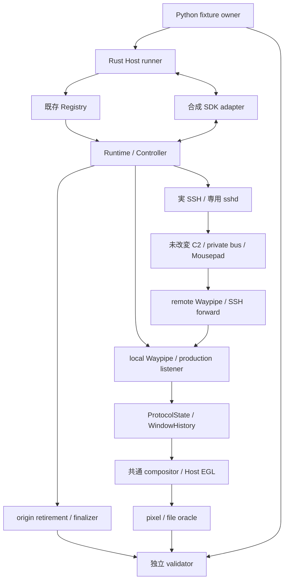
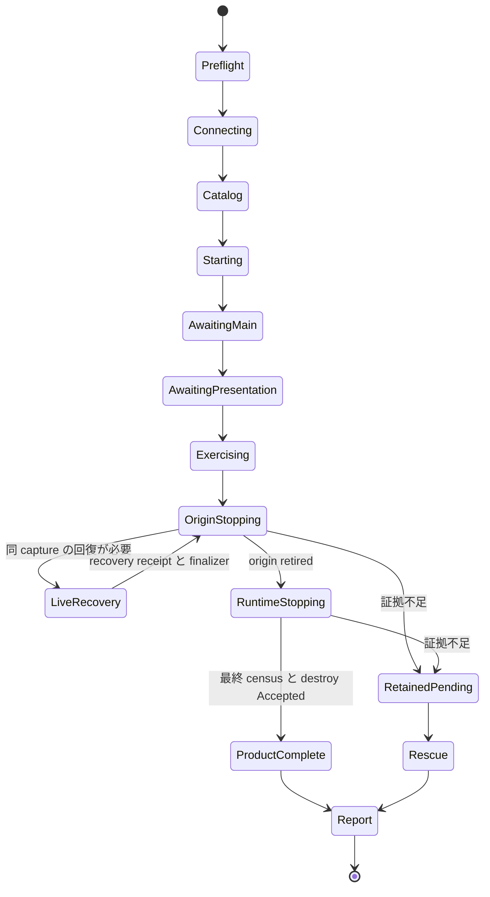

# I6: 通常 v3 Host acceptance／I3-T20・V11 詳細設計

## 0. 基準、位置づけ、受け入れの境界

状態は **proposed（実装引き継ぎ用の詳細設計）**。2026-11-15（日本時間）に調査した
main `0e0df43a2ce4734a00a36f830cc24a80e277bec5` を基準とする。
この文書を追加する PR は文書だけを変更する。以下の新規 fixture、API、schema、CI job は実装案であり、
実装済み・実行成功・設計承認を宣言するものではない。

目的は Quest 3 の広い作業空間で Linux アプリを独立した複数ウィンドウとして扱うために、
通常 v3 の Connect → Inspect → Launch → 表示・入力 → Stop／Recover → 全回収を、
まず Host 上で実 SSH・実 C2・実 Waypipe・実 Mousepad と production compositor を通して検証することである。
初期の実アプリは固定した Mousepad 0.6.3／GTK3 とし、GTK デモも通常 catalog の別ケースで検証する。
同時 GUI lease 数は増やさない。

本書の T20 は **I3-T20** を意味する。I2/I4 などの同名ローカルテスト ID と区別して、
machine-readable report にも `verification_ids: ["I3-T20", "V11"]` を保存する。

| 証拠 | 本書での扱い |
| --- | --- |
| source に実装がある | 固定 commit のコードから確認する。テスト成功とは別 |
| Host unit／Android JVM／既存 A0 の成功 | 各検査が実際に通った範囲だけを記録する |
| I6 Host 通常 v3 acceptance | 本書で新設する固定ケースと validator がすべて成立した場合だけ成功 |
| Meta SDK の実 callback／Surface／Scene | I7/V12。Host の合成 adapter からは証明しない |
| Android の通常設定保存・E1 CAS・marker 再読・再起動 | I7/V12。Host で作った設定入力はその代替証拠ではない |
| Quest 装着時の視認・物理キーボード・コントローラー | H。Host／合成入力の成功から推定しない |

先に読む契約は [統合計画](linux-real-app-v3-integration-plan-20261111.md) §11/20、
[B1](linux-real-app-b1-contract-20261110.md)、[presentation](linux-real-app-b1-presentation-20261110.md)、
[C1](linux-real-app-c1-handoff-20261110.md)、[C2](linux-real-app-c2-helper-20261110.md)、
[I2](linux-real-app-v3-i2-detailed-design.md)、[I3](linux-real-app-v3-i3-detailed-design.md)、
[I4](linux-real-app-v3-i4-detailed-design.md)、[I5](linux-real-app-v3-i5-detailed-design.md)、
[I5 検証記録](linux-desktop-v3-i5-validation-20261114.md)である。
I2 と I4 の resolver context は別々に取得する。I6 は manual discovery とし、D5 manifest へ自動登録しない。
過去の文書の open／未実装という記述は、その文書の基準日時の記録として維持する。

## 1. 調査時点の実装と差分

### 1.1 Git／CI の観測

main は上記 SHA。I5 の [PR #31](https://github.com/tin-machine/eidolon-wayland/pull/31) は merged、
head は `1dcd3f0c77eb92fa4063782fe641122cc9e42c58`、13 commits だった。
I3/I4 の [PR #16](https://github.com/tin-machine/eidolon-wayland/pull/16) は merged で、
merge commit は `eca71addc58009b4576644da162d56670eebfaf5`。
I2 の [PR #28](https://github.com/tin-machine/eidolon-wayland/pull/28) と共通統合の
[PR #13](https://github.com/tin-machine/eidolon-wayland/pull/13) も merged である。
[PR #30](https://github.com/tin-machine/eidolon-wayland/pull/30) は open の任意の構造解析計画であり、I6 の開始条件ではない。

基準 main の [検証 run 43612361312](https://github.com/tin-machine/eidolon-wayland/actions/runs/43612361312)
では Host、Android、Documentation integrity が成功、
[L7a run 43612361403](https://github.com/tin-machine/eidolon-wayland/actions/runs/43612361403)
では GIO と A0 foundation が成功、
[CodeQL run 43612361322](https://github.com/tin-machine/eidolon-wayland/actions/runs/43612361322)
では 5 言語の検査が成功していた。これらは既存検査の証拠であり、未実装の I6、V12、H の成功ではない。

[Issue #27](https://github.com/tin-machine/eidolon-wayland/issues/27) は調査時点で open。
positive timing ケースの修正が source に存在しても、競合負荷下で繰り返し安定した証拠を確認できたことにはしない。

### 1.2 再利用するものと追加するもの

| 対象 | 基準 main の実装 | 再利用 | I6 で追加するもの | 根拠 | 限界 |
| --- | --- | --- | --- | --- | --- |
| acceptance CLI | `APP_V3_NOT_IMPLEMENTED`。終了判定は `a0_passed` 中心 | 既存 stage／package 引数 | 独立 module、validator、stage 別終了値 | [CLI][src-cli] | feasibility 成功を引き継がない |
| A0 | app を直接 spawn する実 Wayland fixture | 固定入力、入力生成、file oracle の部品 | 通常 Runtime 経由の driver | [A0 driver][src-a0-driver]、[A0 runner][src-a0-runner] | A0 全体を通常 v3 と呼ばない |
| Host entry | `eidolon_native::registry::Registry` は portable。JNI bridge は Android 側 | strict parse、handle、command、poll、destroy | Linux 専用 Rust runner | [Registry][src-registry]、[crate][src-native-cargo] | JNI／Kotlin の実行ではない |
| 通常 v3 | Runtime → Controller の Connect／Inspect／Launch／Recover が配線済み | 同じ actor と通常 command | 読み取り専用 trace と fixture pump | [Runtime][src-runtime]、[transport][src-transport] | controller 単独検査では V11 不足 |
| C1/C2 | persistent profile、実 helper、所有・lease・receipt | immutable bundle 内の未改変 source | 実 passwd HOME と sshd の環境 | [C1][src-c1]、[C2][src-c2] | `RealC2Cases` の HOME／boot／clock patch は実 SSH の証拠ではない |
| source pinning | inventory の 15 source と compiled hash、bundle/config export | 既存 validator／builder | 実成果物と実行 checkout の一致確認 | [inventory][src-inventory]、[builder][src-builder] | 古い cache の成功を流用しない |
| I3 window | production Session／ProtocolState／WindowHistory／retirement | listener origin、main、parent、target generation | parent／role／origin の bounded trace | [Session][src-session]、[v3 core][src-v3-core] | `app_id` だけで採用しない |
| Host render | `host.rs` の `Target::frame` は実描画せず成功する stub。`readback: true` も実 readback の証拠ではない | 共通 compositor と所有モデル | Linux EGL backend、実 frame/readback receipt | [Host stub][src-render-host]、[compositor][src-compositor] | stub の成功を pixel oracle に使わない |
| I4 | native gate／Create／binding／frame／retirement が存在 | 同じ Startup と target gate | 合成 SDK adapter、実 Host render と lease の照合 | [v3 core][src-v3-core]、[SDK adapter][src-sdk] | Meta SDK の成功とは分離 |
| report | `transport::Snapshot.desktop_v3: Option<V3Report>` の型はあるが、通常実行でそこへ集約されない | 実際の `desktop_v3_transport`／`desktop_v3_presentation`／`desktop_v3_sdk_target` | cross-owner evidence join | [transport][src-transport]、[Runtime][src-runtime] | 未代入の optional field を成功条件にしない |
| I5 | 二段階回収、保存 barrier、通常 launcher | native reclamation と保持された live Recover | Registry の実 destroy 戻り値を記録 | [I5 記録][src-i5-validation]、[save coordinator][src-save] | Host の設定生成は Android 保存成功ではない |
| CI／docs | A0/GIO job と D5 discovery が存在 | 現在の scope／既存検査 | 独立 I6 job と手動文書リンク | [workflow][src-workflow]、[scope][src-scope] | required checks／manifest authority を弱めない |

## 2. 固定する受け入れ profile

標準 profile は `i6-host-v1`、report revision は `eidolon-i6-host-acceptance-v1` とする。
ケース集合、variant 集合、期待 outcome、必要証拠は実行前に固定した manifest の digest に束縛する。
失敗後に required を optional へ変更したり、実行できなかった variant を集計から落としたりしない。

証拠の種別を三つに分ける。

| 記号 | 種別 | 例 |
| --- | --- | --- |
| R | 実 product Host 経路 | 実 SSH／C2／Waypipe／Mousepad、production dispatch、実 EGL、実 file bytes |
| S | 合成 SDK 境界 | Scene／Entity／listener／dispose を Host adapter がモデル化し、native I4 gate に通常 command を送る |
| T | 明示された test seam／純粋契約テスト | frame 単位 ACK drop、限定 I/O fail-once、fake clock、boot provider |

`host_v3_acceptance_passed` は、この profile の必須 assertion がすべて成立したことを意味する。
すべての負例で product cleanup が complete になった、という意味ではない。
「正しく Unknown/Pending を保持し、保存・新規起動を拒否した」ことを成功条件とするケースもある。
case の成功と product cleanup disposition は別 field で表す。

実 reboot を行う `i6-real-reboot-v1` は、専用 VM と実 boot ID 変化を必要とする別の事前宣言 profile とする。
標準 profile における boot 分岐の契約検査を、実 reboot 成功と呼ばない。
実 JNI／Kotlin／Android 保存／実 SDK は I7/V12、同一署名の旧 APK を用いる upgrade 検査も I7、
装着・物理入力は H に引き継ぐ。旧 v2 source/journal の互換は I6 の必須対象に残す。

## 3. 実行構成と通常経路



対象 Mousepad を spawn するのは C2 だけとする。Python owner が通常ケースの app を直接起動しない。
`Registry` の strict config parse、handle admission、command parse、poll、destroy をそのまま利用し、
`Runtime::guarded` を通る既存 API で credential と surface を渡す。

| 選択肢 | 採否と理由 |
| --- | --- |
| 既存 Registry＋Linux 専用 runner | 採用。通常 entry の parse／gate／destroy を検証できる |
| A0 全体の再利用、controller 単独 fixture | 部品／契約検査には使うが、通常 v3 acceptance の全経路にはしない |
| 現行 Host stub で frame 成功を数える | 不採用。実 compositor 出力を観測できない |
| 別 compositor／Xvfb を通常経路の代わりにする | 不採用。production ProtocolState と compositor が検証対象から外れる |
| C2 に `GTK3_MODULES` を追加して observer を注入する | 不採用。固定 app 環境と source 契約を変えてしまう |
| Quest 実機を I6 開始の必須条件にする | 不採用。Host で成立させる部分と実 SDK の検証を分ける |

## 4. 隔離環境と provisioning

GitHub-hosted `ubuntu-24.04` VM 内の専用 disposable container を標準環境とする。
Host runner／local Waypipe／EGL は非 root の `eidolon-driver`、remote C2／Mousepad は別の非 root
`eidolon-app` で動かす。root は account、package、専用 sshd の準備にだけ使う。

C1 は passwd 由来の HOME と祖先 directory の所有・権限を検査する。
`HOME=/tmp/...` という環境変数の差替えだけでは隔離も C1 の成立も証明できない。
実 passwd HOME を `/home/eidolon-driver` と `/home/eidolon-app` に設け、
private profile、Documents、settings、XDG runtime をその所有者に帰属させる。

専用 sshd は loopback の専用 port を使い、run ごとに host key と Ed25519 client key を生成する。
profile に実 host key を pin し、通常 public-key auth を通す。fault 用の透過 TCP relay を前段に置く。
通常 run はホスト PID namespace、既存 desktop、共有 ADB、Docker socket を共有しない。
`pidfd_getfd` を使う fault broker だけに必要な `CAP_SYS_PTRACE` と seccomp 設定を与え、
runner／app に capability を付けない。broker の対象はこの run の cgroup／UID／生存 owner に限定する。

新規 `scripts/ci/prepare-linux-desktop-v3-acceptance` は明示的な disposable 環境専用 mutator とする。
read-only inspector と通常 acceptance CLI から任意の既存 Host を provision しない。
image digest、font/theme、GTK/Pango/Cairo/Mesa 等の実 fingerprint は初回最小実験で採取して lock する。
未確認の digest をこの設計で作らない。

準備順序は以下で固定する。

1. 専用環境／account／sshd／実 package を準備する。
2. package と source inventory を採取し、read-only inspector で照合する。
3. 既存 builder で immutable bundle を作り、再検証する。
4. `--print-config --build-id` で接続設定を取得する。
5. fresh storage、private artifact root、credential FD、環境 fingerprint を fixture descriptor に束縛する。
6. runner を起動し、通常 Runtime で acceptance を実行する。

外部 Host を用いる場合も、専用 account、pin 済み host key、共有しないデータ、同じ ownership 検査を必要とする。
実 reboot profile だけは専用 VM を使う。container restart は kernel boot ID 変更の代わりにならない。

## 5. 所有者と資源の回収責任

| 資源 | 唯一の owner／識別 | 成立させる回収証拠 |
| --- | --- | --- |
| account／HOME／環境 | Python environment owner、run ID | 最後に環境を破棄する。product 回収成功へ加算しない |
| sshd／relay／port／鍵 | supervisor の live pidfd と private directory | 対象プロセスの wait、FD close、private file 消去 |
| credential | runtime／request／binding、single-use Secret | private FD と zeroize。本文を trace／artifact に含めない |
| C1 profile／lock | installation／profile storage／owner record | 実 release と lock 解放。HOME flock のため同一 account の C2 lease を並走させない |
| Documents／settings | 固定 storage と開いた dirfd／inode | exact bytes／digest、変更すべきでない対象の不変性 |
| I2 journal／`io.lock` | captured profile／pins／storage／nonce／I/O generation | 同 capture finalizer、unlink 後の directory fsync、実 publish 結果 |
| bundle | immutable build ID と source hash | 実行前後の一致。cache の存在だけでは成立しない |
| remote app／bus／Waypipe | C2 ProcessOwner の live pidfd／UID／starttime | descendants を含む reap、所有 pipe EOF、profile release、receipt |
| local Waypipe | native Session の child／worker | wait／pipe drain／worker join |
| SSH channel／forward／router | transport connection と I/O generation | channel close、forward teardown、router／旧 I/O fence |
| Wayland client／surface／SHM | production Session／ProtocolState | closing 中も dispatch した実 destroy、所有数と解放 event |
| renderer target／fence | full TargetKey と render thread | 実 GL target disposal、該当 generation の fence |
| 合成 SDK lease | runtime／target／CreateSeq／adapter ID | 同じ lease の callback drain／dispose／Retired。合成であることを明記 |
| fault writer | broker の child pidfd と複製 FD | 全 writer FD close と reap。EOF を妨げたまま完了しない |
| evidence artifact | Python owner、run/case と relative path | bounded／no-follow／fsync、byte size と SHA-256 |

保存 PID を再読して signal する仕組みは追加しない。救済操作も、生存中に捕捉した owner／pidfd の範囲に限る。
所有していない既存 process を cleanup 成功のために停止しない。[ProcessOwner][src-process-owner]

## 6. Profile／Storage／Runtime config の組立て

既存 parser を呼び、Python 側に受理集合を再実装しない。
[`Profile::parse(raw, installation)`][src-profile-model] は schema 2 と 16 KiB 上限を持つ。
fixture profile は fresh な 32 桁 hex installation、固定 `profile_id: "remote-linux"`、
`revision: "1"`、`display_name: "I6 fixture"`、`backend: "linux_ssh"`、
`host: "127.0.0.1"`、専用 port、`username: "eidolon-app"`、実 host key を用いる。
host key は既存 parser が受理する canonical な `ssh-ed25519` 形式とする。
Profile parser が DNS 名を受理しても、基準 source の ConnectSpec は `DNS_NOT_IMPLEMENTED` を返すため、
標準 fixture は IPv4 literal に固定する。[ConnectSpec][src-profile]

`StorageCapture::from_profile` から `legacy_installation`、`profile_id`、`profile_binding`、
`host_user_binding` の 4 field を得る。これに `schema: 1`、fresh な 32 桁 hex `installation_id` と
`profile_storage_id` を加えた 7-field record を `StorageRecord::parse` へ渡し、`matches_capture` を確認する。
同一 storage 再起動ケースは同じ record と新 nonce を使う。
別 storage の独立性ケースは別の論理 installation/capture を作り、保持中の capture の
`profile_storage_id` だけをすり替えない。[storage/model][src-model]

builder の `--print-config --build-id` 出力を `ConnectionConfig::parse` で検査し、
`{configuration, storage}` を `RuntimeBinding::parse` へ渡して `matches_profile` を確認した後、
通常 `RuntimeConfig` として Registry に投入する。[configuration][src-configuration]

| 境界 | 維持する上限／条件 |
| --- | --- |
| Android v3 config import | 32,768 bytes |
| B1 pins | 4,096 bytes |
| B1 record／native の最終 binding／Runtime／JNI 入力 | それぞれ現行の 16,384-byte 制限を維持。中間入力が通っても最終 envelope を再検査 |
| version／schema | duplicate key、unknown field、混在版を拒否。parse 失敗で v2/v3 を fallback しない |
| local Waypipe | `native_library_dir/libwaypipe_bin.so` に実 Host executable を置き、0.11.3 と必要 feature を検証 |

この組立ては通常 parser と transport に与える **Host fixture input** である。
Android の repository transaction、E1 CAS、active marker publish/readback を実行した証拠としては扱わない。

## 7. API、thread、観測 seam

### 7.1 既存 API を入口にする

Registry の `create(&str) -> Result<i64, Status>`、`command(handle, json) -> Status`、
`guarded(handle, action)`、`poll`、`snapshot`、`catalog_ui`、`request_stop`、`destroy` を使う。
`Accepted`、`Stale`、`Busy`、`InvalidArgument`、`NotReady`、`Failed` を混同しない。
特に queue 受理の Accepted は非同期 command の完了でも資源回収でもない。[Registry][src-registry]

credential は `Runtime::credential_scope()` で要求 scope を得て、同 session／request／binding へ
`provide_credential_for(..., Secret)` で一度だけ渡す。既存の 10 秒期限と最大 16 KiB、
`Zeroizing<Vec<u8>>` を維持する。pin した host key を先に検証し、TOFU を追加しない。
surface は `attach_window_surface(TargetKey, PlatformWindow, width, height)` から渡す。[Runtime][src-runtime]

Connect／Inspect／Launch／Recover／FocusWindow／Key／Pointer／CloseWindowTarget／Disconnect／
CancelConnect は通常 Command parser を通す。fixture 独自の Ready／Started／Mapped／retired setter を設けない。

### 7.2 新設する Host 専用 API 案

以下は Linux の `host-acceptance` feature だけで公開する案である。現行 API と取り違えない。
feature は既定 off、Android と同時に有効なら compile error とする。

```rust
pub struct HostReadbackRequest {
    pub target: TargetKey,
    pub min_content_frame: FrameSeq,
    pub request_seq: NonZeroU64,
    pub roi_ids: Vec<FixedRoiId>,
}

pub struct HostReadbackTicket { /* private owner identity */ }
pub enum HostReadbackPoll {
    Pending,
    Complete(HostReadbackReceipt),
}

// Runtime の guarded 呼出し内。型と命名は実装時に既存 crate の型へ合わせる。
fn request_host_readback(request: HostReadbackRequest)
    -> Result<HostReadbackTicket, Status>;
fn poll_host_readback(ticket: &HostReadbackTicket)
    -> Result<HostReadbackPoll, Status>;
```

`HostEvidenceTrace` は読み取り専用の bounded queue、`HostSdkLease` は外部 JSON から
Deserialize できない所有 token とする。fault は固定 allowlist の `HostFaultRequest` と
single-use `HostFaultTicket` を、現在の capture／I/O generation に束縛して `Runtime::arm_host_fault` へ提出する。
任意 path／argv／syscall、product stage の書換え、proof の投入を許さない。
test field を通常 config や remote wire に追加しない。

### 7.3 thread ownership

| owner | 責任 |
| --- | --- |
| Python supervisor | 環境、sshd、fault broker、watchdog、artifact、最後の validator |
| Rust Host pump | Registry、credential 応答、poll、合成 SDK 状態、readback request/poll |
| core thread | Session、ProtocolState、I3、B1、command 完了 |
| render thread | EGL context、全 GL 呼出し、readback、render fence |
| transport worker | 接続ごとの既存 Tokio 2-thread runtime と SSH actor |
| local Waypipe worker | 子 process、stdout/stderr drain、wait |
| finalizer worker | journal FS 操作と publication |

Ready 待ちや cleanup 待ちの間も pump を止めず、短い一歩ずつ進める。
GL callback から core lock を逆順に取得しない。trace は `try_send` で enqueue し、
overflow は sticky failure として検査を非成功にするが product を block しない。

## 8. 正常 sequence、状態遷移、期限

### 8.1 正常 sequence

1. preflight で環境・source・package・bundle・storage・golden を照合する。
2. Registry create、RuntimeReady、合成 SceneReady／Activity visible／XrFocused を進め、expected Scene を固定する。
3. Connect → host-key 検証 → 同 request の credential → UID probe → ProbeReady を観測する。
4. Inspect で `JournalReserved` を helper exec より先に耐久化し、Prepared の boot identity と実 probe/catalog を得る。
5. 同 actor の catalog から typed Selection を作り Launch する。native permit と retirement owner を local side effect より先に確保する。
6. production Session/listener と local Waypipe を作り、local ready 後に forward を要求する。
   `JournalForwardRequested`、耐久化した `StartRequested` を経て Start を **一度だけ**送る。
7. Started と同 origin の Mapped、固定 main、native Create、合成 SDK binding、実 Host frame を join し、B1 Ready に到達する。
8. Focus/Input gate 経由で GUI ケースを実行し、file/pixel/origin の独立 oracle を採取する。
9. 通常 Close／Stop、必要な同 capture live Recover、I3/I4 retirement、I2 finalizer を完了する。
10. `origin_retired` と pending 0 を確認してから Runtime 全停止し、最後の生存 census と実 `Registry::destroy == Accepted` を採取する。

Started の `process_identity` は root Waypipe の identity であり、Mousepad leaf PID と読み替えない。
leaf を故障対象にするときは C2 ProcessOwner の生存所有関係から捕捉する。



途中の failure/cancel は最初の原因を固定して回収段階へ移す。上図の一本道を timeout で飛び越えて成功させない。

### 8.2 product deadline と fixture budget

| product 条件 | 現行値を維持 |
| --- | --- |
| SSH connect／auth | 5 秒／10 秒 |
| Prepared／Inspect | 10 秒／10 秒 |
| Start ACK | 12 秒 |
| heartbeat interval／ACK | 5 秒／5 秒 |
| C2 lease | 15 秒 |
| Stop ACK／channel close／Stop 全体 budget | 8 秒／3 秒／33 秒 |
| main／SDK 表示 | 20 秒／10 秒 |

fixture の外側 budget は Connect 30 秒、Inspect 45 秒、Launch 45 秒、origin retirement 60 秒、
Runtime stop 15 秒とする。これは artifact 採取と cleanup の余裕であり product deadline を延長しない。
case timeout 後も first failure を保持して cleanup を継続する。
app の総 runtime 上限は追加せず、CI 全体の wall-clock budget と分ける。

## 9. 実描画、合成 SDK、通常入力

### 9.1 Linux Host EGL backend

`native/render/src/host_egl.rs` を新設し、Linux feature 時だけ既存 stub の代わりに選ぶ。
Mesa llvmpipe、surfaceless EGL platform、GLES3、RGBA8 の target ごとの pbuffer を採用する。
surfaceless platform は display の取得方法であり、本案では offscreen render target として pbuffer を使う。
共通 `paint_decorated` を通し、app buffer と decoration の両方を描画する。
既存の最大 dimension 2,048、1 buffer 16 MiB、client SHM 64 MiB、total SHM 128 MiB、
pixel budget 128 MiB を維持する。[limits][src-limits]、[render][src-render]、[compositor][src-compositor]、[Mesa EGL][mesa-egl]、[EGL extension][egl-surfaceless]

readback は app＋decoration 描画後、swap 前に行い、immutable `WindowSnapshot.frame_seq` を捕捉する。
GL error 0、必要な fence/wait、swap 成功を確認した後だけ receipt を発行する。
idle redraw で content frame sequence を増やさない。stub へ黙って fallback しない。

receipt は runtime、full TargetKey、CreateSeq、要求 minimum／実 content frame、present sequence、
snapshot ID、logical/buffer geometry、content rectangle、ROI revision/digest、backend fingerprint を保持する。
request は最大 8 ROI、合計 1 MiB とし、raw pixel は private の一時データとして扱う。
通常の公開 artifact は比較結果、digest、固定 ROI ID、counter を保存する。
旧 target／context loss／owner stop は成功 receipt を生成せず、NotReady／Busy／Stale を typed に返す。

### 9.2 合成 SDK adapter の order

native plan の Create を受けたら ledger を reserve し、`diagnostic: false`、同 CreateSeq と adapter ID で
`RegisterSdkBinding` を送って同期 Accepted を確認する。その後 Host surface と合成 Entity/listener を作り、
attach、既存 `SdkBindingEvidence { phase: Current, ... }`、同 target の実 frame、not-paused を成立させてから
既存 `AdapterApplied { action: Create, ... }` を送り、実 command completion／panel applied／B1 Ready を待つ。
順序は実 [`SpatialPanelAdapter`][src-sdk] の ownership order に合わせる。

合成 SDK token は必ず S と記録する。native gate を通ったことを実 SDK object 生成成功へ読み替えない。
retire は新 callback を seal → Retiring → 実 renderer fence と合成 callback producer drain／dispose →
同 lease の Retired → Accepted → I3/B1 GC → origin proof とする。
fence 前は NotReady とし、`ReleaseSdkBinding` で retirement を迂回しない。

### 9.3 入力の到達

`FocusWindow` に full target と input epoch を指定し、実完了後に得た focus token を Key に結び付ける。
Pointer は既存の full target／input epoch／pointer fields と実 pointer/focus gate を使う。
Pointer command に存在しない focus token field を追加しない。ASCII 追記は固定 US evdev key generator を使う。
GTK API や GSettings を直接呼んで GUI 操作を置き換えない。
Runtime effect gate と Session focus gate の両方を通し、pointer 座標は同 frame の content rectangle から逆変換する。
旧 generation、旧 focus token、旧 admission epoch は C04 で拒否を確認する。[commands][src-commands]、[Session][src-session]

## 10. GUI と永続化の独立 oracle

### 10.1 Open／Edit／Save As

固定 UTF-8 入力は BOM なし、LF、末尾改行ありの次の 8 行とする。

```text
Eidolon I6
日本語の固定入力
line-3
line-4
line-5
line-6
line-7
line-8
```

入力は 78 bytes、SHA-256 は `884b4478282ae75f7f297783a415cb6d529b29b63fcf3b6e56c1110ed2af1262`。
GUI で開き、Ctrl+End、ASCII `eidolon-i6-saved\n` を追記し、Save As で別名保存する。
出力は 95 bytes、SHA-256 は `79a400c35081c5b9bc257e6d440512320c134a680b28c6c904e39b5d40e18337`。
元 file を Ctrl+S で上書きせず、元 bytes の不変性も検査する。

dialog が実 transient parent を持ち、固定 main と同 origin の full target に属することを trace で照合する。
file は信頼した directory FD から no-follow で開き、fstat で regular file／owner／inode を確認して
size、exact bytes、digest を比較する。A0 の `is_symlink()` 後に普通の open を行う形を、そのまま安全な oracle と見なさない。

### 10.2 設定保存

設定は A0 で使用している `[org/xfce/mousepad/preferences/view]` の
`show-line-numbers=true` を使う。[GUI oracle][src-a0-gui]

1. fresh storage で GUI が off、key が未保存であることを独立に観測する。
2. pointer で View menu を開き、実 popup の serial／layer を捕捉して Line Numbers を on にする。
3. keyfile の保存値と、実 pixel の gutter／checkmark を別々に検査する。
4. 通常 Close と全 product cleanup を完了し、同 StorageRecord、新 nonce で再起動する。
5. 8 行の固定 file を開き、gutter 1〜8、menu checkmark、key=true を再確認する。

Mousepad 固定 source の `_View` と `Line N_umbers` の menu 定義を使い、存在が未確認の shortcut を仮定しない。
根拠は upstream commit `65fbfe0459259f820fcc8b9c4dd454228304842a` の [menus.ui][mousepad-menu]。
A0 の `GTK3_MODULES` observer は C2 の固定環境には存在しないため、通常経路に注入しない。

### 10.3 pixel golden の作成と失敗条件

golden は初回最小実験で、別の A0 read-only observer の意味情報と人による fixture review を使って作る。
font/theme、GTK/Pango/Cairo/Mesa、locale、scale、Mousepad commit を pin し、off/on の positive と negative mask を保存する。
通常 acceptance の観測結果から、その run の expected image を生成して一致させない。
曖昧な mask、golden 不在、未レビュー、fingerprint 不一致は fail/not_run とし、成功へ数えない。
意味判定に必要な ROI は本文と設定状態が本当に変わったことを識別できるものに固定する。
比較 tolerance の変更も fixture revision を変えてレビューし、実装の誤りを吸収する自動更新はしない。

## 11. 必須 28 case family と variant

以下の N01〜N11、F01〜F12、C01〜C05 の **28 family すべて**を標準 manifest に登録する。
表中の複数 variant も固定集合として展開し、family 名が存在するだけで完了としない。
R/S/T の意味は §2。期待した product failure は assertion の対象であり、予期しない case failure と区別する。

### 11.1 正常・互換ケース

| ID | 固定入力／variant | 必須観測と成立条件 | 期待 product cleanup | 証拠 |
| --- | --- | --- | --- | --- |
| N01 | Inspect のみ→Stop | 実 catalog、Start=0、NoLocalAllocation seal、helper/SSH/journal 回収 | complete | R |
| N02 | GTK デモ、Mousepad を順番に実行 | 各 variant で同 actor catalog／Started／origin／main／実 frame／B1 Ready | 各 complete | R+S |
| N03 | unknown app ID、scope 変更、revision 変更、旧 catalog、二重 Launch | parser/gate の InvalidArgument／NotReady／Busy を個別固定、Start≤1、拒否による app spawn なし | complete | R+T |
| N04 | 125 秒 idle | 複数 lease 期間の heartbeat、前後の fresh Ctrl+O／Esc 応答、総 runtime 上限なし、Stop 応答 | complete | R+S |
| N05 | 固定 Open→Edit→Save As | §10 の exact bytes／size／digest、元 file 不変、実 parent/main | complete | R+S |
| N06 | Open cancel、Save As confirm、未保存 Close cancel、Close confirm | 各 dialog の実 target／parent、取消後の継続、確定後の保存 bytes／app 終了 | complete | R+S |
| N07 | Line Numbers 設定→Close→同 storage 新 nonce | 前後 2 session の keyfile と独立 pixel oracle | 両 session complete | R+S |
| N08 | 別 bus/display の先行 control、別 fresh storage を順に実行 | 先行 identity/digest、対象の新応答、他の GUI off と settings bytes 不変 | 対象 owner ごと complete | R+S |
| N09 | session 候補、autosave 候補を別 variant で配置 | spawn 前拒否、app spawn=0、候補／文書／設定 bytes 不変 | helper cleanup complete | R |
| N10 | dialog 反復、target generation 交代 | 発行された全 renderer／SDK generation の receipt、I3/B1 GC、finalizer | complete | R+S |
| N11 | frozen v2 pending→旧 Recover | 固定 5 source の hash、版による dispatch、v2 pending 中 v3 拒否、旧 capture 回収 | 旧契約で complete | R |

N08 の先行 control は独立 A0 control として明記し、同一 account に第二の通常 v3 lease を作らない。
N11 は v2 実互換検査であり、旧 APK からの update 成功ではない。
自然な Close で main destroy と terminal の順序により `APP_WINDOW_UNSUPPORTED` が観測される場合は、
source の reason を書き換えず、明示した Close intent と実 event order を照合して期待 outcome を判定する。

### 11.2 故障・回復ケース

| ID | 固定 fault／variant | 必須観測と成立条件 | 期待 product cleanup | 証拠 |
| --- | --- | --- | --- | --- |
| F01 | 実 Started frame を一度 drop | 実 line 受信の digest、Start=1、retry=0、元 deadline、同 Runtime/capture の Recover | complete | R+T |
| F02 | client→sshd を EOF も含め blackhole | upstream を生存させ実 C2 `lease_expired`、native timeout を別記録、旧 I/O fence 後に同 capture Recover | complete | R |
| F03 | 実 control EOF | C2 `input_eof` と該当 receipt、通常回収 | complete | R+限定 control |
| F04 | app、dbus、remote Waypipe の live pidfd kill | 3 variant の実 identity、元 failure を保持、通常 cleanup／Recover | complete | R |
| F05 | 低 rate 中 Stop、stdout limit、stderr limit、write end 保持 | 実 C2 pipe drain/rate limit。保持 variant は EOF 不足を正しく残す | 前 3 complete、保持中 pending | R |
| F06 | receipt collision による部分 publish | 実 c-proof／profile release、r-receipt publish 失敗、所有 blocker 除去後に同 capture Recover | complete | R |
| F07 | completion proof 前の helper owner 喪失 | 同 boot Unknown、journal 保持、設定／新規開始拒否 | retained_pending 後 rescue | R |
| F08 | journal publish、rename 後 fsync、unlink 後 fsync を一度失敗 | 同 capture、誤 clear なし、retry で owner history を保持、別 pending を消さない | retry 後 complete | R+T |
| F09 | Inspect 後に package 変更 | Launch 拒否、app spawn=0、旧 immutable Recover を新 package 判定と分離 | complete | R |
| F10 | Host を kill→新 process で旧 journal を読む | authority 喪失を検出、新 process の 0 件を旧 owner の回収証拠にしない | retained_pending 後 rescue | R |
| F11 | Session 前、catalog 待ち、Launch pending、Ready 後の取消 | 元 request の実完了、Start≤1、各 boundary の所有を維持 | variant ごと complete／所定 pending | R+S |
| F12 | SDK callback 保持、dispose 失敗、旧 Scene delete 不足 | exact lease を pending に保ち、別 Scene／timeout／空配列で成功にしない。同 lease の修復可能分だけ再開 | variant ごと所定 outcome | R+S |

F11/F12 の complete／retained_pending は実装時に case manifest の variant ごとに固定する。
run の観測結果に合わせて期待 outcome を選択しない。

### 11.3 境界・判定器の契約ケース

| ID | 対象 | 必須条件 | 証拠 |
| --- | --- | --- | --- |
| C01 | config／storage／catalog／版／byte 上限 | 共通 golden と拒否変異、duplicate/unknown/mixed version 拒否 | T |
| C02 | 期限ちょうど、heartbeat と Inspect/Launch/Stop/EOF 競合 | fake clock、元 deadline 維持、進行中 send future を捨てない、Start≤1 | T |
| C03 | boot changed／same／矛盾 receipt | 明示的な synthetic boot provider。`pipes_eof` を捏造しない。実 reboot は別 profile | T |
| C04 | wrong Runtime/capture、旧 ACK/generation/input epoch/focus | window 採用なし、入力効果なし、file 変更なし | T＋到達する実 gate |
| C05 | report/artifact 破損、cross-run/capture/source mix | 独立 validator が非 zero、最初の case failure を保持 | T |

## 12. Fault injection の具体的な位置

### 12.1 Start ACK loss と lease expiry

F01 は既存 bounded framer が実際の Started line を組み立てた直後、Protocol が受理する直前に一度だけ drop する。
任意の `ChannelMsg` packet を落として framing 自体を壊すケースとは分ける。
capture／request／session を照合し、実受信 line の digest を残す。
protocol を先へ進めず、sequence を付け替えず、deadline を reset せず、Start を再送せず、
新 generation へ line を再注入しない。[v3 owner][src-owner]、[serve][src-serve]
この variant は実 app が 12 秒の ACK deadline まで生存することを確認してから native timeout を判定する。
それ以前の terminal failure を timeout に置き換えて合格させない。

F02 は透明な raw TCP relay で client→sshd の全 bytes と EOF の伝播を止め、upstream connection は維持する。
単に heartbeat を止めて client を close すると `input_eof` になり、lease expiry の証拠にならない。
実 helper の `lease_expired` と native timeout を独立に記録した後、relay を閉じて旧 I/O generation の fence を成立させる。
回復は生存する同 Runtime と capture で行う。

### 12.2 Pipe flood と EOF

broker は SSH descendant／cgroup／UID／boot/starttime で照合した生存 root owner から pidfd を取得する。
`pidfd_getfd` で stdout/stderr の write end を複製し、fstat の FIFO、`F_GETFL` の write-only、
pipe inode を検査する。保存済み PID からの再探索で authority を作らない。[pidfd_getfd][pidfd-getfd]

複製 FD は同じ open file description を参照するため、**共有 status flag を変更しない**。
独立した writer child が poll と `PIPE_BUF` 以下の小さい write を行い、
block した場合は外側 owner がその writer の live pidfd にだけ期限を適用して停止する。
`O_NONBLOCK` を変更して app 側の FD 挙動を変える方法は採用しない。[pidfd signal][pidfd-signal]

低 rate は各 stream 64 KiB/s、最大 45 秒。高 rate は各試行最大 16 MiB／5 秒。
product の 1 MiB/s／5 MiB burst は変更しない。[C2 core][src-c2-core] 環境が必要 rate に到達できなければ
`FAULT_NOT_REACHED` とし、期待する rate-limit failure が起きなかった事実を記録する。

通常の flood variant は Stop dispatch、root pidfd の death、writer budget のうち最初の条件で、
すべての追加 write FD を閉じて writer を reap する。
C2 は pipe EOF を待って terminal を出すため、terminal を待ってから writer を閉じる循環待ちは作らない。
write end 保持 variant だけはこの close 条件の明示的な例外とし、書込みを止めた FD を、
期待する pending の観測または固定の外側期限まで保持する。
その時点で product disposition を固定してから FD を閉じ、fault resource 解放／rescue を別結果として記録する。

### 12.3 Receipt と journal の失敗

F06 は private receipt directory に mode 0600／O_EXCL で `r-<nonce>.json` blocker を作る。
既存 file があれば準備失敗とし、上書きしない。実 C1 release → `c-<nonce>.json` proof →
一時 session directory 除去 → r-receipt publish の
部分成功を観測し、`receipt_write` failure を保持する。broker が作った同 inode の blocker だけを除去し、
同 capture Recover で再試行する。永続 profile directory を削除するケースではない。[C2 core][src-c2-core]

F08 は I2 journal の特定 I/O boundary だけを fail-once にする。
rename 後／unlink 後の directory fsync 失敗で誤って完了を publish しない。
unlink 済みならその状態を owner が保持して fsync を再試行し、別 capture の pending を消さない。
これは Host journal の実 I/O に対する T であり、remote C2 の fsync syscall を実故障させた証拠ではない。[journal][src-journal]

### 12.4 実 reboot profile

専用 VM の disk／HOME／UID／鍵／bundle を保ち、Host runner を生存させたまま remote VM だけを reboot する。
実 boot ID の変化を採取し、旧 capture Recover の分岐と remote/local/SDK proof をそれぞれ確認する。
container の再起動や synthetic boot provider の値変更を、この profile の成功として受理しない。

## 13. 回収、失敗、救済の順序

回収は次の順序を守る。

1. 新規入力／Launch の admission を閉じ、同 owner の CloseWindowTarget または Disconnect を送る。
2. remote と local の drain を並行して進める。closing 中も Wayland destroy を処理する。
   通常 flood の writer FD や lease fault の relay 等は §12 の条件で解除し、product の EOF／Recover を進める。
3. 必要なら保持中の同 capture で live Recover を実行する。
4. 発行済み全 generation の I3/B1/renderer/SDK 証拠を集め、I2 finalizer を進める。
5. `origin_retired` と全 pending の解消を確認してから `Registry::request_stop` を呼ぶ。
6. 最後の生存 census を採取し、実 `Registry::destroy == Accepted` を確認する。
7. product result を固定する。その後に残余 fault 資源の最終回収、必要な fixture rescue、環境破棄を行う。

fault resource の結果は途中の解除も含めて product と別に記録する。
write end 保持 variant の解除だけは、期待する pending または期限による product disposition の固定後に行う。

Drop、process exit、Stale、journal file の存在/不在、新 Runtime の所有数 0 を、元 owner の回収証拠にしない。
origin retirement 前に Runtime 全体を停止して、必要な live Recover authority を捨てない。
time-out は first failure を記録する契機であり、回収済みにする契機ではない。[retirement][src-retirement]、[I5][src-save]

report は以下を分離する。

| 結果 | 内容 |
| --- | --- |
| `cleanup.product` | product の owner／proof／finalizer／Registry destroy。complete/pending/failed/unknown |
| `cleanup.fault_resources` | broker、writer FD、relay 等の試験注入資源 |
| `cleanup.fixture_rescue` | product 結果固定後の生存 owner に限った救済。product success へ変換しない |
| `cleanup.environment_disposal` | account/container/VM の破棄。product の代替証拠ではない |

期待 disposition は `complete` または `retained_pending`、policy は `product_complete` または
`preserve_unknown_then_rescue` とする。正しい負例で case=pass、product=unknown、rescue=complete は両立する。
その場合でも product complete と報告しない。

例外は固定 reason enum に落とし、自由形式 traceback に credential/profile を混ぜない。
operator cancel は新 case を開始せず停止・回収を進め、`status=cancelled` とする。`stage` は `acceptance` のままとする。
予期しない driver death や CI hard kill によって run の最終 report／必要 receipt が欠けた場合は unknown／非成功である。
F10 の意図的 kill は、生存する Python supervisor と新 driver が所定の全証拠を採取し、
旧 owner の Unknown/Pending 保持を検証した場合だけ case を pass にできる。run の最終 report 欠落は許容しない。
remote owner 喪失後は実 receipt と Recover が成立する場合だけ進み、なければ Unknown を維持する。
cold restart の新 Runtime は、古い local/SDK owner authority を自動的に引き継がない。

## 14. Evidence schema と上限

### 14.1 run と case の識別

新規 `acceptance.json` は schema 1、stage `acceptance`、revision `eidolon-i6-host-acceptance-v1`、
profile `i6-host-v1`、verification IDs `I3-T20`／`V11` を固定する。
run ID は 32 桁 hex、manifest は SHA-256 に束縛する。

`source` は実 checkout commit（40 桁）、canonical tree SHA-256、dirty、build feature を保持する。
PR head と GitHub の synthetic merge commit を使い分けた場合は双方を記録し、実行した checkout を明示する。
tree digest は Git tracked path／mode／content digest を sorted canonical encoding したものとし、
symlink は target bytes を hash して外部へ追跡しない。実行前後を照合し、dirty/change は非成功とする。

`inputs` は package fingerprint、bundle build ID/digest、inventory と compiled source hashes、
renderer fingerprint、golden revision を保持する。artifact は相対 path／size／SHA-256／evidence class を持つ。

各 case/variant は次を保存する。

| field 群 | 必須内容 |
| --- | --- |
| case | `case_id`、固定 variant、status、reason、expected/observed product outcome |
| owners | run/case/runtime/admission epoch、Connect request、Launch request、session、capture/context digest、I/O generation、nonce、scope/native origin |
| targets | full TargetKey、CreateSeq、adapter ID と全発行 generation |
| assertions | manifest に定義した assertion ごとの実 evidence refs |
| failures | `first_case_failure` と `cleanup_failures[]`。期待する product failure は別 field |
| cleanup | §13 の 4 結果と資源ごとの状態／evidence／不足項目 |

正の i64 ID は JSON number ではなく decimal string で保存し、JavaScript の精度損失を避ける。
remote nonce は既存の 16 桁 hex とする。未割当 ID の null は割当前だけに許し、生成後の証拠欠落を隠さない。
複数 clock domain の timestamp を直接比較せず、各 owner の単調 sequence と相関 ID で順序を照合する。

### 14.2 schema の抜粋例

以下は構造説明のための **抜粋**であり、実 run の結果でも全必須 field を持つ有効 report でもない。
F01 が期待した failure を正しく回復した場合の表現を示す。

```json
{
  "schema": 1,
  "stage": "acceptance",
  "revision": "eidolon-i6-host-acceptance-v1",
  "profile": "i6-host-v1",
  "verification_ids": ["I3-T20", "V11"],
  "cases": [
    {
      "case_id": "F01",
      "variant": "started_frame_loss_once",
      "status": "pass",
      "reason": "I6_EXPECTED_FAILURE_RECOVERED",
      "first_product_failure": "DESKTOP_HELPER_TIMEOUT",
      "first_case_failure": null,
      "expected_product_outcome": "complete",
      "observed_product_outcome": "complete",
      "assertions": {
        "start_sent_count": 1,
        "start_retry_count": 0,
        "same_capture_recover": true,
        "registry_destroy_accepted": true,
        "journal_finalized": true
      },
      "cleanup": {
        "product": "complete",
        "fault_resources": "complete",
        "fixture_rescue": "not_needed",
        "environment_disposal": "not_yet"
      }
    }
  ],
  "coverage": {
    "sdk": "synthetic",
    "android_storage_save": "not_observed",
    "real_reboot": "not_run",
    "old_apk_upgrade": "I7_only",
    "quest": "not_observed",
    "physical_input": "not_observed"
  },
  "available": false,
  "production_acceptance_passed": false,
  "quest_verified": false,
  "physical_input_verified": false
}
```

最終 run status は pass/fail/incomplete/cancelled と固定 reason を持つ。
`host_v3_acceptance_passed` と `exit_code` は独立 validator が再計算する。
既存の `available`、`production_acceptance_passed`、`quest_verified`、`physical_input_verified` は Host だけで true にしない。

### 14.3 strict parse と資源 census

| 対象 | 上限 |
| --- | --- |
| acceptance report | 1 MiB |
| schema の case family 容量 | 64。標準 profile の必要集合は固定 28 |
| artifact 数／relative path | 256／ASCII 240 bytes。absolute、`..`、symlink escape を拒否 |
| trace event | 64 KiB |
| case trace | 4,096 events **かつ** 1 MiB |
| readback request | 8 ROI、合計 1 MiB |

duplicate/unknown key、NaN、invalid UTF-8、bool-as-int、trailing bytes を拒否する。
自由形式 error を report に保存せず reason enum を固定する。
既存 128 KiB evidence writer の制限を全体的に広げず、acceptance 専用 writer に新しい上限を適用する。

census は remote processes/pidfds/pipes/profile lock/receipt、SSH channel/forward/router/I/O fence、
local Waypipe/pipes、Wayland clients/objects/surfaces/SHM、native windows、全 renderer/合成 SDK generation、
journal finalizer、Runtime shutdown、Registry destroy を個別に保持する。
state は complete/pending/failed/unknown/not_created とし、evidence と missing reason を付ける。
`not_created` は対応する allocation seal／Start=0 等の証拠を必要とし、観測漏れの代用にはしない。

## 15. Validator と CLI 終了値

新規 `validate_acceptance(report, artifact_root, expected_source, expected_manifest)` は次の順序で独立検査する。

1. strict schema、size、fixed reason を検査する。
2. profile と verification IDs、全 required case/variant/assertion の完全一致を確認する。
3. source／manifest／package／bundle／render/golden の provenance と実行前後の一致を確認する。
4. run/runtime/capture/request/session/target/generation の join を検証する。
5. no-follow で artifact を開き、byte size／digest／所有範囲を確認する。
6. file/pixel と protocol/ownership の独立 oracle を照合する。
7. case ごとの期待 cleanup policy と実 product disposition を確認する。
8. required の欠落、trace overflow、最終 receipt 不足を非成功にし、summary と exit を再計算する。

report 本文の `required`、`status: pass`、集計値を authority としない。
required missing は非成功、duplicate/unknown/cross-run/capture/source mix は invalid、
artifact mismatch は invalid、環境不足は incomplete、manifest が期待していない deadline 違反は case failure、
case 未完了は incomplete、operator cancel は cancelled とする。
optional/I7-only は実行前 manifest の別範囲としてのみ認める。

| exit | 意味 |
| --- | --- |
| 0 | required の全 assertion と policy が成立 |
| 1 | 予期しない case failure |
| 2 | incomplete、環境不足、外側 watchdog による未完了 |
| 3 | invalid report／artifact／provenance |
| 130 | operator cancel |

重複時の優先順位は invalid → cancel → case failure → incomplete とする。
欠損だけの未完了 report と、改ざん／矛盾した report を区別する。
feasibility の既存 0/2 と `a0_passed` 条件は維持し、acceptance の成功判定を混ぜない。[CLI][src-cli]

## 16. I5 の回収・保存 barrier を保つ

I6 runner は origin retirement の開始 → 必要な同 capture live Recover → I2 finalizer／origin retired の順で進め、
これらを Runtime 全停止より前に完了させる。
Android の通常保存は immutable runtime/epoch/capture barrier → intent → E1 Matched → v3 config →
active marker → readback の既存順序を維持する。[save coordinator][src-save]、[Android config][src-android-config]

Host で実 Registry destroy の Accepted を得た証拠は `registry_destroy_accepted` と命名する。
これを Kotlin/JNI が `nativeDestroy` の成功を受け取った証拠や、I5 の typed StopReceipt と呼ばない。
acceptance report は `ReclamationAuthority` ではなく、product の保存 barrier を開ける入力として使用しない。

cold owner、旧 Scene の callback 不足、dispose/destroy 拒否は pending のまま保持する。
Host fixture の都合で空の SDK ledger、新 Runtime、timeout を回収済みへ変換しない。
検査中に実 product bug を発見した場合は通常の再現・回帰修正として扱い、acceptance 専用経路で gate を弱めない。

## 17. 変更予定ファイルと責務

以下は **今後の実装 PR** の配置案であり、この文書 PR の変更一覧ではない。

| file／directory | 変更責務 |
| --- | --- |
| `scripts/linux_real_app_check.py` | stage dispatch と stage 別 validator/exit だけを接続 |
| `scripts/linux_real_app_v3_acceptance.py` | case orchestration、supervisor、固定 manifest と runner protocol |
| `scripts/linux_real_app_v3_evidence.py` | strict schema、owner join、artifact、独立 validator |
| `scripts/linux_real_app_v3_pixels.py` | fixed ROI／golden 検査、曖昧さと fingerprint の拒否 |
| `scripts/fixtures/linux-real-app-v3-host/` | standalone Rust runner、Cargo.lock、Registry driver、合成 SDK adapter |
| `scripts/fixtures/linux-desktop-v3-acceptance/cases-v1.json` | required 28 family と全 variant/assertion/outcome |
| 同 directory の `environment.lock.json`／`pixels/` | 初回実験で採取・レビューした環境と golden |
| `scripts/ci/prepare-linux-desktop-v3-acceptance` | disposable 環境の provisioning |
| `scripts/ci/check-linux-desktop-v3-acceptance` | read-only preflight、実行、validator、sanitized artifact |
| `native/render/Cargo.toml`／`src/lib.rs`／`src/host_egl.rs` | default-off feature、実 EGL backend、共通 readback request/receipt |
| `native/core/src/runtime.rs`／`linux_desktop_v3.rs`／`v3_retirement.rs` | guarded wrapper、bounded trace、既存 gate の実観測 |
| `native/transport/src/linux_desktop/v3/` | frame 単位 fault、送信 count、owner trace、journal fail-once seam |
| `scripts/tests/` と feature Rust tests | validator、pixel、CLI、scope、owner/trace/readback の契約検査 |
| `.github/workflows/linux-real-app.yml` | 独立 I6 job。既存 A0/GIO と分離 |
| `docs/` | 実装後の実行証拠と I7 handoff。設計を成功記録へ書き換えない |

I1 は C2 source／固定環境を変更しない。I2 は観測と限定 fault seam を追加しても auth／deadline／wire を変更しない。
I3 は trace を追加しても admission を変更しない。I4 は実 Host render と合成 adapter を追加しても gate を弱めない。
I5 の product 保存機構は変更せず、既存 JVM 検査を維持する。

## 18. テスト配置、CI、実行 budget

### 18.1 検査の分担

pure Python の validator／CLI／pixel metadata／scope テストは既存 `check-host --suite all` の discovery に載せる。
feature Rust テストは parser、readback の stale/generation、trace overflow、renderer fence を検査する。
実 SSH／GUI は明示的な I6 job に分離し、unit suite で環境不足を skip 成功にする実装はしない。
既存 Host／Android／A0／GIO／frozen v2 検査を削除しない。

新 job ID は `v3_acceptance`、表示名は `Normal v3 Host acceptance (I3-T20/V11)` とする。
既存 scope job を needs に取り、`needs.scope.outputs.mousepad == 'true'` のとき実行する。
既存 4 output を再利用し、新 output の追加に伴う trusted-base classifier の未定義判定を避ける。
[CI scope 契約](ci-change-scope-20261113.md)と [classifier][src-scope] を維持する。

| 変更 | I6 job の扱い |
| --- | --- |
| `scripts/**`、`native/**`、Cargo 入力 | 既存 all routing により I6 も実行 |
| `linux-real-app.yml` | 既存 host/settings/mousepad の範囲に I6 を含める |
| 普通の docs Markdown だけ | Documentation integrity は実行、重い I6 は skip |
| 未知 path／不正 diff／classifier failure | 現行の保守的な full coverage を維持 |

new fixture path と rename/copy の両側を scope regression で検査する。
required checks、CodeQL、Documentation integrity の条件は変更しない。
I6 は A0 job の完了に依存させず、共通 package/source 準備を検証して独立に実行する。

### 18.2 timeout、cancel、artifact

job timeout は 60 分を初期上限とする。build/provision 20〜30 分、case 群 25 分、
各 origin cleanup 60 秒、rescue 30 秒、artifact 3 分を設計 budget とする。
これは測定結果ではなく、初回実行で timing/RSS/artifact volume を採取して調整するための上限案である。
初期環境は 4 vCPU／8 GiB RAM 相当を目安にし、不足で product lease を延長しない。
`cancel-in-progress: false` とし、`always()` で sanitized artifact を採取する。
CI hard kill で receipt がない run は unknown／非成功のままとする。

Mousepad は未改変 upstream commit `65fbfe0459259f820fcc8b9c4dd454228304842a`、
package `0.6.3-0eidolon.a0.1`、Waypipe は 0.11.3、bundle は compiled 15-source table と照合する。
[既存 package 準備][src-prepare]を基礎に renderer/font 等の fingerprint を追加する。
cache は compile/download に限定し、journal、credential、profile、旧 receipt を再利用しない。
cache hit 時も実 package/bundle/source を再検証する。

### 18.3 timing の扱い

Issue #27 の positive ケースは source 上で 3 秒の lease と 1.7 秒 sleep を使う調整があるが、
それを競合負荷下の安定性証拠としない。厳密境界の 0.4 秒ケース、production の 15 秒 lease、
fake-clock の期限ちょうどを別々に維持する。
N04 の実 125 秒 idle と前後の GUI 応答によって、heartbeat が継続し操作も生存することを確認する。

## 19. 今後の実装順序と commit 単位

実装は一つの I6 PR 内で、レビュー可能な次の 7 commit 程度に分ける。
この文書 PR はその実装を含まない。

1. 固定 case manifest、schema、validator と拒否変異を追加する。
2. 隔離環境、通常 config、実 SSH、Inspect-only の成立まで接続する。
3. Registry driver と bounded trace、owner/capture の相関を追加する。
4. 実 EGL readback と合成 SDK adapter、正常 frame/retirement を追加する。
5. review 済み golden、Open/Edit/Save As、設定永続化を追加する。
6. fault、同 capture Recover、v2 互換、全 cleanup disposition を追加する。
7. 独立 CI job、sanitized artifact、実測結果、I7 handoff を追加する。

低コストの契約検査 → 実 SSH smoke → 実 GUI 最小経路 → 全 28 family → 同 head の既存検査と CI の順で進める。
最終修正後の head で検証し、古い head の green を新 head の成功として使わない。

## 20. I7／H への引き継ぎ

| I6 case | Host で確定する範囲 | I7/V12 で追加する実証拠 | H |
| --- | --- | --- | --- |
| N01〜N03 | 実 SSH/C2/catalog/launch/refusal | 実 UI/JNI/通常 launcher、実 SDK binding | 操作性 |
| N04 | lease/heartbeat と Host GUI 生存 | XR pause/resume、Scene 交代、実端末での継続 | 長時間使用 |
| N05/N06 | file bytes、parent/target、通常 input gate | 実 SDK/operator の同じ oracle | 視認、物理入力、dialog 操作 |
| N07〜N09 | remote 設定保持、storage 独立性、復元保護 | Android 通常保存、E1/marker/readback、再起動 | 設定 UX |
| N10/F12 | native/render/finalizer と合成 SDK 世代回収 | 実 delete/Surface/lateExecute/callback/dispose | 空間内の挙動 |
| F01〜F09 | 実 SSH 故障、限定 seam、同 capture Recover | 実 APK での recovery 表示と回収 | 必要な失敗時 UX |
| F10 | cold restart 時の authority 喪失と保護 | 実 Android process restart と保存拒否 | — |
| N11 | frozen v2 source/journal の実互換 | 同一署名の旧 APK からの update、実保存状態 | — |
| C03 | synthetic boot 分岐 | 実 reboot profile の結果を独立参照 | — |

case ID、fixture bytes、期待値、oracle revision、schema、correlation key、reason enum を共有する。
Host の S evidence を値の名前だけ変更して実 SDK evidence に変換しない。
旧署名 APK が利用できなければ I7 の upgrade は未実施と記録し、N11 をその代替にしない。

## 21. 実装着手前の最小実験と完了条件

構成、owner、case 集合、回収順序、判定器の境界は本書で決めた。
以下は未実施の環境成立確認であり、設計を掲載したことから成功と推定しない。

| 最小実験 | 必要な観測／失敗時の扱い |
| --- | --- |
| Mesa＋production compositor | EGL pbuffer、共通 paint、readback、fence が実 buffer を処理する。stub 成功へ fallback しない |
| Host Waypipe | 0.11.3 feature、listener、process/FS 権限、実 remote/local 接続 |
| 実 SSH／C1 | passwd UID/HOME、祖先所有、flock、profile release |
| pidfd fault broker | shared FD flag を変えず注入でき、writer close 後 EOF が成立。不可なら F05 は未実施／非成功 |
| golden | 独立 off/on 観測、fixed fixture review、font/render fingerprint lock |
| 最小通常 v3 | Registry→Connect→Inspect→Launch→実 frame→Close→finalizer→destroy |
| budget | timing、RSS、artifact volume の実測。deadline の緩和で通さない |

I6 完了は、固定 manifest の全 required variant/assertion、case 別 cleanup policy、source/artifact provenance、
独立 validator、同 head の必要 CI が成立したときに記録する。
**本書の基準時点では I6 Host acceptance は未実装・未実行であり、I6 PASS は存在しない。**
I7/V12、実 Android 保存、実 reboot、旧 APK upgrade、Quest/H はそれぞれ実際の証拠を別に必要とする。

## 参照 source

以下の repository source は、特記のない限り調査 baseline
`0e0df43a2ce4734a00a36f830cc24a80e277bec5` に固定する。
通常の設計文書への相対リンクは discovery 用、固定 source link は本書の観測根拠用である。

[src-cli]: https://github.com/tin-machine/eidolon-wayland/blob/0e0df43a2ce4734a00a36f830cc24a80e277bec5/scripts/linux_real_app_check.py
[src-a0-driver]: https://github.com/tin-machine/eidolon-wayland/blob/0e0df43a2ce4734a00a36f830cc24a80e277bec5/scripts/fixtures/linux-real-app-wayland/driver.py
[src-a0-runner]: https://github.com/tin-machine/eidolon-wayland/blob/0e0df43a2ce4734a00a36f830cc24a80e277bec5/scripts/linux_real_app_wayland.py
[src-a0-gui]: https://github.com/tin-machine/eidolon-wayland/blob/0e0df43a2ce4734a00a36f830cc24a80e277bec5/scripts/linux_real_app_gui.py
[src-registry]: https://github.com/tin-machine/eidolon-wayland/blob/0e0df43a2ce4734a00a36f830cc24a80e277bec5/native/android/src/registry.rs
[src-native-cargo]: https://github.com/tin-machine/eidolon-wayland/blob/0e0df43a2ce4734a00a36f830cc24a80e277bec5/native/android/Cargo.toml
[src-runtime]: https://github.com/tin-machine/eidolon-wayland/blob/0e0df43a2ce4734a00a36f830cc24a80e277bec5/native/core/src/runtime.rs
[src-transport]: https://github.com/tin-machine/eidolon-wayland/blob/0e0df43a2ce4734a00a36f830cc24a80e277bec5/native/transport/src/session.rs
[src-commands]: https://github.com/tin-machine/eidolon-wayland/blob/0e0df43a2ce4734a00a36f830cc24a80e277bec5/native/model/src/commands.rs
[src-profile]: https://github.com/tin-machine/eidolon-wayland/blob/0e0df43a2ce4734a00a36f830cc24a80e277bec5/native/transport/src/connect_profile.rs
[src-profile-model]: https://github.com/tin-machine/eidolon-wayland/blob/0e0df43a2ce4734a00a36f830cc24a80e277bec5/native/model/src/connection_profile.rs
[src-limits]: https://github.com/tin-machine/eidolon-wayland/blob/0e0df43a2ce4734a00a36f830cc24a80e277bec5/native/model/src/limits.rs
[src-c1]: https://github.com/tin-machine/eidolon-wayland/blob/0e0df43a2ce4734a00a36f830cc24a80e277bec5/scripts/linux/eidolon_linux_persistent_profile.py
[src-c2]: https://github.com/tin-machine/eidolon-wayland/blob/0e0df43a2ce4734a00a36f830cc24a80e277bec5/scripts/linux/eidolon_linux_desktop_session_v3.py
[src-c2-core]: https://github.com/tin-machine/eidolon-wayland/blob/0e0df43a2ce4734a00a36f830cc24a80e277bec5/scripts/linux/eidolon_linux_desktop_v3.py
[src-process-owner]: https://github.com/tin-machine/eidolon-wayland/blob/0e0df43a2ce4734a00a36f830cc24a80e277bec5/scripts/linux/eidolon_linux_process_owner.py
[src-inventory]: https://github.com/tin-machine/eidolon-wayland/blob/0e0df43a2ce4734a00a36f830cc24a80e277bec5/scripts/linux-desktop-v3-sources.json
[src-builder]: https://github.com/tin-machine/eidolon-wayland/blob/0e0df43a2ce4734a00a36f830cc24a80e277bec5/scripts/linux_desktop_v3_bundle.py
[src-prepare]: https://github.com/tin-machine/eidolon-wayland/blob/0e0df43a2ce4734a00a36f830cc24a80e277bec5/scripts/ci/prepare-linux-real-app-fixture
[src-session]: https://github.com/tin-machine/eidolon-wayland/blob/0e0df43a2ce4734a00a36f830cc24a80e277bec5/native/core/src/session.rs
[src-v3-core]: https://github.com/tin-machine/eidolon-wayland/blob/0e0df43a2ce4734a00a36f830cc24a80e277bec5/native/core/src/linux_desktop_v3.rs
[src-render-host]: https://github.com/tin-machine/eidolon-wayland/blob/0e0df43a2ce4734a00a36f830cc24a80e277bec5/native/render/src/host.rs
[src-render]: https://github.com/tin-machine/eidolon-wayland/blob/0e0df43a2ce4734a00a36f830cc24a80e277bec5/native/render/src/lib.rs
[src-compositor]: https://github.com/tin-machine/eidolon-wayland/blob/0e0df43a2ce4734a00a36f830cc24a80e277bec5/native/render/src/compositor.rs
[src-sdk]: https://github.com/tin-machine/eidolon-wayland/blob/0e0df43a2ce4734a00a36f830cc24a80e277bec5/android/app/src/main/java/io/github/tinmachine/eidolon/SpatialPanelAdapter.kt
[src-save]: https://github.com/tin-machine/eidolon-wayland/blob/0e0df43a2ce4734a00a36f830cc24a80e277bec5/android/app/src/main/java/io/github/tinmachine/eidolon/RuntimeSaveCoordinator.kt
[src-android-config]: https://github.com/tin-machine/eidolon-wayland/blob/0e0df43a2ce4734a00a36f830cc24a80e277bec5/android/app/src/main/java/io/github/tinmachine/eidolon/LinuxRuntimeConfiguration.kt
[src-i5-validation]: https://github.com/tin-machine/eidolon-wayland/blob/0e0df43a2ce4734a00a36f830cc24a80e277bec5/docs/linux-desktop-v3-i5-validation-20261114.md
[src-workflow]: https://github.com/tin-machine/eidolon-wayland/blob/0e0df43a2ce4734a00a36f830cc24a80e277bec5/.github/workflows/linux-real-app.yml
[src-scope]: https://github.com/tin-machine/eidolon-wayland/blob/0e0df43a2ce4734a00a36f830cc24a80e277bec5/scripts/ci/ci_scope.py
[src-model]: https://github.com/tin-machine/eidolon-wayland/blob/0e0df43a2ce4734a00a36f830cc24a80e277bec5/native/model/src/linux_desktop_v3/mod.rs
[src-configuration]: https://github.com/tin-machine/eidolon-wayland/blob/0e0df43a2ce4734a00a36f830cc24a80e277bec5/native/model/src/linux_desktop_v3/configuration.rs
[src-owner]: https://github.com/tin-machine/eidolon-wayland/blob/0e0df43a2ce4734a00a36f830cc24a80e277bec5/native/transport/src/linux_desktop/v3/owner.rs
[src-serve]: https://github.com/tin-machine/eidolon-wayland/blob/0e0df43a2ce4734a00a36f830cc24a80e277bec5/native/transport/src/linux_desktop/v3/runtime/serve.rs
[src-journal]: https://github.com/tin-machine/eidolon-wayland/blob/0e0df43a2ce4734a00a36f830cc24a80e277bec5/native/transport/src/linux_desktop/v3/journal.rs
[src-retirement]: https://github.com/tin-machine/eidolon-wayland/blob/0e0df43a2ce4734a00a36f830cc24a80e277bec5/native/core/src/v3_retirement.rs
[mesa-egl]: https://docs.mesa3d.org/egl.html
[egl-surfaceless]: https://registry.khronos.org/EGL/extensions/MESA/EGL_MESA_platform_surfaceless.txt
[pidfd-getfd]: https://man7.org/linux/man-pages/man2/pidfd_getfd.2.html
[pidfd-signal]: https://man7.org/linux/man-pages/man2/pidfd_send_signal.2.html
[mousepad-menu]: https://github.com/xfce-mirror/mousepad/blob/65fbfe0459259f820fcc8b9c4dd454228304842a/mousepad/resources/gtk/menus.ui
