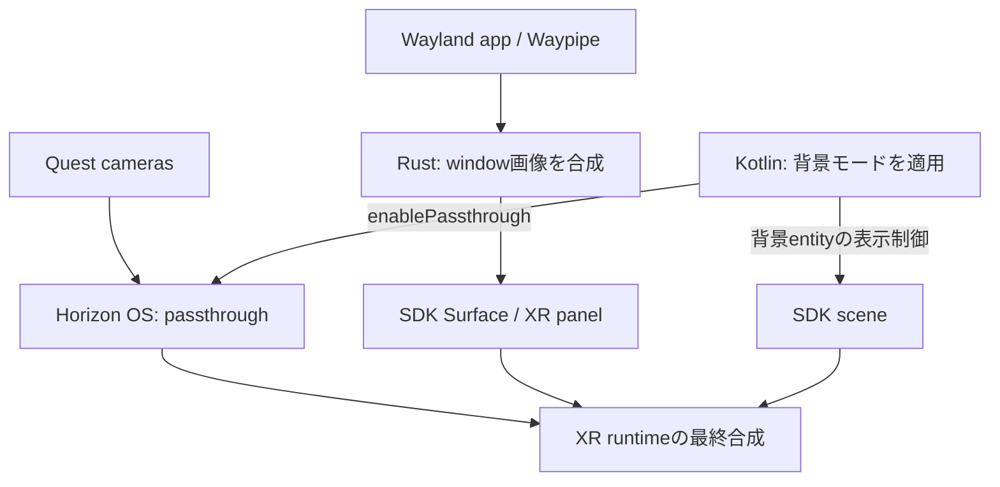

# Phase 1補足 — 現実の映像を背景にするPassthrough

**実装時の正本（2026-11-04詳細化）:** [Sol向けタスク一覧](design/README.md)と[本フェーズの契約](design/phase-4-5.md)。以下の調査経緯を保ちつつ、thread・API・検証順は詳細設計を優先する。

**状態:** 最小Composeパネル＋通常passthroughをQuest 3で視認確認済み（2026-11-04）。Rustパネルとの統合は未実施<br>
**上位計画:** [Phase 1](implementation-plan.md#phase-1--spatial-surfaceの描画スパイク) / [全体設計](architecture.md)  
**前提:** [Phase 0](phase-0-development-environment.md) / [Rust描画spike](phase-1-rust-rendering.md)  
**後続:** [Phase 4](phase-4-rust-window-rendering.md)・[Phase 5](phase-5-rust-window-manager.md)・[Phase 6](phase-6-rust-lifecycle-testing.md)

## 目的と確認範囲

2026-11-04の最小APKでは`scene.enablePassthrough(true)`とComposeパネルを実装し、ユーザーが背景の現実映像・パネル・ボタン操作を確認した。[実機記録](phase-0-troubleshooting-20261104.md)を参照する。以下のRust Surface、MR/VR切替、再生成・寿命管理の試験は引き続き未完了である。

Quest 3の現実の部屋を背景にして、その前にfoot等の独立したLinuxウィンドウを表示する。**Meta Spatial SDKの通常のpassthrough表示を利用する**方針で、カメラ画像をEidolonが取得・転送して背景動画を作る必要はない。

[Meta公式のPassthrough概要](https://developers.meta.com/vr/essentials/horizon-os-passthrough/)は、通常表示ではappがraw camera dataを受け取らず、OSがアプリの描画内容と合成すると説明している。[Spatial SDKの解説](https://developers.meta.com/vr/documentation/spatial-sdk/spatial-sdk-passthrough/)と下記の公式サンプルに具体的なAPIがある。これらは部品・先行実装の根拠であり、EidolonのRust rendererと組み合わせた動作証明ではない。

## 描画経路と責務



図は責務を示す概念図。passthroughのカメラ画素はWaypipe、Smithay、JNIの描画経路へ入れない。Rustは従来どおりLinux windowの画像をSDK Surfaceへ描く。KotlinはSDKの背景設定・entity表示を操作し、実際のカメラ映像とXR表示の合成はOS/runtimeに任せる。[Native Passthroughの仕組み](https://developers.meta.com/vr/documentation/native/android/mobile-passthrough/)にも、専用serviceのlayerをXR compositorへ提出する構造が説明されている。

## SDK APIと起動準備

### ManifestとFeature登録

公式[StarterSampleのManifest](https://github.com/meta-quest/Meta-Spatial-SDK-Samples/blob/f233e2327b95f9871b75bdba867d6fdd726f07cc/StarterSample/app/src/main/AndroidManifest.xml)は次を宣言している。採用構成でもmerged manifestを確認する。

```xml
<uses-feature
    android:name="com.oculus.feature.PASSTHROUGH"
    android:required="false" />
```

これはpassthrough capabilityの宣言で、カメラ画像取得のruntime permissionとは別である。`required="false"`は確認した公式サンプルの設定であり、最終的な対応端末・fallback方針に応じて選ぶ。Nativeの公式説明も、このfeature flagをManifestに入れる必要性を示している。

公式[StarterSampleActivity](https://github.com/meta-quest/Meta-Spatial-SDK-Samples/blob/f233e2327b95f9871b75bdba867d6fdd726f07cc/StarterSample/app/src/main/java/com/meta/spatial/samples/startersample/StarterSampleActivity.kt)やMediaPlayerSampleは`VRFeature(this)`を登録する通常のSpatial SDK構成を使う。今回の背景表示のために独自のRust OpenXR sessionや別Activityを作る方針にはしない。一般的なSDK起動・端末要件は[Phase 0](phase-0-development-environment.md)で採用版に合わせて確認し、raw camera accessのOS要件を通常passthroughへ流用しない。

### Passthroughと背景entity

[公式Passthroughガイド](https://developers.meta.com/vr/documentation/spatial-sdk/spatial-sdk-passthrough/)は`scene.enablePassthrough(true)`とskyboxの非表示を示している。次はsceneと既存entityへの参照が用意されている前提の概念例で、Eidolonに実装済みの関数・変数ではない。

```kotlin
scene.enablePassthrough(true)
skyboxEntity?.setComponent(Visible(false))
environmentEntity?.setComponent(Visible(false))
```

`false`を渡すとpassthroughを無効化できる。skyboxが可視のままでは現実背景が見えず、周囲を覆う不透明なenvironment meshも表示を遮る。非表示にする対象は背景用entityで、Linuxパネルや操作UIまで一括で消すものではない。

StarterSampleは`onSceneReady()`でskyboxを生成し、別途`Environment`をロードする。passthroughのAPI呼出しだけを追加せず、これらの生成順序と参照を確認する。公式MediaPlayerSampleはMR時にsky・environmentを非表示にし、locomotionも無効化する。EidolonでもMR中の仮想移動と物理位置の扱いを確認するが、背景試験のために新たな移動機構を実装する必要はない。

## 背景表示と他のMR機能を区別する

| 機能 | 役割 | 現実を背景にする最小構成 |
| --- | --- | --- |
| 通常passthrough | OSが現実の映像をXR sceneへ合成 | 採用する |
| Camera2 / Passthrough Camera API | appがカメラ画像を受け取り、認識・解析等を行う | 不要。追加する場合は別設計 |
| Scene API / MRUK | 部屋・壁・机等の空間情報を取得・利用する | 背景だけなら不要 |
| Environment Depth | 現実物体と仮想物体の前後関係による遮蔽を扱う | 背景だけなら不要。後続候補 |
| Linuxパネルの画素alpha | パネル内部を透かし、背後の現実を見せる | 初期は不透明でよい |

通常passthroughには特別なcamera permissionは不要と[Metaの現行概要](https://developers.meta.com/vr/essentials/horizon-os-passthrough/)に明記されている。カメラ画素を取得する場合の権限・利用条件は[Passthrough Camera API](https://developers.meta.com/vr/documentation/spatial-sdk/spatial-sdk-pca-overview/)の領域である。

MixedRealitySampleはMRUKで部屋情報をロードするため`USE_SCENE`を要求している。その権限やMRUK・物理衝突処理を、通常背景表示の必須条件としてコピーしない。`scene.enablePassthrough()`の`Scene`クラスと、MRUKが利用する現実空間のScene APIも別である。この区別と部屋情報取得時の権限は[公式MRUK解説](https://developers.meta.com/vr/documentation/spatial-sdk/spatial-sdk-mruk/)に明記されている。

MediaPlayerSampleの切替UIは`enableEnvironmentDepth()`も呼ぶが、[Spatial SDKのSceneクラス](https://developers.meta.com/vr/reference/spatial-sdk/v0.14.0/com_meta_spatial_runtime_scene/)でもpassthroughとdepthは別の操作である。背景が表示されたことから、実際の机や手がLinuxパネルを正しく隠すとまでは判断しない。Environment Depthの遮蔽を、採用するlayer専用panelへ適用できるかも未確認であり、導入時に描画方式とSDKの対応を別途検証する。

## 不透明なLinuxパネルを現実背景へ重ねる

MVPでは**不透明なcheckerboard／footパネルの周囲に現実が見える**状態を目指す。SDK sceneの背景を見せる設定と、個々のLinuxパネルの画素alphaは別であり、パネル全画素をalpha=0にする必要はない。文字領域は通常のアプリ背景色を維持できる。

[公式media描画ガイド](https://developers.meta.com/vr/documentation/spatial-sdk/spatial-sdk-media-playback/)は、`VideoSurfacePanelRegistration`のdirect-to-surface経路に必要な設定と透明化の制約を説明し、direct-to-compositorで`enableTransparent = true`にするとクラッシュする旨を記載している。通常背景の実装のためにこの値を有効化せず、半透明ターミナル等は描画方式・alpha・重なり順を別途検証する。

公式PremiumMediaSampleはpassthroughを有効化し、`VideoSurfacePanelRegistration`を使う描画経路も持つ。ただしEidolonでの具体的なlayer順序、背景との合成、可視枚数は実機で確認する。[Phase 4のlayer予算](phase-4-rust-window-rendering.md#xr-layer数の予算)ではpassthroughやapp本体も含む実際のlayer数を観測し、単純にwindow数だけで見積もらない。

## 背景モードの状態と適用

Phase 1は固定のMR背景から始めてよい。切替を追加する段階では、`BackgroundMode`等の希望設定をRust側の正本にし、Kotlinがpassthroughと背景entityの表示を適用する案を採る。型名やcommand/event名はEidolonの設計案であり、SDKの既存APIではない。windowのpose・focusやSSH／Waylandセッションと背景設定を分ける。

**`scene.isSystemPassthroughEnabled()`を切替後の現在状態getterとして使わない。** [v0.14.0のAPI説明](https://developers.meta.com/vr/reference/spatial-sdk/v0.14.0/com_meta_spatial_runtime_scene/)では起動時に設定され、app生存期間中は変わらない値である。希望モード、adapterの適用記録、実機で確認した表示結果を区別し、APIを呼べたことだけで映像表示成功とは扱わない。

背景の減光・色調整には`scene.setPassthroughLUT(lut)`があり、v0.14.0では`null`で解除できる。文字の読みやすさを調整する後続候補とし、最初の背景表示の合格条件には含めない。利用時は切替・復帰で意図しないLUTが残らないことも確認する。

## フェーズ別の実装と検証

| フェーズ | 作業と合格の確認 |
| --- | --- |
| Phase 0 | uses-featureとSDK構成を確認。採用SDK／OSを記録する |
| Phase 1 | 通常passthrough背景＋Rust checkerboard一枚を実機表示し、背景entityとSurface描画を切り分ける |
| Phase 4 | checkerboardをfootに置き換え、現実背景と文字・カーソル・スクロールを同時に確認する |
| Phase 5 | MR／仮想背景の切替と設定の保存を評価。既存windowの配置・focusを保つ |
| Phase 6 | scene再生成、背景化、sleep/resumeから復旧し、背景モード・Surface・layer数を確認する |

Phase 1の具体的な確認項目:

- [ ] Manifestへpassthrough featureを宣言し、実際のSDK sceneでAPIを実行する。
- [ ] skybox／背景用environmentを非表示にし、頭の向きを変えてパネルの周囲に現実が見えることを確認する。
- [ ] Rustの不透明なcheckerboardが同時に見え、全画面の黒い背景や残ったmeshが現実を覆っていないことを確認する。
- [ ] producer解像度とメートル寸法を変えても背景合成が維持されることを確認する。
- [ ] Universal Menu、背景化、sleep/resumeを分けて試し、XR focus・SurfaceGeneration・背景設定のイベントを記録する。
- [ ] SDK／Horizon OS版、背景entityの状態、API適用、表示結果を記録する。カメラ画素取得を試験の前提にしない。

**Phase 1の背景試験は、Quest実機で「現実背景＋不透明なRustパネル」を同時に確認して合格とする。** ビルド成功、APIの存在、公式サンプルのソース確認だけでは合格にしない。背景合成が未達でも、Surface単独描画・SSH・Waylandの個別検証は継続できる。Phase 6ではsceneが作り直された際に希望設定を適用し直す経路を検証し、背景切替だけでSSH／Waylandを再起動しない構成を目指す。

## 背景を含むデバッグ画像の取得

[開発自動化・デバッグのcapture調査](development-automation-and-debugging.md#キャプチャと起動確認)に従い、通常passthrough＋不透明なpanelが開発用画像へどう写るかを、HMD内表示と照合する。Metaの`metacam`を第一候補にし、`screencap`のAndroid表示との違いを確認する。採用OS／SDKのdirect-to-surface layerを含む具体的な取得範囲は未検証である。

通常背景の表示、外部開発ツールによる合成画像の取得、Camera2によるapp内raw camera取得は別の経路。キャプチャのためにEidolonへCamera2を追加しない。背景は時間で変わるため画像全体のpixel完全一致に依存せず、希望モード・SDK適用・Surface世代・panel領域を照合する。現実の部屋が写る画像は明示的な試験artifactとして扱い、通常ログへ恒常的に残さない。

## 確認した公式ソース

以下はすべて`meta-quest/Meta-Spatial-SDK-Samples`の確認済みcommit **`f233e2327b95f9871b75bdba867d6fdd726f07cc`**。サンプルのSDK版は0.14.0で、Eidolonの採用版を確定したものではない。

| ソース | 確認内容 |
| --- | --- |
| [MixedRealitySampleActivity.kt](https://github.com/meta-quest/Meta-Spatial-SDK-Samples/blob/f233e2327b95f9871b75bdba867d6fdd726f07cc/MixedRealitySample/app/src/main/java/com/meta/spatial/samples/mixedrealitysample/MixedRealitySampleActivity.kt) | VRFeature／MRUK登録、passthrough有効化、部屋情報取得のpermission処理 |
| [MixedRealitySample versions](https://github.com/meta-quest/Meta-Spatial-SDK-Samples/blob/f233e2327b95f9871b75bdba867d6fdd726f07cc/MixedRealitySample/gradle/libs.versions.toml) | サンプルが参照するSpatial SDK 0.14.0 |
| [PremiumMediaSample ImmersiveActivity.kt](https://github.com/meta-quest/Meta-Spatial-SDK-Samples/blob/f233e2327b95f9871b75bdba867d6fdd726f07cc/PremiumMediaSample/app/src/main/java/com/meta/spatial/samples/premiummediasample/immersive/ImmersiveActivity.kt) | `onSceneReady()`でpassthroughを有効化 |
| [PremiumMediaSample ExoVideoEntity.kt](https://github.com/meta-quest/Meta-Spatial-SDK-Samples/blob/f233e2327b95f9871b75bdba867d6fdd726f07cc/PremiumMediaSample/app/src/main/java/com/meta/spatial/samples/premiummediasample/entities/ExoVideoEntity.kt) | direct-to-surface panelの生成 |
| [MediaPlayerSample MRPanel.kt](https://github.com/meta-quest/Meta-Spatial-SDK-Samples/blob/f233e2327b95f9871b75bdba867d6fdd726f07cc/MediaPlayerSample/app/src/main/java/com/meta/spatial/samples/mediaplayersample/MRPanel.kt) | UIからpassthroughを切り替える経路 |
| [MediaPlayerSampleActivity.kt](https://github.com/meta-quest/Meta-Spatial-SDK-Samples/blob/f233e2327b95f9871b75bdba867d6fdd726f07cc/MediaPlayerSample/app/src/main/java/com/meta/spatial/samples/mediaplayersample/MediaPlayerSampleActivity.kt) | MR時のsky・environment・locomotion制御 |
