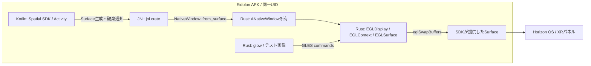

# Phase 1 — RustによるJNI・Android Surface・EGL/GLES描画

**状態:** 調査済み／未実装・Quest実機未検証（2026-11-01）  
**上位計画:** [Phase 1](implementation-plan.md#phase-1--spatial-surfaceの描画スパイク)  
**前提:** [Phase 0](phase-0-development-environment.md) / [全体設計](architecture.md)  
**後続:** [Phase 4: Wayland画像の合成](phase-4-rust-window-rendering.md)  
**補足:** [現実の映像を背景にするPassthrough](phase-1-passthrough-background.md)

## 結論と責務

**自作C++を必須にせず、Kotlin → JNI → Rust → AndroidのEGL/GLESという描画経路を作るための部品は存在する。** JNI、NDK、EGL/GLESをRustで再実装するのではなく、Rustから既存のAndroidネイティブAPI／ドライバーを呼ぶ。Android NDKのtoolchain・sysrootは引き続き必要で、依存ライブラリにC/C++が含まれないという意味でもない。

| 層 | 第一候補 | 根拠・利用範囲 |
| --- | --- | --- |
| Spatial SDKとActivity | Kotlin | SDKが管理するパネルのSurfaceを取得する。[MetaのSurfaceパネル解説](https://developers.meta.com/vr/documentation/spatial-sdk/spatial-sdk-media-playback/) |
| Kotlin↔Rust | `jni` | Kotlin/Javaのnative methodをRustで実装できる。[jni 0.22.4](https://docs.rs/jni/0.22.4/jni/) |
| Surface→ANativeWindow | `ndk` / 必要なら`ndk-sys` | `NativeWindow::from_surface`でJava Surfaceをnative windowへ変換する。[ndk 0.9.0 API](https://docs.rs/ndk/0.9.0/ndk/native_window/struct.NativeWindow.html) |
| EGLの初期化・present | `khronos-egl` | Rust用EGL API binding。Androidでは`libEGL.so`をロードする。[6.0.0 API](https://docs.rs/khronos-egl/6.0.0/khronos_egl/) |
| GLES描画 | `glow` | GLESへのRust binding。EGL contextの生成自体は担当しない。[公式実装](https://github.com/grovesNL/glow) |
| Wayland統合後のrenderer | Smithay `GlesRenderer` | SHM importとEGLSurface出力を再利用できる候補。採用判断は[Phase 4](phase-4-rust-window-rendering.md)へ分離する。 |

表の版は確認したAPIの版であり、全crateを組み合わせた動作保証／lockfileではない。`jni` 0.21系と0.22系はAPIが異なるため、古いサンプルの`JNIEnv`や参照型を混ぜない。[公式migration guide](https://docs.rs/crate/jni/0.22.4/source/docs/0.22-MIGRATION.md)を使って、`ndk`側のJNI生ポインター型との整合も確認する。

## 描画・制御の接続図

Surfaceの生成経路とフレームの生成経路は別。Kotlinに毎フレームのBitmapや画素配列を戻さない。まず一枚の単色／checkerboardを描き、SSHとWaylandは接続しない。SDK SurfaceへのEGL描画には下記の公式サンプルによる根拠があるが、Rustでの連続描画とEidolonのQuest実機動作は未検証である。

このspikeで、**通常passthroughの現実背景＋不透明なRustパネル一枚**も検証する。KotlinがSDKの背景設定を適用し、カメラ画素をRust／Waypipeへ渡さずにOS/runtimeが最終合成する。Manifest、skyboxの非表示、パネルの透明化との違い、試験手順は[Passthrough補足](phase-1-passthrough-background.md)にまとめる。

## SDK Surfaceで確認できたこと（2026-11-01追調査）

Meta公式サンプルの[ExoVideoEntity.kt](https://github.com/meta-quest/Meta-Spatial-SDK-Samples/blob/f233e2327b95f9871b75bdba867d6fdd726f07cc/PremiumMediaSample/app/src/main/java/com/meta/spatial/samples/premiummediasample/entities/ExoVideoEntity.kt)は、`VideoSurfacePanelRegistration.surfaceConsumer`で受け取ったSurfaceに`SurfaceUtil.paintBlack(surface)`を実行する。[SurfaceUtil.kt](https://github.com/meta-quest/Meta-Spatial-SDK-Samples/blob/f233e2327b95f9871b75bdba867d6fdd726f07cc/PremiumMediaSample/app/src/main/java/com/meta/spatial/samples/premiummediasample/SurfaceUtil.kt)には`eglCreateWindowSurface` → `eglMakeCurrent` → `glClear` → `eglSwapBuffers`の実装がある。**公式ソースで確認したのはKotlinによる一回の描画経路**であり、Rust adapter、連続描画、再生成時の寿命管理まで検証済みという意味ではない。

[VideoSurfacePanelRegistration v0.14.0のAPI](https://developers.meta.com/vr/reference/spatial-sdk/v0.14.0/com_meta_spatial_toolkit_videosurfacepanelregistration/)でも、`MediaPanelSettings`のDisplayOptionsは無視され、pixel解像度はSurfaceのproducer側から決まると説明されている。初期spikeでは[ANativeWindowのbuffer geometry設定・サイズ取得](https://developer.android.com/ndk/reference/group/a-native-window)と`eglQuerySurface`の結果を確認し、`PixelDisplayOptions`の指定値だけを成功の根拠にしない。このAPI版の確認はEidolonのSDK採用版の確定ではない。

## なぜNativeActivityやwinitを追加しないのか

EidolonのActivityとXR sceneはMeta Spatial SDKが所有する。NDKが使えることと、別の`NativeActivity`／`winit` event loopを起動することは同義ではない。第一案は通常のKotlin ActivityからRustの`cdylib`をロードし、**既にSDKが作ったSurfaceを借り受けるadapter**を作ること。`winit`や`glutin`は必要性が出てから評価する。

AndroidはSurfaceから`ANativeWindow`を取得し、これを`eglCreateWindowSurface`へ渡す経路を公開している。SurfaceのBufferQueueにproducerを複数接続してはいけない。[Android公式のEGL/Surface説明](https://source.android.com/docs/core/graphics/arch-egl-opengl)を参照。

## 境界の設計案

Kotlin→Rustは`attachSurface(windowId, generation, surface)`、`resizeSurface(...)`、`detachSurface(...)`、入力イベントなどに限定する。これらはEidolon独自のAPI案であり、既存crateの関数名ではない。

- RustはJNI呼出し中にnative windowの所有権／参照を確保する。Javaのlocal referenceや`JNIEnv`を別スレッドにそのまま保存しない。必要なglobal referenceとJavaVM/thread attachmentは[`jni`とAndroid JNI tips](https://developer.android.com/ndk/guides/jni-tips)に従う。
- `ANativeWindow`の参照を保持しても、SDK側のSurface consumerが永続するわけではない。Surface消失と`EGL_BAD_SURFACE`／context lossは通常の状態遷移として扱う。
- `surfaceConsumer`での取得に加え、SDK／Entityの破棄・再生成をどの通知経路で検出するかを採用版で確認する。生成callbackがあることから、対応する破棄callbackの存在まで仮定しない。
- 最初は**単一の専用render thread**にEGL/GLES所有権を集約する。Kotlin UI threadやTokio workerで任意にGLを実行しない。
- `generation`を付け、古いSurfaceに対する遅延frameやdetachが新しいSurfaceを壊さないようにする。
- Rustのpanicや未処理Java例外をJNI境界に漏らさない。`unsafe`をadapter内部へ隔離し、単に`Send`を付けてスレッド制約を隠さない。
- 終了順序を固定する：新規描画停止 → GL処理の完了／解放 → EGLSurface破棄 → native window解放。Activity再生成時には再attachする。

## Linuxとの差を先に試す

`khronos-egl`の一般的な例にある`libEGL.so.1`はAndroid用の名前ではない。Androidでは公開NDKライブラリ`libEGL.so`とGLESを使う。Local Desktopの[Android向けpatch解説](https://localdesktop.github.io/docs/developer/patches/)には、ライブラリ名と`eglMakeCurrent`のpbuffer対応が記録されている。これは問題の候補であり、Questで無条件に同じpatchを適用する指示ではない。

[Local Desktopの実コード](https://github.com/localdesktop/localdesktop.github.io/blob/fdd0275d6ec7840277def8ccd3ba3ed463900ca1/src/android/backend/wayland/winit_backend.rs)ではRustでAndroid native surfaceをEGLSurfaceへ接続している。ただしNativeActivity/winitベースであり、Meta Spatial SDKへの差し替え作業はEidolonに残る。ソースの流用はファイルごとのライセンスを確認する。

## 検証手順・合格条件

- [ ] Rust `cdylib`をKotlinからロードし、JNIの単純な往復とlogcat出力を確認する。
- [ ] SDKから実際に渡されたSurfaceで、RustだけでEGL/GLESによる単色・checkerboardを表示する。
- [ ] [Passthrough背景試験](phase-1-passthrough-background.md#フェーズ別の実装と検証)で、Quest実機に現実の映像と不透明なRustパネルを同時表示する。背景用skybox／meshが現実を覆っていないことを確認する。
- [ ] `glGetString`等でvendor／renderer／GLES版、EGL拡張、選択configを記録する。秘密情報は記録しない。
- [ ] producer側で指定したbacking pixel sizeとEGLSurfaceの実測値を記録する。メートル寸法だけの変更とbuffer解像度変更を別々に試す。
- [ ] パネル移動・拡縮、pause/resume、Surface再生成を繰り返し、native window参照数・EGL resource leakを調べる。
- [ ] Universal Menu、背景化、sleep/resumeを別々に試し、XR session focus・Activity lifecycle・SurfaceGenerationを記録する。[Phase 6の観測方針](phase-6-rust-lifecycle-testing.md#xr-session-focusと早期観測)を描画spikeから適用する。
- [ ] 新規C++なしで成立するかを確認する。不足がC++専用API等に限定される場合のみ、小さいshimを追加して理由を残す。

合格は「実機でRust rendererがSDK Surfaceへ出力でき、現実背景と不透明なパネルを同時に確認できること」。crateのビルド成功だけでは合格にしない。描画単独と背景合成の結果は分けて記録し、次に[Phase 4](phase-4-rust-window-rendering.md)でテスト画像をWaylandの画像へ置き換える。
