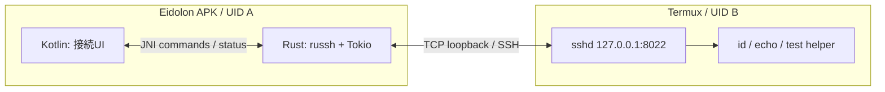
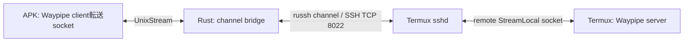

# Phase 2 — Rust SSHとTermux・StreamLocal forwarding

**状態:** API／実装調査済み、Android・Quest上の接続は未検証（2026-11-01）  
**上位計画:** [Phase 2](implementation-plan.md#phase-2--sshとtermuxの安全な接続) / [全体設計](architecture.md)  
**関連:** [Phase 0のUSB調査経路](phase-0-development-environment.md) / [Phase 3のWaypipe統合](phase-3-rust-compositor-waypipe.md)

## 結論

**SSHの新規実装はRustの`russh`を第一候補にする。** SSHJやlibsshの採用はfallback。理由はSSH execだけでなく、Waypipeに必要なremote Unix socket forwardingと着信channelを受けるAPIが既にあるためである。[russhの公式実装](https://github.com/Eugeny/russh)を参照。

2026-11-01に確認した[`russh` 0.65.0のHandle API](https://docs.rs/russh/0.65.0/russh/client/struct.Handle.html)には、`authenticate_publickey`、`channel_open_session`、`streamlocal_forward`、`cancel_streamlocal_forward`、`channel_open_direct_streamlocal`がある。[client Handler](https://docs.rs/russh/0.65.0/russh/client/trait.Handler.html)には`check_server_key`と`server_channel_open_forwarded_streamlocal`がある。**APIがあることと、今回のAndroid/Termux接続が検証済みであることは区別する。**

| 責務 | 担当 |
| --- | --- |
| 接続、認証、exec、forwarding、retry、timeout | Rust / russh + Tokio |
| host key照合の判断、セッション状態 | Rust。未知の鍵の確認UIはKotlin |
| Android Keystore・許可ダイアログ | Kotlin adapter。署名や秘密情報の扱いは別途設計 |
| Waylandのfd／SHM内容の転送表現 | 既存Waypipe。russhでは実装しない |

## Phase 2単体の通信図

最初はhost key検証付き公開鍵認証と`id`等のexecを行う。次に**WaypipeなしのUnixソケットecho試験**でStreamLocalを確認する。これによりWaylandとSSHの問題を混同しない。

## Waypipeへ接続するRust側の仕事

Waypipeの[付属マニュアル](https://man.archlinux.org/man/waypipe.1.en)は、表示側client socketとアプリ側server socketをSSH `-R`で接続する構成を示す。Eidolonでは、そのSSHプロセスの役割をrusshで担う。2026-11-01の再確認でも、[`russh`のclient実装](https://github.com/Eugeny/russh/blob/main/russh/src/client/mod.rs)の`streamlocal_forward`と`server_channel_open_forwarded_streamlocal`がこの方向に対応する。`channel_open_direct_streamlocal`は対向側の既存Unix socketへ接続する別の操作である。

1. APK側でWaypipe clientを起動し、**Wayland用ではなくWaypipe転送用**のUnix socketをlistenさせる。
2. russhでTermuxのsshdへ接続し、host key検証と認証を完了する。
3. Termux UID内に短いセッション専用0700 directoryを用意し、その中のremote socketへの`streamlocal_forward(path)`を要求する。任意の絶対パスを利用者入力から無検証で受け付けない。
4. serverからforwardされた接続を`server_channel_open_forwarded_streamlocal`で受け、期待するpathとセッションを検証する。
5. APK側のWaypipe転送socketへ接続し、受け入れ応答とchannelの寿命を処理する。採用するrussh版の`ChannelOpenHandle` APIに従う。確認したAPIでは`accept`／`reject`を明示し、handleをそのまま破棄すると拒否される。
6. [`Channel::into_stream`](https://docs.rs/russh/0.65.0/russh/struct.Channel.html#method.into_stream)とUnixStreamを、[`tokio::io::copy_bidirectional`](https://docs.rs/tokio/latest/tokio/io/fn.copy_bidirectional.html)等で中継する。長時間copyはcallback内で待ち続けず別taskへ移す。
7. 別のSSH exec channelでTermux側の`waypipe server -- foot`を起動し、stderr／exit status／切断を監視する。引数は安全に組み立て、PTYは要求しない。

この中継をするのは**Waypipeが符号化した通常のバイトストリーム**。Wayland socket自体の`SCM_RIGHTS`を`copy_bidirectional`で運ぶわけではない。fdとSHM再構成は両端のWaypipeが担う。

`streamlocal_forward`を呼ぶだけではAPK内socketへ自動中継されない。incoming channel処理、accept/reject、EOF、half-close、backpressure、cancel、再接続時のsocket掃除がEidolon側の実装責務である。

## Android移植と依存の注意

[`russh/Cargo.toml`](https://github.com/Eugeny/russh/blob/main/russh/Cargo.toml)では確認時点のMSRVは1.89、暗号backendは`aws-lc-rs`または`ring`である。RustのSSH実装を選んでも依存にC／assemblyやクロスビルドが含まれ得る。**pure Rustという宣伝から、NDKやnative依存が不要とは判断しない。**

標準featuresでaarch64 Androidビルドを先に試す。失敗が暗号backendに限られるなら、対応アルゴリズムを維持した上でfeature構成を比較する。単にビルドを通すためにhost key検証や現代的な鍵交換を無効化しない。Cargo.lockと採用版を固定する。

認証鍵は最初に検証専用鍵を使う。`authenticate_publickey`の鍵オブジェクトにAndroid Keystoreの非exportable鍵をそのまま渡せるとは限らない。`authenticate_publickey_with`と外部署名、Keystoreによる保存鍵の保護などを**別のspike**として比較する。秘密鍵・署名対象データ・tokenをログに出さない。

## セキュリティと試験

- [ ] Termux側は127.0.0.1:8022のみlisten、公開鍵認証。`sshd -T`と実際のlistenを確認する。
- [ ] 未登録host keyは明示的に確認し、登録済み鍵の不一致は拒否する。サンプルの`Ok(true)`を製品へコピーしない。
- [ ] SSH認証後にexecのstdout/stderr/exit statusを分離して取得する。
- [ ] 任意の短いテストUnix socketで既知のバイト列が両方向に一致する。同じSSH接続上で複数channelを開き、一方のEOF／終了が他方や接続全体を停止させないことを確認する。
- [ ] 大きなバイト列と遅い受信側でbackpressureを試し、中継のメモリー使用量が無制限に増えないこと、half-close後の残りのデータと切断を処理できることを確認する。
- [ ] OpenSSHの`AllowStreamLocalForwarding`等、server側で必要なforwarding許可を実効設定で確認する。
- [ ] 未知pathへのforward、古いセッションからの接続、不正鍵、timeoutを拒否する。
- [ ] 切断時にforwardのcancelとowned socketのcleanupを行う。他プロセスのsocketを削除しない。
- [ ] Androidビルド／Quest上で以上が成立したら、[Phase 3](phase-3-rust-compositor-waypipe.md)でWaypipeへ差し替える。

成功条件は「Rustで安全なSSHとUnixソケット中継が成立」。SSHコマンドが一度成功しただけではWaypipe用のtransport完成とはしない。

[Phase 3のP3-B](phase-3-rust-compositor-waypipe.md)にあるAPK側helperの配置・起動試験はSSHの完成に依存しない。[Phase 0](phase-0-development-environment.md)〜[Phase 1](phase-1-rust-rendering.md)と並行して前倒しし、transport側はecho試験を独立して進める。
