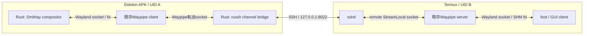

# Phase 3 — Rust compositorのAndroid移植とWaypipe再利用

**状態:** 先行実装／依存調査済み、Eidolonは未実装（2026-11-01）  
**上位計画:** [Phase 3](implementation-plan.md#phase-3--wayland-serverとwaypipeのpoc最重要) / [全体設計](architecture.md)  
**統合時の関連:** [Rust SSH](phase-2-rust-ssh.md) / [Rust描画](phase-1-rust-rendering.md)  
**後続:** [Phase 4](phase-4-rust-window-rendering.md)

## 結論：Smithayは有望で、Androidの先行例もある

Smithayの[公式README](https://github.com/Smithay/smithay)には、Android上のWayland compositorとして[Local Desktop](https://github.com/localdesktop/localdesktop.github.io)が挙げられている。従って「AndroidでRust＋Smithayは完全に前例がない」という状況ではない。

確認したLocal Desktopの[`Cargo.toml`](https://github.com/localdesktop/localdesktop.github.io/blob/fdd0275d6ec7840277def8ccd3ba3ed463900ca1/Cargo.toml)では、Smithay 0.5.0、`default-features = false`、`renderer_glow`／`wayland_frontend`等、ローカルpatchを利用している。**Eidolonが評価するSmithay 0.7系と同一構成ではない。** 古い成功例を最新の無修正ビルド成功と読み替えない。

[patch解説](https://localdesktop.github.io/docs/developer/patches/)には`libEGL.so`名、pbufferによるEGL current処理、libxkbcommonのビルドが記録されている。[Android backend実装](https://github.com/localdesktop/localdesktop.github.io/blob/fdd0275d6ec7840277def8ccd3ba3ed463900ca1/src/android/backend/wayland/winit_backend.rs)は調査の起点にするが、NativeActivity/winitでありMeta Spatial SDKアプリそのものではない。コードをコピーする前に元ファイルのライセンスを確認する。

## 分担と接続図



`Waypipe client/server`はWaypipeの用語。Wayland serverはEidolon、Wayland clientはfootである。WaypipeはWaylandプロトコル・buffer転送を、Rustのrussh adapterはSSHを担当する。新規にWaypipe相当を自作することは主案にしない。

## Smithayの最小構成を調べる

[Smithay Cargo.toml](https://github.com/Smithay/smithay/blob/master/Cargo.toml)はdesktop Linux用backendを多数defaultで有効にする。Android APK内では最初からDRM/KMS・GBM・udev・libinput・libseat・Xwaylandを持ち込まない。`default-features = false`にし、protocolのみ、次にrendererという順でfeatureを増やす。

出発点の例（**コンパイル未検証**）:

```toml
smithay = { version = "0.7", default-features = false, features = [
  "wayland_frontend", "desktop"
] }
# Phase 4で必要になったら renderer_gl / backend_egl 等を追加する。
```

- Wayland-rs backendで足りるか、`use_system_lib`が本当に必要かを区別する。
- `libxkbcommon`等、default featuresを消しても残るnative依存を`cargo tree`とlinker出力で確認する。Androidには通常のLinuxディストリのパッケージパスがない。
- libxkbcommon本体だけでなく、keymap生成に必要なxkeyboard-config等のデータ配置も検証する。Host Ubuntuのヘッダー／ライブラリを誤リンクしない。
- calloop、Unix socket、memfd／共有メモリー、mmap、fd受け渡しとAndroid/Bionicの差を個別試験する。
- UID Aの短いprivate runtime directoryへWayland socketを作る。`XDG_RUNTIME_DIR`は0700、Unix socket path長の制限を守る。
- Smithayのsampleである[smallvil](https://github.com/Smithay/smithay/tree/master/smallvil)はprotocol/seat/stateの参考にする。desktop向けwinit backendごと無条件にAPKへ組み込まない。

### 最小protocolと共有メモリーの契約（2026-11-04レビュー）

初期のglobal一覧に`wl_output`も含め、まず一つの仮想output・scale 1を使う。outputのgeometry／mode／scale／done、surfaceのenter／leave、seat capabilityとkeymapの通知を、広告したprotocol versionに合わせて実装する。XRパネル一枚ごとに物理monitorが必要なわけではない。footが追加で要求する拡張は採用版のregistryと起動ログで確認し、未実装機能を広告しない。[Wayland公式protocol](https://wayland.freedesktop.org/docs/html/apa.html)とSmithayのoutput／seat処理を参照する。

`xdg_toplevel`オブジェクト生成と表示開始は別状態にする。初回のbufferなしcommit → configure → ack → buffer付きcommitでmapし、null bufferでunmap、再configure後のremap、destroyを個別に検証する。非同期のSDK panel生成を待つために初回configureを止めず、最初のlogical sizeを先に決めて交渉する。**clientの初回buffer待ちとSDK Surface生成待ちが循環しないこと**をP3-Dで確認する。根拠は[xdg-shell公式XML](https://gitlab.freedesktop.org/wayland/wayland-protocols/-/blob/main/stable/xdg-shell/xdg-shell.xml)のxdg_surface／xdg_toplevel（今回hostの配布済みXMLでも照合）。surface treeとconfigureの実装は採用Smithayのxdg-shell処理を優先する。

SHMは別プロセスが変更できる共有領域であり、通常のRust所有メモリーとして扱わない。[Smithay 0.7の`with_buffer_contents`のSafety条件](https://docs.rs/smithay/0.7.0/smithay/wayland/shm/fn.with_buffer_contents.html)に従い、callback外へ生pointerを保持せず、共有領域から無条件にRust sliceを作らない。rendererのimport APIを優先し、独自読取りはpool長・offset・stride・寸法・format・算術overflowを検査する。FDの短縮などによる無効なmappingも試し、APK全体のcrashにしない。pool／buffer／client数と総byte数に上限を設け、大きなresizeや異常clientで無制限に確保しない。

## Waypipeについての訂正と採用方針

**Waypipe全体を「Cだけのプロジェクト」と断定しない。** 作者は[Rust版への移行](https://mstoeckl.com/notes/code/waypipe_to_rust.html)を説明している。一方、今回確認した[Termuxのレシピ](https://github.com/termux/termux-packages/blob/master/packages/waypipe/build.sh)は0.11.3で`build_c=true`／`build_rs=false`、生成した`waypipe-c`を`waypipe`にrenameし、dmabuf/videoを無効にしている。

そのためMVPでは**Termuxで使われている既存C版と互換性を確かめた版を両端で再利用**する。Rust中心の設計でも、既存C版Waypipeを書き換える必要はない。APK側の配布／動作の都合でRust版を選ぶ場合も、上流実装の選定であってEidolon独自の再実装にはしない。まず両端の実装・版・featuresをそろえて試す。作者の移行記事にはC版との接続試験も記載されているため、C/Rustという言語の違いだけで互換／非互換を断定せず、採用する組み合わせで実測する。

2026-11-01の追加確認では、Termuxレシピは`libandroid-spawn`へリンクし、次のAndroid向けpatchも含んでいる。Termuxでの成功条件を把握する資料であり、APK側にそのまま適用することを意味しない。

| 確認した箇所 | Eidolon側で確かめること |
| --- | --- |
| [`platform.c` patch](https://github.com/termux/termux-packages/blob/master/packages/waypipe/waypipe-c-platform.c.patch)は`__ANDROID_API__ < 30`のとき`memfd_create`をsyscall経由にする | NDKの対象APIと実機での共有メモリー生成・fd受け渡し。`targetSdk`とは区別して記録する |
| [`waypipe.c` patch](https://github.com/termux/termux-packages/blob/master/packages/waypipe/waypipe-c-waypipe.c.patch)は`/tmp`をTermux prefix配下へ置換する | APKでは自身のprivate runtime directoryを使用し、転送socketとWayland socketのパスを明示する |
| [build.sh](https://github.com/termux/termux-packages/blob/master/packages/waypipe/build.sh)は`libandroid-spawn`等へ依存する | APK用ELFの依存とloaderの解決先。Termuxのprivate prefixへ依存していないことを確認する |

Termuxの実行ファイルをAPKのdata directoryへコピーしてそのままexecできる、とは仮定しない。Termux固有prefix、依存`.so`、Androidの実行制約、APK同梱方式を確認する。Waypipeは安定した組込みlibrary APIを提供するとも仮定せず、**native helper processとしての再利用**を第一候補にする。将来のFFI組込みは別spikeである。

### APK側helperの実行確認をPhase 0〜1へ前倒しする

[Android公式のAndroid 10変更点](https://developer.android.com/about/versions/10/behavior-changes-10#execute-permission)では、`targetSdkVersion >= 29`のアプリは書込み可能なapp home内のファイルを`execve()`で起動できない。Termux内や`adb shell`から実行できても、通常のAPK自身のUIDで実行できる証明にはならない。

このため特に下表の**P3-Bは[Phase 0](phase-0-development-environment.md)〜[Phase 1](phase-1-rust-rendering.md)と並行して先に検証**する。採用予定の`targetSdk`、ABI、native packaging設定を使い、KotlinまたはRustからhelperを起動する。小さなhelperで配置方式を確かめてからWaypipeへ差し替えるなど、切り分け方は実装時に選んでよい。

- [ ] APK自身のUIDで、同梱した固定版Waypipeを起動できる。`--version`とELF依存を記録する。
- [ ] 転送用Unix socketをAPKの短いprivate directoryでlistenできる。Wayland接続が必要な部分には最小compositorを使い、SSH／XR描画の完成を待たない。
- [ ] 終了／起動失敗を親側で観測でき、owned socketのcleanup後に再起動できる。
- [ ] packaging、対象API、Quest OS build、成功／失敗ログを記録する。`adb shell`での起動結果とAPK UIDでの結果を区別する。

**追加の実装参考:** Wawonaの[`android-shell-tools.nix`](https://github.com/Wawona/Wawona/blob/master/dependencies/wawona/android-shell-tools.nix)にはWaypipeのELFを`jniLibs/libwaypipe_bin.so`として同梱する処理があり、[`build.gradle.kts`](https://github.com/Wawona/Wawona/blob/master/android/app/build.gradle.kts)には`useLegacyPackaging = true`がある。APK同梱方式を調べる起点にできる。一方、[`patch-waypipe-android.sh`](https://github.com/Wawona/wwn-waypipe/blob/main/dependencies/libs/waypipe/patch-waypipe-android.sh)にはlibrary化、CLI引数処理、process終了、logger初期化への変更があるため、上流が安定した組込みAPIを提供している根拠にはしない。**今回確認したのはソースのみで、Wawonaの動作やQuestへの適合、Eidolonでの採用は未検証**。方式を比較するときは当該ソースのcommitとライセンスを確認する。

## まず実施する分離spike

| 試験 | 成功条件 | 調べる問題 |
| --- | --- | --- |
| P3-A: protocolのみ | Android内の最小compositorがfdを受け、SHM内の既知パターンを読み取れる | Bionic、calloop、socket、xkb依存 |
| P3-B: APK側Waypipe（Phase 0〜1へ前倒し） | 実際のAPK UIDで固定版Waypipeを起動し、転送socketのlisten・終了・cleanup・再起動を確認 | パッケージング、loader、prefix、native依存 |
| P3-C: Rust SSH＋Waypipe | Phase 2のecho中継をWaypipeに交換し、既知のSHMパターン、続いてfootのtoplevelとbufferを受信 | forwarding方向、環境変数、version互換 |
| P3-D: protocol lifecycle | configure/ack、commit、frame callback、buffer.release、切断が正常 | protocol管理の不足 |

P3-Dにはmap／unmap／remap、output通知、異常SHM・過大resizeも含める。`wl_buffer.release`はcompositorがbufferの参照を終えたこと、frame callbackは次の描画タイミングの通知であり、XR表示完了とは別である。表示先がないprotocol単体試験では、読取り／copy完了後にreleaseし、試験用の期限付きschedulerでcallbackを進める。非表示windowはcallbackを抑制する方針と復帰条件を決め、無制限のbusy loopを作らない。

P3-A／P3-BはSSHやXR描画の完成に依存しない。P3-Cで[Phase 2](phase-2-rust-ssh.md)のtransportを統合する。具体的には、最初に同じAPK UID内の単純なSHM clientから`SCM_RIGHTS`でfdを送り、compositorが`mmap`した内容を既知の画像パターンと比較する。次にWaypipeを挟んで同じ内容を確認し、最後にfootへ進む。既存の小さなSHM clientや検証用clientの選定は実装時に判断する。この順序ならフォント、端末起動、入力などの問題を転送経路から切り離せる。

この段階ではXRへの描画は必須にしない。受信したsurfaceのメタデータと検証用bufferで接続の成立を確認する。静止画を一度受け取っただけで合格にせず、P3-Dで複数回のcommitとframe callback／buffer.releaseの進行も確認する。Wayland protocol logは診断時限定にし、通常運用で入力や画面内容を漏らさない。

## 自動試験の観測点

[共通文書](development-automation-and-debugging.md#debug-buildの観測と操作)のrunnerへ、P3-Bの実行UID・helper版・終了状態と、P3-A／C／Dの既知SHMパターン、toplevel数、configure／ack／commit／releaseの進行を段階的に追加する案とする。APK UIDの試験をADB shell UIDの実行で代替せず、protocolが進んだことと最終XR表示を分けて報告する。XRキャプチャやXR Operatorの導入が未達でも、これらの分離spikeは進められる。

## 不成立時の判断

Android向けpatchで解消できるなら小さなpatchを記録し、全機能をC++へ戻さない。native libraryをC ABI経由でRustから呼ぶ構成も許容する。構造上の障害が残る場合のみ、既存planのlibwayland-serverやTermux側compositor案を比較する。**Rustへの統一より、root不要・Quest単体・各WaylandウィンドウのXR表示という目的を優先**する。

[Phase 4](phase-4-rust-window-rendering.md)では、成立したprotocol受信をRust rendererへ接続する。
