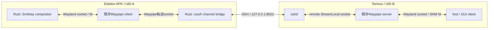

# Phase 3 — Rust compositorのAndroid移植とWaypipe再利用

**状態:** 先行実装／依存調査済み、Eidolonは未実装（2026-11-01）  
**上位計画:** [Phase 3](implementation-plan.md#phase-3--wayland-serverとwaypipeのpoc最重要) / [全体設計](architecture.md)  
**前提:** [Rust SSH](phase-2-rust-ssh.md) / [Rust描画](phase-1-rust-rendering.md)  
**後続:** [Phase 4](phase-4-rust-window-rendering.md)

## 結論：Smithayは有望で、Androidの先行例もある

Smithayの[公式README](https://github.com/Smithay/smithay)には、Android上のWayland compositorとして[Local Desktop](https://github.com/localdesktop/localdesktop.github.io)が挙げられている。従って「AndroidでRust＋Smithayは完全に前例がない」という状況ではない。

確認したLocal Desktopの[`Cargo.toml`](https://github.com/localdesktop/localdesktop.github.io/blob/fdd0275d6ec7840277def8ccd3ba3ed463900ca1/Cargo.toml)では、Smithay 0.5.0、`default-features = false`、`renderer_glow`／`wayland_frontend`等、ローカルpatchを利用している。**Eidolonが評価するSmithay 0.7系と同一構成ではない。** 古い成功例を最新の無修正ビルド成功と読み替えない。

[patch解説](https://localdesktop.github.io/docs/developer/patches/)には`libEGL.so`名、pbufferによるEGL current処理、libxkbcommonのビルドが記録されている。[Android backend実装](https://github.com/localdesktop/localdesktop.github.io/blob/fdd0275d6ec7840277def8ccd3ba3ed463900ca1/src/android/backend/wayland/winit_backend.rs)は調査の起点にするが、NativeActivity/winitでありMeta Spatial SDKアプリそのものではない。コードをコピーする前に元ファイルのライセンスを確認する。

## 分担と接続図



`Waypipe client/server`はWaypipeの用語。Wayland serverはEidolon、Wayland clientはfootである。WaypipeはWaylandプロトコル・buffer転送を、Rustのrussh adapterはSSHを担当する。新規にWaypipe相当を自作することは主案にしない。

## Smithayの最小構成を調べる

[Smithay Cargo.toml](https://github.com/Smithay/smithay/blob/master/Cargo.toml)はdesktop Linux用backendを多数defaultで有効にする。Android APK内では最初からDRM/KMS・GBM・udev・libinput・libseat・Xwaylandを持ち込まない。`default-features = false`にし、protocolのみ、次にrendererという順でfeatureを増やす。

出発点の例（**コンパイル未検証**）:

```toml
smithay = { version = "0.7", default-features = false, features = [
  "wayland_frontend", "desktop"
] }
# Phase 4で必要になったら renderer_gl / backend_egl 等を追加する。
```

- Wayland-rs backendで足りるか、`use_system_lib`が本当に必要かを区別する。
- `libxkbcommon`等、default featuresを消しても残るnative依存を`cargo tree`とlinker出力で確認する。Androidには通常のLinuxディストリのパッケージパスがない。
- libxkbcommon本体だけでなく、keymap生成に必要なxkeyboard-config等のデータ配置も検証する。Host Ubuntuのヘッダー／ライブラリを誤リンクしない。
- calloop、Unix socket、memfd／共有メモリー、mmap、fd受け渡しとAndroid/Bionicの差を個別試験する。
- UID Aの短いprivate runtime directoryへWayland socketを作る。`XDG_RUNTIME_DIR`は0700、Unix socket path長の制限を守る。
- Smithayのsampleである[smallvil](https://github.com/Smithay/smithay/tree/master/smallvil)はprotocol/seat/stateの参考にする。desktop向けwinit backendごと無条件にAPKへ組み込まない。

## Waypipeについての訂正と採用方針

**Waypipe全体を「Cだけのプロジェクト」と断定しない。** 作者は[Rust版への移行](https://mstoeckl.com/notes/code/waypipe_to_rust.html)を説明している。一方、今回確認した[Termuxのレシピ](https://github.com/termux/termux-packages/blob/master/packages/waypipe/build.sh)は0.11.3で`build_c=true`／`build_rs=false`、生成した`waypipe-c`を`waypipe`にrenameし、dmabuf/videoを無効にしている。

そのためMVPでは**Termuxで使われている既存C版と互換性を確かめた版を両端で再利用**する。Rust中心の設計でも、既存C版Waypipeを書き換える必要はない。APK側の配布／動作の都合でRust版を選ぶ場合も、上流実装の選定であってEidolon独自の再実装にはしない。C/Rust版の相互接続はバージョンと機能を実測する。

Termuxの実行ファイルをAPKのdata directoryへコピーしてそのままexecできる、とは仮定しない。Termux固有prefix、依存`.so`、Androidの実行制約、APK同梱方式を確認する。Waypipeは安定した組込みlibrary APIを提供するとも仮定せず、**native helper processとしての再利用**を第一候補にする。将来のFFI組込みは別spikeである。

## まず実施する分離spike

| 試験 | 成功条件 | 調べる問題 |
| --- | --- | --- |
| P3-A: protocolのみ | Android内でWayland socketをlistenし、clientとfd/SHMが往復 | Bionic、calloop、socket、xkb依存 |
| P3-B: APK側Waypipe | 固定版WaypipeをAPK UIDで起動できる | パッケージング、loader、prefix、native依存 |
| P3-C: Rust SSH＋Waypipe | Phase 2のecho中継をWaypipeに交換し、footのtoplevelとbufferを受信 | forwarding方向、環境変数、version互換 |
| P3-D: protocol lifecycle | configure/ack、commit、frame callback、buffer.release、切断が正常 | protocol管理の不足 |

この段階ではXRへの描画は必須にしない。受信したsurfaceのメタデータと検証用bufferで接続の成立を確認する。Wayland protocol logは診断時限定にし、通常運用で入力や画面内容を漏らさない。

## 不成立時の判断

Android向けpatchで解消できるなら小さなpatchを記録し、全機能をC++へ戻さない。native libraryをC ABI経由でRustから呼ぶ構成も許容する。構造上の障害が残る場合のみ、既存planのlibwayland-serverやTermux側compositor案を比較する。**Rustへの統一より、root不要・Quest単体・各WaylandウィンドウのXR表示という目的を優先**する。

[Phase 4](phase-4-rust-window-rendering.md)では、成立したprotocol受信をRust rendererへ接続する。
