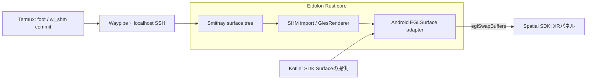

# Phase 4 — RustでWaylandの各ウィンドウをXR Surfaceへ描画

**状態:** 設計／既存API調査、実機未検証（2026-11-01）  
**上位計画:** [Phase 4](implementation-plan.md#phase-4--wayland-windowをxrパネルに描画mvp) / [全体設計](architecture.md)  
**前提:** [Phase 1](phase-1-rust-rendering.md)・[Phase 3](phase-3-rust-compositor-waypipe.md)  
**後続:** [Phase 5](phase-5-rust-window-manager.md)

## 結論：描画エンジンもRust中心にする

初期はPhase 1の`khronos-egl + glow`でSurfaceへの出力を証明する。Wayland統合後はSmithayの[`GlesRenderer`](https://docs.rs/smithay/0.7.0/smithay/backend/renderer/gles/struct.GlesRenderer.html)を第一候補にする。`ImportMemWl`、`ImportMem`、`Bind<EGLSurface>`などがあり、SHM bufferのimportと合成処理を既存実装へ寄せられる。

ただし`GlesRenderer`を選ぶだけではAndroid出力は完成しない。Android `ANativeWindow`をEGLへ渡すadapterと、SDK Surfaceの寿命管理が必要。[SmithayのEGLNativeSurface](https://smithay.github.io/smithay/smithay/backend/egl/native/trait.EGLNativeSurface.html)と[Local DesktopのAndroidNativeSurface実装](https://github.com/localdesktop/localdesktop.github.io/blob/fdd0275d6ec7840277def8ccd3ba3ed463900ca1/src/android/backend/wayland/winit_backend.rs)が具体的な調査対象である。

## データ経路

Kotlinはpanel entityとSurfaceの生成・更新通知を担当する。画素データは**Rust内で受信・管理・合成・present**し、KotlinのBitmapやJNI byte array経由で毎フレーム往復させない。これは「コピーがゼロ」という意味ではなく、SHMからGPUへのuploadはMVPで許容する。

## Rendererの選定基準

| 選択肢 | 用途 | 残る仕事 |
| --- | --- | --- |
| `khronos-egl + glow` | Phase 1の小さな描画spike、rendererの切り分け | surface tree、damage、format変換等は自分で扱う |
| Smithay `GlesRenderer` | Phase 4以降の第一候補 | Android EGL adapter、SDK Surface lifecycle、panel単位のrender target |
| wgpu | 将来Vulkan等の抽象化が必要な場合 | Wayland buffer importとSDK Surfaceとの接続は別に必要。MVPには追加しない |
| 少量C/C++ shim | Rust bindingに欠けるABI等が確認された場合 | 範囲、所有権、例外／panic境界を文書化 |

二つのrendererを同じEGL contextで無秩序に混用しない。Smithayを使う場合はcontext/stateの所有者を明確にし、独自GL命令は公式APIの許す範囲で扱う。

## スレッド・所有権の重要な制約

確認した`GlesRenderer`は`!Send`／`!Sync`であり、contextが他スレッドでcurrentになっている場合は安全に使用できない。[APIのSafety記述](https://docs.rs/smithay/0.7.0/smithay/backend/renderer/gles/struct.GlesRenderer.html)に従い、**compositor stateとrendererを専用の一つのowner threadに置く**案を先に評価する。Tokio SSH runtimeとはbounded queueで連携する。

一つのEGL contextから複数EGLSurfaceへ順番に描画する方式をMVPの候補にする。Surfaceのproducerは一つだけとし、SDK/別rendererとの二重接続を避ける。[Android公式EGL仕様](https://source.android.com/docs/core/graphics/arch-egl-opengl)を参照。

## Window単位の描画モデル

通常の`xdg_toplevel`に一つのXRパネルを割り当てる。ただし`wl_surface`一個が常に一つのアプリ窓とは限らない。subsurface／popup／decorationを含むsurface treeを対象にする。MVPではpopupを親と同一パネルに合成し、親領域外へ出る場合のclipかcanvas拡張を明示する。後者では入力の原点変換も更新する。

`WindowId`と`SurfaceGeneration`をキーにrender targetを管理する。Wayland logical size、buffer scale／transform、Android buffer size、XRのメートル寸法を別の型／フィールドで保持する。[Phase 5の状態モデル](phase-5-rust-window-manager.md)を唯一の判断元にする。

## 現実背景とfootを同時に表示する

[Phase 1のPassthrough背景試験](phase-1-passthrough-background.md)を維持し、Rustのテスト画像をfootの描画へ置き換える。初期は**不透明なアプリパネルの周囲に現実の部屋が見える**状態でよい。背景の有効化とskybox／environmentの表示はKotlinが担当し、Rust rendererへカメラ画素を追加しない。

パネル内部の半透明化は別の検証課題である。[Metaのmedia描画ガイド](https://developers.meta.com/vr/documentation/spatial-sdk/spatial-sdk-media-playback/)はdirect-to-compositorで`enableTransparent = true`にするとクラッシュすると説明し、direct-to-surfaceにもその描画方式を前提としている。通常passthroughを表示するためにこの設定を有効化せず、SHMのalpha処理と最終パネルの透明化を区別する。実物がパネルを隠すEnvironment Depthの遮蔽も、背景表示だけで成立したとは扱わない。

文字・カーソル・スクロールの見え方を現実背景上で確認し、背景の明るさやパネルの重なりによる可読性の差を記録する。LUTによる減光は[補足の後続案](phase-1-passthrough-background.md#背景モードの状態と適用)であり、最初のfoot表示の必須条件にはしない。

## XR layer数の予算

[Meta公式の描画方式の説明](https://developers.meta.com/vr/documentation/spatial-sdk/spatial-sdk-2dpanel-layers/)では、`VideoSurfacePanelRegistration`はcompositor layer専用である。[Compositor layersの公式資料](https://developers.meta.com/vr/documentation/spatial-sdk/os-compositor-layers/)は、Questで1frameあたり最大16 layers、超過分は非表示と説明している。これは2024-11-06更新の資料に2026-11-01時点で掲載されている制約で、app framebufferや通知等もlayerを使う。**Eidolonで使えるwindow数が16枚という意味ではなく、採用SDK／Horizon OSで利用できる数は実機未検証**である。

初期の1〜2枚を実証した後、論理window数、表示対象、実際のlayer数を分けて計測する。非表示windowの保持や表示対象の選択は[Phase 5のWindowManager](phase-5-rust-window-manager.md)で扱い、Wayland windowが存在する限り必ずlayerを保持し続ける設計には固定しない。具体的な割当方針は測定後に選ぶ。

passthroughのON／OFFと表示パネル数を組み合わせて測定し、背景・app本体を含む使用量と可用枚数を記録する。passthroughの有無から固定のlayer消費数を差し引く計算だけで予算を決めない。

代替候補の`ReadableVideoSurfacePanelRegistration`はmesh描画も扱えるが、[公式Known issues](https://developers.meta.com/vr/documentation/spatial-sdk/spatial-sdk-known-issues/)には`ReadableMediaPanelRenderOptions`で`PanelRenderMode.Mesh()`を指定してもlayerが生成される問題が掲載されている。同資料は`toPanelConfigOptions()`で変換した後に`layerConfig = null`を設定するworkaroundも示している。回避策を含めて採用版で検証し、mesh指定だけでlayer消費を回避できるとは扱わない。文字の見やすさとの比較も必要で、MVPから描画方式を変更する指示ではない。

## 正しさを先に試す

[共通の画像・状態の照合](development-automation-and-debugging.md#キャプチャと起動確認)を引き継ぎ、foot／resize／複数panelのframe、WindowId、Surface世代、背景モードとXR画像を対応付ける。direct-to-surface panelがcaptureへ含まれるかは採用OS／SDKで確認する。captureでの欠落とHMD内の欠落を混同せず、文字の可読性と最終表示はHMDでも確認する。録画・castingありの性能値は撮影なしのbaselineと分ける。

- [ ] ARGB8888/XRGB8888、stride、上下向き、alpha、色の取り扱いを既知のtest imageで確認する。
- [ ] bufferが再利用される前に必要な読取／uploadを終える。`wl_buffer.release`とframe callbackを「受信したから即送信」で一律処理しない。
- [ ] 同期commitしたsurface treeとdamageを扱い、途中状態や解放済みbufferを描画しない。
- [ ] 初期は全体再描画でもよい。damage最適化は正しさとpresentを確認してから入れる。
- [ ] フレーム過多時はboundedな状態を保つ。古い描画を省略してもWayland protocol上のrelease/commit処理は省略しない。
- [ ] UI停止、window close、Surface再生成、SSH切断でstale IDのframeを描かず、リソースを回収する。
- [ ] 一枚のfootで文字・カーソル・スクロールを確認し、次に二枚以上へ増やす。
- [ ] 通常passthroughの現実背景と不透明なfootを同時に表示し、背景による文字の可読性とlayer使用量を記録する。

**合格条件:** TermuxのfootがRustの受信・合成経路からXRパネルに描画され、現実背景と同時表示できること。Wayland描画と背景合成の結果は分けて記録する。ここではGPU描画したWayland clientやDMA-BUF zero-copyは必須にしない。

## GPU共有は後続調査

RustにもNDK hardware bufferのbindingはあるが、Linux DMA-BUFとAndroid AHardwareBufferの形式・modifier・同期が一致するとは限らない。加えてSSH＋Waypipeでは転送先bufferを再構成する。Rust採用や同一端末というだけでゼロコピーとは主張しない。検討は[Phase 6](phase-6-rust-lifecycle-testing.md)の計測結果を起点にする。
