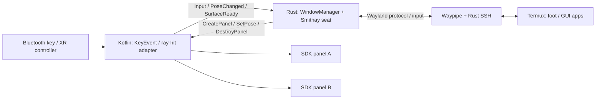

# Phase 5 — Rust中心の空間ウィンドウ管理と入力

**状態:** 採用方針／設計案。実装・実機検証前（2026-11-01）  
**上位計画:** [Phase 5](implementation-plan.md#phase-5--xr入力と複数ウィンドウ) / [全体設計](architecture.md)  
**前提:** [Phase 4](phase-4-rust-window-rendering.md) / **後続:** [Phase 6](phase-6-rust-lifecycle-testing.md)

## 結論：Rustが状態と方針を所有、KotlinがSDK操作を実行

ユーザーの希望に合わせて、Wayland compositorに加え、ウィンドウ一覧・フォーカス・配置・サイズ・セッション世代・配置保存をRustへ寄せる。KotlinからMeta Spatial SDKを呼ぶ必要は残るが、**Kotlin側に別のwindow managerを作らない**。

同種の分担の参考は[WayVRのWayland backend](https://github.com/wayvr-org/wayvr/tree/main/wayvr/src/backend/wayvr)、特に[window.rs](https://github.com/wayvr-org/wayvr/blob/main/wayvr/src/backend/wayvr/window.rs)、[hit_test.rs](https://github.com/wayvr-org/wayvr/blob/main/wayvr/src/backend/wayvr/hit_test.rs)、[client.rs](https://github.com/wayvr-org/wayvr/blob/main/wayvr/src/backend/wayvr/client.rs)。これはLinux上の実装で、Quest移植済みという意味ではない。

## 一元管理する情報

| Rustの正本 | Kotlinのadapterが持つ情報 |
| --- | --- |
| WindowId、client/surface tree、window lifecycle | WindowId→SDK Entityの対応 |
| keyboard/pointer focusと入力capture方針 | Android入力／XR ray-hitの取得 |
| 論理サイズ、buffer scale、resize交渉 | SDKでのパネル作成・表示・変形 |
| pose、メートル寸法、配置保存 | SDK座標系への変換、表示の適用結果 |
| SurfaceGeneration、session generation | Java Surfaceの受取／破棄通知 |
| close/reconnect/restore policy | Android lifecycle・権限・IME UI |

Kotlinはプラットフォームハンドルと操作adapter、Rustは永続／論理モデルを持つ。SDKがdrag中のposeを更新する場合はイベントでRustへ戻し、二つの正本を作らない。

## 双方向接続図

図のイベント名はEidolon独自の設計案である。Android UI／SDK呼出しのthread制約を尊重し、Rust threadから任意にentityを変更しない。SDK操作はKotlin側の適切なdispatcherで実行して結果を返す。[JNI tips](https://developer.android.com/ndk/guides/jni-tips)に従い、小さいイベントをbatch化し、framebufferをJNIへ流さない。

## 必要最小限のprotocol案

Kotlin→Rust: `SurfaceReady(WindowId, generation, Surface)`、`SurfaceLost(...)`、`PointerHit(WindowId, uv, buttons)`、`KeyEvent(...)`、`PoseChanged(...)`、`LifecycleChanged(...)`。

Rust→Kotlin: `CreatePanel`、`SetPose`、`SetPhysicalSize`、`SetTitle`、`DestroyPanel`、`RequestHostKeyConfirmation`。

`WindowId`はnative pointerではなく、世代付きのopaque handleにする。destroy済みwindowへの入力、再接続前のcallback、古いSurface attachは無害に拒否する。SDK Entityへの直接参照やJNI local referenceをRustの汎用stateへ混入させない。

## 入力とresizeの注意

- Android keyCode／scanCode／Unicode文字はWaylandのkeyboard keycodeと同一ではない。modifier、repeat、US/JIS配列を明示して変換する。VNC用keysym変換をそのまま移植しない。[Smithay input sample](https://github.com/Smithay/smithay/blob/master/smallvil/src/input.rs)を基に検証する。
- ray-hitのUVをlogical surface座標へ変換し、buffer scale、transform、popup原点、letterboxを反映する。座標計算はRustで単体テストする。
- keyboard focus、pointer focus、drag/popup grabは別の状態として管理する。選択windowの変更で押しっぱなしの修飾キーを残さない。
- メートル単位の拡大は必ずしもWayland resizeではない。logical size変更が必要な操作だけ`xdg_toplevel.configure`等の交渉を行い、ackと次commitを待つ。
- 日本語IMEはキー送信だけでは完成しない。AndroidのcompositionとWayland text-input/input-method、またはLinux内IMEの利用を別に評価する。MVPの初期合格は物理キーボードの英数字＋修飾キーから始める。

## Rustで先にテストできる設計

`WindowManager`からAndroid/JNI/GLを切り離したcrateを用意し、仮のpanel adapterでイベント列を再生する。これによりQuestを装着せずに、focus移動、二枚の配置、resize世代、destroy後の入力、save/restoreをテストできる。

- [ ] Rustが二枚以上のwindow状態を所有し、Kotlinはcommandに従ってパネルを表示する。
- [ ] foot内のfish/tmux/NeovimをEsc/Ctrl/Alt/Tab/Fキーで操作できる。
- [ ] popup、parent-child、clipboardの扱いを段階的に追加する。
- [ ] パネル移動・物理拡大・pixel resizeを区別して操作できる。
- [ ] GUI操作ログからモデルを再現できる。ただし文字入力内容や画面画像の恒常記録はしない。

成功条件は「独立した二枚のXRパネルとWaylandの入力focusが一致し、状態の正本がRustにあること」。XR runtimeや最終的な3D scene rendererをRustで置き換える作業はスコープに含めない。
