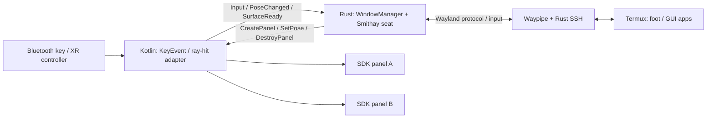

# Phase 5 — Rust中心の空間ウィンドウ管理と入力

**実装時の正本（2026-11-04詳細化）:** [Sol向けタスク一覧](design/README.md)と[本フェーズの契約](design/phase-4-5.md)。以下の調査経緯を保ちつつ、thread・API・検証順は詳細設計を優先する。

**状態:** 採用方針／設計案。実装・実機検証前（2026-11-01）  
**上位計画:** [Phase 5](implementation-plan.md#phase-5--xr入力と複数ウィンドウ) / [全体設計](architecture.md)  
**前提:** [Phase 4](phase-4-rust-window-rendering.md) / **後続:** [Phase 6](phase-6-rust-lifecycle-testing.md)

## 結論：Rustが状態と方針を所有、KotlinがSDK操作を実行

ユーザーの希望に合わせて、Wayland compositorに加え、ウィンドウ一覧・フォーカス・配置・サイズ・セッション世代・配置保存をRustへ寄せる。KotlinからMeta Spatial SDKを呼ぶ必要は残るが、**Kotlin側に別のwindow managerを作らない**。

同種の分担の参考は[WayVRのWayland backend](https://github.com/wayvr-org/wayvr/tree/main/wayvr/src/backend/wayvr)、特に[window.rs](https://github.com/wayvr-org/wayvr/blob/main/wayvr/src/backend/wayvr/window.rs)、[hit_test.rs](https://github.com/wayvr-org/wayvr/blob/main/wayvr/src/backend/wayvr/hit_test.rs)、[client.rs](https://github.com/wayvr-org/wayvr/blob/main/wayvr/src/backend/wayvr/client.rs)。これはLinux上の実装で、Quest移植済みという意味ではない。

## 一元管理する情報

| Rustの正本 | Kotlinのadapterが持つ情報 |
| --- | --- |
| WindowId、client/surface tree、window lifecycle | WindowId→SDK Entityの対応 |
| keyboard/pointer focusと入力capture方針 | Android入力／XR ray-hitの取得 |
| 論理サイズ、buffer scale、resize交渉 | SDKでのパネル作成・表示・変形 |
| pose、メートル寸法、配置保存 | SDK座標系への変換、表示の適用結果 |
| 希望する背景モード、設定の保存 | passthrough・skybox等の表示操作と適用記録 |
| 論理windowの保持、表示対象・layer割当の方針 | SDK panelの実体、描画方式・割当の適用結果 |
| SurfaceGeneration、session generation | Java Surfaceの受取／破棄通知 |
| close/reconnect/restore policy、入力を受け付ける状態 | Android lifecycle・XR session focus・権限・IME UI |

Kotlinはプラットフォームハンドルと操作adapter、Rustは永続／論理モデルを持つ。SDKがdrag中のposeを更新する場合はイベントでRustへ戻し、二つの正本を作らない。

[Phase 4のlayer制約](phase-4-rust-window-rendering.md#xr-layer数の予算)に備え、**存在する論理window、現在の表示対象、SDK layerの割当を分離する**案を評価する。非表示windowのWayland状態と配置は保持しつつ、panelを解放・再生成する余地を残す。layerを使える具体的な枚数や優先順位は実機測定後に選び、SDK操作の失敗や未適用もRustへ返す。MVPの二枚表示に先立って複雑な割当機構を完成させる必要はない。

## 背景モードの切替と保存

[Passthrough背景の詳細](phase-1-passthrough-background.md)に従い、希望する背景モードはRustを正本とし、Kotlinが`scene.enablePassthrough(...)`とskybox／背景用environmentの表示へ適用する。MR／仮想背景の切替と設定保存を追加する際も、windowのpose・選択focusとSSH／Wayland sessionを保持する方針にする。背景切替をwindowや接続の作り直しに結び付けない。

希望設定と、Kotlin adapterがどのsceneへ何を適用したかの記録を分け、未適用・失敗もRustへ返す。APIを呼べたことと実際に背景が見えることは別に確認する。`BackgroundMode`等の型名や通知イベントはEidolonの設計案で、SDKの既存APIではない。まず小さい設定と通知から始め、専用の複雑な状態機構を必須にしない。

**`scene.isSystemPassthroughEnabled()`を現在の背景状態getterにしない。** [公式Scene API v0.14.0](https://developers.meta.com/vr/reference/spatial-sdk/v0.14.0/com_meta_spatial_runtime_scene/)では起動時に決まってapp生存中は変化しない値である。切替後の状態管理や保存には希望設定と適用記録を使い、scene再生成・復帰時の扱いは[Phase 6](phase-6-rust-lifecycle-testing.md#背景モードの復元)で検証する。

## 双方向接続図

図のイベント名はEidolon独自の設計案である。Android UI／SDK呼出しのthread制約を尊重し、Rust threadから任意にentityを変更しない。SDK操作はKotlin側の適切なdispatcherで実行して結果を返す。[JNI tips](https://developer.android.com/ndk/guides/jni-tips)に従い、小さいイベントをbatch化し、framebufferをJNIへ流さない。

## 必要最小限のprotocol案

Kotlin→Rust: `SurfaceReady(WindowId, generation, Surface)`、`SurfaceLost(...)`、`PointerHit(WindowId, uv, buttons)`、`KeyEvent(...)`、`PoseChanged(...)`、`LifecycleChanged(...)`、`SessionFocusChanged(...)`。

Rust→Kotlin: `CreatePanel`、`SetPose`、`SetPhysicalSize`、`SetTitle`、`DestroyPanel`、`RequestHostKeyConfirmation`。

`WindowId`はnative pointerではなく、世代付きのopaque handleにする。destroy済みwindowへの入力、再接続前のcallback、古いSurface attachは無害に拒否する。SDK Entityへの直接参照やJNI local referenceをRustの汎用stateへ混入させない。

## 入力とresizeの注意

まず**一枚のfoot**でキー・クリック・scroll・resizeを通し、その後に二枚のfocus移動へ進む。Phase 4の表示PoCから単一windowの操作までを小さく結合し、複数windowや配置保存の完成を待たずに主要な入力経路の可否を判断する。

- Android keyCode／scanCode／Unicode文字はWaylandのkeyboard keycodeと同一ではない。modifier、repeat、US/JIS配列を明示して変換する。VNC用keysym変換をそのまま移植しない。[Smithay input sample](https://github.com/Smithay/smithay/blob/master/smallvil/src/input.rs)を基に検証する。
- ray-hitのUVをlogical surface座標へ変換し、buffer scale、transform、popup原点、letterboxを反映する。座標計算はRustで単体テストする。
- keyboard focus、pointer focus、drag/popup grabは別の状態として管理する。選択windowの変更で押しっぱなしの修飾キーを残さない。
- アプリ全体のXR session focus喪失も入力停止の契機にする。`onPause()`だけに依存せず、`onSessionStateChanged()`をRustへ渡す。Wayland側へ送った押下状態を追跡し、focus喪失時のkey/button release、repeat停止、復帰時の再同期を検証する。通知の根拠と寿命との区別は[Phase 6](phase-6-rust-lifecycle-testing.md#xr-session-focusと早期観測)を参照。
- メートル単位の拡大は必ずしもWayland resizeではない。logical size変更が必要な操作だけ`xdg_toplevel.configure`等の交渉を行い、ackと次commitを待つ。
- 日本語IMEはキー送信だけでは完成しない。AndroidのcompositionとWayland text-input/input-method、またはLinux内IMEの利用を別に評価する。MVPの初期合格は物理キーボードの英数字＋修飾キーから始める。

## 入力とモデルの自動化を分ける

[開発自動化・デバッグ](development-automation-and-debugging.md)の方針に従い、Androidの`input tap`／KeyEvent、debug用の内部command、OpenXR入力、実コントローラー／キーボードを別の試験とする。UI Automatorや`metavr ui`が、Surface内のfootやSpatial SDKの任意entityを意味的なUI要素として取得できるとは仮定しない。

debug操作は通常のRust command経路へ流し、SDKの適用結果を照合する。ただし内部commandによるfocus／pose変更の成功だけでは、SDKのray-hitや物理入力を検証したことにならない。[XR Operator／Tapedeck](development-automation-and-debugging.md#xr入力の自動化)は独立spikeで、Ubuntu＋Spatial SDK＋非root Questへの適合を調べる。未成立でもhostの状態遷移テストと実機の物理操作試験を進める。旧AutoDriverはOpenXR非対応のため候補にしない。

## Rustで先にテストできる設計

`WindowManager`からAndroid/JNI/GLを切り離したcrateを用意し、仮のpanel adapterでイベント列を再生する。これによりQuestを装着せずに、focus移動、二枚の配置、resize世代、destroy後の入力、save/restoreをテストできる。

- [ ] Rustが二枚以上のwindow状態を所有し、Kotlinはcommandに従ってパネルを表示する。
- [ ] foot内のfish/tmux/NeovimをEsc/Ctrl/Alt/Tab/Fキーで操作できる。
- [ ] key／button押下中にUniversal Menuを開閉し、押しっぱなしや古い入力の再送が起きないことを確認する。
- [ ] popup、parent-child、clipboardの扱いを段階的に追加する。
- [ ] パネル移動・物理拡大・pixel resizeを区別して操作できる。
- [ ] MR／仮想背景の切替と設定保存を確認し、windowの配置・選択focusと接続を維持する。XR focus喪失時の入力停止は別途検証する。
- [ ] GUI操作ログからモデルを再現できる。ただし文字入力内容や画面画像の恒常記録はしない。

成功条件は「独立した二枚のXRパネルとWaylandの入力focusが一致し、状態の正本がRustにあること」。背景切替でもwindowと接続を維持し、保存した背景設定を再適用できることを確認する。XR runtimeや最終的な3D scene rendererをRustで置き換える作業はスコープに含めない。
