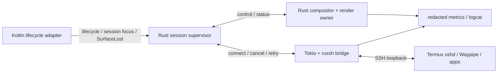

# Phase 6 — Rust coreのライフサイクル・性能・検証

**状態:** 設計／調査反映、実機未検証（2026-11-03）  
**上位計画:** [Phase 6](implementation-plan.md#phase-6--運用性性能耐障害性) / [全体設計](architecture.md)  
**前提:** [Rust renderer](phase-4-rust-window-rendering.md) / [Rust WindowManager](phase-5-rust-window-manager.md)

## 所有者とスレッドを固定する

Rustへ寄せる目的は言語数削減だけでなく、状態と破棄順序を一元化すること。採用案は次の三領域である。

| 実行領域 | 所有するもの | 境界 |
| --- | --- | --- |
| Kotlin SDK/UI thread | Activity、SDK Entity、Surface通知、XR session focus、権限UI | 小さなJNI command/event |
| Rust compositor/render owner thread | Smithay state、WindowManager、EGL context、renderer、window buffer | bounded command queue |
| Rust Tokio runtime | russh、socket bridge、timeout、retry、I/O counters | 状態イベント・停止要求 |

Smithay [`GlesRenderer`](https://docs.rs/smithay/0.7.0/smithay/backend/renderer/gles/struct.GlesRenderer.html)の`!Send`／`!Sync`と、[Android EGLのthread規約](https://source.android.com/docs/core/graphics/arch-egl-opengl)を前提にする。SSHのasync taskにGL所有者を移さず、UI threadから重いrendererを同期的に呼び出さない。

## 三つの寿命を混同しない

**Android Activity/Surface、SSH transport、Wayland client sessionは別々の寿命**を持つ。

Surfaceの再生成だけならSSHやWaylandを再起動する必要はない設計を目指す。反対にSSHが再接続できても、元のWaylandアプリが保持されるとは限らない。Waypipeのreconnectionを追加実装・検証しないMVPでは、**切断後は新しいセッションとして起動し直す**ことを明示する。「再接続＝作業内容を必ず復元」と約束しない。

開発PCとQuestを結ぶUSB／無線ADBは、この三つとは別の接続状態である。現在のAPKとTermux間のlocalhost SSH＋Waypipe構成では、**無線ADBの切断だけを理由に製品内のSSH／Waylandセッションを再起動しない**。sleepやOSによるプロセス終了が両方へ影響する場合も、ADB到達性と製品内の状態を別々に記録する。観測が途切れた時間帯を、セッションの存続確認として扱わない。

`SessionGeneration`、`WindowId`、`SurfaceGeneration`を分離し、旧channelのframeやcallbackが新セッションのwindowに適用されないようにする。停止処理は冪等にする。

参考: [Local DesktopのSurface suspend/resume実装](https://github.com/localdesktop/localdesktop.github.io/blob/fdd0275d6ec7840277def8ccd3ba3ed463900ca1/src/android/backend/wayland/winit_backend.rs)、[Waypipe付属マニュアル](https://man.archlinux.org/man/waypipe.1.en)、[Anlandのライフサイクル／接続方式](https://github.com/lfdevs/anland-termux/blob/main/docs/developer-guide.md)。方式は異なるので、そのままコピーせず障害境界の参考にする。

## XR session focusと早期観測

Meta公式[MediaPlayerSampleActivity.kt](https://github.com/meta-quest/Meta-Spatial-SDK-Samples/blob/f233e2327b95f9871b75bdba867d6fdd726f07cc/MediaPlayerSample/app/src/main/java/com/meta/spatial/samples/mediaplayersample/MediaPlayerSampleActivity.kt)は、Universal Menu表示時の`FOCUSED → VISIBLE`と復帰時の`VISIBLE → FOCUSED`を`onSessionStateChanged()`で扱う。ソースは、`onPause()`がActivity全体の背景化時に呼ばれることと、このsession focus通知を区別している。**可視だが入力focusがない状態は、Surface破棄やSSH切断とは別**として扱う。

Phase 0の最小APKからActivityとXR sessionの通知を観測し、Phase 1のpattern描画でSurfaceの生成・破棄・再attachとの順序を記録する。Universal Menu、背景化、sleep/resume、panel破棄を分けて試し、callbackのthread、時刻、実装段階で利用可能な`SessionGeneration`／`SurfaceGeneration`を残す。破棄通知をSDKのどこで取得するかも採用版で確認し、Phase 6まで実機観測を後回しにしない。

Termux側の存続も最小XR APKから観測できる。[Termux公式README](https://github.com/termux/termux-app#readme)にはAndroid 12以降のプロセス数・CPU使用に関する終了制約の注意があるが、Questでの適用条件は未検証である。TermuxのSSH経路ができたらXRアプリを前面にし、sshdと検証用プロセスが維持されるかを短く試す。foot導入後と本フェーズの長時間試験で再確認し、OS全体の制限設定を無条件に変更する手順にはしない。

入力実装では、XR focus喪失時にRustへ通知してcaptureとrepeatを停止し、送信済みkey/buttonの押下を解消する方針を検証する。復帰時は実際の入力状態と同期し、古いイベントを再生しない。XR focus喪失だけでSSH／Waylandセッションを再起動する設計にはしない。これは上記通知を利用するEidolonの方針案で、実機検証結果ではない。

## 背景モードの復元

[Phase 5の背景設定](phase-5-rust-window-manager.md#背景モードの切替と保存)と[Passthrough背景の詳細](phase-1-passthrough-background.md)を引き継ぐ。scene再生成時にはRustの希望モードを新しいsceneへ適用し直し、passthroughとskybox／背景用environmentの表示を整合させる。Activity背景化、sleep/resume、Universal Menuからの復帰は分けて試し、背景設定・adapter適用記録・実際の表示結果を確認する。常にsceneが再生成されるとは仮定しない。

背景モード、XR session focus、`SurfaceGeneration`は独立して扱う。背景切替だけでSSH／Waylandを再起動せず、focus喪失時の押下解除やSurfaceの再attachはそれぞれの通知に従う。背景が復元できたことを、入力・Surface・接続すべての復旧成功とは扱わない。色調整LUTを将来採用する場合は、復帰・切替後の適用と解除も確認する。LUTは任意候補であり、初期の背景表示には要求しない。

## キュー・backpressure・復旧

- メモリ上限を持つqueueを使い、フレームが増えた場合は古い表示要求のcoalesceを行う。ただしprotocol処理やbuffer解放をdropしない。
- SSHの接続／認証／forwarding／execを別のエラーとして報告する。unknown host keyを自動retryで承認しない。
- EOF／half-close／cancel時にbridge taskを終了し、child helperの寿命とsocket cleanupを回収する。[Tokio copy_bidirectional](https://docs.rs/tokio/latest/tokio/io/fn.copy_bidirectional.html)の挙動もテストする。
- JNIのGlobalRef、NativeWindow、EGLSurface、texture、Wayland buffer、SSH channelの所有者と解放契機を一覧化する。
- RustのpanicをJNI境界越しにunwindさせない。異常なnative状態を無理に継続せず、安全に失敗を表示できる経路を作る。
- APKとTermuxのバックグラウンド制限／OOM killはRustでは回避できない。停止検出と再起動案内を設計する。

## 性能の測定順序

1. APK内だけのRust pattern描画。
2. SHMをRust rendererへ投入するCPU upload。
3. localhost SSH＋Waypipeを通したfoot一枚。
4. 複数window、resize、scroll、キー入力。
5. 調査結果に応じてGPU import、圧縮、damaged areaの最適化。

描画時間、present待ち、SHM upload量、Waypipe転送量、SSH CPU、queue depth、FD数、native memory、Surface再生成回数を比較する。フレーム更新数とHMD refresh rateを同一視しない。

複数windowでは、論理window数、表示対象数、実際のcompositor layer数も分けて記録する。[Phase 4のlayer予算](phase-4-rust-window-rendering.md#xr-layer数の予算)を実測し、非表示化・panel解放でlayer消費がどう変わるか、表示復帰時にWayland状態が保持されるかを確認する。

同じwindow数・解像度・描画負荷でpassthrough ON／OFFを比較し、背景entityの構成、使用layer数、frame時間、CPU／GPU負荷を記録する。通常passthroughの合成経路は[詳細文書](phase-1-passthrough-background.md#描画経路と責務)を参照し、背景が消費するlayer数やLinuxパネルの可用枚数を未測定の固定値として扱わない。

[capture・castingの条件](development-automation-and-debugging.md#キャプチャと起動確認)も測定記録に含め、撮影なしのbaselineと比較する。MQDH Cast等によるFOV・負荷・proximity設定の変化を通常動作と混同しない。未装着の継続運転、通常設定での取り外し／sleep／復帰、性能計測を分けて実施する。

DMA-BUF／AHardwareBuffer／zero-copyは機能ゲートを別に置く。SSH経路で転送が生じること、buffer形式・modifier・fenceの整合が必要なことを前提にし、Rustにしただけで低遅延やゼロコピーを保証しない。

## 給電＋Wi-Fiでの試験運用

Phase 0でUSB接続による初期確認を終えた後は、USB-Cを給電に使い、APK更新・起動・ログ・画像取得をWi-Fi経由で行う運用を検証する。[Meta公式ADB資料](https://developers.meta.com/vr/documentation/native/android/ts-adb/)は、USBでTCP/IP接続を設定してからUSBデータ接続を外す手順を説明している。[Meta VR CLIの公式reference](https://github.com/meta-quest/agentic-tools/blob/3a8553d10a5a1bd1bf9beaaa950243fbbed3b9ea/docs/metavr-cli.md)にもWi-Fi接続と対象端末選択の機能がある。これらは公式ツールの機能確認であり、**EidolonのQuest 3で更新・描画・復旧が成功した記録ではない**。接続・対象選択・復旧の詳細は[無線ADB](development-automation-and-debugging.md#無線adb)を正本とする。

[Meta公式debug skill](https://github.com/meta-quest/agentic-tools/blob/3a8553d10a5a1bd1bf9beaaa950243fbbed3b9ea/skills/hz-vr-debug/SKILL.md)は、sleep後のWi-Fi ADB切断と、起床後の再接続を注意点として挙げる。CLIにwake機能があっても、ADBへ到達できない端末を起こせるとは扱わない。起床・再認証・USBによる再設定が人の操作を要した場合も記録し、完全無人復旧の成功に含めない。

| 試験 | 条件と確認する範囲 |
| --- | --- |
| 通常更新と長時間運転 | USBで確認したsmokeをWi-Fiでも実行する。給電した30分／2時間運転で、アプリの進行、ADB到達性、残量推移、温度・thermal状態を追う |
| Wi-Fi／ADB切断と再接続 | 製品内のSSH・Wayland・Surfaceの状態を独立して確認する。再接続後のsnapshot／ログと突き合わせ、回収できない証跡は欠落として残す |
| 自然なsleepと復帰 | 通常のproximity／sleep設定に戻し、casting等の介入も外す。未装着で描画を継続させる試験と分け、起床、ADB再接続、XR focus、Surface、Termuxの順序を観測する |
| Quest再起動 | ネットワーク到達性、IP・認証・ADB待受、APKとTermuxの起動条件を再確認する。電源断からの起動や再起動後の復旧を自動化できるとは未確認であり、以前のWaylandセッション保持も前提にしない |
| Horizon OS更新後 | 変更前後のOS buildを残し、同じsmoke、無線接続、capture範囲、sleep／復帰、Termuxの存続条件を再確認する |

未装着の継続運転にテスト用proximity／autosleep設定を使う場合は、開始時の値と変更内容を記録し、終了・中断時に元の値へ戻す。[Scriptable Testing Servicesの公式資料](https://developers.meta.com/vr/documentation/native/android/ts-scriptable-testing/)では、変更した設定がrebootだけで元に戻るとはされていない。既定値への復元と試験前の値への復元を同一視せず、復旧失敗も報告する。

給電中でも残量の維持や連続運転を保証しない。[Metaのthermal管理資料](https://developers.meta.com/vr/essentials/thermal/)は、温度に応じた性能制限や冷却状態への移行を説明している。負荷、給電条件、残量・温度の推移を実測し、capture／castingを伴う運転と撮影なしの性能baselineを分けて評価する。

## 自動化runnerと証跡

デバッグ方法・試験手順を変更する際は、[開発自動化・デバッグ](development-automation-and-debugging.md)を確認する。Phase 0のsmokeを拡張し、状態snapshot、frame／Surface／session世代、XR画像、ログ、結果JSON、未実施理由をrun単位で残す。Quest OS build、SDK／tool版、APK revision、USB／Wi-Fiのtransport、給電条件、残量・温度、装着・sleep・XR session状態、テスト用設定、capture条件も対応付ける。Activity起動・PID・capture成功だけで、接続・protocol・入力・XR表示の全項目をpassにしない。診断schemaとrunnerの具体的な実装は必要に応じて選ぶ。

無線切断やcapture経路の失敗を、アプリの描画失敗と直結させない。ADB到達性、captureコマンドの結果、frame／Surface／XR sessionの記録、HMD内表示を分けて確認し、画像を回収できなければ描画確認の未実施・欠測を残す。反対に、再接続や画像回収だけで製品内セッションの継続を合格にしない。

host CI、Quest接続runner、HMDを装着した品質確認の役割を分ける。実機runnerでは端末を排他し、readinessにtimeoutを設け、失敗時も証跡を採取する。[無人運用の条件](development-automation-and-debugging.md#無人運用とライフサイクル試験)を満たす場合だけテスト用設定を使い、変更前を記録して復元する。設定はrebootだけで元に戻ると仮定しない。port forward、起動したhelper、変更設定のcleanup失敗も報告する。

XR Operator／Tapedeckによる入力・記録再生は未検証の追加候補で、回帰試験の必須基盤にはしない。内部commandの再生では確認できないray-hit、物理controller、Bluetooth key、hand tracking等の範囲を別に残す。HMD内の可読性、奥行き感、快適性もスクリーンショットだけで合格にしない。

## 試験と合格条件

- [ ] WindowManagerの純粋なRust状態遷移テストをhost CIで実行。
- [ ] JNI/Surfaceの生成・破棄・再attachを繰り返し、FD／memoryが増え続けないことを確認。
- [ ] Universal MenuでのXR focus喪失、Activity背景化、panel破棄を区別し、入力停止・押下解除とSurface再attachを検証する。
- [ ] scene再生成・背景化・sleep/resume・Universal Menu復帰で背景設定とskybox表示を確認し、背景切替のみでSSH／Waylandが再起動しないことを検証する。
- [ ] wrong host key、sshd停止、Waypipe終了、Termux kill、Quest sleep/resumeを別々に試す。
- [ ] USBでの初期確認後、給電＋Wi-FiでAPK更新・起動・ログ・画像取得を確認し、ADB切断と製品内SSH／Waylandの状態を切り分ける。
- [ ] 再接続100回、30分／2時間運転など既存planの試験を実施し、transport、給電条件、残量・温度の推移と限界を記録。
- [ ] テスト用設定での未装着継続運転と、通常設定での自然なsleep／復帰を分け、設定の復旧と人の操作が必要な条件を記録する。
- [ ] Quest再起動・Horizon OS更新後の無線接続、APK／Termux起動、capture範囲、lifecycleを再確認し、自動復旧できた範囲と未検証範囲を残す。
- [ ] キー配列・modifier・focus・popup・clipboardを回帰試験する。
- [ ] 依存crate、Waypipe版、native patch、ライセンス、Cargo.lock、SDK版を記録。
- [ ] 実機runnerの排他・timeout・失敗時証跡・設定復旧を確認し、実施／未実施／未対応を分けて報告する。
- [ ] 通常ログに鍵、token、入力文字、window pixelsを残さない。明示的に採取した画像・protocol dumpは試験artifactとして管理し、恒常記録やGitへの混入を避ける。

実機がないCIではビルド／hostロジックまでを検証し、QuestのXR表示を合格扱いにしない。実機ADBへ接続できる場合も、Activity起動だけではXR表示成功としない。参照したRust crateの存在、Androidの先行例、Eidolon実機試験の三段階を報告書でも区別する。
