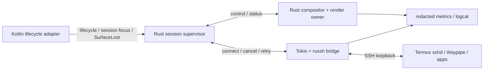

# Phase 6 — Rust coreのライフサイクル・性能・検証

**状態:** 設計／調査反映、実機未検証（2026-11-01）  
**上位計画:** [Phase 6](implementation-plan.md#phase-6--運用性性能耐障害性) / [全体設計](architecture.md)  
**前提:** [Rust renderer](phase-4-rust-window-rendering.md) / [Rust WindowManager](phase-5-rust-window-manager.md)

## 所有者とスレッドを固定する

Rustへ寄せる目的は言語数削減だけでなく、状態と破棄順序を一元化すること。採用案は次の三領域である。

| 実行領域 | 所有するもの | 境界 |
| --- | --- | --- |
| Kotlin SDK/UI thread | Activity、SDK Entity、Surface通知、XR session focus、権限UI | 小さなJNI command/event |
| Rust compositor/render owner thread | Smithay state、WindowManager、EGL context、renderer、window buffer | bounded command queue |
| Rust Tokio runtime | russh、socket bridge、timeout、retry、I/O counters | 状態イベント・停止要求 |

Smithay [`GlesRenderer`](https://docs.rs/smithay/0.7.0/smithay/backend/renderer/gles/struct.GlesRenderer.html)の`!Send`／`!Sync`と、[Android EGLのthread規約](https://source.android.com/docs/core/graphics/arch-egl-opengl)を前提にする。SSHのasync taskにGL所有者を移さず、UI threadから重いrendererを同期的に呼び出さない。

## 三つの寿命を混同しない

**Android Activity/Surface、SSH transport、Wayland client sessionは別々の寿命**を持つ。

Surfaceの再生成だけならSSHやWaylandを再起動する必要はない設計を目指す。反対にSSHが再接続できても、元のWaylandアプリが保持されるとは限らない。Waypipeのreconnectionを追加実装・検証しないMVPでは、**切断後は新しいセッションとして起動し直す**ことを明示する。「再接続＝作業内容を必ず復元」と約束しない。

`SessionGeneration`、`WindowId`、`SurfaceGeneration`を分離し、旧channelのframeやcallbackが新セッションのwindowに適用されないようにする。停止処理は冪等にする。

参考: [Local DesktopのSurface suspend/resume実装](https://github.com/localdesktop/localdesktop.github.io/blob/fdd0275d6ec7840277def8ccd3ba3ed463900ca1/src/android/backend/wayland/winit_backend.rs)、[Waypipe付属マニュアル](https://man.archlinux.org/man/waypipe.1.en)、[Anlandのライフサイクル／接続方式](https://github.com/lfdevs/anland-termux/blob/main/docs/developer-guide.md)。方式は異なるので、そのままコピーせず障害境界の参考にする。

## XR session focusと早期観測

Meta公式[MediaPlayerSampleActivity.kt](https://github.com/meta-quest/Meta-Spatial-SDK-Samples/blob/f233e2327b95f9871b75bdba867d6fdd726f07cc/MediaPlayerSample/app/src/main/java/com/meta/spatial/samples/mediaplayersample/MediaPlayerSampleActivity.kt)は、Universal Menu表示時の`FOCUSED → VISIBLE`と復帰時の`VISIBLE → FOCUSED`を`onSessionStateChanged()`で扱う。ソースは、`onPause()`がActivity全体の背景化時に呼ばれることと、このsession focus通知を区別している。**可視だが入力focusがない状態は、Surface破棄やSSH切断とは別**として扱う。

Phase 0の最小APKからActivityとXR sessionの通知を観測し、Phase 1のpattern描画でSurfaceの生成・破棄・再attachとの順序を記録する。Universal Menu、背景化、sleep/resume、panel破棄を分けて試し、callbackのthread、時刻、実装段階で利用可能な`SessionGeneration`／`SurfaceGeneration`を残す。破棄通知をSDKのどこで取得するかも採用版で確認し、Phase 6まで実機観測を後回しにしない。

Termux側の存続も最小XR APKから観測できる。[Termux公式README](https://github.com/termux/termux-app#readme)にはAndroid 12以降のプロセス数・CPU使用に関する終了制約の注意があるが、Questでの適用条件は未検証である。TermuxのSSH経路ができたらXRアプリを前面にし、sshdと検証用プロセスが維持されるかを短く試す。foot導入後と本フェーズの長時間試験で再確認し、OS全体の制限設定を無条件に変更する手順にはしない。

入力実装では、XR focus喪失時にRustへ通知してcaptureとrepeatを停止し、送信済みkey/buttonの押下を解消する方針を検証する。復帰時は実際の入力状態と同期し、古いイベントを再生しない。XR focus喪失だけでSSH／Waylandセッションを再起動する設計にはしない。これは上記通知を利用するEidolonの方針案で、実機検証結果ではない。

## キュー・backpressure・復旧

- メモリ上限を持つqueueを使い、フレームが増えた場合は古い表示要求のcoalesceを行う。ただしprotocol処理やbuffer解放をdropしない。
- SSHの接続／認証／forwarding／execを別のエラーとして報告する。unknown host keyを自動retryで承認しない。
- EOF／half-close／cancel時にbridge taskを終了し、child helperの寿命とsocket cleanupを回収する。[Tokio copy_bidirectional](https://docs.rs/tokio/latest/tokio/io/fn.copy_bidirectional.html)の挙動もテストする。
- JNIのGlobalRef、NativeWindow、EGLSurface、texture、Wayland buffer、SSH channelの所有者と解放契機を一覧化する。
- RustのpanicをJNI境界越しにunwindさせない。異常なnative状態を無理に継続せず、安全に失敗を表示できる経路を作る。
- APKとTermuxのバックグラウンド制限／OOM killはRustでは回避できない。停止検出と再起動案内を設計する。

## 性能の測定順序

1. APK内だけのRust pattern描画。
2. SHMをRust rendererへ投入するCPU upload。
3. localhost SSH＋Waypipeを通したfoot一枚。
4. 複数window、resize、scroll、キー入力。
5. 調査結果に応じてGPU import、圧縮、damaged areaの最適化。

描画時間、present待ち、SHM upload量、Waypipe転送量、SSH CPU、queue depth、FD数、native memory、Surface再生成回数を比較する。フレーム更新数とHMD refresh rateを同一視しない。

複数windowでは、論理window数、表示対象数、実際のcompositor layer数も分けて記録する。[Phase 4のlayer予算](phase-4-rust-window-rendering.md#xr-layer数の予算)を実測し、非表示化・panel解放でlayer消費がどう変わるか、表示復帰時にWayland状態が保持されるかを確認する。

DMA-BUF／AHardwareBuffer／zero-copyは機能ゲートを別に置く。SSH経路で転送が生じること、buffer形式・modifier・fenceの整合が必要なことを前提にし、Rustにしただけで低遅延やゼロコピーを保証しない。

## 試験と合格条件

- [ ] WindowManagerの純粋なRust状態遷移テストをhost CIで実行。
- [ ] JNI/Surfaceの生成・破棄・再attachを繰り返し、FD／memoryが増え続けないことを確認。
- [ ] Universal MenuでのXR focus喪失、Activity背景化、panel破棄を区別し、入力停止・押下解除とSurface再attachを検証する。
- [ ] wrong host key、sshd停止、Waypipe終了、Termux kill、Quest sleep/resumeを別々に試す。
- [ ] 再接続100回、30分／2時間運転など既存planの試験を実施し、限界を記録。
- [ ] キー配列・modifier・focus・popup・clipboardを回帰試験する。
- [ ] 依存crate、Waypipe版、native patch、ライセンス、Cargo.lock、SDK版を記録。
- [ ] ログに鍵、token、入力文字、window pixelsを残さない。

実機がないCIではビルド／hostロジックまでを検証し、QuestのXR表示を合格扱いにしない。参照したRust crateの存在、Androidの先行例、Eidolon実機試験の三段階を報告書でも区別する。
