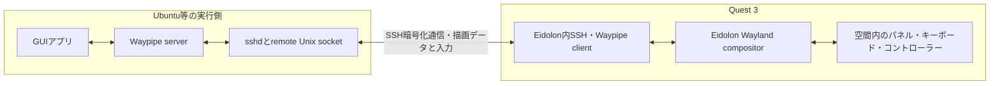

# Ubuntu等の別マシンからGUIを表示する拡張案

作成日: 2026-11-07。調査基準: `871f496`。**技術調査・計画のみ。実装・接続試験は未実施**。
[次フェーズ計画](next-phase-termux-startup-linux-gui-plan-20261107.md)第10節の補足。
ユーザーはQuest内Termuxに加え、Ubuntu Desktop等へSSH接続し、GUIをQuestで表示・操作できるか相談した。

## 技術的な成立性

**可能な拡張であり、既存のSSH・Waypipe・Wayland compositorを利用する方式が第一候補。**
Waypipeは別マシンのWaylandアプリを表示側へ転送するための仕組みである。
[作者による構成説明][waypipe-author]と[Ubuntu配布のマニュアル][waypipe-man]を確認した。
Eidolonの現在の転送経路を、Quest内の通信からLAN越しの通信へ一般化する。

Ubuntu側でアプリを動かし、Quest側で表示と入力を扱う。x86_64のアプリをQuest向けに移植する方式ではない。
Ubuntu向けバイナリーはUbuntuに残り、ファイルの読み書きも原則としてそのマシン上で行う。
Quest APKからUbuntuのSSHへ直接接続する構成を目指し、この接続の中継としてTermuxを必須にしない。
WaylandではEidolonがcompositor/serverだが、Waypipeでは表示側をclient、アプリ実行側をserverと呼ぶ。

対象はQuest向けに起動する個別のGUIウィンドウ。Ubuntuで既に開いている窓の移送や
デスクトップ画面全体の共有は別の設計になる。単にfoot内から通常の`ssh`を実行するだけでは、
遠隔GUIをEidolonの窓へ接続する処理は追加されない。

## 現状で足りない部分

現行APKが任意のSSH接続先を扱えるわけではない。IP変更だけでは成立しない。

| 現行の制約 | 調査した場所 | 必要な拡張 |
| --- | --- | --- |
| 接続先は`127.0.0.1:8022`に固定 | [session.rs](../native/transport/src/session.rs) | profileからhost/portを解決し、DNS・IPv4/IPv6・期限・取消を扱う |
| profileは最大1個、IDは`termux-local`のみ | [commands.rs](../native/model/src/commands.rs)、[host_key.rs](../native/transport/src/host_key.rs) | 接続先の保存・選択とschema移行。複数同時接続は別段階 |
| UIと保存はusername/host keyを中心としたTermux用 | [ConnectionProfile.kt](../android/app/src/main/java/io/github/tinmachine/eidolon/ConnectionProfile.kt)、[CredentialStore.kt](../android/app/src/main/java/io/github/tinmachine/eidolon/CredentialStore.kt) | 表示名・host・port・実行環境の区分・認証設定。Linux usernameの入力規則も確認 |
| home、Python、helper、foot等のpathがTermux固定 | [launcher.rs](../native/transport/src/launcher.rs)、[eidolon-session.py](../scripts/termux/eidolon-session.py) | Linux用のpath/環境adapterと、version付きhelper契約 |
| Waypipeは0.11.3のC実装、SHM中心、圧縮なし | [deps.lock.json](../native/deps.lock.json)、[waypipe.rs](../native/core/src/waypipe.rs) | 対向の実装・版・featureを検証。LANで圧縮と転送量を評価 |

既存の鍵・host key pin照合、StreamLocal転送、lease、所有processの回収、停止時の入力解除は再利用候補。
launcherのSHA照合やJSON検査を外すことでLinuxへ対応する設計にはしない。
OSに依存しない監督処理と、Termux/Linuxのpath・環境設定を分離する。
LinuxへAndroid/Termux専用のexec環境変数を持ち込まず、Termux側の既存対策も維持する。

## 接続先の準備と小規模検証の条件

初回は同じLAN内のUbuntu一台、一つのアプリで検証する。
対象OS・CPU architecture・SSH認証・実際のpackage/版・表示backendは接続先を決めてから確認する。
今回、特定のUbuntuマシンにログインしたり、packageやsshd設定を変更したりはしていない。

- Ubuntu側にSSH server、対応Waypipe、Python helper、試験用アプリを用意する。
  通常ユーザーの専用session directoryへsocketを作り、既存desktopのsocketを置き換えない。
- OpenSSHのremote Unix socket転送を許可する必要がある。
  [`AllowStreamLocalForwarding`][sshd-config]、転送禁止設定、鍵ごとの制約等の実効値を確認する。
  SSHログイン成功だけを、転送可能の証拠にしない。
- APK専用鍵の公開部分を対象ユーザーへ登録し、対象hostのfingerprintを検証してprofileへ保存する。
  host key変更を自動受理せず、Termux向けpinを他のマシンへ流用しない。
  接続先・ユーザー・pin・profile revisionと回収journalの対応を維持する。
- 最初はAPKと揃えたWaypipe 0.11.3のC実装・必要featureを基準にする。
  Ubuntu標準packageが同じ版・実装とは限らない。版番号だけで相互接続を合格にせず、SHM転送を検証する。
  別版やRust実装へ広げる場合は独立した互換性確認にする。
- アプリのWayland backendと、Eidolonが扱えるSHM経路を確認する。
  Ubuntu側にGUIログイン済みであることを一律の前提にしないが、D-Bus、font、locale、
  toolkitの初期化等の必要条件はアプリごとに調べる。
- 同一ユーザーの既存アプリへ起動要求を転送するsingle-instance/D-Bus動作に注意する。
  processが正常終了しても、既存Ubuntu画面に窓が出ただけならQuest表示の成功にしない。
  アプリの独立instance起動方法等を検証し、無関係なdesktop processは停止しない。

## ランチャー・ファイル指定・負荷表示との統合

[ランチャー計画](application-launcher-plan-20261107.md)の登録内容を、接続先profileへ対応付ける。
「Quest内 / Ubuntu」等の短い接続先表示を付け、同名アプリでも実行場所を判別できるようにする。
最初は選択中の一接続先のカタログを扱い、別hostの窓を同時に混在させる方式は後段とする。

- ファイル指定、実行file、interpreter、cwd、アイコンの取得元、カタログのpathは、その接続先のnamespaceで解決する。
  Ubuntuの`/home/...`をQuest/Termuxのpathとして処理しない。遠隔ファイルをAPKへコピーして実行しない。
- 既存のTermux用定義は`termux-local`として移行する。未知のprofile IDや切断中のhostを、
  自動的にQuest内Termuxへ置き換えて実行しない。設定reloadだけで接続・起動を繰り返さない。
- カタログの登録IDは接続先IDと組にして区別する。profileとそのカタログの対応はAPK側で管理し、
  ランチャーTOMLへ秘密鍵や任意の接続先への自動切替を埋め込む必要はない。
  具体的なprofile/schemaの移行は実装前に確定する。
- 窓のCPU/RSS/Disk I/Oリングは、Ubuntu側の対象process群から取得する。
  Quest全体のメトリクスと混ぜず、取得不可の場合はunknownとして扱う。
  groupキーにも接続先を含め、同名のfootをhostをまたいで自動的にまとめない初期案とする。

複数接続先の同時表示は、session/window/scene世代、入力focus、journal、
一接続だけ失敗した場合の回収を分離した後に検討する。
その場合も最大9枚は**全接続先の合計**とし、hostごとに9枚の予算を増やさない。
一接続先ずつの初期段階では、切替時の既存窓の終了と必要な保存をUIで案内し、起動操作だけで黙って切断しない。

## LAN越しに確認する制約

端末内通信と比べ、往復遅延・Wi-Fi変動・転送量が操作感へ影響する。
現在の`--compress none`を固定の最適解とせず、両端の対応を確認してnone/lz4/zstdを比較する。
採用時はAPK側とLinux側の起動設定を合わせ、転送量・CPU負荷・入力から描画までの遅延を測る。
結果を待つ間も描画/入力threadを通信待ちで止めず、queueとframeの保持数に上限を設ける。

現在のAPK WaypipeはDMA-BUF/video/VAAPIを無効にしている。
PC側に強いGPUがあっても、任意の3Dアプリや動画を現行SHM経路で快適に表示できる保証にはならない。
まず小さな静的GUI・テキスト中心のアプリから始め、高更新頻度・高解像度は別に測る。
X11アプリ、音声、clipboard/file転送、切断後の同一GUIセッション復元は、個別に設計・検証する後続項目。
初期の切断時は既存のlease/所有資源回収契約を守り、再接続時は新しいsessionとして扱う。
「GUIが表示された」をこれらの機能まで成立した証拠にしない。

## 実装を再開した後の順序

1. **接続先profileとLinux adapter:** 現行Termuxを維持してhost/portを可変にする。
   schema移行、pin取り違え、DNS失敗、取消、profile変更と古い回収記録の分離をhostで確認する。
2. **Ubuntu一台への小probe:** 認証とStreamLocal転送を確認し、固定SHM client、footの順で
   Quest表示・入力・終了・通信断後の回収を検証する。実際のOS/版/コマンドを記録する。
3. **軽量GUIとランチャー:** 小さなGTK/Qt等のアプリ一つを選び、backend・独立起動・popup・resizeを検証する。
   profileに結び付いたアイコンと、遠隔fileの一時起動・登録を接続する。
4. **LAN性能と複数窓:** 静止/更新、圧縮、通信断、再接続、資源上限を確認する。
   HMDの読みやすさと操作遅延を最後に確認してもらう。複数hostの同時利用は次段階とする。

今回の相談では既存のTermux・ゲーム・ランチャー等の優先順位を変更しない。
この調査を実装開始やUbuntu実機への変更承認として扱わない。

[waypipe-author]: https://mstoeckl.com/notes/gsoc/blog.html
[waypipe-man]: https://manpages.ubuntu.com/manpages/stonking/man1/waypipe.1.html
[sshd-config]: https://man.openbsd.org/sshd_config#AllowStreamLocalForwarding
