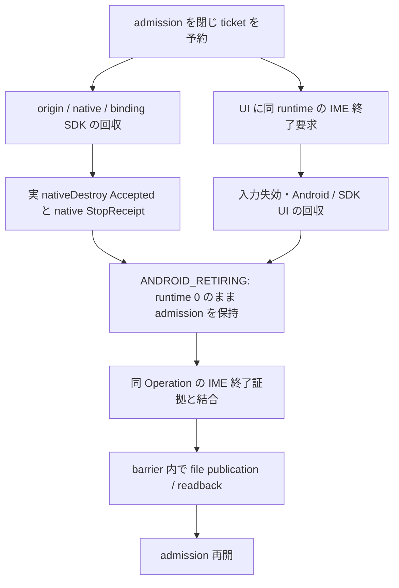

# IME 終了証拠と設定保存の接続案

2026-11-15。PR #30 のレビューから得た**製品修正の設計案**。
今回の評価では、product IME を captured runtime に属する一時 UI として扱い、**その回収完了を publication の前提に含める方針**を選ぶ。
以下の API / phase は提案であり、製品への実装・I5/NX09 正本への採用・実 SDK 受入はまだ行っていない。

source 基準は `0e0df43a2ce4734a00a36f830cc24a80e277bec5`。
背景は[所有境界のレビュー](source-structure-watch-ownership-20261115.md)、
既存契約は [I5 §2–5](linux-real-app-v3-i5-detailed-design.md) と [NX09](nx09-terminal-ime-entry-20261108.md)。
Activity の常設 control/launcher はこの IME receipt に含めない。

## 現行の境界を実行して確かめた

[SaveImeBoundaryTest](../scripts/structure/probes/SaveImeBoundaryTest.kt) は実 `RuntimeSaveCoordinator` と実 `ImeSessionConnection` を同じ fixture で動かす。
Host の UI queue / owner clear と Controller の SDK disposal は明示的な double として与える。
実 NativeSessionHost、TerminalImeController、Android IMM、Meta SDK、file I/O を一続きに実行する試験ではない。

| ケース | 実行して確認する現行挙動 |
| --- | --- |
| preparing / BOUND で UI dispatch を遅延 | coordinator が COMMITTED になっても owner と Entity double が生存できる。input ticket は失効している |
| publication 後の UI disposal が失敗 | UI obligation を保持しても coordinator に feedback がなく、保存成功は維持される |
| UI の input close を先に実行 | 実 IME model は入力を拒否し raw gate を閉じるが、Entity double の回収を coordinator は待たない |

3テストは**現行の不足を再現する characterization**である。成功しても、この設計案の安全条件を満たした証拠にはしない。
製品 wiring を修正するときは、これらを新しい順序を要求する regression へ移す。

## 終了証拠の責務

`ImeRetirementTicket` は保存 Operation が所有する opaque な authority とし、JSON・diagnostics・disk から復元しない。
identity は captured runtime、admission epoch、capture、IME Run identity、captured Scene とする。
capture の実値や editor 本文はログへ出さない。

| 証拠 | 完了条件 / 拒否する代用 |
| --- | --- |
| 開始の ACK | UI が対象 runtime の Run を捕捉して終了要求を受けたこと。worker が post しただけでは不可 |
| 入力失効 | 同 owner の ticket 失効と editor attach/transaction/nontext の拒否。別 runtime の input reset で補わない |
| native 終端 | 同 owner の通常 cleanup ACK と epoch、または同 runtime の実 StopReceipt による runtime 全体の終端。後者を IME 局所 ACK の成功に書き換えない |
| Android 終端 | captured editor/input connection と bridge の終了、focus/IMM の解放を別に観測。editor close を呼んだだけで IMM 解放済みとしない |
| SDK UI 終端 | 捕捉した panel/bridge/Entity、既知の pending factory/future/callback を回収。destroy 呼出の戻りだけで delete + 同 Scene の後続 pass を代替しない |
| IME なし | admission 閉鎖後に UI が対象 runtime の Run 不在を確認し、開始済み callback/factory の義務もない場合だけ typed な empty receipt を発行。worker から参照が見えないだけでは不可 |

通常 IME OFF は既存どおり raw focus 復帰を確認する。**設定保存の retirement は raw focus を再取得しない。**
Scene が閉じて必要な証拠を得られない場合は pending/failure を保持する。新 Scene の pass、timeout、空 collection へ移して完了にしない。

## 停止順序と循環待ちの回避

IME の終了要求は保存開始時、native が生存しているうちに送る。ただし UI は worker を同期 wait しない。
native の回収進行も UI dispatch を同期 await しない。

UI 側は明示 retirement request を処理し、`imeStatus(owner)==null` だけを待つ実装から独立させる。
一方、native 終端後にしか完了できない Android/SDK 処理もあるため、**IME の全証拠を nativeDestroy の前提へ単純に追加しない**。
実 Destroy が成功した後は `ANDROID_RETIRING`（提案）のような別 phase で runtime=0 を正当な状態として扱う。
現在の `poll` の「runtime が元 handle と違えば stale」という分岐へ、そのまま入れてはいけない。

既存の `StopReceipt` は native + binding SDK の証拠として保持し、保存許可にはさらに同 Operation の IME receipt を結合した authority を要求する。
UI cleanup が先に終わっても、native census / 実 Destroy の省略を許さない。
実 Destroy 後の IME failure は元 native receipt と UI obligation を保持して `SAVE_PENDING` とし、新 runtime は生成しない。
publication の resume は両 receipt が有効な場合だけ許可する。UI 回収の明示的な再確認と file publication の resume は別入口にする。

## 実装境界の候補

- **worker / Coordinator:** Operation に ticket と UI 進行を保持し、Destroy 後の phase と publication 前提を追加する。ACK は ticket identity を照合し、UI mutable state を直接読む方式にしない。
- **Host port:** MainLooper への開始要求と、thread-safe な progress/receipt の受領を接続する。同期 await や UI から worker の join を作らない。
- **TerminalImeController:** Run を同 runtime で捕捉して retirement mode にし、遅い panel setup/editor callback を新 owner へ付け替えない。失敗した bridge/Entity と pending producer を保持する。
- **Scene cleanup observer:** Entity delete と同 Scene pass の証拠を得る。既存 fence の再利用可否は API と所有範囲を先に確認する。通常 binding の lease を装って IME を登録しない。

単なる責務抽出より動作条件を変える修正になるため、Host の大きな分割とは別 commit に分ける。
保存済み旧ローカル案は比較対象として保持する。

## 次の実装で要求する結合ケース

| ID | 注入条件 | 要求する結果 |
| --- | --- | --- |
| IME-S1 | preparing/BOUND、MainLooper を遅延 | publication 0。旧 input ticket は直ちに拒否。worker poll は応答する |
| IME-S2 | close request の UI post 拒否 / ACK 欠落 | 開始 ACK を合成せず pending/failure。新 runtime と file publication を許可しない |
| IME-S3 | IME UI 完了前に nativeDestroy Accepted | native receipt を保持して runtime=0 の専用 phase へ。owner clear だけでは publish しない |
| IME-S4 | UI 完了が先、native Busy / 非0の census | native 回収を省略しない。Destroy/publication は既存条件を維持 |
| IME-S5 | bridge close / Entity destroy / delete-pass の各失敗 | 該当 obligation を保持。timeout で成功にせず、明示再確認後も同 ticket を要求 |
| IME-S6 | seal 後に旧 factory/future/setup callback が後着 | 新 editor に adopt せず、捕捉結果だけを回収。pending が drain するまで receipt 不可 |
| IME-S7 | Scene 閉鎖、新 Scene の同 Entity ID/pass | 旧 Scene の証拠へ転用しない。旧 SDK object へ不正にアクセスしない |
| IME-S8 | foreign runtime / capture / epoch / Run の ACK | 無視または拒否し、元 obligation を消さない |
| IME-S9 | 両 receipt 後に file publication 失敗、同 intent で resume | IME/native の新 owner を作らず、既存 capture/readback 条件を維持 |
| IME-S10 | admission 再開後の旧 cleanup callback / 新接続 | 新 owner の editor/UI/input を閉じない。Activity 常設 UI は維持 |

次は純 Kotlin の authority/state machine と adversarial cases を実装し、その後に Host/Controller/SDK wiring を接続する。
実 SDK の通知・IMM の解放は Android/JNI/Quest の別検証で確認する。optional probe の成功で置換しない。

## この PR での実施記録

- 現行境界の composition probe 3件 PASS。製品の修正は未実施。
- 通常 window の allocation → seal/release の狭い契約を索引へ追加。IME の新 receipt は未実装なので辺として登録しない。
- 継続判断は `scoped_only`。索引を完成させることを I6/I7 の前提にしない。

同 source で再実行した検証:

| 検証 | 結果 |
| --- | --- |
| 索引 unit test | 26件 PASS |
| 既存保存/SDK/admission/origin model | 39件 PASS |
| 実 scope/fence + SDK/Android doubles | 11ケース PASS |
| 既存 IME connection/raw return model | 29件 PASS |
| 現行の保存/IME composition | 3件 PASS（現行挙動の再現） |
| docs resolver / CI scope | 25件 + 25件 PASS |
| 文書 registry / Phase 契約 / context smoke test | PASS |

cache 内の Kotlin/JDK と既存 host cc だけを使用し、新しい Android/Rust 環境は導入していない。
完全な host/Android build と実機検証はこの表に含まない。`scripts/**` 差分に対する既存 CI scope は維持する。
