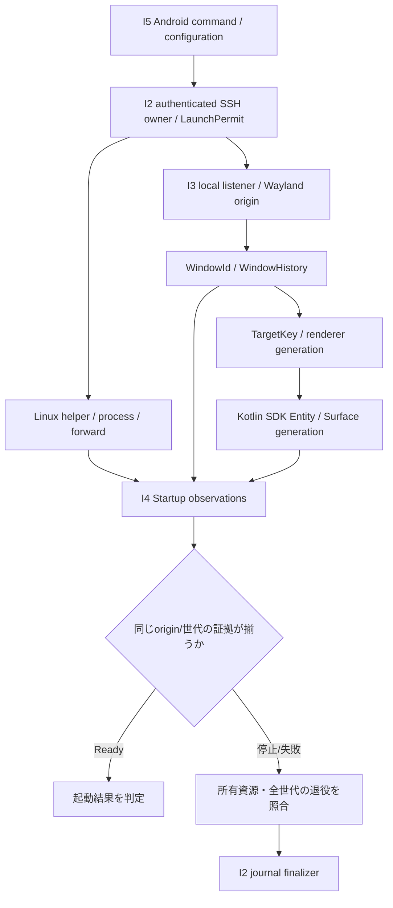

# Eidolon Wayland — I5完了後のソース構造解析・リファクタリング評価計画

**状態:** 提案（未着手、評価前）。本書は既存の製品契約、I2〜I5の実装計画、host/Quest受入れ条件を変更しない。  
**作成日:** 2026-11-14  
**対象:** Eidolon WaylandのRust / Kotlin / JNI / Python helperと、Linux Desktop v3を中心とする所有権・起動・表示・停止の境界。  
**着手時期:** 原則として **I5がmainに統合され、I2〜I5の変更境界が一度安定した後**。I5のCI成功だけで実機受入れ完了とはみなさない。

## 1. 目的と期待値

構造解析を「コードの良し悪しを自動判定する仕組み」ではなく、**読むべきソースを絞り、責務・所有権・レイヤー間契約を根拠付きで理解し、限定的なリファクタリング候補を検証する補助技術**として試す。

期待する成果は次の三つである。

1. 大きなcoordinatorや重複ロジックについて、具体的な依存関係とテスト根拠を伴う改善候補を得る。
2. I2 SSH Controller、I3 Wayland window admission、I4 Startup/SDK evidence、I5 Android storage/launcherをまたぐ、通常のCall Graphでは見えない契約を可視化する。
3. Coding Agentの探索効率・変更の初回検証成功率が実際に改善するか、小さな再現可能な実験で測る。

**効果は仮説であり、Eidolonではまだ測定していない。** 大きなファイル、fan-out、複雑な状態機械を自動的に「悪い設計」としない。単一ownerへの意図的な集約や安全のための冗長性は保持する。

### 明確な非目標

- I5/I6/I7の製品実装・受入れを本実験の完成待ちにすること
- 自動リファクタリング、自動削除、自動PRマージ
- 新しいcompositor、transport、SSH helper、Runtime FSMへの置き換え
- Rustのborrow checkerやKotlin compiler、実機トレースの完全な代替
- homecluster側の解析コードをEidolonへそのまま移植すること
- 生成グラフから「必ず停止できる」「安全に再起動できる」「Questで見える」と断定すること

## 2. 再評価の開始条件と基準ソース

開始時に以下を確認し、**その時点のmainと対象PR SHAを新たに採取する**。以下のファイル・文書の記載は2026-11-14の調査候補であり、将来も同名とは限らない。

- [Linux Desktop v3統合計画](linux-real-app-v3-integration-plan-20261111.md)と[feature index](features/linux-desktop-v3/README.md)でI2〜I5の設計・実装・登録状態を個別に確認する。
- [I2詳細設計](linux-real-app-v3-i2-detailed-design.md)、[I3詳細設計](linux-real-app-v3-i3-detailed-design.md)、[I4詳細設計](linux-real-app-v3-i4-detailed-design.md)と、実際にマージされたコード・テストを突き合わせる。
- I5のstorage barrier、config identity、launcher、v2/v3相互排他、cleanup引渡しを確認する。I5に残件がある場合、未実装箇所を「静的解析上の欠落」と混同しない。
- I6の実SSH/Waypipe/Mousepad host acceptanceとI7のQuest検証は**別の証拠**であり、完了していない場合は未検証として残す。構造解析導入の前提に自動昇格させない。
- dirtyな実装worktreeを触らない。解析には専用のread-only checkout、固定commit、固定解析器/profileを使う。

この活動はI5後の**任意の設計品質評価**であり、製品スケジュール上の必須gateにはしない。

## 3. 優先対象と仮説

| 領域・調査入口 | 最初に確かめたいこと | 仮説上の有用性 |
| --- | --- | --- |
| `native/core/src/runtime.rs` | coordinatorに異なる責務が密結合していないか。抽出可能な純粋な判断処理がないか | 高 |
| `native/transport/src/session.rs` | SSH actorの状態、launch gate、journalとnative退役の契約がどこに集まるか | 高 |
| `native/core/src/session.rs` / compositor | Listener / origin / window / input / renderの責務境界と、Stop後の残存経路 | 高 |
| `native/model/src/linux_desktop_v3/presentation.rs` | Startup判定と観測変換、時刻・世代・帰属・失敗時の分岐 | 高 |
| `scripts/linux/eidolon_linux_desktop_v3.py` | child process・private bus・lease・journalの回収関係。小さなPython Deep解析の実験対象 | 中〜高 |
| `android/` のKotlinとJNI境界 | SDK Entity、Surface/Scene、callbackの登録・退役、I5設定ownerとの契約 | 高 |

現時点で確認した規模の例は`runtime.rs`約3,200行、`transport/session.rs`約1,800行、`core/session.rs`約1,200行。**規模は探索候補の選択にのみ使う**。対象の正確な行数・symbol・call数・coverageは着手時のpinned sourceから再計測する。

対象を全repositoryへ一度に広げない。最初は重要な **3つのslice** に限定する。

1. **Launch slice:** v3の認証済みInspect→LaunchPermit→local listener→remote Start→main/dialog admission。
2. **Retirement slice:** Stop/timeout/切断→process/forward→Wayland native window→SDK target世代退役→journal finalization。
3. **Presentation slice:** Wayland mapping→WindowId/TargetKey→SDK binding→renderer frame→B1 Startup ready、およびscene/activityの遅延callback。

## 4. 解析モデルの候補

### 4.1 Lightweight（最初に実装・評価）

- Rust、Kotlin、Pythonそれぞれのmodule/file、symbol、可視性、source location。
- 静的に一意なcall、import、参照。非一意なtrait dispatch、macro、callback、reflection、FFI、動的登録は`unknown` / `unresolved`に残す。
- Cargo crate依存、JNI export/import、JSONやwire codec、Python helperの境界を**別domainとして扱う**。
- 一つの巨大な全体グラフをmodelへ渡さず、task seedからbounded sliceを作る。

Rust候補: `cargo metadata` + Tree-sitter Rust。Kotlin候補: Tree-sitter Kotlin。Python候補: 標準AST。いずれも**検証前の候補**であり、rust-analyzer/コンパイラ情報、他の解析器、手動定義でもよい。まず出力したい関係を定義し、ツール選定を後から行う。

### 4.2 Semantic Contract Graph（Eidolonで優先）

言語に依存しないenvelopeを共有し、関係の意味はdomainごとに区別する。

```text
node: {id, domain, repository, path, symbol, source_revision}
edge: {from, to, relation, evidence, confidence, resolution}
resolution: resolved | ambiguous | dynamic | unsupported | missing
evidence: source selector / test reference / contract document
```

上記は**議論用の最小例**であって、採用済みschemaではない。秘密値、実ファイル内容、SSH秘密鍵、ユーザーの画面内容、実行時tokenをgraphへ含めない。

候補関係:

- `CALLS` / `IMPORTS`: 静的に確認できたコード上の参照。
- `PRODUCES` / `CONSUMES` / `BINDS`: protocol、Origin、TargetKey、SDK targetなどの境界。
- `OWNS` / `CREATES` / `RETIRES`: 資源の生成と退役の**設計上の**責務。
- `OBSERVES` / `VALIDATES` / `TESTED_BY`: 状態遷移の観測・検証経路。

**最も重要:** `OWNS`、`RETIRES`、`VALIDATES`等の意味的な辺を、名前の類似や単なるcall edgeから自動昇格させない。契約本文と対象source/testの証拠を確認してから、明示的なレビュー対象として登録する。証拠が消失・多重化したらunknown/要レビューとする。行番号の移動だけでは意味を変えないselectorを選ぶが、無条件の曖昧一致・自動修復は禁止する。

### 4.3 Deep（必要になった箇所のみ）

CFG/DFG/PDGは、状態遷移・値の起源・条件分岐を追う必要が確認された**限定した関数/モジュール**でのみ比較する。Python helperにはAST起点の保守的な実験が可能。Rustはmacro/async/trait、Kotlinはcoroutine/SDK callback、JNIは言語境界により、単純なASTベースのPDGだけで実際の実行順や寿命を証明できない。

特に`select!`、送信future cancellation、ACK喪失、Drop、外部プロセス、EGL/SDK callbackの順序は実コードとfixtureが優先する。解析精度の限界を測らずに網羅的PDGを先行実装しない。

## 5. Eidolon固有の Resource Ownership / Lifecycle Graph

通常Call Graphとは分離して、**所有者・識別子・資源・観測・退役の証拠**を表す研究用viewを用意する。



これは**現時点の設計から推定した調査view**であり、実機の実行順序・SDK実装を自動計測したものではない。検証では少なくとも次を別々に追う。

- `RuntimeHandle`、`SessionId`、`CommandSeq`、`NativeOrigin`、`WindowId`、`TargetKey`、`SceneEpoch`、transport journalを混同しない。
- `Accepted`、`Started`、mapped、SDK bound、frame、readyを同義としない。
- 現行世代のready判定と、古い世代も含めたrelaunch可否を別の述語として記録する。
- process、SSH channel、forward/router、Wayland client/window、SHM、EGL renderer、SDK Entity/Surfaceの退役ownerを列挙し、foreign/canceled/stale callbackを新originの証拠へ転用しない。
- graphに「退役辺がない」ことは**解析未対応**の可能性がある。実欠陥と判定する前にsource・fixture・実行時証拠を確認する。

将来の[Contextual Window Graph構想](architecture.md)に接続する余地はあるが、静的なsource関係、実行中のresource telemetry、XRに表示するwindow関係は**異なるデータ面**。本実験は実行中のグラフ表示機能を実装しない。

## 6. 固定入力・生成物・安全境界

実験時に次のようなパイプラインを検討する。

```text
clean pinned source
  -> parser / source evidence extraction
  -> coverage + unknown report
  -> lightweight graph / reviewed contracts
  -> consistency check / bounded slice
  -> source + testsで再確認
  -> 人間による採否判断
```

- source commit SHA、解析器のversion/content digest、profile、contract登録版、選択path、coverage、generated artifact digestをmanifestへ残す。
- 同じ入力から2回構築し、動的timestamp/絶対pathを除いた出力をbyte-for-byte比較。キャッシュがstaleなら利用を拒否する。
- 読めないpath・parser failure・unsupported fileを**解析済みcoverageに混ぜない**。unknown件数を情報として保持する。
- 生成物は原則`gitignored`な一時領域（例: XDG cache/state）に保存し、評価用に必要なsummary/sliceのみPRへ添付する。ユーザーの既存worktreeをreset/cleanしない。
- ローカル/Quest/remote runtimeは一切操作せず、SSH接続、Android SDK callback、実機telemetryの採取も実験の既定動作にしない。
- 他repository由来コードのコピー・vendoringは原則避け、発想・指標・interface思想を再利用する。実装をコピーする場合だけライセンス/第三者NOTICE/継続保守を別途判断する。

## 7. 段階的な進め方と成果物

| Step | 作業 | 成果物 / 判定 |
| --- | --- | --- |
| S0: I5後の再調査 | main/PR SHA、関連設計、テスト、現行owner、I6/I7残件を確認 | `baseline.md`、coverage候補、未実装との区別 |
| S1: Lightweight PoC | Rust主要3モジュールからsymbol/import/call、Python helperからASTを抽出。必要ならKotlinはsymbolのみ | `graph.json`、`coverage.json`、unknown一覧、3つのbounded slice |
| S2: Contract / Ownership | I2〜I5の最重要境界を少数のレビュー済みedgeにする | source evidence付きcontract mapとresource retirement matrix |
| S3: refactor候補探索 | hotspot、重複、凝集度、外部edgeとテストを確認。単純な行数ランキングを採用しない | 最大3件の候補。各候補に`keep / extract / investigate`の判断と理由 |
| S4: 小さな比較実験 | 同等の限定taskでsource-only探索とstructural sliceありを比較 | 再現可能な結果表、false positive/negative、コスト |
| S5: 継続判断 | 開発効果・維持コスト・CI負荷をレビュー | `adopt_lightweight / scoped_only / stop`の明示判断 |

S1〜S4は**別PRで行ってよい**。設計PRだけでS0以降を「実装済み」にしない。全体グラフ、全言語対応、CI強制を初回の完成条件にしない。

### リファクタリング候補の評価テンプレート

```text
対象 / pinned SHA:
観測: symbol / call / contract / unknown / test
仮説: 不要な重複? 高い責務凝集? 意図的な単一owner?
変更候補: 抽出する純粋関数・状態遷移・adapter境界
保持する不変条件: v2/Termux互換、B1 golden、one-shot launch、
                    ownership、generation isolation、Stop/Recover
検証: 既存fixture / adversarial fixture / regression
影響と導入コスト:
結論: keep / extract / investigate
```

## 8. 実験の測定方法

**仮説:** 同じtaskについてstructural sliceを先に渡すと、参照するファイル数・探索量が減り、契約逸脱や修正の手戻りも減る可能性がある。

比較対象は最低3種類の小task（例: Rust ownerの局所修正、I2〜I4の契約追跡、Kotlin/JNI sourceの依存探索）。各taskで同じ固定source、同じモデル/設定、同じテスト・acceptanceと上限を使う。学習や順序による偏りに注意し、可能なら実行順を入れ替える。小標本は探索的結果であり統計的有意差を主張しない。

| 指標 | 解釈 |
| --- | --- |
| 読んだdistinct source files / tool read calls | navigation効率。少なければ常に良いとは限らない |
| 初回validation pass / repair回数 | 作業品質の主要参考値 |
| 変更対象外ファイルへの編集、v2/B1/owner契約の逸脱 | guardrail、回帰の疑いがあればsource+fixtureで判定 |
| elapsed time、入力/出力token、index生成時間 | 導入・運用コスト込みで比較 |
| precision / missing edges / unsupported割合 | 解析結果の信用境界。coverage変動時は横並び比較しない |
| 人手レビューで採用した具体的refactor候補 | 実用性。graphノード数の減少自体は成功指標でない |

最初の採用判断は、再現可能な有用sliceが得られ、未解決を隠さず、通常開発より探索やレビューを改善し、維持コストが妥当なこと。改善が見えなければ`scoped_only`または`stop`でよい。

## 9. CI・製品テストとの関係

- 当初は**手動・read-only**で走らせる。GitHub Actionsの必須チェック、pre-commit hook、auto-refactorは追加しない。
- 解析器自体にはfixtureを用意し、決定論、stale拒否、構文未対応、曖昧binding、foreign generation、改変済みartifactの拒否をテストする。
- 将来CIへ加える場合も軽量かつ変更範囲限定とし、[CI change scope](ci-change-scope-20261113.md)とrequired checkのPending回避方針を尊重する。Deepは常時実行しない。
- 構造解析でのpassは、`scripts/check-host --suite all`、`scripts/build-android`、I6実host acceptance、I7 Quest/HMDの代替にならない。
- 製品sourceを変更するrefactor PRでは、差分に応じた既存のhost/Android/Waypipe/Mousepad・owner回帰テストを必須とする。

## 10. Go / No-go と終了条件

**続行の条件:** 信頼可能なsymbol/callまたはcontractのsliceが小さな労力で得られ、実際のレビュー/実装タスクで役立ち、false certaintyを生まないこと。

**縮小・中止の条件:** 未解決関係が重要箇所を占める、動的実行と静的モデルの乖離が大きい、データ鮮度/manifest管理が過重、Coding Agentへ渡すより直接sourceを読んだ方が速い、CI負荷が期待利益を上回ること。

終了時には「改善した」「効果不明」「有用でなかった」を分けて記録する。**採用しなくても、所有権matrix・調査slice・不確実性の棚卸しが残れば実験の収穫とする。**

## 11. 参照資料と権威の境界

Eidolon側（実装時は必ず最新コードと照合する）:

- [システム構成](architecture.md)、[共通契約](design/contracts.md)
- [Linux Desktop v3統合計画](linux-real-app-v3-integration-plan-20261111.md)
- [I3詳細設計](linux-real-app-v3-i3-detailed-design.md) と [I4詳細設計](linux-real-app-v3-i4-detailed-design.md)
- [D5 feature index](features/linux-desktop-v3/README.md) と [ドキュメント正本の扱い](knowledge/README.md)

考え方の背景（別の**private** repository。公開Eidolonのビルド・ドキュメント解決の依存にはしない）:

- [Hugo記事: Coding Agent向けソースコード構造解析](https://github.com/tin-machine/hugo/blob/main/content/ai/source-structural-analysis-for-coding-agents.md)
- [homeclusterのstructural analysis skill](https://github.com/tin-machine/homecluster-runbook/blob/main/.agents/skills/homecluster-source-structure/SKILL.md)
- [homeclusterのDeep refactor候補レビュー](https://github.com/tin-machine/homecluster-runbook/blob/main/docs/operation/source-structure-refactor-followup-20261024.md)

候補となる一般技術（採用決定ではない）:

- [Cargo metadata](https://doc.rust-lang.org/cargo/commands/cargo-metadata.html)
- [Tree-sitter Rust](https://github.com/tree-sitter/tree-sitter-rust)
- [Tree-sitter Kotlin](https://github.com/tree-sitter-grammars/tree-sitter-kotlin)
- [Python ast](https://docs.python.org/3/library/ast.html)

この文書は**未登録の独立提案**であり、D5/D6のmanaged document/task graphにはまだ登録しない。採用が決まった後に、metadata、feature manifest、文書依存を別レビューで追加する。
