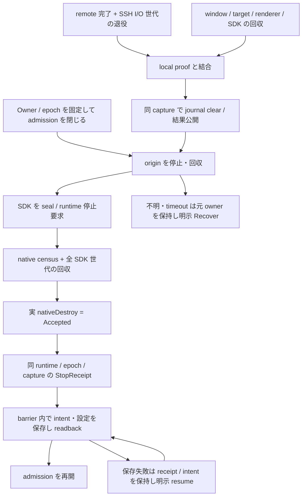

# 回収・設定保存のレビューと Eidolon 専用構造解析の試行

2026-11-15。対象は main `0e0df43a2ce4734a00a36f830cc24a80e277bec5`（I5 / PR #31 統合後）。
[PR #30](https://github.com/tin-machine/eidolon-wayland/pull/30) の評価計画に対する、小さな S0/S2 の具体化である。
全言語の S1 parser、S4 の比較実験、起動・表示経路の全面解析は未実施。
設計承認、I6/I7/H の受入結果、PR #30 のマージ状態を変更する文書ではない。

続報: [Host/JNI・SDK 境界レビューと探索比較](source-structure-boundary-review-20261115.md)。
初版を固定した比較、offline JVM / SDK double 検査、監視対象の不足を記録している。
さらに[監視範囲・所有境界・追加3問](source-structure-watch-ownership-20261115.md)で、変更検知の補強と IME の未決契約を整理した。
本書末尾には、PR head `769315f` で実際に索引を再構築して source へ戻ったローカル再レビューを追記している。

## 判断

**回収・保存に範囲を限って継続する（scoped_only、暫定）。** source/test に戻れる索引は作れた。
現時点でレビュー時間や不具合発見率の改善を測定したとはいえない。
確認した範囲では新たな確定不具合は見つからなかった。未確認の接続部分は以下へ分離した。

Eidolon は Android SDK、Kotlin/JNI、Rust native、SSH/remote Linux の間で所有者と世代を保持する。
汎用の call 数より、**どの owner の証拠が、どの条件で、次の段階に使われるか**を追う方がこのレビューには適している。
このため最初の成果は人手確認した関係の索引とし、機械による語彙・型・呼出解決とは区別した。

homecluster の既存 preflight はこの repository を `repository_not_supported` としたため、直接 source を確認した。
実装した [structure.py](../scripts/structure.py) は homecluster の parser、queue、private repository 参照を必要としない。
着想は Hugo の `content/ai/source-structural-analysis-for-coding-agents.md` にある、小さい slice、鮮度、unknown、
構造上のリスクと確定不具合の区別。Hugo 記事は実行時依存ではない。

## レビュー対象の条件と流れ（省略あり）

ここでの停止・回収と「設定を書き換えてよい」は別条件である。remote 完了や handle=0 の単独観測では保存を許可しない。

## Source・不変条件・対応テスト

行番号は [slice コマンド](../scripts/structure/README.md) が対象 revision から返す。
この表のテスト名は**所在と検査内容の確認**であり、今回すべてを実行したという記録ではない。

| source / 索引入口 | 確認した条件 | 対応テスト / 限界 |
| --- | --- | --- |
| [RuntimeSaveCoordinator](../android/app/src/main/java/io/github/tinmachine/eidolon/RuntimeSaveCoordinator.kt)、[RuntimeAdmission](../android/app/src/main/java/io/github/tinmachine/eidolon/RuntimeAdmission.kt) / `save.poll` | origin 回収後に runtime 全体を停止。Owner の同一性と epoch を維持し、timeout で自動 Recover しない | [RuntimeSaveCoordinatorTest](../android/app/src/test/java/io/github/tinmachine/eidolon/RuntimeSaveCoordinatorTest.kt) の `originCleanupPrecedes…`、`remoteUnknownKeeps…`、`foreignRuntimeEpoch…`。Port はモデル |
| 同 coordinator / `save.receipt` | shutdown と各残存 counter/pending、SDK seal/全世代/failure、実 Destroy Accepted を同 runtime/epoch/capture で結合 | 同 suite の `everySingleRemainingResource…`、`stopReceiptRequiresExact…`、`sdkDisposeFailure…` |
| [SdkRetirementHub](../android/app/src/main/java/io/github/tinmachine/eidolon/SdkRetirementHub.kt)、[SdkEvidenceBridge](../android/app/src/main/java/io/github/tinmachine/eidolon/SdkEvidenceBridge.kt) / `sdk.progress` | reserve/seal の排他、callback/producer drain、Scene/adapter に属する後続 deletion pass、古い世代の完了数を保持 | coordinator の `sdkDisposalAndOldSceneLateCallbacks…` と [SdkEvidenceBridgeTest](../android/app/src/test/java/io/github/tinmachine/eidolon/SdkEvidenceBridgeTest.kt)。実 SDK 呼出網羅性は未確認 |
| [NativeSessionHost](../android/app/src/main/java/io/github/tinmachine/eidolon/NativeSessionHost.kt)、[JNI bridge](../native/android/src/bridge.rs)、[registry](../native/android/src/registry.rs)、[Runtime snapshot](../native/core/src/runtime.rs) / `host.port` | live snapshot を厳密 decode。JNI の destroy macro は registry.destroy に対応し、実戻り値を Host へ返す。snapshot に Destroy 成功を合成しない | Kotlin `typedNativeSnapshotRejects…` と Rust `storage_receipt_requires_the_last_live_snapshot_and_actual_destroy_result`。結合した JNI テストではない |
| [Runtime](../native/core/src/runtime.rs)、[native finalizer](../native/core/src/v3_retirement.rs)、[transport Controller](../native/transport/src/session.rs) / `native.advance` | worker が Tokio runtime を drop してから io_retired を公開。handoff と local proof を保持して結合し、journal I/O は finalizer worker へ出す | `every_registered_generation_requires_its_own_sdk_receipt` 等は部分条件。SSH 全経路と finalizer worker の障害注入は次の確認対象 |
| [reclamation](../native/transport/src/linux_desktop/v3/reclamation.rs) / `proof.finalize` | context/generation と全 local proof を確認後に clear。同世代以外・二重 clear を拒否。remote 完了だけでは削除しない | `remote_complete_does_not_unlink_until_matching_local_retirement`、`incomplete_retirement_can_be_rechecked_without_losing_authority`、`finalization_requires_same_generation_and_all_local_proofs` |
| [settings repository](../android/app/src/main/java/io/github/tinmachine/eidolon/LinuxDesktopSettingsRepository.kt) / `settings.save` | barrier 内で capture/intent を再照合し、intent→profile/storage→config→marker→readback。並行変更を上書きしない | [RuntimeSettingsIntegrationTest](../android/app/src/test/java/io/github/tinmachine/eidolon/RuntimeSettingsIntegrationTest.kt) の `realFilesAndIdsAppearOnlyAfter…`、`concurrentProfileMutation…`。実ファイル、モデル Port |
| Host と coordinator / `save.resume` | 元 receipt/Owner を保持。Host が同 durable intent または変更前 capture を確認して token 別名を許可。ID/revision 再発行を避ける | 同 integration suite の `realPublishFailureRetainsReceiptAndIntent…`、`lostSameProcessAuthority…`。Host wiring 自体はテストされない |

## 未確認事項とレビュー優先度

1. **Android Host → JNI → native census/Destroy の結合**：個別テストはあるが、Host の callback 配線や import/encode/decode を同時に実行していない。macro の対応は人手確認まで。
2. **SDK の副作用を起こす全入口が reserve されるか**：ledger の内部条件だけでは producer の登録漏れを検出できない。旧 Scene の delete と後続 pass の進行は実 SDK/Quest 側の証拠が必要。
3. **実 SSH/Waypipe の切断・Recover と finalizer の進行**：`drop(runtime)` → `io_retired` の source 順序は確認した。remote helper、異常時の全分岐、実通信の停止性をこの slice では網羅していない。
4. **下位ファイル永続化と crash recovery 全組合せ**：settings の barrier と intent/readback を対象にした。E1 の各 filesystem primitive、OS 電源断、cold restart の新しい所有権移送設計まではレビューしていない。

この4点は不具合の断定ではない。graph 上に辺があることによって未確認事項を解消した扱いにしない。

## 環境単位で最適化する範囲

環境単位の最適化は適している。ただし、物理ホストごとに解析器を複製すると、比較条件と修正箇所が増える。
**共通の鮮度・証拠形式・slice 制限に、repository 固有の契約と実行環境 profile を組み合わせる**。

| profile | 含める関心領域 | 推論してはいけないこと |
| --- | --- | --- |
| `android-product`（実装済み） | Kotlin model、Host/JNI adapter、native。target は `aarch64-linux-android`、variant は debug を記録 | production build の active cfg/call graph を解決済み、SDK/実機検証済みという意味ではない |
| `host-model`（実装済み） | JVM の純 Kotlin モデル、host native の契約。Android/JNI adapter の辺は除外を表示 | JNI が無いから Android 実装が欠落している、モデル成功だから Quest でも成功するという結論 |
| remote Linux（未実装） | 将来 C2 helper、process/session ownership、SSH/Waypipe、journal を追加 | current client slice から remote の lifecycle を推測すること |

Rust の cfg/features、Android variant、generated/vendor、fixture の境界は完全な解析前に固定すべき入力。
今回の profile は compiler の結果ではなく、明示したレビュー範囲である。
全解析を環境内に閉じると最重要の JNI/SSH 契約が消えるため、環境間の辺と unknown は残す。

## 構造解析の基準と評価

[registry](../scripts/structure/retirement.json) に26 source anchor、16 test anchor、22関係を登録した。
Android profile は42 node / 22 edge、host profile は38 node / 16 edge。
これらは手で選んだ集合の大きさであり、全 repository の coverage 率ではない。
関係の `provenance` はすべて `manual_source_review`。自動 call graph として評価しない。

試行の3問を固定した。

| 問い | slice | 最低限辿るべき関係 |
| --- | --- | --- |
| Destroy 成功だけで保存してよいか | `save.receipt`、1 hop | `destroy-receipt`、`publication` と残存資源・所有者違いのテスト |
| 保存途中の再開に新しい runtime=0 を使えるか | `save.resume`、1 hop | `host-intent`、`resume-receipt` と lost authority のテスト |
| remote cleanup が済めば journal を消せるか | `proof.finalize`、2 hop | `confirm`、`unlink`、`finalized-publication` と同世代の負例 |

この3問の navigation と証拠参照の閉包を照合し、slice の省略を明示することを今回の機械的な基準とした。
S4 の効率評価は次に行う。同じ固定 SHA・同じ問い・同じ検証条件で source-only と slice ありを比較し、
誤った辺、重要条件の見落とし、追加 source read、所要時間、索引保守時間を記録する。
同じ会話で source を読んだ後の検索の速さを、効率改善の証明にはしない。

## リファクタリング候補と保存したローカル案

現段階ではアプリ source を変更していない。候補を最大3件に絞った。

| 候補 | 判断と根拠 | 保存したローカル案との比較 |
| --- | --- | --- |
| NativeSessionHost の settings Port / begin / resume / readback のまとまり | **抽出候補**。intent 照合、handle 寿命、worker/epoch と callback が同じ Host に集まる。まず Host wiring のテスト可能な port を作り、同じ境界を維持して抽出 | 旧案の `LinuxRuntimeReclamation.kt` は責務を分ける着想として有用。ただし現在の typed census、capture に結びついた StopReceipt、全世代 SDK ledger を置き換える根拠にはならない |
| core runtime と transport session の v3 固有 orchestration | **追加調査**。回収の owner と worker 寿命を跨ぐ。関数の所属だけを移しても同期関係が見えにくくなる可能性がある | 旧案の `runtime/desktop_v3.rs`、`session/desktop_v3.rs` の分割単位は比較材料。旧 `await_reclaimed` は Tokio 内で local 回収を待つ方式なので、現行の I/O 退役後 handoff/finalizer と混ぜて採用しない |
| Coordinator / StopReceipt / SDK hub / settings repository の分離 | **維持**。状態進行、回収証拠の結合、SDK ledger、ファイル更新は違う責務で、現在の負例もその境界を使う | 旧 snapshot の広い JSON 再集計や集約 receipt へ戻す優位性は今回確認できなかった。旧案全体の不要判定はしていない |

ローカル案は復元・pop・削除せず Git object を読み取って比較した。具体的な保全 ID とバックアップは非公開の作業記録へ保持する。
採用判断時は旧 base の別 checkout と比較し、現在の main へ一括適用しない。

## 検証結果と次の手順

2026-11-15、このコンテナで以下を確認した。

| 検証 | 結果 |
| --- | --- |
| `test_structure.py` | 17件 PASS。本文だけの変更、テスト変更、古い HEAD/profile/generator、改変 artifact、曖昧/欠落 anchor、slice 上限と証拠参照を検査 |
| 両 profile の2回生成・byte 比較・`verify` | PASS。同じ入力で一致。Android graph は36,340 bytes、host graph は32,129 bytes |
| 固定3問の slice と手動基準の照合 | PASS。receipt は7 node / 2 edge / 6,413 bytes、resume は6 / 2 / 5,998 bytes、journal は9 / 4 / 7,612 bytes。すべて指定範囲で省略なし |
| Python 全 suite | 941件実行、2 errors、12 skipped。2 errors は GTK3 の pkg-config 不在による既存 fixture/build test。変更前 main の別 checkout でも同じ2 errors を再現 |
| `scripts/docs.py validate` | PASS。37 managed docs / 6 manifests / 146 unregistered legacy Markdown docs |
| `scripts/check-design` | PASS。31 tasks / 45 checks / 依存 DAG・参照。実装・実機判定は含まない |
| 対象 JUnit 3 suite の offline 実行 | Android SDK location 未設定のため task 実行前に失敗。今回の PASS 証拠は得られなかった |
| Rust / 実 SSH / Quest / HMD | 今回未実行 |

unit test は既存 Python discovery に参加するが、current source と registry の鮮度検査を required CI へ追加していない。
fixture によるツールの回帰検査と、明示実行する repository review の `check` を分けた。
既存 CI の scope 条件、アプリ実装、設計 task の状態は変更していない。

1. この試行を使い、上記3問の source-only / slice 比較と、Host/JNI・SDK 登録漏れの確認を先に行う。
2. 索引の維持費に見合うことを確認できたら、起動の Inspect→Permit→listener→remoteStart、表示の target→SDK→renderer へ広げる。
3. Host settings 境界の抽出から小さな変更を選び、保存したローカル案と対応テストを比較する。

## ローカル実行からの再レビュー（2026-11-15）

PR #30 の head `769315f3c39692a47c53c7d31401f2820de11b0b` を remote と照合し、clean な checkout で実行した。
source のレビュー基準は引き続き `0e0df43a2ce4734a00a36f830cc24a80e277bec5`。
以下は初版17テスト・22辺の記録とは別の、新しい実行結果である。
対象は回収・保存・SDK の登録済み範囲で、repository 全体の自動解析ではない。

### レビュー結果と優先度

**今回追加で確認できた、製品の確定不具合はない。既知の IME 終了条件の不足は未解決であり、最優先の動作変更候補を維持する。**
`ok` や CI 成功だけから実装全体を承認せず、抽出した関係の source と対応テストを読み直した。

1. **既知の実装課題: IME UI の終了は保存成功の証拠に含まれない。**
   [Coordinator.finishRuntimeStop](../android/app/src/main/java/io/github/tinmachine/eidolon/RuntimeSaveCoordinator.kt) は実 Destroy 成功後、Host の `runtimeDestroyed` を経て `publish` を呼ぶ。
   [Host.clearRetiredRuntime](../android/app/src/main/java/io/github/tinmachine/eidolon/NativeSessionHost.kt) は UI queue へ IME owner の clear を post するが、UI 終了の ACK は coordinator へ返らない。
   [TerminalImeController.finish](../android/app/src/main/java/io/github/tinmachine/eidolon/TerminalImeController.kt) の bridge/Entity 回収が遅延・失敗しても、その成功を待つ publication 条件はない。
   今回再実行した接続モデル3件もこの順序を確認した。実機の残存 UI を新たに再現したという意味ではない。
   [IME 終了契約案](source-structure-ime-retirement-contract-20261115.md)の ticket と Destroy 後の待機を先に具体化し、Host 分割に混ぜない。
2. **索引の改善候補: SDK の一連の寿命を一つの入口から辿れない。**
   [registry](../scripts/structure/retirement.json) の追加6辺は、allocation、future producer、delete/pass、native release の別々のまとまりに登録されている。
   2 hop の `window.create` は3辺、`scope.future` と `window.destroy` は各1辺で、生成から削除・release へ連続した案内にはならなかった。
   `save.receipt` から SDK の生成・破棄実装へは、別の入口指定または `rg` と source read が必要だった。
   `bounded_slice` の `complete=true` は選択済みの登録辺に省略がないという判定であり、寿命全体の網羅性ではない。
   接続を機械的に追加するのではなく、adapter の tick/dispose → scope → hub progress の source/test を確認して、次の登録候補とする。
3. **未検証の境界: ledger のテストは adapter/JNI 全経路の実行ではない。**
   `accepted-native-release` の実装は [SpatialPanelAdapter.destroy](../android/app/src/main/java/io/github/tinmachine/eidolon/SpatialPanelAdapter.kt) で readyToRelease → native の実 Accepted → nativeReleased の順になっている。
   参照先 `SdkEvidenceBridgeTest.everyChildAndProducerMustFinishBeforeSynchronousNativeRelease` が実行するのは ledger model。
   SDK double probe は scope/fence を実行するが adapter 本体を実行しない。登録済みの `test_scope` の注意は妥当である。
   以後の結合ケースには、native release が Busy/STALE を返したとき binding を保持し続けることを含める。

### Source へ戻って照合した条件

| 抽出入口 | 確認した条件 | 今回の判断の限界 |
| --- | --- | --- |
| `save.receipt` | typed census の同 runtime・全残数0・sealed SDK・callback drain・実 Destroy Accepted を結合し、barrier 前後で同 owner/capture を要求 | IME UI を含むという追加条件は未実装 |
| `save.resume` | Host は同 durable intent または不変の pre-intent capture を照合し、元 receipt を持つ coordinator に token alias を渡す | 実 Host/JNI の failure 注入は今回未実施 |
| `proof.finalize` | transport は Tokio runtime を drop した後に I/O 退役を公開し、handoff と同 capture の local proof を結合して journal clear、結果公開へ進む | Rust/実 SSH の再実行は今回していない。source と既存テストの所在を照合 |
| `window.create` / `scope.future` | reserve/native registration が allocation に先行し、callback/producer を副作用前に加算。seal 後の late result は回収し、post/dispose failure は成功へ変換しない | 実 SDK の全 factory/caller の網羅性は未証明 |
| `window.destroy` | dispose・renderer detach・delete/pass の成立後、同 native release Accepted だけで ledger を完了させる | adapter の終端配線は source 照合。実機受入ではない |

### 実行結果

| 検査 | 結果 |
| --- | --- |
| `android-product` build 2回 / byte 比較 / verify | PASS。55 node / 28辺、issues 0 |
| `host-model` build 2回 / byte 比較 / verify | PASS。44 node / 16辺、adapter の12辺を除外表示、issues 0 |
| source watch | 399ファイル、変更0。381ファイルは意味的な登録ファイル外で、監視のみ |
| 主要6入口の2 hop slice（上限32,000 bytes） | 全て `complete=true`、`omitted_edges=[]`。辺数は receipt 5 / resume 4 / finalize 4 / create 3 / future 1 / destroy 1 |
| 索引の unit test | 26件 PASS |
| 実 scope/fence + SDK/Android doubles | 11ケース PASS |
| 実 coordinator + IME connection / Host・UI doubles | 3件 PASS。現行の不足を再現する試験で、提案の受入成功ではない |

同一入力で生成した Android artifact digest は `ca779645cae2c94d42d436a88555ade25bfea9d59592965b50210e6189f23bcc`、
host は `0320e0ce979e014b189cf317b13a1632879eec2c11a145202d321173d3401fc9`。
この digest は実行した head に固有であり、文書だけの commit 後も再構築が必要になる。
生成 JSON、実行ログ、probe の source/jar hash はローカルの作業記録へ保持した。
実 JNI/Android IMM/Meta SDK/Quest の実行、環境の追加導入、製品 source の変更は行っていない。

次は IME の終了 authority と状態機械の検証を進め、その証拠を得てから SDK の接続関係を補う。
現時点の継続判断は `scoped_only`。保存したローカル案の採用・廃棄と、大規模な責務分割は未決定である。
