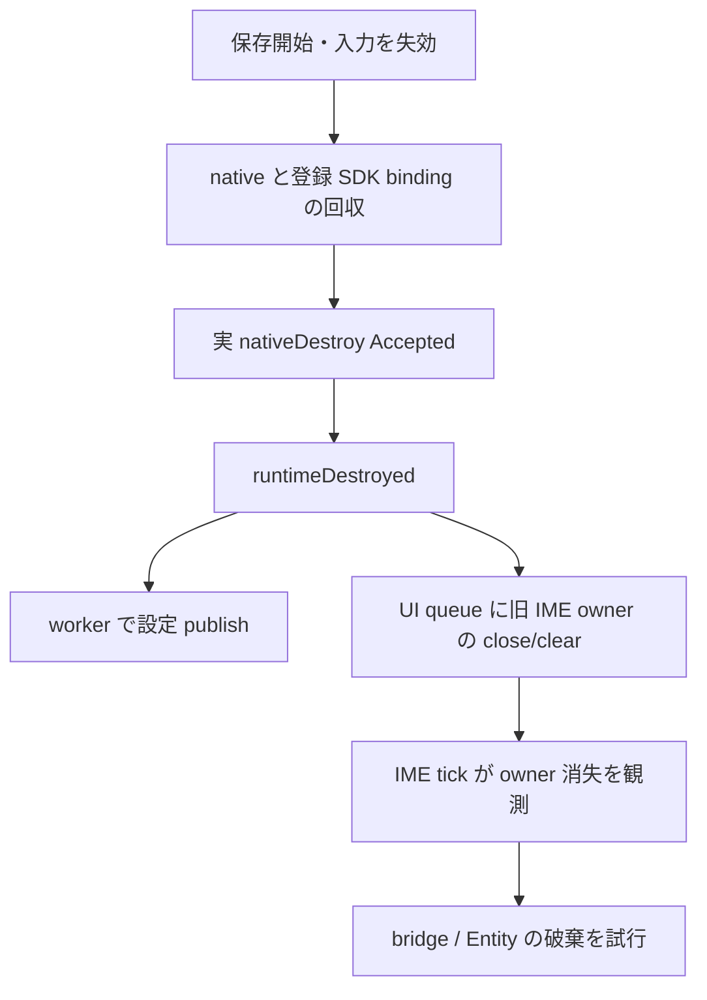

# 構造解析の監視範囲、IME の所有境界、追加3問の評価

2026-11-15。source は `0e0df43a2ce4734a00a36f830cc24a80e277bec5`。
[前回の境界レビュー](source-structure-boundary-review-20261115.md)で提案した監視補強・所有範囲の整理・追加課題の比較を実施した。
変更はレビュー用スクリプト、fixture、文書に限る。アプリ source と保存済みローカル案は変更していない。

## 判断

**変更検知を補強し、契約の確認用索引として継続する。起動・表示全体の索引化はまだ進めない。**
初版が見逃した SDK source の変更は検出できるようになった。一方、追加3問とも索引単独では必要 source が不足した。
`rg` と併用すると、この3問で事前に挙げた必要 source をすべて見つけられた。読解時間や不具合発見率の改善を測った結果ではない。

新しく具体化した設計上の論点は **設定保存の完了と、product IME panel の回収完了の関係**である。
現行の StopReceipt は後者を含まない。入力の権限と画面の寿命を分けて整理し、仕様を決めてから結合テストを作るのが次の一歩になる。

## 監視と意味的な辺を分離した

[structure.py](../scripts/structure.py) / [registry](../scripts/structure/retirement.json) に独立した `watch` を追加した。
意味的な関係は初版の22辺のまま。399ファイルを監視し、そのうち383は意味的登録ファイル外である。
既存登録20ファイルとの和集合は403。数を増やしたことを、コードのレビュー完了数やテスト網羅率とは扱わない。

| 対象 | 検査 |
| --- | --- |
| Android の main/debug/release/test 等 | `android/app/src` 以下の `.kt/.java` の一覧、Git blob と実ファイル |
| native Android/core/model/transport/render/theme/fixtures | 各 directory 以下の `.rs`。Rust の inline/外部テスト、build.rs も含む |
| 元の20登録ファイル | 従来どおり全文・anchor・test 参照を照合。Cargo/Gradle 等の4設定もここで検査 |
| root/suffix 外 | C/XML、SDK内部、生成物、vendor、build output 等は網羅しない。自動で production caller と判定しない |

基準 SHA → HEAD と HEAD → worktree の差分を分け、追加・削除・内容・実行 mode の変更を報告する。
rename は削除＋追加、ignored/untracked の新規 source も検出する。symlink は追わずエラーとする。
両 profile は同じ広い監視を使うため、モデルから除外した adapter の変更でも再確認を求める。
監視範囲外の新 root や別言語は引き続き unknown。詳細は[使用方法](../scripts/structure/README.md)に明記した。

固定 SHA の別 checkout で、前回と同じ `SdkResourceScope.createEntity` の `ticket.valid()` 条件を一時的に外した。
今回は `needs_review` になり、旧 artifact の検証は拒否された。辺を持たない新規 Kotlin caller も検出した。
検査後に元の bytes を戻し、元と同一の artifact が生成されることを確認した。
通常 checkout のアプリ source は変えていない。

広い監視には保守費がある。回収の意味に影響しない変更でも確認が必要になり得る。
基準 SHA を進めるときは一覧の差分を分類し、辺・所有境界・テストを追加する必要があるかを判断する。
変更通知を消すためだけに基準を進めない。今回の1回の生成は約0.36秒だったが、差分の人手評価時間は未測定である。

## 所有範囲の整理

| 資源・権限 | 所有者と現行の終端 | 保存との関係 / 証拠の限界 |
| --- | --- | --- |
| 通常 window、decoration、controls、menu、関連 producer/listener | [SpatialPanelAdapter](../android/app/src/main/java/io/github/tinmachine/eidolon/SpatialPanelAdapter.kt) の captured runtime/target/Scene/adapter と [SdkResourceScope](../android/app/src/main/java/io/github/tinmachine/eidolon/SdkResourceScope.kt) | SDK ticket に含む。delete 後の同 Scene pass、renderer detach、native release Accepted まで保存を待つ。実 SDK の順序は未検証 |
| Activity の操作 panel / launcher panel | [MainActivity](../android/app/src/main/java/io/github/tinmachine/eidolon/MainActivity.kt) の `onSceneReady` で生成し `onSpatialShutdown` で破棄 | Activity/Scene の常設 UI。runtime ごとの保存 barrier に無条件に混ぜない。通常保存は adapter 全体を close しない |
| IME の入力権限 | [NativeSessionHost](../android/app/src/main/java/io/github/tinmachine/eidolon/NativeSessionHost.kt) の captured runtime、editor owner、input ticket/epoch | 保存開始と runtime 停止時に入力を失効。attach/transaction/nontext は同 owner/runtime/ticket を確認。旧 owner を新 runtime へ付け替えない |
| product IME の panel / bridge / editor | [TerminalImeController.Run](../android/app/src/main/java/io/github/tinmachine/eidolon/TerminalImeController.kt) が captured runtime/editor を保持 | 一時的な runtime 関連 UI。通常 binding の SDK ledger 外。入力権限の失効と Entity の回収は別。現行保存は後者を待つ receipt を持たない |
| debug exclusive/probe | debug lease / probeRecovery による排他 owner | 保存入口に gate がある。個々の debug fixture の全 lifecycle と結合した検証は未完了 |
| mesh creator / SDK 内部の SceneObject | SDK/Scene lifecycle の確認が必要 | 呼出元があることだけで、SDK 内部の所有・解放を確定しない |

### IME について source から確定したこと

1. Host の `beginLinuxSettingsSave` は admission を閉じ、`invalidateRuntimeInput` → `resetInput` / `invalidateImeConnection` を呼ぶ。
   `attachImeEditor` / `enqueueImeCommand` / `imeFocusCurrent` は captured owner/runtime/ticket を照合する。
2. [RuntimeSaveCoordinator.finishRuntimeStop](../android/app/src/main/java/io/github/tinmachine/eidolon/RuntimeSaveCoordinator.kt) は native census と SDK hub を確認し、実 Destroy Accepted → `runtimeDestroyed` → `publish` の順に進む。
3. Host の `runtimeDestroyed` は handle を0にし、`clearRetiredRuntime` から UI queue へ旧 IME owner の close/clear を post する。
   この UI 処理の完了を coordinator へ返す ACK はない。file publication は同 worker 上で続く。
4. `TerminalImeController.Run` は100msの tickで owner 消失、または正常な native/Android 解放等を観測する。
   `finish` は editor / bridge / Entity を破棄し、例外時には `SDK_CLEANUP` と参照を保持して再試行する。

この図は owner 消失を使う終端経路を示す。正常な IME close がそれ以前に完了する場合もある。
**E は H の完了を待たない。** 「旧 runtime へ入力できない」と「旧 IME の SDK UI が回収済み」は同じ証拠ではない。
保存成功が後者まで証明するとは、現行 source からはいえない。実機で残存 UI や破損を再現した報告ではない。

### 契約として残す判断と推奨案

[I5 §4–5](linux-real-app-v3-i5-detailed-design.md) は runtime census と SDK binding/scope の全回収を定義する。
[NX09](nx09-terminal-ime-entry-20261108.md) は IME の bridge/entity の回収失敗を保持する。
両者を接続して「保存前に IME Entity の回収証拠を要するか」までは明示していない。

推奨は **IME を常設 Activity UI と分け、captured runtime に属する一時 UI として独自の終了 receipt を定義する案**である。
その receipt を保存前提に含めるか、入力を失効させた後の UI 回収を後続義務として許すかを、I5/NX09 の契約に明記する。
「全回収」という保存条件を維持するなら、前者が整合させやすい。

前者では IME の終了要求を nativeDestroy より前に出し、native input、Android focus/IMM、SDK UI の証拠を分けて集める必要がある。
**既存 ledger に数だけ追加する修正は避ける。** owner 消失を待つ経路は Destroy 後の clear に依存するため、
Destroy 前に IME の回収を待つだけでは循環待ちを作り得る。終了順序と failure 保持を先に設計する。
今回その契約の採用やアプリ修正は行っていない。

| 次に必要な結合ケース | 確かめる条件 |
| --- | --- |
| 準備中/BOUND で保存開始、古い editor/future が後着 | 旧 ticket から attach/入力を再許可せず、新 runtime へ付け替えない |
| UI dispatch を遅延、Entity destroy / bridge close を失敗させる | 採用した契約に従って publication の可否を判定し、回収義務を消さない |
| Scene 閉鎖と保存が交差、別 Scene の pass が先着 | 元 owner の証拠だけを使い、timeout で回収済みにしない |
| 保存成功後に再接続、古い Run の cleanup callback が到着 | 新 owner の入力・UIを閉じず、旧 owner の failure/参照を誤って置換しない |
| Activity の launcher/control を残した通常保存 | 常設 UI を誤って全停止待ちへ含めず、次の明示操作が可能 |

## 既存の3問とは別の課題で再評価

[比較問題](../scripts/structure/probes/boundary-questions.json)を watch 実装の前に保存し、意味的な辺は増やさずに比較した。
同じ reviewer は前回の境界調査で source を既に読んでいる。独立 reviewer の blind 評価ではない。
両方式の候補に必要 source があるかを検査し、回答自体は本文へ戻って確認した。

| 追加の問い | rg bytes / 候補 file | slice bytes / 参照 file | slice 単独で不足した必要 source |
| --- | --- | --- | --- |
| seal 後の future 完了で UI post が拒否されたら保存できるか | 14,042 / 12 | 4,632 / 3 | SdkResourceScope、SdkEvidenceBridge |
| 保存完了は IME Entity の破棄完了も意味するか | 1,045 / 2 | 7,686 / 5 | NativeSessionHost、TerminalImeController |
| 通常保存で Activity の launcher も破棄されるか | 2,301 / 6 | 4,632 / 3 | MainActivity、SpatialPanelAdapter |

必要 source の和集合は3問とも不足なし。IME 問では rg の固定語だけだと RuntimeSaveCoordinator が不足し、slice が補った。
監視対象399ファイルを候補 file 数に足して「探索できた」とは評価しない。watch は変更検知であり、問いへの案内ではない。
前回の重要9ファイルは全て watch に入ったが、9ファイルとも意味的な `files` 登録外のままである。

future 問の回答は、実 scope の post 拒否が failure を記録し、producer を drain しても回収完了へ昇格しない、である。
これは前回の SDK double probe でも検査した。IME と Activity 問の回答・限界は上記の所有表のとおり。
1問で bytes が減っても、必要な source が不足しているので、圧縮の成功とは評価しない。

## 検証と適用範囲

- 索引 unit test **26件 PASS**。新規9件は watch-only 差分、commit後の差分、新規 ignored caller、directory削除、rename、範囲外、symlink、抽出中の変更等を検査。
- 同一 SHA の別 checkout で SDK guard の削除・新 caller 追加を検出し、復元後の artifact 同一性を確認。
- 両 profile の `check`、決定的な build、旧 artifact の拒否、bounded slice を確認。Android の意味的関係は42 node / 22 edge、host は38 / 16のまま。
- 既存 IME 2 suite **29件 PASS**（ImeSessionConnectionTest 20件、ImeRawFocusReturnTest 9件）。既存 cache の Kotlin/JDK だけを使用。
- 前回の39モデルテスト・SDK double 11ケースは過去の同 source に対する証拠として参照する。今回それらを再実行したとは扱わない。
- 製品 Host/JNI、実 Android IMM/Meta SDK、Quest/HMD、保存と IME UI 終了の結合は未検証。環境差を埋める作業は行っていない。

## 次の順序

1. IME の入力権限・一時 UI・設定 publication の終了条件を決め、上記の結合ケースを具体化する。
2. その条件が source/test に接続してから、**window の Create → native 登録 → SDK allocation → seal/release** の一経路だけを意味的索引へ追加する候補にする。
3. Start の二重実行、remote app 起動、Presentation 全体の graph 化は後にする。Host 分割等はその根拠を得てから保存済みローカル案と比較する。

この段階の採用判断は `scoped_only` の継続である。PR #30 の評価計画全体や、実機受入の完了とはしない。
